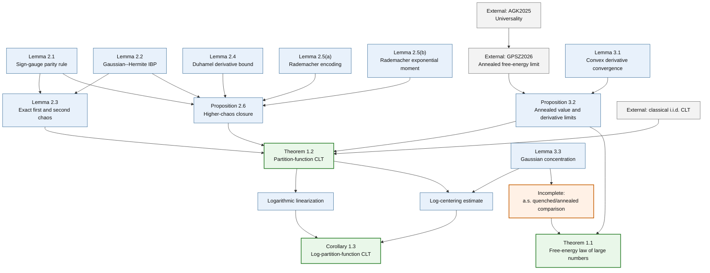

# SYK 中心極限定理の証明構造

## 目的と役割

この文書は `refs/CLT_SYK.tex` と `refs/sections/` にある Theorem 1.1--1.2 と Corollary 1.3 の意図した依存関係、および各結果の現在の証明状態を記録する。正確な論文の定理文はこれらを合わせた原稿を source of truth とする。

最小構成を維持するため、独立した `proof_status.md` は作成せず、証明状態をこの文書に併記する。

## 基本設定

偶数 `q >= 4` と偶数 `N` に対して、論文では `M_N = binomial(N,q)`、`sigma_N^2 = (q-1)!/N^(q-1)`、`Y_N = Z_N/E[Z_N]`、および fluctuation exponent `a = q/2-1` を用いる。normalization の詳細と正確な数式は原稿を参照する。

## 主結果と現在の状態

### Theorem 1.1: free-energy law of large numbers

annealed free-energy limit と、quenched free energy が同じ極限を持つ almost-sure statement を主張する。

現在の定理文は、十分小さい `|beta|` に対して

```text
N^(-1) log Z_N(beta) -> ell_q(beta),
N^(-1) log E[Z_N(beta)] -> ell_q(beta)    almost surely
```

および `ell_q` の微分可能性を主張する。原稿中の `ell_p` は `ell_q` の notation error と考えられるが、定理文の修正前に確認する。

状態：**未完成**。Proposition 3.2 は annealed limit とその導関数の収束を与えるが、almost-sure quenched/annealed comparison の明示的な証明が本文にない。

### Theorem 1.2: partition-function CLT

`N^a (Y_N-1)` の Gaussian limit と、variance による standardized CLT を主張する。

現在の relative CLT の定理文は

```text
N^(q/2-1) (Y_N(beta)-1)
  => Normal(0, (q!/2) * beta^2 * (ell_q'(beta))^2)
```

である。したがって limiting variance は

```text
rho^2(beta) = (q!/2) * beta^2 * (ell_q'(beta))^2.
```

状態：**原稿内に証明あり、要監査**。Gaussian-chaos decomposition、第2 chaos の厳密な同定、高次 chaos の remainder estimate、annealed derivative limit、および classical i.i.d. CLT を組み合わせる。standardized CLT は `beta = 0` で定義されないため、parameter range を明確にする必要がある。

### Corollary 1.3: log-partition-function CLT

`N^a (log Z_N-E[log Z_N])` の Gaussian limit を主張する。

現在の定理文は Theorem 1.2 と同じ limiting variance を持つ。

状態：**原稿内に証明あり、要監査**。Theorem 1.2 に加えて logarithmic linearization、Gaussian concentration、negative-tail control、および deterministic centering error の評価を使う。

## Partition-function CLT の分解

証明の中心は `Y_N-1 = c_N S_N+R_N` という exact decomposition である。具体的には

```text
S_N = (1 / sqrt(2 M_N)) * sum_I (g_I^2-1),
c_N(beta) = beta * partial_beta log E[Z_N(beta)] / sqrt(2 M_N),
R_N = sum_{r >= 3} P_r Y_N.
```

`S_N` は独立な `g_I^2-1` の規格化和、`c_N S_N` は第2 Gaussian chaos、`R_N` は第3次以上の chaos の和である。annealed derivative limit と `M_N ~ N^q/q!` から

```text
N^(q/2-1) c_N(beta)
  -> sqrt(q!/2) * beta * ell_q'(beta)
```

を得る。

必要な内部結果は次である。

1. sign-gauge parity rule：incidence-even でない Hermite coefficient を消す。
2. Gaussian--Hermite integration by parts：Hermite coefficient を微分の期待値に変換する。
3. exact first and second chaos：first chaos の消滅と second chaos の係数を有限 `N` で同定する。
4. Duhamel derivative bound：任意次数の partition-function derivative を評価する。
5. Rademacher encoding：incidence-even multi-index の和を Rademacher chaos の moment として表す。
6. Rademacher exponential-moment estimate：全高次 chaos を一度に和する。
7. higher-chaos closure：`||R_N||_2^2 = O(N^(-3a)) = o(N^(-2a))` を得る。
8. annealed derivative asymptotic：第2 chaos の deterministic coefficient の極限を得る。
9. classical i.i.d. CLT と Slutsky's theorem：Theorem 1.2 を完成する。

## Logarithmic transfer

`W_N = log Y_N` とおくと、Corollary 1.3 では次を使う。

```text
N^a (W_N-E[W_N])
  = N^a (W_N-(Y_N-1)) + N^a (Y_N-1) - N^a E[W_N].
```

第1項には `log(1+x)-x = O(x^2)` と Theorem 1.2 から得られる tightness、第2項には Theorem 1.2、第3項には Gaussian concentration と負の tail の積分評価を使う。

## Free-energy law of large numbers

Theorem 1.1 を閉じるためには、annealed free-energy convergence、`E[log Z_N]-log E[Z_N]` の評価、`log Z_N` の concentration、および almost-sure convergence を与える summable tail estimate または対応する外部定理が必要である。

既存の Gaussian concentration lemma と Corollary 1.3 で使う centering estimate を再利用できる可能性があるが、現在の原稿では Theorem 1.1 の証明として構成されていない。

## 外部入力

- `GPSZ2026`：Theorem 5 から高温領域の annealed free-energy limit を用いる。analyticity の抽出では同論文の Proposition 3 の評価も参照する。
- `AGK2025`：`GPSZ2026` の Gaussian extension が参照する Gaussian--Rademacher universality
- classical i.i.d. central limit theorem
- standard Gaussian concentration

外部結果を利用するときは、正確な statement、normalization conversion、temperature range、および直接引用した部分と推論した部分を区別する。

現在の原稿で用いる `GPSZ2026` との normalization conversion は

```text
psi_i^GPSZ = 2^(-1/2) psi_i,
H_N^GPSZ = 2^(-q/2) H_N,
u = 2^(q/2) beta
```

である。導関数の収束は外部定理から直接引用するのではなく、annealed free-energy の pointwise convergence、limit の regularity、および Lemma 3.1 の convexity argument から導く。

## Dependency graph

次の Mermaid 図は論理依存関係の概観であり、本文に記録した正確な statement と convergence mode を置き換えるものではない。



## 将来の Lean module 構成

Lean 形式化はまだ開始していない。Lean ファイルと module の構成は、最初の形式化対象と interface が確定してから定める。候補となる順序は incidence parity、Rademacher encoding、指数比較、抽象的な CLT transfer、logarithmic transfer、最後に SYK 固有の行列解析である。

README には実在する module だけを掲載し、計画段階の module を既存ファイルとして記述しない。
