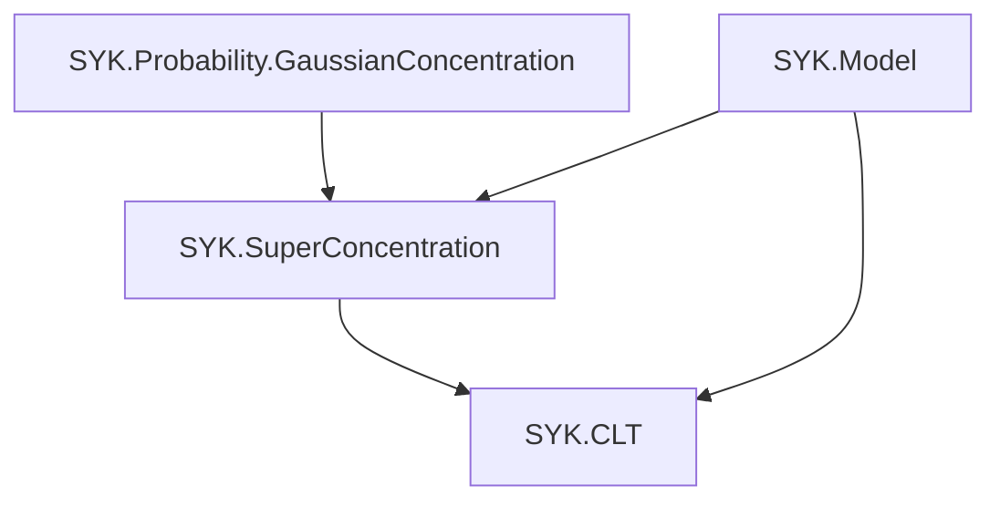
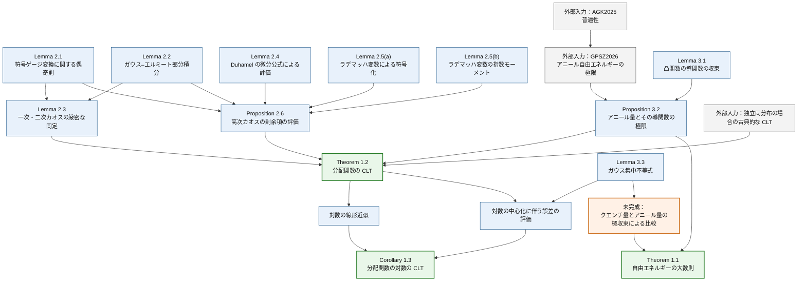

# SYK 中心極限定理の証明構造

## 目的と役割

この文書は、`refs/CLT_SYK.tex` と `refs/sections/` にある Theorem 1.1–1.2 と Corollary 1.3 について、意図した証明の依存関係と現在の証明状態を記録する。正確な定理文については、これらを合わせた原稿を正式な参照元とする。

文書を必要以上に増やさないため、証明状態だけを記録する `proof_status.md` は作成せず、この文書に併記する。

## 基本設定

この文書では原稿の現在の証明状態と、今後の形式化の目標を併記する。「原稿内に証明あり」は Lean による検証済みを意味しない。非負逆温度への統一、複素分配関数の API、大文字のモジュールパスは移行方針であり、原稿・実装に残る差は `EDITING_PLAN.md` で管理する。

偶数 `q >= 4` と偶数 `N` に対して、論文では `M_N = binomial(N,q)`、`sigma_N^2 = (q-1)!/N^(q-1)`、規格化トレースで定義した `Z_N`、`Y_N = Z_N/E[Z_N]`、およびゆらぎを拡大する指数 `a = q/2-1` を用いる。論文の確率論的結果は `β >= 0` で述べ、Lean では解析用の分配関数を `z : ℂ` まで拡張する。

共有模型の `SYK.partitionFunction` は通常のトレースを使う。標準行列表現を構成した後に、この名前空間で `normalizedTrace (exp (-z • H))` による CLT 固有の規格化分配関数を定義し、原稿の `Z_N` に対応させる。この局所的な定義は逆向きに `Model` へ依存させず、共有 API に規格化・非規格化の別名を並べない。

Lean の複素解析を担う層では、`Z_N(z)` の整関数性と微分を、零点に関する仮定なしで扱う。対数微分には `Z_N(z) != 0` を仮定し、具体的に零点がない領域は将来の別の結果として扱う。分配関数の正値性、実数値の `log Z_N`、裾確率、および CLT は `β : ℝ≥0` に限定する。

## 主結果と現在の状態

「自由エネルギー」は以下の対数分配関数の規格化量を指す原稿の呼称として使う。物理的自由エネルギー密度 `-(β N)^(-1) log Z_N` とは係数が異なるため、結果を移す際は名称だけで同一視せず式を照合する。

以下で相対ゆらぎは `Y_N-1`、標準化したゆらぎは `(Z_N-E[Z_N])/sqrt(Var(Z_N))`、対数のゆらぎは `log Z_N-E[log Z_N]` を指す。標準化には分散の正値性が必要である。CLT の矢印 `=>` は分布収束を表し、自由エネルギーの概収束と区別する。

アニール量は `N^(-1) log E[Z_N]` という確定的な量、ここで比較するクエンチ量は `N^(-1) log Z_N` というランダムな量である。`N^(-1) E[log Z_N]` を介して両者を比較するため、期待値と対数の順序を区別する。

### Theorem 1.1：自由エネルギーの大数則

アニール自由エネルギーの極限と、クエンチ自由エネルギーがほとんど確実に同じ極限を持つことを主張する。

目標とする定理文は、十分小さい非負の `beta` に対して

```text
N^(-1) log Z_N(beta) -> ell_q(beta)    （ほとんど確実に）
N^(-1) log E[Z_N(beta)] -> ell_q(beta)
```

さらに、`ell_q` の微分可能性を主張する。原稿中の `ell_p` は `ell_q` の記号上の誤りと考えられるが、定理文を修正する前に確認する。

状態：**未完成**。Proposition 3.2 はアニール量とその導関数の極限を与えるが、クエンチ量とアニール量がほとんど確実に同じ極限を持つことの明示的な証明が本文にない。原稿には0を中心とする実区間を使う旧記述が残るため、非負の逆温度へ統一する必要がある。

### Theorem 1.2：分配関数の中心極限定理

`N^a (Y_N-1)` がガウス分布へ収束することと、標準偏差で割った分配関数のゆらぎに対する CLT を主張する。

相対ゆらぎに関する現在の定理文は

```text
N^(q/2-1) (Y_N(beta)-1)
  => Normal(0, (q!/2) * beta^2 * (ell_q'(beta))^2)
```

である。したがって極限分散は

```text
rho^2(beta) = (q!/2) * beta^2 * (ell_q'(beta))^2.
```

状態：**原稿内に証明あり、要監査**。ガウスカオス展開、二次カオスの厳密な同定、高次カオスからなる剰余項の評価、アニール自由エネルギーの導関数の極限、および独立同分布の確率変数に対する古典的な CLT を組み合わせる。標準化した CLT は `beta = 0` で定義されないため、パラメータの範囲を明確にする必要がある。

### Corollary 1.3：分配関数の対数の中心極限定理

`N^a (log Z_N-E[log Z_N])` がガウス分布へ収束することを主張する。

現在の定理文では、極限分散は Theorem 1.2 と同じである。

状態：**原稿内に証明あり、要監査**。Theorem 1.2 に加えて、対数の線形近似、ガウス集中不等式、負の側の裾の制御、および中心化に伴う確定的な誤差の評価を使う。

## 分配関数の中心極限定理に用いる分解

ここでガウスカオスは、ガウス確率変数のエルミート展開を次数ごとに分けた成分であり、量子カオスとは異なる。

証明の中心は、`Y_N-1 = c_N S_N+R_N` という厳密な分解である。具体的には

```text
S_N = (1 / sqrt(2 M_N)) * sum_I (g_I^2-1),
c_N(beta) = beta * partial_beta log E[Z_N(beta)] / sqrt(2 M_N),
R_N = sum_{r >= 3} P_r Y_N.
```

`S_N` は独立な確率変数 `g_I^2-1` の規格化和、`c_N S_N` は二次ガウスカオス、`R_N` は三次以上のカオス成分の和である。アニール自由エネルギーの導関数の極限と `M_N ~ N^q/q!` から

```text
N^(q/2-1) c_N(beta)
  -> sqrt(q!/2) * beta * ell_q'(beta)
```

を得る。

必要な内部結果は次である。

1. 符号ゲージ変換に関する偶奇則：各頂点の出現回数がすべて偶数でない多重添字に対応するエルミート係数を消す。
2. ガウス–エルミート部分積分：エルミート係数を微分の期待値に変換する。
3. 一次・二次カオスの厳密な同定：一次カオスの消滅と二次カオスの係数を有限の `N` で同定する。
4. Duhamel の微分公式による評価：分配関数の任意階の導関数を評価する。
5. ラデマッハ変数による符号化：各頂点の出現回数がすべて偶数である多重添字の和を、ラデマッハカオスのモーメントとして表す。
6. ラデマッハ変数の指数モーメント評価：すべての高次カオス成分を一度に足し合わせて評価する。
7. 高次カオスの剰余項の評価：`||R_N||_2^2 = O(N^(-3a)) = o(N^(-2a))` を得る。
8. アニール自由エネルギーの導関数の漸近挙動：二次カオスの確定的な係数の極限を得る。
9. 独立同分布の確率変数に対する古典的な CLT と Slutsky の定理：Theorem 1.2 を完成する。

## 分配関数からその対数への移行

中心化に現れる差は `E[log Y_N] = E[log Z_N] - log E[Z_N]` である。対数の局所的な線形近似だけでは、その誤差の期待値が小さいことまでは従わないため、負の側の裾の評価を別に使う。

`W_N = log Y_N` とおくと、Corollary 1.3 では次を使う。

```text
N^a (W_N-E[W_N])
  = N^a (W_N-(Y_N-1)) + N^a (Y_N-1) - N^a E[W_N].
```

第1項には `log(1+x)-x = O(x^2)` と Theorem 1.2 から得られる確率的有界性、第2項には Theorem 1.2、第3項にはガウス集中不等式と負の側の裾を積分して得られる評価を使う。

## 自由エネルギーの大数則

Theorem 1.1 の証明を完成するには、アニール自由エネルギーの収束、`E[log Z_N]-log E[Z_N]` の評価、`log Z_N` の集中不等式、および概収束を導くための総和可能な裾確率の評価、またはそれに相当する外部定理が必要である。

既存のガウス集中不等式に関する補題と、Corollary 1.3 で使う中心化の評価を再利用できる可能性がある。ただし、現在の原稿では、それらを組み合わせた Theorem 1.1 の証明は示されていない。

## 外部入力

- `GPSZ2026`：Theorem 5 から高温領域におけるアニール自由エネルギーの極限を用いる。解析性を導く際には、同論文の Proposition 3 の評価も参照する。
- `AGK2025`：`GPSZ2026` がガウス分布へ拡張する際に参照する、ガウス変数とラデマッハ変数の間の普遍性
- 独立同分布の確率変数に対する古典的な中心極限定理
- 標準ガウス測度に対する集中不等式

外部結果を利用するときは、正確な定理文、規格化の変換、逆温度の範囲、および直接引用した結論とそこから推論した結論を区別する。

現在の原稿で用いる `GPSZ2026` との規格化の対応は

```text
psi_i^GPSZ = 2^(-1/2) psi_i,
H_N^GPSZ = 2^(-q/2) H_N,
u = 2^(q/2) beta
```

である。導関数の収束は外部定理から直接引用するのではなく、アニール自由エネルギーの各点収束、極限関数の正則性、および Lemma 3.1 の凸性を用いた議論から導く。

## 依存関係

次の Mermaid 図は論理的な依存関係の概観であり、本文に記録した正確な定理文や収束の種類に代わるものではない。

Lean モジュール間の依存関係は次の一方向とする。





## Lean モジュールの構成

既存の雛形で採用している、TeX の定理ラベルに基づくファイル分けを維持する。ファイル名とモジュール名を構成する各部分は `UpperCamelCase`、名前空間は `SYK.CLT` とする。形式化は、各頂点の出現回数に関する偶奇条件、ラデマッハ変数による符号化、指数の比較、二次カオスと剰余項から CLT を導く抽象的な定理、分配関数からその対数へ CLT を移す補題、最後に SYK 固有の模型への適用、という順序で進める。共有すべき行列解析やガウス集中不等式を CLT 内に複製しない。

共有模型と集中不等式の再設計が済むまでは、CLT の雛形へ依存する宣言を追加しない。再設計後には、ガウスカオスの完全直交系・射影・無限和、任意階の行列微分評価、`N` に依存して変わる確率空間上の分布収束、および概収束で必要な共通確率空間を、別々の形式化課題として扱う。mathlib にある古典的 CLT と Slutsky の定理は接続に利用できるが、これらの基盤を省略する根拠にはしない。

README には実在するモジュールだけを掲載する。

現在の TeX ラベルと Lean ファイルの対応は次のとおりとする。原稿中の定理番号が変わっても、この表と Lean のコメントでは TeX ラベルによって対応を追跡する。

| Lean ファイル | TeX ラベル |
| --- | --- |
| `Main.lean` | `thm:partition-clt`、`cor:free-energy-clt`、および現在ラベルのない自由エネルギーの大数則 |
| `Lemmas/CLTComponents.lean` | `lem:exact-second-chaos`, `prop:higher-chaos-closure`, `prop:annealed-free-energy` |
| `Lemmas/GaussianConcentration.lean` | `eq:centered W_N tail`, `eq:centered W_N exp` |
| `Lemmas/ConvexDerivatives.lean` | `lem:convex-derivatives` |
| `Lemmas/Preliminaries.lean` | `lem: parity rule lemma`, `lem:Gaussian-Hermite-IBP`, `lem:Z-derivative-bound`, `lem:Rademacher-encoding` |

補助モジュールは `Lemmas/` に配置する。空白を含む既存のラベル名は TeX のソースコードと厳密に一致させ、TeX 側を変更するまでは Lean のコメントだけを整形しない。
