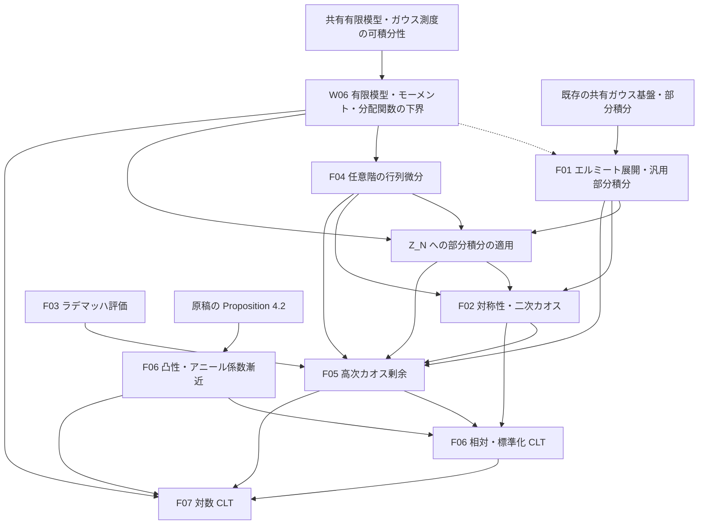

# SYK 中心極限定理の証明構造

## 基準と正式な参照元

W06 の有限模型・モーメント・対数に関する公開30定理は検証済みである。F01 の一般部分積分、直交性、有限射影、有限積ガウス $L^2$ の完全性と無限次数和は検証済みである。`Setting.Z` への適用は F04 に残る。共同 CLT と外部入力そのものは未証明である。検証時点・公理依存・警告は [W06 の記録](../WORK_HISTORY.md#clt-w06) と [F01 取り込み検証](../WORK_HISTORY.md#merge-f01-2026-09-27) に記す。

正確な原稿の主張は `refs/CLT_SYK.tex` と、そこから読み込む `introduction.tex`・`gaussian-chaos.tex`・`higher-chaoses.tex`・`main-results.tex` を参照する。実装の型と証明項は Lean ソース、横断的な状態は [全体計画](../EDITING_PLAN.md)、残作業は [編集計画](EDITING_PLAN.md)、完了済み作業の詳しい検証根拠は [作業履歴](../WORK_HISTORY.md) に置く。原稿内の証明、外部結果、Lean の検証済み証明を区別する。

`main-results.tex` の対数 CLT は `Z_N≥1` とカオス分解を使う新証明だけを含む。R01 の再照合では、旧計画が記録した `\iffalse` 内の集中評価による旧証明は現行ソースに存在しなかった。現在の依存関係は新証明を基準とし、旧集中評価を必須入力に数えない。

## 模型・型・規格化

| 項目 | 現行の内容 |
| --- | --- |
| 模型 | 固定した偶数 `q≥4`、偶数 `N≥q`、独立標準正規座標 `g_I` |
| 演算子 | 自己共役な Majorana 生成子、反交換関係 `ψ_i ψ_j+ψ_j ψ_i=2δ_ij I`、昇順積と位相 `i^(q/2)` |
| ハミルトニアン | `H_N=σ_N Σ_I g_I ψ_I`、`σ_N²=(q-1)!/N^(q-1)` |
| 原稿のトレース | `tr=2^(-N/2) Tr`、標準表現の次元で規格化 |
| Lean のトレース | 一般の非空有限次元表現で、行列の添字型の要素数 `Fintype.card d` で割る `normalizedTrace` |
| 分配関数 | `Z_N(z)=tr exp(-z H_N)`、`z : ℂ`、`Z_N(0)=1` |
| 確率論の逆温度 | 現行原稿・CLT の宣言は `β : ℝ`。共有 Gibbs・集中 API の `β : ℝ≥0` は変更しない |
| 系の極限 | 原稿は偶数 N を通る極限。Lean の `Setting q` は偶数サイズが無限大へ発散する任意の族 |
| 確率空間 | 各サイズの共有ガウス係数空間。分布収束はサイズごとの空間を許す。概収束には別途共通確率空間が必要 |

標準表現への特殊化で原稿のトレースと一致することと、一般表現で外部極限定理を利用できることは別の確認事項である。W06 では前者を照合済みである。一般表現族への外部入力の供給は R02・F06 に残し、表現独立性を暗黙に仮定しない。

共有の `SYK.partitionFunction` は通常のトレースを使う。CLT の局所定義は既に存在し、通常トレースの分配関数を次元で割ったものとの一致も証明項を持つ。複素解析の API は共有側を使い、零点のない領域や対数の枝は仮定しない。W06 では利用のない複素解析 API の一式追加を求めない。

## 現在の実装と原稿との差

| 対象 | ソース上の状態と残る照合 |
| --- | --- |
| 有限模型の零逆温度・トレース対応・実数性・正値性 | `Main.lean` に証明項あり。9月18日時点の「実数性・正値性が未証明」という記録は履歴 |
| 有限模型・モーメント・対数 | トレース零、`Z≥1`、`Setting.partition_moments`、相対量の期待値1・二乗可積分性、対数の可積分性・中心化恒等式、零逆温度を検証済み。標準表現との規格化の一致も証明済み。公開30定理に `sorryAx` なし。2026-09-26、Tool 再実装後の統合監査でも公開30定理と `lake build` の成功を再確認。W06 完了 |
| 共同 CLT | `partition_and_log_partition_clt` は `S : Setting q` と `hFE : AnnealedInput q S` を受け取る条件付きの定理文で、`sorry` が残る。二つの個別 CLT はその射影 |
| アニール極限・係数漸近・非退化性 | `hFE` の下での証明項あり。入力自体を構築した結果ではない |
| 凸関数列の導関数収束 | `Lemmas/ConvexDerivatives.lean` の `convex_convergence_deriv_tendstoUniformlyOn`。関数列の局所一様収束を仮定しており、原稿の各点収束から局所一様収束を導く補題全体ではない |
| ガウス–エルミート部分積分・展開 | 共有 `Probability/GaussianConcentration/Smooth.lean` に一般部分積分、`Lemmas/GaussianChaos.lean` に規格化の照合がある。`GaussianHermiteOrthogonality.lean` は直交性・階乗ノルム・有限射影、`GaussianPolynomialDensity.lean` は有限積ガウス $L^2$ 完全性と無限次数和を証明済み。`Setting.Z` への特殊化は F04 に残る |
| ラデマッハ評価 | `Lemmas/Rademacher.lean` に有限符号平均と `rademacher_encoding` がある。関連ビルド・主要定理の公理依存を確認済み。符号化の計数恒等式と F03/F05 の CLT 側への接続は未完了 |
| 行列解析と対称性 | `Lemmas/SingularValues.lean` は有限次元の特異値・Schatten 評価、`Lemmas/MatrixTraceExponential.lean` は規格化トレースと指数の評価、`Lemmas/TraceExpDerivatives.lean` は Hermitian 行列の指数の高階微分評価を証明済み。これらを CLT のカオス解析へ接続する作業は F04 に残る |
| 符号ゲージ・偶奇則 | `Lemmas/CliffordSignParity.lean` の符号ゲージ・Hermite 偶奇則は `Preliminaries.lean` で `Setting.Z` の規格化・ガウス測度に接続済み。一次カオスの消滅と二次の非対角係数零を検証した。二次の共通係数も F02 で検証済み |
| その他の補助モジュール | `SecondChaos.lean` は二次カオスの対角係数を個別の期待値で表す有限サイズの恒等式を検証済み。`GaussianConcentration.lean` は引き続き雛形。`Setting.Y_secondChaos_eq` は原稿どおりの共通係数まで検証済み |
| Blueprint | `../Chapters/AnnealedFE.lean` でガウス入力構造と別原稿の Rademacher 極限を分け、`../Chapters/CLT.lean` で有限模型の証明状態・条件付き極限・現行の対数 CLT の依存を記録した。Verso の生成・参照検査は休止中 |

### 補助 Lean ファイルの役割

補題を利用するときは、以下の用途と宣言名から対象を選び、ソースで定理文と必要な定義を確認する。名前空間、節の変数、型クラス、局所記法も確認し、証明の詳細は必要になった箇所を読む。この参照方法は通常の文書・Lean ソースを対象とし、適用される `AGENTS.md` の確認範囲を限定しない。以下の説明は索引であり、正確な仮定と型は Lean 宣言を参照する。

- `Lemmas/GaussianIBP.lean` は、指数傾斜によるシフト恒等式、差商の一様評価、支配収束を用いて、実ガウス分布の Stein 型部分積分を構成する。共有 `Probability/GaussianConcentration/Smooth.lean` は、独立標準ガウスと probabilists' Hermite 多項式に対し、`C^{|α|}` の正則性と `η ≤ α` の各偏導関数に対する指数増大から、多重指数部分積分 `hermiteMulti_ibp_of_expGrowth` と両辺の可積分性を与える。これは `lem:Gaussian-Hermite-IBP` の一般部分に対応するが、`Setting.Z` の各偏導関数の評価を供給したり、この公式を `Z_N` に適用したりするものではない。
- [GaussianChaos.lean](Lemmas/GaussianChaos.lean)：`SYK.CLT.hermite_coefficient_ibp` と `hermite_coefficient_integrable` が係数の部分積分と両辺の可積分性の入口である。`SYK.GaussianConcentration.hermiteMulti` と `CliffordSignParity.lean` の `SYK.hermiteMulti`、二つの標準ガウス測度の定義を照合し、原稿の成長条件で後者の記法へ移す。正次数の平均零と Hermite 関数の積の可積分性も証明する。
- [GaussianHermiteOrthogonality.lean](Lemmas/GaussianHermiteOrthogonality.lean)：`SYK.CLT.hermiteMulti_orthogonality`、`inner_hermiteLp`、`hermiteFiniteProjection_eq_starProjection` が、原稿の Hermite 内積・階乗ノルムと任意の有限添字集合への直交射影公式の入口である。このファイルの `hasSum_hermiteCoefficients` と `hasSum_hermiteDegreeProjection` は $L^2$ 完全性を仮定する。完全性を別途渡さずに使う結果は、次の `GaussianPolynomialDensity.lean` を参照する。
- [GaussianHermiteDensity.lean](Lemmas/GaussianHermiteDensity.lean)：一変数実多項式の Hermite 基底、任意の実係数多変数多項式関数の Hermite 有限線形包への包含、$L^2$ クラスへの移送を証明する。多項式クラスがガウス $L^2$ に稠密なら規格化 Hermite 族も稠密であることを証明済み。
- [GaussianMomentDetermination.lean](Lemmas/GaussianMomentDetermination.lean)：指数モーメントを持つ有限実測度のモーメント一意性を扱う。
- [GaussianPolynomialDensity.lean](Lemmas/GaussianPolynomialDensity.lean)：`SYK.CLT.hermiteOrthonormal_dense`、`hasSum_hermiteCoefficients_unconditional`、`hasSum_hermiteDegreeProjection_unconditional` が完全性と展開の入口である。標準ガウスの指数関数と $L^2$ 関数との積の可積分性、有限積ガウス $L^2$ の多項式稠密性を経て、Hermite 完全性、階乗係数と次数別の無限和を証明済みである。これらの展開定理は完全性を追加仮定として受け取らない。
- [SingularValues.lean](Lemmas/SingularValues.lean)：特異値・min-max・Ky Fan・Schatten 評価の証明基盤である。[MatrixTraceExponential.lean](Lemmas/MatrixTraceExponential.lean) は規格化トレース、Schatten 評価と指数の評価を扱う。[TraceExpDerivatives.lean](Lemmas/TraceExpDerivatives.lean) の高階微分評価の入口は `MatrixAnalysis.Matrix.iterDirectionalFDeriv_traceExp_bound` と `iterDirectionalFDeriv_traceExp_bound_of_norm_le_one` であり、Hermitian な基点における反復方向微分を扱う。`Setting.Z` のスケール・実部・ガウス可積分性との接続は F04 に残る。
- `Lemmas/Rademacher.lean` は、Boolean ベクトル上の一様平均 `radE`、符号和、および次数 `q` の基本対称式である Rademacher カオスを定義する。Newton 恒等式でカオスを符号和から評価し、独立符号和の指数モーメント評価と組み合わせて、偶数 `q ≥ 4` と `0 ≤ t ≤ c_q N^{-(q-1)}` の下で `𝔼_ε[|S_{N,q}|^3 exp(t|S_{N,q}|)] ≤ C_q N^{3q/2}` を証明する。これは `lem:Rademacher-encoding` の評価部品であり、Gaussian chaos の剰余評価 `prop:higher-chaos-closure` への適用は未完了。
- `Lemmas/ConvexDerivatives.lean` は、割線の差の評価と平均値の定理を準備し、凸関数列の導関数を左右の割線で挟む証明を形式化する。主定理 `convex_convergence_deriv_tendstoUniformlyOn` は、開集合 `I` 上の各関数の凸性・微分可能性、関数列の局所一様収束、極限関数の微分可能性と導関数の連続性を仮定し、任意のコンパクト集合 `K ⊆ I` 上で導関数の一様収束を結論する。原稿で必要な各点収束から局所一様収束への導出や、アニール入力との接続までは含まない。

`Main.lean` は `Annealed_FE/main_result.lean` を import せず、`SYK.CLT.AnnealedInput q S` を宣言する。CLT の数学的入力は現行原稿の `prop:annealed-free-energy`（Proposition 4.2）である。この構造体は一つの `S : Setting q` に対して、全実軸の偶・凸な `C¹` 極限、圧力と導関数の局所一様収束、命題の明示的評価と非零逆温度での符号を要求する。小温度展開は評価から従うためフィールドに重ねていない。旧構造の実解析性・共通高温半径・全 `Setting q` への一括量化は除去した。原稿の模型族が特定の `Setting q` に対応することと、その族について入力を構築することはなお未証明である。旧ファイルの重複宣言も除去した。

`Annealed_FE/refs/SYK-HT-arxiv.tex` の主結果は Rademacher 相互作用を使い、物理的 Majorana 生成子の二乗を `I/2` とする別の原稿に属する。同原稿の圧力・自由エネルギー極限を、ガウス模型の全 `Setting q` についての `AnnealedInput` の構築と同一視しない。新しい Annealed_FE 章は両者の接点と未証明状態を示す。

`Annealed_FE` 内には別途 Rademacher 模型・CCG の定義と未完成の定理がある。その存在を Gaussian CLT 用入力の構築と同一視しない。現行 CLT は同ライブラリを import しない。有限模型の成果の公理依存と、別ライブラリに残る未完成箇所は別々に確認する。

## 現行原稿の主張

| TeX ラベル | 主張と監査事項 |
| --- | --- |
| `thm: input` | `ell_q` の記号へ修正済み。He2026 v3 の直接の結論は固定正温度でのアニール圧力と期待クエンチ圧力の極限であり、標本ごとの概収束は直接引用できない。定理を弱めるか、共通確率空間上の集中評価で補うかは R04-A の判断待ち |
| `thm:partition-clt` | 小さい `|β|` で相対・標準化 CLT。相対 CLT は零で退化極限を持つが標準化量は未定義であり、標準化の範囲だけ `β≠0` とする変更は R02-A の判断待ち。現行原稿に `tilde_beta_q` はない |
| `cor:free-energy-clt` | 同じ範囲と分散で中心化した対数 CLT。`beta_q` の記号へ修正済み。新証明は集中不等式を使わず、R05 で監査済み |
| `prop:annealed-free-energy` | 全実軸の圧力・導関数の局所一様収束、偶性・凸性・`C¹`、小温度展開と非零逆温度の符号。He2026 v3 の規格化と引用、原稿内の導出を R03 で監査済み |

相対量・スケール・極限分散は
```text
Y_N = Z_N / E Z_N,  a = q/2 - 1,
ρ²(β) = (q!/2) β² (ℓ_q'(β))².
```
相対 CLT は `N^a(Y_N-1)`、対数 CLT は `N^a(log Z_N-E log Z_N)` の分布収束である。標準化は `(Z_N-E Z_N)/sqrt(Var Z_N)`。零逆温度の前二者の退化極限と、零分散での標準化を混同しない。Lean の共同定理は非零小温度で「すべての有限サイズの分散正値性」も要求するため、漸近分散の正値性だけではその結論を充足しない。

## カオス分解と係数の漸近

現在の原稿は次の二つの同値な記法を使う。
```text
M_N = choose(N,q),  Q_N = M_N⁻¹ Σ_I(g_I²-1),
A_N(β) = (β/2) ∂_β log E Z_N(β),
S_N = (2M_N)^(-1/2) Σ_I(g_I²-1),
c_N(β) = β ∂_β log E Z_N(β) / sqrt(2M_N),

Y_N - 1 = A_N Q_N + R_N = c_N S_N + R_N,
R_N = Σ_{r≥3} P_r Y_N.
```

符号ゲージ対称性・Hermite 部分積分で一次・二次カオスを同定し、Duhamel 微分評価と Rademacher 符号化・指数モーメントにより `‖R_N‖₂²=O(N^(-3a))` を得る。係数の同一性は F02 で符号付き頂点転置とガウス測度の不変性から証明した。`PartitionDerivatives.lean` の一次部分積分・放射方向微分・期待値との微分交換を用い、全実数の逆温度で共通係数を同定済みである。アニール導関数の極限と `M_N~N^q/q!` により
```text
A_N/N → (β/2) ℓ_q'(β),
N^a c_N → sqrt(q!/2) β ℓ_q'(β).
```
古典的 CLT と Slutsky を適用し、標準化には直交分解による分散漸近と非退化性を別に使う。

## 対数 CLT の新しい経路

`W_N=log Y_N` とすると
```text
N^a(log Z_N-E log Z_N)
  = N^a(W_N-(Y_N-1)) + N^a(Y_N-1) - N^a E W_N.
```
最初の項は対数の局所近似と確率的有界性、二番目は相対 CLT を使う。最後の期待値の制御は次の入力に依存する。

| 入力・評価 | 担当 |
| --- | --- |
| 相互作用・H のトレース零、Jensen による `Z_N≥1`、モーメントと正しい中心化の恒等式 | W06 |
| `‖R_N‖₂²=O(N^(-3a))` | F05 |
| `c_N=O(N^(-a))`、アニール入力から `log E Z_N=O(N)` | F06 |
| `sup_N E S_N^4<∞`、`P(Y_N<1/2)=O(N^(-3a))`、期待値の誤差 | F07（R05 で監査） |

`h(y)=y-1-log y` に対し `E h(Y_N)=-E log Y_N`。`Y_N≥1/2` では二次モーメントで評価し、`Y_N<1/2` では `h(Y_N)≤-log Y_N≤log E Z_N` を使う。これにより
```text
0 ≤ -E log Y_N = O(N^(-2a)) + O(N^(1-3a))
               = O(N^(-2a)) = o(N^(-a))  (a≥1).
```
分布収束だけからこれらのモーメント評価は推論しない。W06 は有限模型の入力までを供給し、この漸近論証全体は F07 に残す。

## 外部入力と未確定事項

現行原稿は He2026 v3 の Theorem 1.1、Proposition 3.3、Theorem 2.5 を引用し、Schwinger–Dyson 圧力・その微分公式・正の Lehmann 表現を用いる。R03 で原文を照合し、原稿内の変換 `H_N^He=2^(-q/2)H_N`、`s=2^(q/2)|β|`、規格化トレース、Lehmann 測度の二次モーメントが一致することを確認した。符号の処理にはガウス分布に従う相互作用係数の対称性を使う。

圧力・導関数の収束、零での接続、明示的な二次・四次誤差、`βℓ_q'(β)>0` の原稿内導出を R02・R03 で照合する。古い GPSZ2026 の解析性を前提とした説明を現行の証明へ自動的に流用しない。F06 の入力は原稿の Proposition 4.2 とし、`AnnealedInput q S` はその主張を受け取る。He2026 は同命題の証明内の引用として監査する。これは W06 の有限模型証明とは独立に進められる。

R04 の監査では、He2026 の Theorem 1.1 が標本ごとの概収束を直接述べないことを確認した。`thm: input` を期待クエンチ圧力の極限へ弱めるか、共通確率空間上の Gaussian concentration と Borel--Cantelli で固定温度の概収束を補うかは R04-A の研究者判断とする。F08 はその Lean 上の扱いの仕様再検討であり、内部での大数則証明を自動的に再開せず、W06・最終 CLT の前提にも追加しない。

## 依存関係と実装の分担

次は作業上の待ち合わせと数学的な入力を合わせた図であり、現行の import グラフや形式化の完了状態を表すものではない。W06 から F01 への破線は実装順序を示す。共有ガウス基盤の調査は W06 と並行でき、汎用のガウス–エルミート部分積分は W06 を数学的に必要としない。



F01 で照合した流用候補は SpinGlass のコミット `dc1d3820af6e443c09bd1177ec3e409cf0640d5c` にある [ExpGrowth.lean](https://github.com/or4nge19/SpinGlass/blob/dc1d3820af6e443c09bd1177ec3e409cf0640d5c/Common/Mathlib/Probability/Distributions/Gaussian/ExpGrowth.lean) の `HasExpGrowth`・可積分性の補題と、[GaussianIntegrationByParts.lean](https://github.com/or4nge19/SpinGlass/blob/dc1d3820af6e443c09bd1177ec3e409cf0640d5c/Common/Mathlib/Probability/Distributions/GaussianIntegrationByParts.lean) の `stein_lemma_gaussianReal_of_expGrowth'` である。候補の Lean/mathlib は `4.34.0-rc2`、現行ワークスペースは `4.32.2` である。原稿の分散1の規格化では既存の `gaussianReal_stein` と `pi_gaussian_stein_coord` が必要な入力を満たすため、上流コードは流用せず、Lake の依存にも追加していない。一般部分積分の共有配置と検証は完了し、詳細は [F01-G の記録](EDITING_PLAN.md#ticket-f01-g)を参照する。

原稿の `lem:Gaussian-Hermite-IBP` は `f ∈ C^{|α|}` を仮定し、成分ごとに `η ≤ α` を満たす各偏導関数について、ある `C_η > 0` による `|∂^η f(G)| ≤ C_η exp(C_η ‖G‖)` を要求する。2026-09-26、この一般部分を同じ仮定のまま証明し、F01-G で共有 `Smooth.lean` に移した。共有 `pi_gaussian_stein_coord` は選択座標だけの成長評価を使い、偏導順序の交換と Hermite 因子の成長評価から反復の入力を導く。両辺の可積分性も `hermiteMulti_ibp_integrable` で証明済み。`Z_N` の正則性・成長評価と特殊化は F04 に残す。有限射影、有限積ガウス $L^2$ 完全性、無限次数和の収束は F01-H で証明済み。原稿の `eq: chaos` は研究者の確認に従いガウス $L^2$ の等式として解釈する。

模型から独立したガウス基盤は利用側を import しない。Model が CLT を import する依存も作らない。`SuperConcentration` は既存の独立成果として維持し、新しい対数 CLT の必須入力にはしない。現行 `Main.lean` は `Annealed_FE` を import せず、アニール入力を `AnnealedInput q S` として受け取る。

W06 の追加証明は既存の `Main.lean` に実装され、Model への補題追加は行われなかった。後続で共有するトレース零・行列評価は Model の既存ファイルへ移す。既存の凸関数補題と条件付き漸近補題を再実装せず、F06 で不足する入力を補う。

| Lean ファイル | 原稿との対応・用途 |
| --- | --- |
| `../Probability/GaussianConcentration/StandardGaussian.lean` などの既存ファイル | 既存の指数可積分性・部分積分を提供し、選択座標だけの成長仮定への更新は検証済み。一般 Hermite 部分積分の共有配置と流用候補の照合は [汎用基盤の F01 記録](../Probability/GaussianConcentration/EDITING_PLAN.md#f01) |
| `Main.lean` | `subsec:SYK-model`、`thm:partition-clt`、`cor:free-energy-clt`、有限模型と条件付きアニール入力 |
| `Lemmas/Preliminaries.lean` | `lem: parity rule lemma` の `Setting.Z` への接続、一次カオス零、二次の非対角係数零。相互作用添字間の対称性も証明済み |
| `Lemmas/PartitionDerivatives.lean` | `Setting.Z` の滑らかさ・一次微分評価、二次係数への部分積分と期待値の微分交換。任意階の評価は F04 に残る |
| `Lemmas/SecondChaos.lean` | `lem:exact-second-chaos` の共通係数まで実装済み。`prop:higher-chaos-closure`、`prop:annealed-free-energy` は未完了 |
| `../Probability/GaussianConcentration/Smooth.lean` | 汎用のガウス–エルミート部分積分。`lem:Gaussian-Hermite-IBP` の `Z_N` への適用は F04 と接続して検査する |
| `Lemmas/CliffordSignParity.lean` | 符号ゲージと Hermite 偶奇則。共有分配関数を直接利用し、`Preliminaries.lean` に接続する |
| `Lemmas/SingularValues.lean`・`Lemmas/MatrixTraceExponential.lean`・`Lemmas/TraceExpDerivatives.lean` | 一般行列の特異値・Schatten 評価と高階微分評価。共有模型への接続は F04 |
| `Lemmas/Rademacher.lean` | `lem:Rademacher-encoding` に対応する有限符号平均と指数モーメント評価。F03/F05 への統合は未完了 |
| `Lemmas/ConvexDerivatives.lean` | `lem:convex-derivatives` の導関数収束補題。局所一様収束などを仮定し、原稿の入力を導く不足部分は F06 に残る |
| `Lemmas/GaussianConcentration.lean` | 旧証明の `eq:centered W_N tail`・`eq:centered W_N exp` の雛形。W06 で実装も削除も要求しない |

新しい有限模型の結果に TeX ラベルがない場合は、所在の節と証明を記録し、架空のラベルを作らない。Blueprint の更新細目は Chapters の計画に置く。
