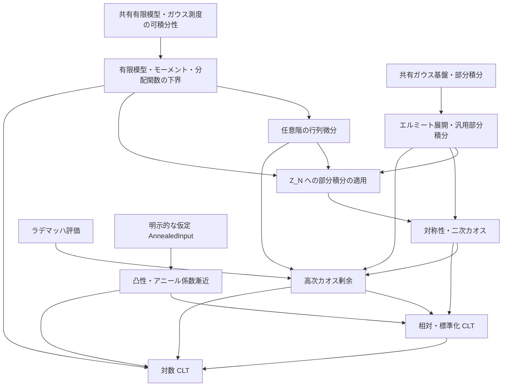

# SYK 中心極限定理の証明構造

## 基準と正式な参照元

有限模型と、三種類の条件付き CLT をまとめた `partition_and_log_partition_clt` は過去の統合検査で Lean に受理されている。今後の入力整理では `prop:annealed-free-energy` の内容を明示的な仮定として受け取り、命題自体の証明は保留する。検証時点・公理依存は [作業履歴](../WORK_HISTORY.md#clt-integration-audit-2026-09-29) を参照する。`sec:introduction` と `sec:main-results` の更新後の原稿と現行実装には、以下に記す不一致がある。入力整理は未実装である。

正確な原稿の主張は `refs/CLT_SYK.tex` と、そこから読み込む `introduction.tex`・`gaussian-chaos.tex`・`higher-chaoses.tex`・`main-results.tex` を参照する。実装の型と証明項は Lean ソース、横断的な状態は [全体計画](../EDITING_PLAN.md)、残作業は [編集計画](EDITING_PLAN.md)、完了済み作業の詳しい検証根拠は [作業履歴](../WORK_HISTORY.md) に置く。原稿内の証明、外部結果、Lean の検証済み証明を区別する。

`main-results.tex` の対数 CLT は `Z_N≥1` とカオス分解を用い、旧集中評価を必須入力にしない。

## 原稿推敲と記法の対応

原稿のどの箇所の改訂でも、定理の主張を維持する意図と、実際の差分の数学的な同値性の確認は区別する。現在の改訂予定と同期手順は [全体計画](../EDITING_PLAN.md#原稿改訂と実装の同期) を参照する。以下の数学的説明は現在の原稿に基づき、予定された改訂を反映済みとは扱わない。

改訂差分を確認した後、新旧の記法・TeX ラベル、数学的意味・型・添字・規格化、対応する Lean 宣言、照合対象と結果をこの節に記録する。現在、予定された改訂の対応は未確定である。

同じ記号でも規格化や添字の意味が変わっていないかを確認する。ラベルや束縛変数の改名と、変数変換・規格化変更を区別し、後者には等式や型の対応を示す。Lean 宣言と原稿の記号は同じ綴りにする必要がない。担当・通知・完了判定は全体計画に集約する。

## 模型・型・規格化

| 項目 | 現行の内容 |
| --- | --- |
| 模型 | 固定した偶数 `q≥4`、偶数 `N≥q`、独立標準正規座標 `g_I` |
| 演算子 | 自己共役な Majorana 生成子、反交換関係 `ψ_i ψ_j+ψ_j ψ_i=2δ_ij I`、昇順積と位相 `i^(q/2)` |
| ハミルトニアン | `H_N=σ_N Σ_I g_I ψ_I`、`σ_N²=(q-1)!/N^(q-1)` |
| 原稿のトレース | `tr=2^(-N/2) Tr`、標準表現の次元で規格化 |
| Lean のトレース | 一般の非空有限次元表現で、行列の添字型の要素数 `Fintype.card d` で割る `normalizedTrace` |
| 分配関数 | `Z_N(z)=tr exp(-z H_N)`、`z : ℂ`、`Z_N(0)=1` |
| 確率論の逆温度 | 現行原稿・CLT の宣言は `β : ℝ`。共有のギブス状態・集中 API の `β : ℝ≥0` は変更しない |
| 系の極限 | 原稿は偶数 N を通る極限。Lean の `Setting q` は偶数サイズが無限大へ発散する任意の族 |
| 確率空間 | 各サイズの共有ガウス係数空間。分布収束はサイズごとの空間を許す。概収束には別途共通確率空間が必要 |

標準表現への特殊化で原稿のトレースと一致することと、一般表現で外部極限定理を利用できることは別の確認事項である。前者は `Normalization.lean` の `partitionFunction_standard` で照合する。CLT は一つの抽象模型族 `S : Setting q` と `hFE : AnnealedInput q S` を入力とする条件付き定理として統一する。`hFE` の構築や表現独立性の証明はこの CLT の完了条件ではない。

有限模型の定義・評価・モーメントは `FiniteModel.lean` に置き、一般の `Params` と非空有限行列表現 `MajoranaSystem` のみを仮定する。`Basic.lean` がこれを import し、`Setting.partition_moments` では `S.params n` と `S.majorana n` に適用する。標準表現の import は規格化照合の `Normalization.lean` に分離し、抽象 CLT の依存から外す。最終三定理の入力は `{q : ℕ} (S : Setting q) (hFE : AnnealedInput q S)` にそろえ、`Even q` と `4 ≤ q` は `S` だけに保持する。

共有の `SYK.partitionFunction` は通常のトレースを使う。CLT の局所定義は既に存在し、通常トレースの分配関数を次元で割ったものとの一致も証明項を持つ。複素解析の API は共有側を使い、零点のない領域や対数の枝は仮定しない。現行の条件付き CLT は複素対数を入力に使わない。

## 補助 Lean ファイルの役割

補題を利用するときは、以下の用途と宣言名から対象を選び、ソースで定理文と必要な定義を確認する。名前空間、節の変数、型クラス、局所記法も確認し、証明の詳細は必要になった箇所を読む。この参照方法は通常の文書・Lean ソースを対象とし、適用される `AGENTS.md` の確認範囲を限定しない。以下の説明は索引であり、正確な仮定と型は Lean 宣言を参照する。

- `Lemmas/GaussianIBP.lean` は、指数傾斜によるシフト恒等式、差商の一様評価、支配収束を用いて、実ガウス分布の Stein 型部分積分を構成する。共有 `Probability/GaussianConcentration/Smooth.lean` は、独立標準ガウスと probabilists' Hermite 多項式に対し、`C^{|α|}` の正則性と `η ≤ α` の各偏導関数に対する指数増大から、多重指数部分積分 `hermiteMulti_ibp_of_expGrowth` と両辺の可積分性を与える。これは `lem:Gaussian-Hermite-IBP` の一般部分に対応するが、`Setting.Z` の各偏導関数の評価を供給したり、この公式を `Z_N` に適用したりするものではない。
- [GaussianChaos.lean](Lemmas/GaussianChaos.lean)：`SYK.CLT.hermite_coefficient_ibp` と `hermite_coefficient_integrable` が係数の部分積分と両辺の可積分性の入口である。`SYK.GaussianConcentration.hermiteMulti` と `CliffordSignParity.lean` の `SYK.hermiteMulti`、二つの標準ガウス測度の定義を照合し、原稿の成長条件で後者の記法へ移す。正次数の平均零と Hermite 関数の積の可積分性も証明する。
- [GaussianHermiteOrthogonality.lean](Lemmas/GaussianHermiteOrthogonality.lean)：`SYK.CLT.hermiteMulti_orthogonality`、`inner_hermiteLp`、`hermiteFiniteProjection_eq_starProjection` が、原稿の Hermite 内積・階乗ノルムと任意の有限添字集合への直交射影公式の入口である。このファイルの `hasSum_hermiteCoefficients` と `hasSum_hermiteDegreeProjection` は $L^2$ 完全性を仮定する。完全性を別途渡さずに使う結果は、次の `GaussianPolynomialDensity.lean` を参照する。
- [GaussianHermiteDensity.lean](Lemmas/GaussianHermiteDensity.lean)：一変数実多項式の Hermite 基底、任意の実係数多変数多項式関数の Hermite 有限線形包への包含、$L^2$ クラスへの移送を証明する。多項式クラスがガウス $L^2$ に稠密なら規格化 Hermite 族も稠密であることを証明済み。
- [GaussianMomentDetermination.lean](Lemmas/GaussianMomentDetermination.lean)：指数モーメントを持つ有限実測度のモーメント一意性を扱う。
- [GaussianPolynomialDensity.lean](Lemmas/GaussianPolynomialDensity.lean)：`SYK.CLT.hermiteOrthonormal_dense`、`hasSum_hermiteCoefficients_unconditional`、`hasSum_hermiteDegreeProjection_unconditional` が完全性と展開の入口である。標準ガウスの指数関数と $L^2$ 関数との積の可積分性、有限積ガウス $L^2$ の多項式稠密性を経て、Hermite 完全性、階乗係数と次数別の無限和を証明済みである。これらの展開定理は完全性を追加仮定として受け取らない。
- [SingularValues.lean](Lemmas/SingularValues.lean)：特異値・min-max・Ky Fan・Schatten 評価の証明基盤である。[MatrixTraceExponential.lean](Lemmas/MatrixTraceExponential.lean) は規格化トレース、Schatten 評価と指数の評価を扱う。[TraceExpDerivatives.lean](Lemmas/TraceExpDerivatives.lean) の高階微分評価の入口は `MatrixAnalysis.Matrix.iterDirectionalFDeriv_traceExp_bound` と `iterDirectionalFDeriv_traceExp_bound_of_norm_le_one` であり、Hermitian な基点における反復方向微分を扱う。`Setting.Z` のスケール・実部・ガウス可積分性との接続は F04 の `PartitionHigherDerivatives.lean` で検証済みである。
- `Lemmas/Rademacher.lean` は、Boolean ベクトル上の一様平均 `radE`、符号和、および次数 `q` の基本対称式である Rademacher カオスを定義する。`even_sum_rademacher_moment` は原稿 `eq:even-sum-Rademacher-moment` の有限和恒等式を証明する。Newton 恒等式でカオスを符号和から評価し、独立符号和の指数モーメント評価と組み合わせて、偶数 `q ≥ 4` と `0 ≤ t ≤ c_q N^{-(q-1)}` の下で `𝔼_ε[|S_{N,q}|^3 exp(t|S_{N,q}|)] ≤ C_q N^{3q/2}` を証明する。
- `Lemmas/PartitionHigherDerivatives.lean` は既存の行列トレース指数微分評価を `Setting.Z` の任意階の偏導関数に接続し、原稿 `eq:Z-derivative-bound` の係数、指数増大、ガウス–エルミート部分積分との接続を証明する。`Lemmas/HigherChaosProjection.lean` は各次数の Hermite 射影ノルムを偶多重指数の和、さらに Rademacher モーメントで評価し、無限次数和を指数付き三次モーメントで抑える。`tsum_higherChaosProjection_le_power` と `higherChaosProjection_isLittleO` は高温半径内の原稿 `prop:higher-chaos-closure` のべき評価を証明する。
- `Lemmas/ConvexDerivatives.lean` は、割線の差の評価と平均値の定理を準備し、凸関数列の導関数を左右の割線で挟む証明を形式化する。主定理 `convex_convergence_deriv_tendstoUniformlyOn` は、開集合 `I` 上の各関数の凸性・微分可能性、関数列の局所一様収束、極限関数の微分可能性と導関数の連続性を仮定し、任意のコンパクト集合 `K ⊆ I` 上で導関数の一様収束を結論する。原稿で必要な各点収束から局所一様収束への導出はこの補題に含まれない。条件付き CLT に必要な局所一様収束は `AnnealedInput` の仮定として受け取る。

## アニール入力の現状と整理後の目標

`Basic.lean` は `Annealed_FE/main_result.lean` を import せず、`SYK.CLT.AnnealedInput q S` を宣言する。意図する数学的入力は現行原稿の `prop:annealed-free-energy` だが、現行構造体には旧原稿の追加評価も残る。整理後は命題の内容を仮定として受け取り、原稿の模型族についての命題そのものは証明済みとしない。現行の条件付き CLT は、整理が終わるまでは原稿の命題より強い入力を仮定する。

| 現行のフィールド | 現行原稿との対応 | 整理後の目標 |
| --- | --- | --- |
| `ℓ`、`even`、`convex`、`contDiff_one` | 全実軸の偶・凸な `C¹` 極限 | 保持 |
| `pressure_limit`、`derivative_limit` | 圧力と導関数の全実軸での局所一様収束 | 保持 |
| `sign` | 非零逆温度で `βℓ_q'(β)>0` | 保持 |
| `derivative_pos` | 正の逆温度での導関数正値性。`sign` から従う | 削除予定 |
| `derivative_le`、`derivative_error_nonneg` | 同値な導関数上界。命題文にはないが証明本文に残る | 削除予定 |
| `pressure_error_nonneg` | 圧力上界。命題文にはないが証明本文に残る | 削除予定 |
| `derivative_error_le`、`pressure_error_le` | 旧原稿の三次・四次誤差上界。現行原稿では削除 | 削除予定 |

現行実装の誤差上界は、`β>0` で `β/q-ℓ_q'(β)≤β³/3`、全実数で `β²/(2q)-ℓ_q(β)≤β⁴/12` を要求する。現行原稿の命題文からこの二つのフィールドを埋める根拠は得られない。現行原稿の証明本文に残る `0<ℓ_q'(β)≤β/q` と `0≤ℓ_q(β)≤β²/(2q)` とは区別する。追加6フィールドは CLT の証明から参照されておらず、現行命題に合わせて削除する計画である。表の目標は未実装であり、現行実装の説明として扱わない。

`Annealed_FE/refs/SYK-HT-arxiv.tex` の主結果は Rademacher 相互作用を使い、物理的 Majorana 生成子の二乗を `I/2` とする別の原稿に属する。同原稿の圧力・自由エネルギー極限を、ガウス模型の全 `Setting q` についての `AnnealedInput` の構築と同一視しない。Annealed_FE 章は両者の接点と未証明状態を示す。

`Annealed_FE` 内には別途 Rademacher 模型・CCG の定義と未完成の定理がある。その存在を Gaussian CLT 用入力の構築と同一視しない。現行 CLT は同ライブラリを import しない。有限模型の成果の公理依存と、別ライブラリに残る未完成箇所は別々に確認する。

## 現行原稿の主張

| TeX ラベル | 主張と監査事項 |
| --- | --- |
| `thm: input` | 各固定実逆温度でのアニール圧力の極限と、極限関数の全実軸での微分可能性。期待クエンチ圧力の極限や標本ごとの概収束は現行の定理文に含まない |
| `thm:partition-clt` | 原稿と Lean の相対・標準化 CLT はともに小さい `0<\|β\|<β_q` を仮定する。標準化量は逆温度ゼロで未定義。現行原稿に `tilde_beta_q` はない |
| `thm:free-energy-clt` | 原稿と Lean の中心化した対数 CLT はともに `0<\|β\|<β_q` を仮定する。証明は集中不等式を使わない。Lean コメントには旧ラベル `cor:free-energy-clt` が残る |
| `lem:convex-derivatives` | 各点収束から関数・導関数の局所一様収束。現行原稿は全実軸で述べ、証明を省略して Rockafellar を引用する。Lean は関数の局所一様収束を仮定し、補題全体は未形式化 |
| `prop:annealed-free-energy` | 全実軸の圧力・導関数の局所一様収束、偶性・凸性・`C¹`、非零逆温度での符号。明示的な三次・四次誤差上界と零近傍の展開は現行命題から削除されている |

原稿の `lem:convex-derivatives` は全実軸上の主張だが、既存の Lean の開集合上の一般形を維持してよい。原稿の改訂による定義域と証明の扱いの変化は [作業履歴](../WORK_HISTORY.md#clt-manuscript-input-plan-2026-10-03) を参照する。

相対量・スケール・極限分散は
```text
Y_N = Z_N / E Z_N,  a = q/2 - 1,
ρ²(β) = (q!/2) β² (ℓ_q'(β))².
```
相対 CLT は `N^a(Y_N-1)`、対数 CLT は `N^a(log Z_N-E log Z_N)` の分布収束である。標準化は `(Z_N-E Z_N)/sqrt(Var Z_N)`。逆温度ゼロでは前二者は退化するが、原稿と Lean の CLT 定理文はともに対象外とする。零分散での標準化と混同しない。`partition_and_log_partition_clt` は非零の小さい逆温度で「すべての有限サイズの分散正値性」も結論に含むため、漸近分散の正値性だけではその結論を充足しない。

## カオス分解と係数の漸近

現在の原稿は次の二つの同値な記法を使う。
```text
|I_N| = choose(N,q),  Q_N = |I_N|⁻¹ Σ_I(g_I²-1),
A_N(β) = (β/2) ∂_β log E[Z_N(β)],
U_N = (2|I_N|)^(-1/2) Σ_I(g_I²-1),
c_N(β) = β ∂_β log E[Z_N(β)] / sqrt(2|I_N|),

Y_N - 1 = A_N Q_N + R_N = c_N U_N + R_N,
R_N = Σ_{r≥3} P_r Y_N.
```

符号ゲージ対称性・Hermite 部分積分で一次・二次カオスを同定し、Duhamel 微分評価と Rademacher 符号化・指数モーメントにより `‖R_N‖₂²=O(N^(-3a))` を得る。係数の同一性は F02 で符号付き頂点転置とガウス測度の不変性から証明した。`PartitionDerivatives.lean` の一次部分積分・放射方向微分・期待値との微分交換を用い、全実数の逆温度で共通係数を同定済みである。アニール導関数の極限と `|I_N|~N^q/q!` により
```text
A_N/N → (β/2) ℓ_q'(β),
N^a c_N → sqrt(q!/2) β ℓ_q'(β).
```
古典的 CLT と Slutsky を適用し、標準化には直交分解による分散漸近と非退化性を別に使う。

## 対数 CLT の証明経路

`W_N=log Y_N` とすると
```text
N^a(log Z_N-E log Z_N)
  = N^a(W_N-(Y_N-1)) + N^a(Y_N-1) - N^a E W_N.
```
最初の項は対数の局所近似と確率的有界性、二番目は相対 CLT を使う。最後の期待値の制御は次の入力に依存する。

| 入力・評価 | 主な Lean モジュール |
| --- | --- |
| 相互作用・H のトレース零、Jensen による `Z_N≥1`、モーメントと正しい中心化の恒等式 | `FiniteModel.lean`、`Basic.lean` |
| `‖R_N‖₂²=O(N^(-3a))` | `Lemmas/HigherChaosProjection.lean` |
| `c_N=O(N^(-a))`、アニール入力から `log E Z_N=O(N)` | `Basic.lean`、CLT の漸近補題 |
| `sup_N E U_N^4<∞`、`P(Y_N<1/2)=O(N^(-3a))`、期待値の誤差 | `Lemmas/GaussianFourthMoment.lean`、`Lemmas/LogEventBound.lean`、`Lemmas/LogAsymptotics.lean` |

`h(y)=y-1-log y` に対し `E h(Y_N)=-E log Y_N`。`Y_N≥1/2` では二次モーメントで評価し、`Y_N<1/2` では `h(Y_N)≤-log Y_N≤log E Z_N` を使う。これにより
```text
0 ≤ -E log Y_N = O(N^(-2a)) + O(N^(1-3a))
               = O(N^(-2a)) = o(N^(-a))  (a≥1).
```
分布収束だけからこれらのモーメント評価は推論しない。有限模型の入力と `LogAsymptotics.lean` の減衰極限を用いて、対数 CLT を検証した。原稿の明示的な `O(N^(-2a))` 評価そのものは独立した Lean 定理にしておらず、CLT に必要な、`N^a` を掛けた期待誤差が零に収束することを証明している。

## 仮定する命題と保留した証明

現行原稿は He2026 v3 の Theorem 1.1、Proposition 3.3、Theorem 2.5 を引用し、Schwinger–Dyson 圧力・その微分公式・正の Lehmann 表現を用いる。現行の変換は `H̃_N=2^(-q/2)H_N`、`s=2^(q/2)|β|` であり、規格化トレースを使う。符号の処理にはガウス分布に従う相互作用係数の対称性を使う。過去の引用照合は [作業履歴](../WORK_HISTORY.md#clt-r01-r05-audit-2026-09-27) を参照する。

現行の `prop:annealed-free-energy` の証明は、圧力・導関数の収束、零での接続、`βℓ_q'(β)>0` を導く。当面の Lean の対象はこの命題を仮定した条件付き CLT と具体模型への条件付き適用であり、原稿更新後の主張・引用・Lean 宣言の照合は編集計画に残す。命題の証明を再開する場合は、He2026 から受け取る結果と内部で証明する導出を分離し、残る外部仮定を明示する。He2026 の定理自体の全面的な形式化は現在の計画に含めない。

## 依存関係と実装の分担

次の図は現行実装の証明に使う数学的な入力の関係を表す。Lean の import グラフではない。入力は現行の `AnnealedInput` であり、原稿の命題との違いと整理後の目標は上の入力表に記す。汎用のガウス–エルミート部分積分は有限模型を数学的な前提としない。



ガウス–エルミート部分積分には、共有基盤の `gaussianReal_stein` と `pi_gaussian_stein_coord` を用いる。流用候補の調査と採否は [作業履歴](../WORK_HISTORY.md#clt-f01-completion-2026-09-27) を参照する。

原稿の `lem:Gaussian-Hermite-IBP` は `f ∈ C^{|α|}` を仮定し、成分ごとに `η ≤ α` を満たす各偏導関数について、ある `C_η > 0` による `|∂^η f(G)| ≤ C_η exp(C_η ‖G‖)` を要求する。この一般部分は同じ仮定のまま共有 `Smooth.lean` で証明した。共有 `pi_gaussian_stein_coord` は選択座標だけの成長評価を使い、偏導順序の交換と Hermite 因子の成長評価から反復の入力を導く。両辺の可積分性も `hermiteMulti_ibp_integrable` で証明済み。`Z_N` の正則性・成長評価と特殊化は `PartitionHigherDerivatives.lean` で証明した。有限射影、有限積ガウス $L^2$ 完全性、無限次数和の収束も証明済み。原稿の `eq: chaos` は研究者の確認に従いガウス $L^2$ の等式として解釈する。

模型から独立したガウス基盤は利用側を import しない。Model が CLT を import する依存も作らない。`SuperConcentration` は既存の独立成果として維持し、新しい対数 CLT の必須入力にはしない。現行 `Main.lean` は `Annealed_FE` を import せず、アニール入力を `AnnealedInput q S` として受け取る。

有限模型の定義・証明は `FiniteModel.lean` に、標準表現との規格化照合は `Normalization.lean` に置く。必要な補題の再利用先が増えた場合は、実際の型と利用関係を確認して共有層への移設を検討する。整理後は原稿の `prop:annealed-free-energy` に対応する入力を `Basic.lean` の `AnnealedInput q S` が受け取り、`Main.lean` はそれを仮定して主定理を証明する。命題自体の証明は [その他の残件](EDITING_PLAN.md#その他の残件) に置く。主要補題の所在は上の索引を参照する。

Blueprint の更新細目は [Chapters の計画](../Chapters/EDITING_PLAN.md) に置く。
