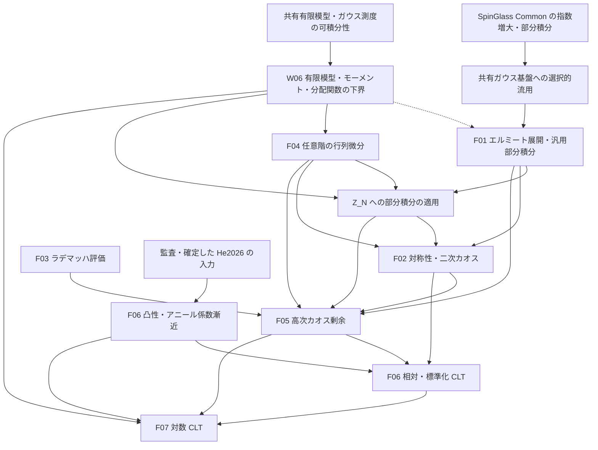

# SYK 中心極限定理の証明構造

## 基準と正式な参照元

2026-09-24、コミット `6621fedfb214cef1b1c3dead0951efdff6bb3e2d` の原稿と手作業を含む Lean 実装に基づき、W06 の再計画に必要な依存関係を更新した。今回の照合はソースの確認であり、外部文献の監査・Lean の再検証・原稿のコンパイルではない。

同日の後続依頼で、関連ビルド・CLT と Annealed_FE の個別検査・26宣言の公理依存を再検証した。有限模型6定理、条件付き漸近5定理、凸関数3補題、共有基盤6宣言は通常公理のみであり、残る6宣言には `sorryAx` がある。正確な対象・仮定・警告は [編集計画の W06 検証記録](EDITING_PLAN.md#w06) に記す。外部入力そのものと最終 CLT は未証明のままである。

正確な原稿の主張は `refs/CLT_SYK.tex` と、そこから読み込む `introduction.tex`・`gaussian-chaos.tex`・`higher-chaoses.tex`・`main-results.tex` を参照する。実装の型と証明項は Lean ソース、横断的な状態は [全体計画](../EDITING_PLAN.md)、残作業・検証根拠は [編集計画](EDITING_PLAN.md) に置く。原稿内の証明、外部結果、Lean の検証済み証明を区別する。

`main-results.tex` の対数 CLT には有効な新証明と `\iffalse` 内の旧証明がある。現在の依存関係は新証明を基準とし、旧集中評価を必須入力に数えない。旧本文の削除はこの再計画に含めない。

## 模型・型・規格化

| 項目 | 現行の内容 |
| --- | --- |
| 模型 | 固定した偶数 `q≥4`、偶数 `N≥q`、独立標準正規座標 `g_I` |
| 演算子 | 自己共役な Majorana 生成子、反交換関係 `ψ_i ψ_j+ψ_j ψ_i=2δ_ij I`、昇順積と位相 `i^(q/2)` |
| ハミルトニアン | `H_N=σ_N Σ_I g_I ψ_I`、`σ_N²=(q-1)!/N^(q-1)` |
| 原稿のトレース | `tr=2^(-N/2) Tr`、標準表現の次元で規格化 |
| Lean のトレース | 一般の非空有限次元表現で、行列の添字型の要素数 `Fintype.card d` で割る `normalizedTrace` |
| 分配関数 | `Z_N(z)=tr exp(-z H_N)`、`z : ℂ`、`Z_N(0)=1` |
| 確率論の逆温度 | 現行原稿・CLT の宣言は `β : ℝ`。共有 Gibbs・集中 API の `β : ℝ≥0` は変更しない |
| 系の極限 | 原稿は偶数 N を通る極限。Lean の `Setting q` は偶数サイズが無限大へ発散する任意の族 |
| 確率空間 | 各サイズの共有ガウス係数空間。分布収束はサイズごとの空間を許す。概収束には別途共通確率空間が必要 |

標準表現への特殊化で原稿のトレースと一致することと、一般表現で外部極限定理を利用できることは別の確認事項である。W06 は前者を照合する。一般表現族への外部入力の供給は R02・F06 に残し、表現独立性を暗黙に仮定しない。

共有の `SYK.partitionFunction` は通常のトレースを使う。CLT の局所定義は既に存在し、通常トレースの分配関数を次元で割ったものとの一致も証明項を持つ。複素解析の API は共有側を使い、零点のない領域や対数の枝は仮定しない。W06 では利用のない複素解析 API の一式追加を求めない。

## 現在の実装と原稿との差

| 対象 | ソース上の状態と残る照合 |
| --- | --- |
| 有限模型の零逆温度・トレース対応・実数性・正値性 | `Main.lean` に証明項あり。9月18日時点の「実数性・正値性が未証明」という記録は履歴 |
| 有限模型・モーメント・対数 | トレース零、`Z≥1`、`Setting.partition_moments`、相対量の期待値1・二乗可積分性、対数の可積分性・中心化恒等式、零逆温度を検証済み。標準表現との規格化の一致も証明済み。公開30定理に `sorryAx` なし。2026-09-26、未使用の Tool を参照監査後に削除し、`lake build CLT` 成功。W06 完了 |
| 共同 CLT | `partition_and_log_partition_clt` は `hFE : AnnealedInput q` を受け取る条件付きの定理文で、`sorry` が残る。二つの個別 CLT はその射影 |
| アニール極限・係数漸近・非退化性 | `hFE` の下での証明項あり。入力自体を構築した結果ではない |
| 凸関数列の導関数収束 | `Lemmas/ConvexDerivatives.lean` の `convex_convergence_deriv_tendstoUniformlyOn`。関数列の局所一様収束を仮定しており、原稿の各点収束から局所一様収束を導く補題全体ではない |
| ガウス–エルミート部分積分・直交性 | `Lemmas/GaussianIBP.lean` に一次元・多変数の結果がある。`Lemmas/GaussianChaos.lean` は符号対称性側との規格化を一致させる。`Lemmas/GaussianHermiteOrthogonality.lean` は正確な内積と有限 Hermite 張る空間への直交射影を証明する。$L^2$ 完全性・無限次数和の収束、および `Setting.Z` への特殊化は未完成 |
| ラデマッハ評価 | `Lemmas/Rademacher.lean` に有限符号平均と `rademacher_encoding` がある。F03/F05 の CLT 側への接続と関連ビルドは未確認 |
| 行列解析と対称性 | `Lemmas/Tool.lean` は有限次元の特異値・Schatten 評価と Hermitian 行列の指数の高階微分評価を証明済みで、`lake build CLT` も成功した。これらを CLT のカオス解析へ接続する作業は F04 に残る。符号ゲージ・Hermite 偶奇則の CLT への接続は F02 に残る |
| その他の補助モジュール | `Preliminaries`・`CLTComponents`・`GaussianConcentration` は引き続き実質的に雛形。新しい補助ファイルの存在だけではこれらの計画済み適用は完了しない |
| Blueprint | `../Chapters/AnnealedFE.lean` でガウス入力構造と別原稿の Rademacher 極限を分け、`../Chapters/CLT.lean` で有限模型の証明状態・条件付き極限・現行の対数 CLT の依存を記録した。Verso の生成・参照検査は休止中 |

### 補助 Lean ファイルの役割

- `Lemmas/GaussianIBP.lean` は、指数傾斜によるシフト恒等式、差商の一様評価、支配収束を用いて、実ガウス分布の Stein 型部分積分を構成する。多変数側では独立標準ガウスと probabilists' Hermite 多項式に対し、`C^{|α|}` の正則性と `η ≤ α` の各偏導関数に対する指数増大から、多重指数部分積分 `hermiteMulti_ibp_of_expGrowth` と両辺の可積分性を与える。多項式の閉性から `hermiteMulti_pair_ibp` も導く。これは `lem:Gaussian-Hermite-IBP` の一般部分に対応するが、`Setting.Z` の各偏導関数の評価を供給したり、この公式を `Z_N` に適用したりするものではない。
- `Lemmas/GaussianChaos.lean` は `GaussianIBP.hermiteMulti` と `CliffordSignParity.lean` の `SYK.hermiteMulti`、二つの標準ガウス測度の定義を照合する。原稿の成長条件で係数の部分積分と両辺の可積分性を後者の記法へ移し、正次数の平均零と Hermite 関数の積の可積分性を証明する。`Lemmas/GaussianHermiteOrthogonality.lean` は原稿の Hermite 内積・階乗ノルムと、任意の有限添字集合が張る空間への直交射影公式を証明する。$L^2$ 完全性を仮定した場合の無限次数和の収束も証明済み。`Lemmas/GaussianHermiteDensity.lean` は一変数実多項式の Hermite 基底、任意の実係数多変数多項式関数の Hermite 有限線形包への包含、$L^2$ クラスへの移送を証明する。多項式クラスがガウス $L^2$ に稠密なら規格化 Hermite 族も稠密であることを証明済み。`Lemmas/GaussianMomentDetermination.lean` は指数モーメントを持つ有限実測度のモーメント一意性、`Lemmas/GaussianPolynomialDensity.lean` は標準ガウスの指数関数と $L^2$ 関数との積の可積分性を証明する。多項式クラスのガウス $L^2$ 稠密性は未証明。
- `Lemmas/Rademacher.lean` は、Boolean ベクトル上の一様平均 `radE`、符号和、および次数 `q` の基本対称式である Rademacher カオスを定義する。Newton 恒等式でカオスを符号和から評価し、独立符号和の指数モーメント評価と組み合わせて、偶数 `q ≥ 4` と `0 ≤ t ≤ c_q N^{-(q-1)}` の下で `𝔼_ε[|S_{N,q}|^3 exp(t|S_{N,q}|)] ≤ C_q N^{3q/2}` を証明する。これは `lem:Rademacher-encoding` の評価部品であり、Gaussian chaos の剰余評価 `prop:higher-chaos-closure` への適用は未完了。
- `Lemmas/ConvexDerivatives.lean` は、割線の差の評価と平均値の定理を準備し、凸関数列の導関数を左右の割線で挟む証明を形式化する。主定理 `convex_convergence_deriv_tendstoUniformlyOn` は、開集合 `I` 上の各関数の凸性・微分可能性、関数列の局所一様収束、極限関数の微分可能性と導関数の連続性を仮定し、任意のコンパクト集合 `K ⊆ I` 上で導関数の一様収束を結論する。原稿で必要な各点収束から局所一様収束への導出や、アニール入力との接続までは含まない。

`Main.lean` は `Annealed_FE/main_result.lean` を直接 import する。同ファイルの `AnnealedFreeEnergyLimit` は高温の共通半径、実解析性、偶性、圧力と導関数の局所一様収束、小温度展開を構造体のフィールドとして受け取る。現行原稿の `prop:annealed-free-energy` は全実軸の偶・凸な `C¹` 関数と明示的評価を主張し、同じ仕様ではない。特に `C¹` から実解析性は出ない。

`Annealed_FE/refs/SYK-HT-arxiv.tex` の主結果は Rademacher 相互作用を使い、物理的 Majorana 生成子の二乗を `I/2` とする別の原稿に属する。同原稿の圧力・自由エネルギー極限を、ガウス模型の全 `Setting q` についての `AnnealedInput` の構築と同一視しない。新しい Annealed_FE 章は両者の接点と未証明状態を示す。

`Annealed_FE` 内には別途 Rademacher 模型・CCG の定義と未完成の定理がある。その存在を Gaussian CLT 用入力の構築と同一視しない。既定ビルド対象から外れていても、CLT の依存先としては構築対象になる。有限模型の成果の公理依存と、import 先に残る未完成箇所は別々に確認する。

## 現行原稿の主張

| TeX ラベル | 主張と監査事項 |
| --- | --- |
| `thm: input` | すべての実数の逆温度でのアニール・クエンチ自由エネルギー極限と微分可能性を He2026 から引用。旧計画の「原稿内の大数則証明が欠けている」課題をそのまま適用しない。引用・概収束の量化・`ell_p` の記号は要監査 |
| `thm:partition-clt` | 小さい `|β|` で相対・標準化 CLT。標準化の定理文は零を含むが、証明と Lean は `β≠0` を要求する。残る `tilde_beta_q` の意味も要確認 |
| `cor:free-energy-clt` | 同じ範囲と分散で中心化した対数 CLT。新証明は集中不等式を使わない。`beta_p` の記号は要確認 |
| `prop:annealed-free-energy` | 全実軸の圧力・導関数の局所一様収束、偶性・凸性・`C¹`、小温度展開と非零逆温度の符号。He2026 の引用と内部の導出は分けて監査 |

相対量・スケール・極限分散は
```text
Y_N = Z_N / E Z_N,  a = q/2 - 1,
ρ²(β) = (q!/2) β² (ℓ_q'(β))².
```
相対 CLT は `N^a(Y_N-1)`、対数 CLT は `N^a(log Z_N-E log Z_N)` の分布収束である。標準化は `(Z_N-E Z_N)/sqrt(Var Z_N)`。零逆温度の前二者の退化極限と、零分散での標準化を混同しない。Lean の共同定理は非零小温度で「すべての有限サイズの分散正値性」も要求するため、漸近分散の正値性だけではその結論を充足しない。

## カオス分解と係数の漸近

現在の原稿は次の二つの同値な記法を使う。
```text
M_N = choose(N,q),  Q_N = M_N⁻¹ Σ_I(g_I²-1),
A_N(β) = (β/2) ∂_β log E Z_N(β),
S_N = (2M_N)^(-1/2) Σ_I(g_I²-1),
c_N(β) = β ∂_β log E Z_N(β) / sqrt(2M_N),

Y_N - 1 = A_N Q_N + R_N = c_N S_N + R_N,
R_N = Σ_{r≥3} P_r Y_N.
```

符号ゲージ対称性・Hermite 部分積分で一次・二次カオスを同定し、Duhamel 微分評価と Rademacher 符号化・指数モーメントにより `‖R_N‖₂²=O(N^(-3a))` を得る。係数の同一性には相互作用添字間の対称性の根拠も必要であり、R03 で監査する。アニール導関数の極限と `M_N~N^q/q!` により
```text
A_N/N → (β/2) ℓ_q'(β),
N^a c_N → sqrt(q!/2) β ℓ_q'(β).
```
古典的 CLT と Slutsky を適用し、標準化には直交分解による分散漸近と非退化性を別に使う。

## 対数 CLT の新しい経路

`W_N=log Y_N` とすると
```text
N^a(log Z_N-E log Z_N)
  = N^a(W_N-(Y_N-1)) + N^a(Y_N-1) - N^a E W_N.
```
最初の項は対数の局所近似と確率的有界性、二番目は相対 CLT を使う。最後の期待値の制御は次の入力に依存する。

| 入力・評価 | 担当 |
| --- | --- |
| 相互作用・H のトレース零、Jensen による `Z_N≥1`、モーメントと正しい中心化の恒等式 | W06 |
| `‖R_N‖₂²=O(N^(-3a))` | F05 |
| `c_N=O(N^(-a))`、アニール入力から `log E Z_N=O(N)` | F06 |
| `sup_N E S_N^4<∞`、`P(Y_N<1/2)=O(N^(-3a))`、期待値の誤差 | F07（R05 で監査） |

`h(y)=y-1-log y` に対し `E h(Y_N)=-E log Y_N`。`Y_N≥1/2` では二次モーメントで評価し、`Y_N<1/2` では `h(Y_N)≤-log Y_N≤log E Z_N` を使う。これにより
```text
0 ≤ -E log Y_N = O(N^(-2a)) + O(N^(1-3a))
               = O(N^(-2a)) = o(N^(-a))  (a≥1).
```
分布収束だけからこれらのモーメント評価は推論しない。W06 は有限模型の入力までを供給し、この漸近論証全体は F07 に残す。

## 外部入力と未確定事項

現行原稿は He2026 の Theorem 1.1、Proposition 3.3、Theorem 2.5 を引用し、Schwinger–Dyson 圧力・その微分公式・正の Lehmann 表現を用いる。原稿内の変換は `H_N^He=2^(-q/2)H_N`、`s=2^(q/2)|β|` であり、符号の処理にはガウス分布に従う相互作用係数の対称性を使う。ここでは引用内容の正しさを未確認のまま記録し、外部定理を検証済みとはしない。

圧力・導関数の収束、零での接続、明示的な二次・四次誤差、`βℓ_q'(β)>0` の原稿内導出を R02・R03 で照合する。古い GPSZ2026 の解析性を前提とした説明を現行の証明へ自動的に流用しない。He2026 の正確な入力に合わせるために `AnnealedInput` や最終定理文を変更する場合は、その変更案と根拠を先に確定する。これは W06 の有限模型証明とは独立に進められる。

R04 は `thm: input` の引用監査、F08 はその Lean 上の扱いの仕様再検討とする。内部での大数則証明を自動的に再開せず、W06・最終 CLT の前提にも追加しない。

## 依存関係と実装の分担

次は作業上の待ち合わせと数学的な入力を合わせた図であり、現行の import グラフや形式化の完了状態を表すものではない。W06 から F01 への破線は実装順序を示す。共有ガウス基盤の調査は W06 と並行でき、汎用のガウス–エルミート部分積分は W06 を数学的に必要としない。



流用元は SpinGlass のコミット `dc1d3820af6e443c09bd1177ec3e409cf0640d5c` とする。候補は [ExpGrowth.lean](https://github.com/or4nge19/SpinGlass/blob/dc1d3820af6e443c09bd1177ec3e409cf0640d5c/Common/Mathlib/Probability/Distributions/Gaussian/ExpGrowth.lean) の `HasExpGrowth`・可積分性の補題と、[GaussianIntegrationByParts.lean](https://github.com/or4nge19/SpinGlass/blob/dc1d3820af6e443c09bd1177ec3e409cf0640d5c/Common/Mathlib/Probability/Distributions/GaussianIntegrationByParts.lean) の `stein_lemma_gaussianReal_of_expGrowth'` である。先方の Lean/mathlib は `4.34.0-rc2`、現行ワークスペースは `4.32.2` であり、全体を Lake の依存に加えるのではなく、必要な証明を選んで既存の `SYK.Probability.GaussianConcentration` に統合する。既存の `gaussianReal_stein` と重複させず、流用する証明・仮定・出典を個別に確認する。移植・コンパイルと公理依存の検査は未実施である。

原稿の `lem:Gaussian-Hermite-IBP` は `f ∈ C^{|α|}` を仮定し、成分ごとに `η ≤ α` を満たす各偏導関数について、ある `C_η > 0` による `|∂^η f(G)| ≤ C_η exp(C_η ‖G‖)` を要求する。2026-09-26、`GaussianIBP.lean` の `hermiteMulti_ibp_of_expGrowth` で、この一般部分を同じ仮定のまま証明した。共有 `pi_gaussian_stein_coord` は選択座標だけの成長評価を使い、偏導順序の交換と Hermite 因子の成長評価から反復の入力を導く。両辺の可積分性も `hermiteMulti_ibp_integrable` で証明済み。ユーザーの指定により `Z_N` の正則性・成長評価と特殊化は F04 に残す。有限 Hermite 射影は別に証明したが、エルミート展開の $L^2$ 完全性と無限次数和の収束は、この一般部分や有限射影からは従わない。検証根拠は [編集計画](EDITING_PLAN.md#formalization) を参照する。

模型から独立したガウス基盤は利用側を import しない。Model が CLT を import する依存も作らない。`SuperConcentration` は既存の独立成果として維持し、新しい対数 CLT の必須入力にはしない。現行 Lean の `Annealed_FE → CLT/Main` の import は記録して保持し、入力の再設計時に配置先と依存を再検討する。

既存のファイルを使い、W06 で新しいモジュール階層は作らない。共有すべきトレース零・行列評価だけを Model の既存ファイルへ置く。既存の凸関数補題と条件付き漸近補題を再実装せず、F06 で不足する入力を補う。

| Lean ファイル | 原稿との対応・用途 |
| --- | --- |
| `../Probability/GaussianConcentration/StandardGaussian.lean` などの既存ファイル | F01 の模型に依存しない指数増大・可積分性・部分積分。現時点では流用・移植前 |
| `Main.lean` | `subsec:SYK-model`、`thm:partition-clt`、`cor:free-energy-clt`、有限模型と条件付きアニール入力 |
| `Lemmas/Preliminaries.lean` | `lem: parity rule lemma`、`lem:Gaussian-Hermite-IBP` の模型への適用、`lem:Z-derivative-bound`、`lem:Rademacher-encoding` の接続用雛形 |
| `Lemmas/CLTComponents.lean` | `lem:exact-second-chaos`、`prop:higher-chaos-closure`、`prop:annealed-free-energy` |
| `Lemmas/GaussianIBP.lean` | 汎用のガウス–エルミート部分積分。`lem:Gaussian-Hermite-IBP` の `Z_N` への適用は F04 と接続して検査する |
| `Lemmas/Rademacher.lean` | `lem:Rademacher-encoding` に対応する有限符号平均と指数モーメント評価。F03/F05 への統合は未完了 |
| `Lemmas/ConvexDerivatives.lean` | `lem:convex-derivatives` の導関数収束補題。局所一様収束などを仮定し、原稿の入力を導く不足部分は F06 に残る |
| `Lemmas/GaussianConcentration.lean` | 旧証明の `eq:centered W_N tail`・`eq:centered W_N exp` の雛形。W06 で実装も削除も要求しない |

新しい有限模型の結果に TeX ラベルがない場合は、所在の節と証明を記録し、架空のラベルを作らない。Blueprint の更新細目は Chapters の計画に置く。
