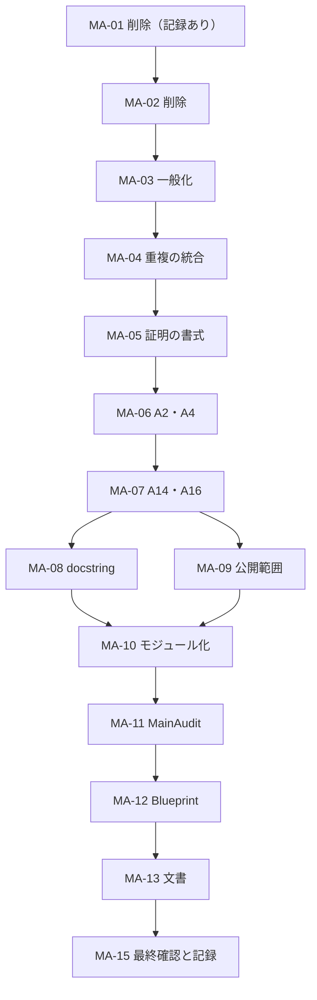

# SYK の未完了作業

この文書は未完了課題の状態と着手条件を管理する。規則は [AGENTS.md](AGENTS.md)、現行の数学的仕様は各構造文書、完了した成果と検証は [作業履歴](WORK_HISTORY.md) を参照する。数学の新しい実装課題はなく、残る実装作業は監査に基づく整備 `MAINT-AUDIT` である。

## 残る作業

| 作業ID | 課題 | 状態・着手条件 | 担当・統合 |
| --- | --- | --- | --- |
| `MAINT-AUDIT` | 2026-10-13 の監査に基づくコード・文書・Blueprint・設定の整備 | 内容はすべて研究者と確認済み。MA-00 と MA-14 は完了した。[小項目](#小項目) の順に MA-01 から実行する | 実行は任意のセッション。統合とコミットは研究者 |
| `BLUEPRINT-PAGES` | GitHub Pages での Blueprint 公開 | 公開は CI の workflow の deploy job が行う（MA-14）。Pages の Source 設定、初回 build・deploy と公開 URL の確認待ち | 研究者が確認 |
| 公開の経路 | `lakefile.toml` のメタデータ、README の利用手順（`require` で使う方法）、親の雛形なしでの `SYK`・`SYKBlueprint` 単体のビルドの CI | 保留。ライセンスと引用情報は [README](README.md#licensing-and-citation)、[LICENSE](LICENSE)、[原稿の著作権表示](Paper/COPYRIGHT.md)、[CITATION.cff](CITATION.cff) に設定済み。残る公開手順は別課題とする | 未割当 |

## MAINT-AUDIT：監査に基づく整備

### 前提

- 調査の基準は `f5ddd27`（2026-10-12、PR #52 のマージ）である。そこでは `lake build SYKBlueprint`、HTML 生成、`vbp check` が成功し、数学コードの警告はなく、Blueprint 側には外部依存の universe 警告2件だけがある。主要な定理は通常公理だけに依存する。
- 本計画の内容は、2026-10-13 に研究者と項目ごとに確認して決めた。本計画を実行する依頼は、ここに書いた変更の承認を含む（AGENTS.md「作業範囲と分担」）。計画にない変更が必要になったときは、AGENTS.md に従って報告し、判断を待つ。
- MA-00（規則の追記）は本計画を記録したコミットで、MA-14（設定）はそれに続く2つのコミットで完了した。次の作業は MA-01（コードの変更）から始める。
- 行番号は調査時点の目安である。作業では宣言名で対象を特定する。一覧は調査時点の結果なので、各小項目の着手時に参照と利用を調べ直す。
- 着手前に、ワークスペース・本リポジトリ・対象の話題の AGENTS.md を読む。特に「作業範囲と分担」（小項目ごとの検証、計画の状態の更新、コミットの提案と研究者のコミット待ち）、「公開 API の変更」（互換用の別名を作らない）、「検証の補助」（検査の方法）に従う。
- Lake のコマンドは、ワークスペースのルート（`SYK_CLT/` の親）で実行する。原稿本文は編集しない。

### この作業で適用する方針

研究者が決定した。1 は MA-00 で AGENTS.md の規則にした。2〜5 はこの作業だけの指示で、AGENTS.md には書かない。

1. **一般化：** 仮定を弱める変更（未使用の型クラス引数の除去を含む）と、結論を強める変更は、個別の承認なしに適用する。仮定を強める変更と、結論を弱める変更はしない。`SYK.CLT.Setting` と `SYK/Main.lean` の `Model` の `nonempty` フィールドは外さない。0次元の行列でも反交換関係は自明に成り立つので、これを外すと Z_N ≡ 0 となり CLT が偽になる。
2. **削除：** 使われていない宣言は、API であっても削除する。ただし、次のものは残す。
   - 原稿の結果の発展に関わる部分（定量評価）
   - mathlib への提供を検討できる汎用的な部分
   - 研究者が個別に残すと決めたもの（DEL-5 の複素解析の部分、DEL-8 の β=0 の補題）

   作業履歴には、手戻りの大きい削除（DEL-1、DEL-2）だけを、判断理由と復元元のコミット（`f5ddd27`）とともに記録する（`WORK_HISTORY.md` の冒頭の記録方針）。
3. **公開範囲：** 他のファイル・Blueprint・文書・モジュール docstring から参照されない証明の部品は、非公開にする。次のものは公開のままにする：公開されている定理の文に現れる定義、汎用的な結果、原稿の式に対応する結果、定量評価、公開されている定義の基本的な性質。
4. **用語：** `β` は逆温度である。小さい |β| は高温であり、「small temperature」「real temperature」とは書かない。「superconcentration」という語は変えない。
5. **コメント：** 宣言の説明は `/--` の docstring で書く。経緯、計画、存在しないファイルや旧名をコードのコメントに書かない。

### 決定事項の一覧

| 項目 | 決定 | 実行する小項目 |
| --- | --- | --- |
| 一般化の規則（AGENTS.md）と、作業履歴に残す基準（`WORK_HISTORY.md` の冒頭） | 追記した | MA-00（完了） |
| DEL-1（`ConvexDerivatives.lean`）、DEL-2（標準表現の直交性） | 削除し、作業履歴に記録する | MA-01 |
| DEL-3（未使用）、DEL-4（1変数の稠密性）、DEL-6（4次モーメント上界の包み）、DEL-7（L=0 の裾）、DEL-9（Jordan–Wigner の `simp` 補題） | 削除する | MA-02 |
| DEL-5（複素解析の部分）、DEL-8（β=0 の補題と有限模型の小さな補題） | 残す | — |
| GEN-1（`[Nonempty d]`。定義からも外し、模型の規約の記述を直す）、GEN-2（`[CompleteSpace E]`）、GEN-3（`0 < L`） | 外す | MA-03 |
| 重複の統合と書式（REF-1〜REF-3、重複した `noncomputable section`） | 行う | MA-04 |
| A17：`GaussianConcentration` の証明の書式の整理 | 行う | MA-05 |
| A2：`exists_small_temperature_*` を半径のない定理に置き換える | 行う | MA-06 |
| A4：主定理の層の整理（個別の定理3つの削除） | 行う | MA-06 |
| A14：`multiIndices_degree` の改名 | 行う | MA-07 |
| A16：汎用補題の汎用層への移動 | 行う | MA-07 |
| docstring とコメントの修正 | 行う | MA-08 |
| A6：公開範囲（非公開化の一覧） | 行う | MA-09 |
| A19：モジュールシステムへの移行（import の整理を含む） | 行う | MA-10 |
| A15：`SYK/Main.lean` は1ファイルのまま、検査用の `SYK/MainAudit.lean` を置く。不変条件を `SYK/CLT/ARCHITECTURE.md` とモジュール docstring に書く | 行う | MA-11 |
| A11：Blueprint の構成の変更と、事実関係の修正 | 行う | MA-12 |
| A9：ルートの `README.md`（著者順、`SYK/Main.lean` の案内）と、その他の文書 | 行う | MA-13 |
| A1：manifest の `inherited`。`experimental.module` の削除。A10：CI の二つの workflow を一つにまとめ、Lean の検証、Blueprint の検証、公開を分ける。A12：`.gitignore` の2行の削除 | 行った | MA-14（完了） |

次のことは行わない。
- **A13：二つの規格化トレースの統一と、`SYK.CLT.partitionFunction` の改名。**
  - 設計（`SYK/Model/ARCHITECTURE.md`、`SYK/CLT/ARCHITECTURE.md`）では、模型は通常のトレースを使い（`SYK.partitionFunction`）、CLT は原稿どおりの規格化トレースを使う（`SYK.CLT.partitionFunction`）。文献に両方の流儀があるので、名前空間で表し分けている。
  - 二つの規格化トレース（`SYK.normalizedTrace` と `SYK.MatrixAnalysis.normalizedTrace`）を別々に保つのは、模型の層が行列解析の層に依存しない向きを保つためである。二つをつなぐのは `SYK.CLT.Setting.Z_eq_traceExp` などの補題である。
- 「superconcentration」の用語の変更
- Blueprint の原稿との対応を出典メタデータ（`source_document`）へ移すこと。本文の LaTeX ラベルでの参照を維持する。原稿の確定後に、改めて検討してよい。
- 方針2〜5を AGENTS.md の規則にすること
- CI を PR で起動すること
- 原稿の Lean 付録の変更。`SYK/Main.lean` への案内は README に置く。

### 小項目

小項目ごとに検証し、本表の状態を同じ差分で更新して、コミットメッセージを提案する。研究者のコミットを待ってから次へ進む。

| 小項目 | 内容 | 状態 |
| --- | --- | --- |
| MA-00 | 一般化の規則と、作業履歴に残す基準の追記 | 完了（本計画と同じコミット） |
| MA-01 | DEL-1、DEL-2 と作業履歴の記録 | 完了 |
| MA-02 | DEL-3、DEL-4、DEL-6、DEL-7、DEL-9 | 完了 |
| MA-03 | GEN-1〜GEN-3 | 完了 |
| MA-04 | REF-1〜REF-3 と書式 | 完了 |
| MA-05 | A17 | 完了 |
| MA-06 | A2、A4 | 完了 |
| MA-07 | A14、A16 | 未着手 |
| MA-08 | docstring とコメント | 未着手 |
| MA-09 | 公開範囲 | 未着手 |
| MA-10 | モジュールシステムへの移行 | 未着手 |
| MA-11 | `SYK/MainAudit.lean` と不変条件の記述 | 未着手 |
| MA-12 | Blueprint | 未着手 |
| MA-13 | 文書 | 未着手 |
| MA-14 | 設定（MA-01 より先に行った） | 完了 |
| MA-15 | 最終確認と記録 | 未着手 |

### 共通の検証と注意

- 変更した Lean ファイルは、それぞれ `lake lean SYK_CLT/<パス>` で検査する。小項目の終わりに `lake build SYK` を実行する。Blueprint の章や、`lean :=` が参照する宣言を変えた場合は、`lake build SYKBlueprint`、HTML の生成、`vbp check` を行う（[README の Blueprint の節](README.md#blueprint) のコマンド）。新しい警告を出さない。
- 削除・非公開化・改名・移動の前に、`rg -nw <名前> SYK_CLT` で Lean、Blueprint、`*.md` からの参照を調べ、同じ小項目の中で直す。宣言名を含まない説明文（構造文書の段落など）も、内容から探して直す。削除・移動で不要になった import は、同じ小項目で除く。`WORK_HISTORY.md` は当時の記録なので直さない。互換用の別名は作らない。
- `rfl` で閉じる `simp` 補題は、使われても名前が証明項に残らない。削除の後のビルドで暗黙の利用がないことを確かめる。
- Blueprint の `lean :=` から、存在しない宣言や非公開の宣言を参照しない。
- `SYK/Main.lean` の証明は、他のファイルの定義を展開して一致させている。定義の形を変えた小項目では、`lake lean SYK_CLT/SYK/Main.lean` で接続が壊れていないことを確かめる。

### MA-00 規則の追記（完了）

- `SYK_CLT/AGENTS.md` の「作業範囲と分担」に、一般化は承認なしに行ってよいという、ワークスペースの規則に対する明示的な指示を加えた。
- `WORK_HISTORY.md` の冒頭の記録方針に、宣言の削除は手戻りの大きいものだけを記録するという基準を加えた。

### MA-01 削除（作業履歴に記録する）

**DEL-1 `SYK/Analysis/ConvexDerivatives.lean`（ファイル全体）**
- 対象：`SYK.Analysis.convex_convergence_deriv_tendstoUniformlyOn`、`abs_slope_sub_le`、`abs_slope_sub_deriv_lt`
- 理由：原稿の `lem:convex-derivatives` のうち導関数の収束の部分にあたるが、`AnnealedInput` が導関数の収束を直接仮定しているため、どこからも使われない。
- 付随する更新：
  - Blueprint `CLT.lean`：import を除く。ノード `clt_convex_derivative_transfer`（原稿の `lem:convex-derivatives`）は名前を変えずに残し、`lean :=` を外して未形式化のノードにする。本文の「The Lean convexity lemma gives …」は、原稿の補題の主張に書き直す（構成は MA-12 で直す）。
  - `AGENTS.md` の名前空間の表から `SYK.Analysis` の行を除く。
  - `SYK/CLT/ARCHITECTURE.md`：配置の表、「現行原稿の主張」の `lem:convex-derivatives` の行（Lean の入口なし・未形式化とする）、「仮定する命題と形式化の範囲」の除外項目「各点収束からの凸収束補題の補完」（補題全体が未形式化になるので書き直す）
  - `SYK/CLT/README.md` の `ConvexDerivatives` への言及

**DEL-2 標準表現の直交性**
- 対象：
  - `SYK.standardInteraction_orthonormal` と private の `SYK.interaction_trace_eq_zero`（`SYK/Model/StandardRepresentation.lean`）
  - `SYK.MajoranaSystem.interactionOperator_mul_generator_of_not_mem`（`SYK/Model/Majorana.lean`）
- `SYK.normalizedTrace_one` は `SYK.CLT.partitionFunction_zero`（DEL-8 で残す）が使うので残す。
- 付随する更新：
  - Blueprint `Model.lean`：ノード `standard_interaction_orthonormality` を証明ブロックごと削除する。原稿に対応する主張がなく、Lean の結果を示すためだけのノードだからである。
  - `SYK/Model/ARCHITECTURE.md`：直交性への言及をすべて直す。規約の表のトレースの行（規格化トレースを使う場面）、「直交性」の意味の段落、標準行列表現の行、汎用の層の「規格化トレースは直交性など…」の文、`standardInteraction_orthonormal` の段落、「生成子が添字集合に含まれる場合・含まれない場合の相互作用との交換則も同じ共有層に置く」の文（`_of_not_mem` の削除で、含まれない場合が事実でなくなる）。

**作業履歴への記録**

DEL-1 と DEL-2 について、削除した結果、原稿との対応、削除の理由、復元元（`git show f5ddd27:SYK/Analysis/ConvexDerivatives.lean` など）を短く記す。

### MA-02 削除

- **DEL-3 未使用の宣言：**
  - `SYK.couplingSpace_card`（`SYK/Model/GaussianDisorder.lean`）。`SYK/SuperConcentration/ARCHITECTURE.md` の言及も直す。
  - private の `SYK.MatrixAnalysis.SVDAux.eigenvalues_adjoint_comp_self_of_positive`（`SYK/Analysis/Matrix/TraceExponential.lean`）
  - `SYK.CLT.Setting.Z_firstChaos_eq_zero` と `SYK.CLT.Setting.integral_Z_mul_hermite_eq_zero`（`SYK/CLT/Chaos/PartitionSymmetry.lean`）。モジュール docstring、Blueprint `CLT.lean` の本文、`SYK/CLT/ARCHITECTURE.md` の `lem: parity rule lemma` の行の参照を、実際に使われている `Setting.integral_Z_mul_hermite_eq_zero_pi` に直す。
- **DEL-4 1変数の多項式稠密性（`SYK/Probability/GaussianChaos/PolynomialDensity.lean` のうち、多変数版より前の部分）：**
  - 対象：`gaussianExp_memLp_two`、`gaussianLp_integrable_mul_exp`、`gaussianPositiveMeasure`、`gaussianPositiveMeasure_finite`、`gaussianPositiveMeasure_integrable_exp`、`integral_gaussianPositiveMeasure`、`gaussianPositiveMeasure_integrable_pow`、private の `gaussianPositivePart_mul_pow_integrable`、`gaussianPositiveMeasure_moments_eq_of_orthogonal`、`gaussianPositiveMeasure_eq_neg_of_orthogonal`、`gaussianLp_eq_zero_of_polynomial_moments_zero`、`gaussianMonomial_memLp`、`gaussianMonomialLp`、`gaussianMonomialLp_dense`
  - 多変数版は1変数版を参照しない（調査時点で確認済み）。
  - Blueprint：`clt_hermite_complete` の `lean :=` から `gaussianMonomialLp_dense` を除く。`clt_exponential_moment_determination` の `lean :=` と本文を、多変数版（`gaussianExpDual_memLp_two`）に替える。
- **DEL-6 4次モーメント上界の包み：**
  - 対象：`SYK.CLT.normalizedQuadraticSum_fourth_moment_le` と `SYK.CLT.Setting.normalizedQuadraticSum_fourth_moment_le`（`SYK/CLT/Quadratic/IndependentFourthMoment.lean`）
  - Blueprint：`clt_gaussian_quadratic_moments` の `lean :=` と本文
- **DEL-7 Lipschitz 定数 0 の裾評価：**
  - 対象：`SYK.GaussianConcentration.product_standardGaussian_two_sided_tail_zero`（`SYK/Probability/GaussianConcentration/Lipschitz.lean`）
  - Blueprint：`GaussianConcentration.lean` のノード `gaussian_zero_lipschitz_tail` を削除する（原稿に対応する主張がない）。
  - `SYK/SuperConcentration/ARCHITECTURE.md` の「零の場合に裾の事象の測度が零になる定理は、分けて述べる」を除く。
- **DEL-9 Jordan–Wigner の `simp` 補題：**
  - 対象：`SYK.jordanWigner_zero`、`SYK.jordanWigner_succ`
  - 削除後のビルドで暗黙の利用がないことを確かめ、利用があれば残して、小項目の表の MA-02 の行に記す。
  - Blueprint：`standard_majorana_relations` の `lean :=`

### MA-03 一般化

- **GEN-1 `[Nonempty d]` の除去：**
  - 対象：`SYK.normalizedTrace`、`SYK.thermalDensity`（`SYK/Model/FiniteDimensionalGibbs.lean`）、`SYK.logPartition`（`SYK/SuperConcentration/Main.lean`）、`SYK.MatrixAnalysis.normalizedSchattenNorm_conjDiag_pow`（`SYK/Analysis/Matrix/TraceExponential.lean`）
  - 続けて、これで不要になる `[Nonempty d]` を外す。節の `variable` から自動で入るもの（`SYK.CLT.partitionFunction` など）が該当する。`#lint` の `unusedArguments` とビルド時の警告で確かめる。
  - 値が次元に依存する定理（`Z ≥ 1`、`normalizedTrace_one`、実逆温度での正値性・局所非零性など）の仮定と、`Setting`・`Model` の `nonempty` は残す。
  - 規約の記述を直す：
    - `SYK/Model/ARCHITECTURE.md`：「規格化トレースと…API には `[Nonempty d]` を要求する」を、「正値性・局所非零性などの定理に要求する。定義は空の添字型でも値をとる（規格化トレースは 0）」という趣旨に直す。
    - `SYK/CLT/ARCHITECTURE.md`：二つの規格化トレースを別々に保つ理由から「非空型」を除き、スカラー（ℂ と一般の `RCLike`）、定義式、依存の向きの違いとする。
    - 二つの `normalizedTrace` の docstring：非空型についての記述を、上に合わせて直す。
- **GEN-2 `[CompleteSpace E]` の除去：**
  - 対象：`SYK.GaussianChaos.integral_gaussianCouplings_sign` と `integral_gaussianCouplings_perm`
  - 連鎖して不要になれば、`integral_gaussianCouplings_signed_perm` からも外す。
- **GEN-3 `0 < L` の除去：**
  - 対象：`SYK.GaussianConcentration.integrable_exp_smul_lipschitz`、`integrableExpSet_lipschitz_eq_univ`、`herbst_of_cov_bound`
  - L ≤ 0 なら `L.toNNReal = 0` で F は定数なので、仮定なしで成り立つ。
  - そのうえで、`Lipschitz.lean` の L=0 を別扱いしている部分（`eq_const_of_lipschitz_zero`、`centered_eq_zero_of_lipschitz_zero`、`product_standardGaussian_hasSubgaussianMGF` の場合分け）を簡単にできるか確かめる。公開されている結論は変えない。
  - `SYK/SuperConcentration/ARCHITECTURE.md` の L = 0 の扱いの段落（「`L > 0` の場合の既存の証明を保ち…」）を、変更後の仮定と証明に合わせる。

### MA-04 重複の統合と書式（定理文は変えない）

- **REF-1：** `SYK.MajoranaSystem.listProduct_eq_sign_smul_of_perm` を `SYK/CLT/Chaos/CliffordSignParity.lean` から `SYK/Model/Majorana.lean` へ移し、同じ帰納法を繰り返している `listProduct_eq_smul_of_perm` を削除する。後者の利用箇所（`Majorana.lean` の `psiProduct_mul_generator_of_mem`、`SYK/SuperConcentration/MajoranaBound.lean`）では、符号付きの版から存在の部分だけを取り出す。Model から CLT への import は作らない。
- **REF-2：** `SYK/SuperConcentration/Main.lean` の上側・下側・両側の裾の3定理に共通する部分を、補助補題へ括り出す。共通部分は、Lipschitz 定数 `|β|/√q`、`L² = β²/q`、指数の書き換え（約20行）である。`logPartition_hasSubgaussianMGF` の証明が手本になる。
- **REF-3：** `SYK/CLT/Quadratic/IndependentFourthMoment.lean` の private `centeredSquareCoordinate_memLp_four` と、`GaussianFourthMoment.lean` の `centeredGaussianSquares_sum_memLp_four` の証明に共通する、座標ごとの `L⁴` 補題を `GaussianFourthMoment.lean` に置いて共有する。
- **書式：** `SYK/Analysis/Matrix/TraceExponential.lean` で重複している `noncomputable section` を一つにする。`@[expose] public section` と import の整理は MA-10 で行う。

### MA-05 証明の書式の整理（A17、定理文は変えない）

- 対象：`SYK/Probability/GaussianConcentration/` に残る、取り込み時の書式の証明。
  - `StandardGaussian.lean`：`integrable_exp_smul_lipschitz`、`herbst_of_cov_bound`、`integrable_abs_coord_mul_exp_c_sum_abs_pi`、`pi_gaussian_stein_coord`、`gradient_toLp_coord_eq_fderiv`、`gaussian_ibp_integrable`
  - `Smooth.lean` と `Lipschitz.lean` で、同じ書き方をしているもの
- 見分け方：行末のセミコロンの連鎖、場合分けしたうえでの `nlinarith`、`apply_rules`、`simp +zetaDelta at *`、括弧の内側の空白。
- ワークスペースの AGENTS.md に従い、明示的な項と基本的なタクティクで書き直す。`simp`・`nlinarith` などは、数学的な役割がはっきりした局所的な目標に限る。

### MA-06 半径のない分散の正値性と、主定理の層の整理（A2、A4）

- **A2：**
  - `SYK.CLT.limitVariance_pos_of_ne_zero`（`hFE : AnnealedInput q S` の下で `β ≠ 0 → 0 < limitVariance q hFE.ℓ β`）を `SYK/CLT/Basic.lean` に置く。現在の `exists_small_temperature_variance_pos` の証明から半径を除いた形で示せる。
  - `exists_small_temperature_sign` と `exists_small_temperature_variance_pos` を削除し、利用箇所（`SYK/CLT/Main.lean` の `partition_clt`、`SYK/CLT/Limit/StandardizedCLT.lean`）を直す。半径の `min` が一つ減るだけで、主定理の文は変わらない。
  - Blueprint の `clt_conditional_nondegeneracy` を直す。
- **A4：**
  - `SYK.CLT.log_partition_clt`、`SYK.CLT.standard_partition_clt`、`SYK.CLT.standard_log_partition_clt` を削除する。共同定理2つ、`SYK.CLT.partition_clt`、`SYK/Main.lean` の3定理は残す。
  - 付随する更新：
    - `SYK/CLT/StandardModel.lean`、`SYK/CLT/Main.lean`
    - Blueprint の `log_partition_clt`、`partition_function_clt`、`clt_standard_model_application` の `lean :=`
    - `SYK/CLT/ARCHITECTURE.md`（主張の表と標準模型族の表）、`SYK/CLT/README.md`

### MA-07 改名と汎用補題の移動（A14、A16）

**A14：改名**

| 現在の名前 | 新しい名前 |
| --- | --- |
| `SYK.GaussianChaos.multiIndices_degree` | `SYK.GaussianChaos.multiIndicesOfDegree` |
| `mem_multiIndices_degree` | `mem_multiIndicesOfDegree` |
| `sum_multiIndices_degree` | `sum_multiIndicesOfDegree` |
| `multiIndices_degree_zero` | `multiIndicesOfDegree_zero` |

- 文に `multiIndices_degree` が現れる他の定理も、同じ規則で改名する（AGENTS.md の命名規則：既存の名前の lowerCamelCase を一つの構成要素として保つ）。
- 文がこの定義に触れない `finite_multiIndices_degree_le` は、名前を変えない。

**A16：汎用補題の移動（名前空間が変わる）**

| 補題 | 移動先のファイル | 名前空間 |
| --- | --- | --- |
| `fourth_moment_add_of_indep` と `second_moment_add_of_indep`（`CLT/Quadratic/IndependentFourthMoment.lean`。後者は同じファイルの private の `centeredSquareSum_second` が使う） | 新しいファイル `SYK/Probability/IndependentMoments.lean` | `SYK.Probability` |
| `norm_sq_hermiteFiniteProjection`、`norm_sq_hermiteDegreeProjection`（`CLT/Chaos/HigherChaosProjection.lean`） | `SYK/Probability/GaussianChaos/Orthogonality.lean` | `SYK.GaussianChaos` |
| `inner_hermiteDegreeProjection_eq_zero`（`CLT/Chaos/HigherChaosRemainder.lean`） | 同上 | `SYK.GaussianChaos` |
| `hermiteLp_zero`、`multiIndicesOfDegree_zero`（`CLT/Chaos/ZeroChaos.lean`） | 同上 | `SYK.GaussianChaos` |

- 新しいファイルは、汎用の層に置き場所がないので作る。
- `inner_hermiteDegreeProjection_eq_zero` は、決定時に挙げた5つの補題と同じ性質を持つ汎用の補題（異なる次数のカオスは直交する）なので、一緒に移す。
- 移した補題の参照（Lean、Blueprint、構造文書）を直す。

### MA-08 コメントと docstring

`SYK/CLT/`

- `Basic.lean`：モジュール docstring の「`Main.lean`」を `SYK/CLT/Main.lean` と明記し、「This supersedes the planned nonnegative-temperature restriction」を削る。
- `Limit/StandardizedCLT.lean`：モジュール docstring の「at nonzero small temperatures」を「at small nonzero inverse temperature」に直す。
- `Chaos/PartitionDerivatives.lean`：
  - `Setting.disorderMatrix`：存在しない `Tool` を参照している。「ハミルトニアン g ↦ H_N(g) を、L² 作用素ノルムを持つ行列空間への連続な実線形写像として見たもの」と書く。
  - `exists_Z_exp_bound_all_beta`：「全ての β と g について Z_β(g) ≤ exp(C|β|‖g‖) となる C ≥ 0 がある」と書く。
  - `meanZ_hasDerivAt`：「real temperature」を「real inverse temperature」に直す。
  - `integral_Z_mul_sq_sub_one_ibp`：恒等式 E[Z(g_I²−1)] = E[g_I ∂_I Z] を書く。
  - モジュール docstring：「the existing normalized model」を削り、`PartitionHigherDerivatives.lean` の高階微分評価の土台でもあることを書く。
  - docstring のない公開宣言（`Z_eq_traceExp`、`norm_traceExp_disorder`、`Z_hasDerivAt_beta`、`coordDeriv_Z_eq` など）に docstring を加える。`Z_eq_traceExp` には、CLT の分配関数の定義に使う `SYK.normalizedTrace` と、`traceExp` が使う `SYK.MatrixAnalysis.normalizedTrace` を橋渡ししていることを書く。
- `Limit/QuadraticGaussianVariance.lean`：
  - モジュール docstring を内容に合わせる。内容は、正規化二次和 Q_N の単位ノルム、Var Y_N = c_N² + ‖R_N‖² の分解、Y_N と Z_N の尺度付き分散の極限、Var Z_N = (E Z_N)² Var Y_N である。二次の項 P₂Y_N = c_N Q_N のノルムは 1 ではなく |c_N| であることに注意する。
  - `scaled_varianceY_pi_tendsto`：極限が `limitVariance` であること、`AnnealedInput` の下である半径未満の |β| についての主張であることを書く。
  - `scaled_varianceZ_over_mean_sq_tendsto`：「nonzero-inverse-temperature」を削る（定理は β = 0 を含む）。
- `Chaos/CliffordSignParity.lean`：`hermiteMulti_vertex_flip` は「頂点 x での次数が奇数の」Hermite 単項式についての主張であると書く。
- `Log/Taylor.lean`：モジュール docstring の「will be controlled」を、制御している場所（`CLT/Log/EventBound.lean`）を示す文に直す。

`SYK/Model/`

- `FiniteDimensionalGibbs.lean`：`partitionFunction_re_pos_real` と `partitionFunction_mul_log_deriv_near_real` の docstring の「real temperature」を「real inverse temperature」に直す。

`SYK/Probability/`

- `GaussianConcentration/StandardGaussian.lean`：
  - `integrable_exp_mul_norm` の前にある log-Sobolev の証明概略を削除する。これは形式化されていない経路である。実際の経路（`Smooth.lean` の回転による共分散の補間 → `Lipschitz.lean` の平滑化 → 本ファイルの `herbst_of_cov_bound`）は、モジュール docstring に1–2文で書く。
  - 同じコメントの末尾にある Fernique の段落は、`integrable_exp_mul_norm` の docstring にする。
  - `quadratic_bound_of_deriv_sub_le`：「Grönwall 型」と「端点で s の符号を強いる」を削る。正しくは、s ≥ 0 で Φ'(s) − m ≤ cs、s ≤ 0 で Φ'(s) − m ≥ cs が成り立つので、ψ = Φ − (ms + cs²/2) は 0 で最大になる。
  - `gaussian_ibp_integrable`：可積分なのは `w_i · g(w)` と `(∇g(w))_i` であると書く。
  - `integrableExpSet_lipschitz_eq_univ`：Lipschitz の仮定を書く（GEN-3 の後の文に合わせる）。
- `GaussianConcentration/` の全ファイル：宣言の直前の `/- … -/` を、上の修正の後の内容で `/-- … -/` にする（調査時点で `Smooth.lean` 12、`StandardGaussian.lean` 10、`Lipschitz.lean` 2）。
- `GaussianChaos/Orthogonality.lean`：`hermiteHilbertBasis` の「the remaining analytic input」を削り、稠密性は `hermiteOrthonormal_dense` で示されていると書く。
- `GaussianChaos/HermiteIBP.lean`：`creation_ibp_of_expGrowth` の「will follow」を、現在の事実に直す。

その他

- `SYK/Analysis/Matrix/SingularValues.lean`：
  - `sum_rpow_le_of_weak_maj`：結論は Σ x_i^r ≤ Σ y_i^r であると書く。
  - `kyFan`：部分等長になるのは、a < k で s_a > 0 のときに限ると書く。
- `SYK/SuperConcentration/Main.lean`：モジュール docstring の「This public module」を「This file」に直す。
- docstring のない公開の定義（`#lint` の `docBlame`）のうち、MA-09 で非公開にしないものに docstring を加える：`Setting.relativeFluctuation`、`Setting.logFluctuation`、`Setting.standardizedFluctuation`、`MajoranaSystem.swapInteractionEquiv`、`Setting.ZGaussianLp`、`normalizedHamiltonianLinear`、`quadraticGaussianLp`、`Setting.logLinearError`。

### MA-09 公開範囲（A6）

従来形式のファイルのまま `private` を付ける。MA-10 でモジュール形式に移したときも、`public section` の中の `private` として意味を保つ。

- **不整合の解消：** `SYK.GaussianChaos.sum_multiIndicesOfDegree`（MA-07 の後の名前）を非公開にする。公開されているのに、その文が private のインスタンス `fintypeDegreeSubtype` を使っている。
- **非公開にする宣言：** 調査時点で、他のファイル・Blueprint・文書・モジュール docstring から参照されないもの。実行時に「検証の補助」の方法で調べ直し、その時点で存在しないもの、他から参照されるもの、公開の定理の文に現れるものは除く。docstring は残す。
  - `Analysis/Matrix/TraceExponential.lean`：`toEuclideanLin_mul'`、`norm_toContinuousLinearMap_toEuclideanLin`、`trace_eq_trace_toEuclideanLin`、`normalizedSchattenNorm_nonneg'`、`word_schatten_bound`、`conjDiag_pow`、`trace_conjDiag`、`posSemidef_conjDiag`、`prod_weight_finSumEquivOfFinset`、`elim_finSumEquivOfFinset_of_mem`
  - `CLT/Chaos/CliffordSignParity.lean`（いずれも `MajoranaSystem.` 以下）：`listProduct_mul_reverse`、`complementIndex`、`reflectionInv`、`reflection_mul_inv`、`reflectionInv_mul`、`reflection_mul_generator`、`exists_generator_swap`、`exists_generator_swap_action`、`mul_listProduct_swap`、`swapInteractionIndex_swap`、`orderedIndices_swap_perm`、`psiProduct_swap`、`interactionOperator_swap`、`exists_interaction_swap_sign`、`interactionSum_swap`、`mul_listProduct`、`mul_interactionOperator`
  - `CLT/Chaos/HigherChaosProjection.lean`：`Setting.inner_hermiteLp_YGaussianLp_eq_zero_of_odd`
  - `CLT/Chaos/PartitionDerivatives.lean`：`Setting.norm_fderiv_Z_le`、`Setting.Z_contDiff_beta`、`Setting.norm_deriv_Z_beta_le`、`Setting.continuous_deriv_Z_beta`、`Setting.Z_coord_exp_bounds`
  - `CLT/Chaos/PartitionHigherDerivatives.lean`：`partialList_cons_perm_append`、`contDiff_partialList_top`、`partialList_eq_iterDirectionalFDeriv`、`contDiff_iterDirectionalFDeriv`、`iterDirectionalFDeriv_comp_right`、`iterDirectionalFDeriv_comp_left`、`normalizedHamiltonian_single`、`Setting.disorderMatrix_single`、`Setting.norm_disorderMatrix_single`、`Setting.iterDirectionalFDeriv_Z_eq`、`Setting.abs_iterDirectionalFDeriv_Z_le`、`Setting.abs_partialList_Z_le`、`Setting.integral_Z_pi`、`Setting.abs_integral_Z_mul_hermite_le`、`Setting.inner_hermiteLp_ZGaussianLp_eq_integral`
  - `CLT/Chaos/PartitionSymmetry.lean`：`Setting.integral_Y_mul_sq_sub_one_swap`、`interaction_function_constant_of_swap`、`multiIndex_eq_single_of_degree_one`、`odd_multiIndex_of_degree_one`、`odd_multiIndex_two_distinct`
  - `CLT/Chaos/Rademacher.lean`（いずれも `Rademacher.` 以下）：`abs_rad`、`rad_pow`、`abs_sgnSum_le`、`chaos_eq_sum_interactionIndex`、`interactionMonomial_eq_vertexProduct`、`radE_vertexProduct`、`radE_interactionMonomial`、`radE_chaos_pow_eq_sum_multinomial_even`、`newton`、`psum_bound`、`chaos_bound`、`radE_exp`、`radE_cosh_le`、`exp_sq_le_sum`、`pointwise_bound`
  - `CLT/Chaos/SecondChaos.lean`：`diagonalMultiIndices`、`diagonalMultiIndices_eq_image`、`Setting.inner_single_two_Y_eq_integral`、`Setting.Y_secondChaos_eq_diagonal`、`Setting.Y_secondChaos_eq_sum_diagonal`、`Setting.Y_secondChaos_eq_half_sum`、`Setting.Y_secondChaos_eq_common_of_symmetry_and_sum`
  - `CLT/Chaos/SecondChaosAsymptotic.lean`：`Setting.choose_ratio_tendsto`、`Setting.inverse_choose_ratio_tendsto`、`Setting.normalized_choose_factor_tendsto`
  - `CLT/Chaos/ZeroChaos.lean`：`inner_hermiteLp_zero_Y`
  - `CLT/FiniteModel.lean`：`normalizedHamiltonian_single_ne_zero`、`realPartitionFunction_gt_one_of_hamiltonian_ne_zero`
  - `CLT/Limit/EuclideanRelativeCLT.lean`：`Setting.relativeFluctuation_law`、`gaussian_scaled_limit_law`
  - `CLT/Limit/QuadraticBridge.lean`：`hermite_sum_ae`
  - `CLT/Limit/QuadraticGaussianVariance.lean`：`inner_hermiteLp_single_two`、`quadraticGaussianLp_norm_sq`、`Setting.inner_secondChaos_higherChaosRemainder_eq_zero`、`Setting.varianceY_pi_eq_norm_sq`、`Setting.varianceZ_eq_mean_sq_varianceY_pi`
  - `CLT/Limit/RelativeCLT.lean`：`Setting.scaled_higherChaosRemainderLp_ae`
  - `CLT/Limit/StandardizedCLT.lean`：`Setting.standardizedFluctuation_eq_multiplier`、`gaussian_normalized_limit_law`
  - `CLT/Log/Asymptotics.lean`：`Setting.fluctuationScale_tendsto_atTop`、`Setting.unscaledQuadraticCoefficient_tendsto_zero`、`Setting.N_le_fluctuationScale`、`Setting.scaled_log_meanZ_Y_lt_half_tendsto_zero`、`Setting.varianceY_eq_varianceY_pi`、`Setting.scaled_varianceY_tendsto`、`Setting.scaled_varianceY_tendsto_zero`
  - `CLT/Log/EventBound.lean`：`measureReal_abs_ge_le_fourth`、`measureReal_abs_ge_le_second`、`measureReal_abs_add_ge_half_le_moments`、`measureReal_lt_half_le_moments_of_ae_decomposition`、`Setting.Y_minus_one_ae_quadratic_remainder`、`Setting.Y_pi_lt_half_le_moments`
  - `CLT/Log/Taylor.lean`：`log_linear_error_nonneg`、`log_linear_error_le_sq`
  - `Model/FiniteDimensionalGibbs.lean`：`partitionFunction_star_eq`、`partitionFunction_eq_ofReal_re`、`matrixTraceCLM`、`matrixTraceCLM_apply`
  - `Model/Majorana.lean`：`MajoranaSystem.star_psiProduct`、`MajoranaSystem.star_psiProduct_of_even`、`star_phase_mul_self`
  - `Probability/DistributionTransfer.lean`：`probabilityMeasure_mul_tendsto`
  - `Probability/GaussianChaos/Basic.lean`：`integral_gaussianCouplings_perm`
  - `Probability/GaussianChaos/HermiteDensity.lean`：`realHermiteSequence`、`memLp_and_span_of_mem_hermiteMulti_span`、`mvPolynomialLp_mem_hermiteSpan`、`hermiteLp_mem_hermiteOrthonormal_span`
  - `Probability/GaussianChaos/HermiteIBP.lean`：`coord_stein_of_expGrowth`、`euclidean_norm_le_sum_abs`、`hermite_factor_exp_bound`、`hermite_product_exp_bound`、`coord_stein_of_euclidean_expGrowth`、`creation_ibp_of_expGrowth`、`contDiff_hermiteList`、`hermiteList_ibp_of_expChain`、`hermiteMulti_ibp_of_expChain`
  - `Probability/GaussianChaos/Orthogonality.lean`：`inner_hermiteFiniteProjection`、`inner_hermiteFiniteProjection_error`、`finite_multiIndices_degree_le`、`hermiteFiniteProjection_mem`、`hermiteFiniteProjection_error_orthogonal`、`multiIndexDegreeEquiv`
  - `Probability/GaussianChaos/PolynomialDensity.lean`：`gaussianPositiveMeasurePi`、`gaussianPositiveMeasurePi_finite`、`gaussianPositiveMeasurePi_integrable_exp_dual`、`integral_gaussianPositiveMeasurePi`、`gaussianPositiveMeasurePi_integrable_pow_dual`、`gaussianPositiveMeasurePi_moments_eq_of_orthogonal`、`gaussianPositiveMeasurePi_map_eq_neg_of_orthogonal`、`gaussianPositiveMeasurePi_eq_neg_of_dual_moments`
  - `Probability/GaussianConcentration/Lipschitz.lean`：`tendsto_integrals_of_approx`、`product_standardGaussian_mgf_le`、`eq_const_of_lipschitz_zero`、`centered_eq_zero_of_lipschitz_zero`、`abs_gt_iff_pos_or_neg`
  - `Probability/GaussianConcentration/Smooth.lean`：`contDiff_abs_le_of_gradient_le`、`gradient_exp_smul`、`gradient_affine_comp`、`gaussian_cov_eq_double`、`gaussian_path_ftc`、`integrable_cov_psi`、`integrable_cov_Phi`、`gaussian_cov_change_of_var`、`gaussian_cov_ibp_step`、`gaussian_cov_per_theta`、`integrable_cov_joint`、`gaussian_cov_fubini_swap`、`gaussian_cov_H_bound`
  - `Probability/GaussianConcentration/StandardGaussian.lean`：`quadratic_bound_of_deriv_sub_le`、`integrable_exp_smul_lipschitz`、`integrableExpSet_lipschitz_eq_univ`
  - `SuperConcentration/Main.lean`：`hasDerivAt_logPartition_line`、`couplingScale_mul_sqrt_choose_le`
  - `SuperConcentration/MajoranaBound.lean`：`Outside`、`extendInteraction`、`MajoranaSystem.extendInteraction_anticommute`、`ChosenPoint`、`extensionEquiv`、`sum_over_extensions`
- **同じファイルの中でしか使われないが、公開のままにする宣言**（方針3。名前は MA-07 の後のもの）：
  - 公開されている定理の文に現れる定義：`hermiteFiniteSpan` とそのインスタンス、`hermiteList`、`polynomialProdEval`、`Rademacher.rad`
  - 汎用的な結果（行列解析）：`PositiveTrace.norm_trace_comp_positive_le` と `…_le_norm_trace`、正規化 Schatten ノルムの Hölder 系3つ、`norm_normalizedTrace_le_schatten_one`、`Schatten.powerSum`、`Schatten.normalizedNorm`、`norm_trace_mul_exp_hermitian_le` とその正規化版、`eigenvalues_eq_of_basis`、`iterDirectionalFDeriv_eq_iteratedFDeriv`、`gibbsOperator_posDef`
  - 汎用的な結果（確率論・Hermite）：`fourth_moment_add_of_indep`、`mgf_eq_of_moments`、`integrable_exp_abs_gaussianReal`、`rotation_measurePreserving`、`gaussian_cov_repr`、`gaussian_cov_bound`、`hermite_aeval_neg`、`gaussianExpDual_memLp_two`、`gaussianLpPi_eq_zero_of_dual_moments_zero`、`norm_sq_hermiteFiniteProjection`、`norm_sq_hermiteDegreeProjection`、`multiIndicesOfDegree_zero`、`hermiteLp_zero`
  - 原稿の式・定量評価：`norm_interactionOperator`、`normalizedHamiltonian_trace_eq_zero`、`Setting.Z_smul`、`Setting.fderiv_Z_self_eq_beta_deriv`、`Setting.sum_integral_Z_mul_sq_sub_one`、`Setting.integral_Z_mul_hermite_eq_zero_pi`、`Setting.higherChaosRemainderLp_isLittleO`、`Setting.integral_logLinearError_le_variance_tail`、`hamiltonian_swap`、`hamiltonian_gauge`、`Setting.meanZ_ge_one`
  - 公開されている定義の基本的な性質：`coordDeriv_mul`、`continuous_coordDeriv`、`coordDeriv_comm`、`contDiff_partialList`、`multiIndexList_count`、`partialList_eq_partialMulti`、`integrable_of_euclidean_expBound`、`realHermiteBasis_apply`、`hermiteHilbertBasis`、`hasSum_hermiteOrthonormal`、`hermiteOrthonormal_coefficient`、`listProduct_eq_sign_smul_of_perm`

### MA-10 モジュールシステムへの移行（A19）

- **対象：** `SYK` ライブラリの全ファイル（`SYK/` 以下）。`SYKBlueprint` パッケージ（Verso の文書）は対象外で、従来形式のまま `SYK` を import する。
- **試作：** 依存の葉にあたるファイル1つ（例：`SYK/Analysis/Matrix/SingularValues.lean`）を先に移し、次のことを確かめてから全体に進む。
  - 従来形式のファイル（Blueprint の章、未移行の SYK のファイル）から import したとき、どの宣言と定義の中身が見えるか
  - `#print axioms` と Blueprint の宣言の表示が保たれるか
  - 期待と違う場合は、研究者に報告して判断を待つ。
- **移行の順序：** `Analysis` → `Probability` → `Model` → `CLT` → `SuperConcentration` → `SYK/Main.lean` の順に、依存の向きに沿って移す。区切りごとに `lake build SYK` と `lake build SYKBlueprint` を通す。
- **各ファイルの書き方：**
  - 先頭に `module` を置く。
  - import は、そのファイルの公開宣言の文に必要なものを `public import`、それ以外を `import` にする。
  - 公開する宣言は `public section` に置き、MA-09 で非公開にしたものは `private` のままにする。
  - 定義の中身（`@[expose]`）を見せるのは、他のファイルが展開を必要とする定義だけにする。例：他のファイルで `unfold`、`simp [定義名]`、`rfl` を使っているもの、`SYK/Main.lean` の接続に必要なもの。初めは広めに付けてビルドを通し、外せるものを外す。
- **書式の整理：** `SYK/Analysis/Matrix/` の3ファイルにある `@[expose] public section`（従来形式では効果がない）は、この設計に置き換える。
- **import の整理：** 移行の後、`lake shake`（モジュール形式のファイルにだけ使える）で不要な import を調べ、確認してから除く。調査時点で、他の import から含意される SYK 内部の import が6件、`TraceExponential.lean` には `SingularValues.lean` と同じ Mathlib の import の繰り返しがあった。
- **文書：** 構造文書と AGENTS.md の「検証の補助」で、従来形式を前提にした記述（private の内部名の扱いなど）を確かめ、必要なら直す。
- **規模：** 大きいので、試作、各ディレクトリ、import の整理を、それぞれ別の小項目（MA-10a、MA-10b、…）に分けてよい。分けた場合は本表に行を加える。

### MA-11 `SYK/MainAudit.lean` と不変条件の記述（A15）

- **検査用ファイル `SYK/MainAudit.lean`：**
  - `SYK.Main` を import し、短いメタコマンドを定義して実行する。ライブラリのビルド（`lake build SYK`）で実行され、CI でも検査される。
  - 検査の内容：`SYK.CLT.GaussianSYK.syk_partition_and_log_partition_clt`、`syk_partition_clt`、`syk_log_partition_clt` の型が使う定数から出発し、定義・構造体・帰納型の型と値、構成子の型をたどる（定理の証明はたどらない）。たどり着いた定数のモジュールが `SYK` の下にあり、かつ `SYK.Main` でなければ、エラーにしてビルドを失敗させる。
  - 調査時点では、上の3定理の文が依存する SYK のモジュールは `SYK.Main` だけである。
  - モジュール形式でのメタプログラムの書き方（`meta` の扱いなど）は、MA-10 の試作で確かめる。モジュール形式で書けない場合は、このファイルだけ従来形式にし、その理由を `SYK/CLT/ARCHITECTURE.md` に書く。
- **`SYK/CLT/ARCHITECTURE.md`：** `SYK/Main.lean` の説明に、次の不変条件と設計理由を加える。
  - 不変条件：定理文は mathlib と同じファイルの定義だけで書き、内部の定義と重複していても置き換えない。
  - 設計理由：定理文を mathlib だけで照合できるようにするため。
  - 検査：`SYK/MainAudit.lean` がビルド時に検査する。
- **`SYK/Main.lean` のモジュール docstring：** 既存の「Declarations from other SYK files are used only inside the joint proof」に、「内部の定義と重複していても置き換えない」という趣旨を英語で一文加える。

### MA-12 Blueprint（A11）

**構成の変更**
- 依存の構造を次のようにする。
  - ノード `clt_expected_pressure_limit`（原稿の `thm: input`。外部の結果で未形式化）と `clt_convex_derivative_transfer`（原稿の `lem:convex-derivatives`。MA-01 で Lean を外した）から、原稿の `prop:annealed-free-energy` に対応する新しい命題ノード（Lean に結ばない）へつなぐ。
  - その命題ノードから、`AnnealedInput` に結んだ定義ノード（`gaussian_annealed_input`）へ、さらに CLT の各ノードへつなぐ。
  - これで、主定理が「Lean で証明済み、ただし上流に未形式化の仮定がある」と自動の進捗表示に現れる。
- **状態の記述：** 本文から状態の記述（`sorryAx`、「Lean proves」「checked」「verified」など）を除く。状態は Verso Blueprint が自動で表示する。断り書きで説明していた「仮定であって証明していない」ことは、上の依存の構造で示す。
- **Lean の識別子：** 本文に並んでいる Lean の識別子は `lean :=` に移して、本文から除く。原稿との対応は、本文の LaTeX ラベルで参照する（AGENTS.md の規則どおり）。出典メタデータは使わない。
- **証明ブロック：** 原稿に証明のある主張にはすべて、その要点を証明ブロック（`:::proof`）として書き、主張のブロックには主張だけを残す。証明の中での依存は、証明ブロックの `uses` に書く。
- **記法：** 原稿に揃える（`ψ_I`、`H_N(G)`、次元で正規化した `Z_N`、`ℓ_q`、`M_N`）。正規化しない有限次元の分配関数は、`Tr e^{−zH}` と明示して区別する。
- **グループとブロックの種別：**
  - CLT 章を、原稿の節に対応する3つのグループ（Gaussian カオス＝`gaussian-chaos.tex`、高次カオス＝`higher-chaoses.tex`、主結果の証明＝`main-results.tex`）に分ける。
  - ブロックの種別は原稿に合わせて、lemma（`:::lemma_`）・proposition・theorem・corollary を使い分ける。
  - 章の分け方（Model、Gaussian 集中、集中、CLT）は変えない。
  - `:::group` の本文は、数式を含まない短い題名にする（AGENTS.md）。

**事実関係の修正**
- `GaussianConcentration.lean`：
  - `$…$` で書かれた式を `` $`…` `` に直す（生成された HTML では、現状は文字のまま表示される）。
  - MGF の不等式 E e^{s(F−EF)} ≤ e^{s²L²/2} と裾の不等式を表示し、`L²` などプレーンテキストの式を数式にする。
- `CLT.lean`：
  - `clt_second_chaos_and_remainder` に `lean :=` を加え、作業キューに「未着手」と出ないようにする。本文で名前を挙げている公開宣言（`Setting.Y_decomposition`、`Setting.higherChaosRemainderLp_norm_sq`、`Setting.scaled_higherChaosRemainderLp_norm_tendsto_zero`、`Setting.relativeFluctuation_clt`、`Setting.varianceY_pi_decomposition`、`Setting.standardizedFluctuation_clt` など）を結ぶ。
  - `partition_function_clt`：「圧力の収束も結論に含む」が当てはまるのは `SYK.CLT.partition_clt` だけであると書く。
  - `clt_exact_second_chaos` の証明で、Γ を原稿（`gaussian-chaos.tex`）どおり Γ = ψ_1⋯ψ_N と定義する。Γ はユニタリで、N が偶数のとき各 ψ_j と反交換する。
  - `clt_rademacher_encoding`：偶の多重指数（各頂点 x で Σ_{I∋x} α_I が偶数）を定義し、`eq:Rademacher-exponential-moment` の不等式 E_ε[|S_{N,q}|³ e^{t|S_{N,q}|}] ≤ C_q N^{3q/2}（0 ≤ t ≤ c_q N^{−(q−1)}）を表示する。
- `Model.lean`：定義ノードに式を書く（`partition_function` には Tr e^{−zH}、`model_parameters` には N と q の条件、`majorana_system` には反交換関係、`interaction_hamiltonian` には H = Σ J_I ψ_I）。

**検証**

関係する章と両方の入口を Lean で検査し、HTML を生成して `vbp check` を実行する。`lake exe vbp query --site SYK_CLT/_out/site work-queue` で、作業キューに残るのが未形式化の3ノード（`clt_expected_pressure_limit`、`clt_convex_derivative_transfer`、`prop:annealed-free-energy` に対応する新しいノード）だけであることを確かめる。

### MA-13 文書

- **ルートの `README.md`（A9）：**
  - 引用文の著者順を、原稿・`CITATION.cff`（Kamijima, Nakajima, Noda, Sasaya）に合わせる。
  - 構成図と、主結果の確認手順（`import SYK.Main`、`#print axioms SYK.CLT.GaussianSYK.syk_partition_and_log_partition_clt`）に `SYK/Main.lean` を加える。
- **`SYK/CLT/README.md`：** `../Main.lean`（`SYK/Main.lean`）と `Main.lean`（`SYK/CLT/Main.lean`）を区別して書く。MA-06・MA-07 の変更を反映する。
- **`SYK/CLT/ARCHITECTURE.md`：** `SYK/Main.lean` の説明（「原稿改訂と実装の対応」の節の2段落）を、MA-11 で加えた不変条件と設計理由を中心に短くする。宣言の列挙は `SYK/Main.lean` の docstring に任せる。
- **その他の構造文書：** `SYK/Model/ARCHITECTURE.md`、`SYK/SuperConcentration/ARCHITECTURE.md` など、MA-01〜MA-11 で変わった名前・配置・ファイル（`SYK/Probability/IndependentMoments.lean`、`SYK/MainAudit.lean`）を反映する。
- **AGENTS.md：** 名前空間の表に、`SYK/Main.lean` の `SYK.CLT.GaussianSYK` を加える。`SYK/CLT/AGENTS.md` の「抽象的な `Main.lean`」を `SYK/CLT/Main.lean` と明記する（`Main.lean` は3つある）。

### MA-14 設定（完了）

MA-01 より先に、二つのコミットで行った。

- **ビルドの設定：**
  - 二つの manifest で、`VersoBlueprint` の `inherited` を `true` にした。ワークスペースのルートは、`SYKBlueprint` を通してだけ `VersoBlueprint` に依存するからである。
  - 二つの `lakefile.toml` から、Lean 4.32.2 では何もしない `experimental.module = true` を削った。
- **CI と `.gitignore`：**
  - `blueprint-pages.yml` を `lean_action_ci.yml` にまとめ、Lean の検証、Blueprint の検証、公開を別々の job にした。理由は[作業履歴](WORK_HISTORY.md#ci-workflow-merge-2026-10-13)に記した。
  - `.gitignore` から、別プロジェクトの2項目を除いた。

### MA-15 最終確認と記録

- `lake build SYKBlueprint`、HTML の生成、`vbp check` を行う。
- 主要な定理の `#print axioms` を作業用の一時ファイルで確かめ、すべて通常公理だけであることを確認する。対象：
  - `SYK.CLT.GaussianSYK.syk_partition_and_log_partition_clt`、`syk_partition_clt`、`syk_log_partition_clt`
  - `SYK.CLT.partition_and_log_partition_clt`、`SYK.CLT.partition_clt`、`SYK.CLT.standard_partition_and_log_partition_clt`
  - `SYK.logPartition_lipschitz`、`SYK.logPartition_hasSubgaussianMGF`、`SYK.logPartition_upper_tail_standardGaussian`、`SYK.logPartition_lower_tail_standardGaussian`、`SYK.logPartition_two_sided_tail_standardGaussian`
- 作業履歴に、MAINT-AUDIT の判断と理由を書く。対象は、方針1〜5、残すと決めたもの（DEL-5、DEL-8）、行わないと決めたこと（A13 など）、モジュール化と `SYK/MainAudit.lean` の設計である。
- 本計画から MAINT-AUDIT を除く。

### 完了条件

- 本計画のすべての小項目が完了している。
- 上の検査がすべて成功し、新しい警告がない。
- 主要な定理の公理依存は通常公理だけである。定理文の変更は、方針1の一般化と、本計画に書いた API の変更（MA-06、MA-07）に限られる。
- 文書・Blueprint・モジュール docstring に、削除・改名・移動・非公開化した名前への参照が残っていない（`WORK_HISTORY.md` を除く）。

## 補足

CLT は `hFE : AnnealedInput` を明示的に仮定する形で仕様を確定した。形式化の範囲は [CLT の構造文書](SYK/CLT/ARCHITECTURE.md#仮定する命題と形式化の範囲) に記す。

`BLUEPRINT-PAGES` の公開は、[CI の workflow](.github/workflows/lean_action_ci.yml) の deploy job が行う。Blueprint の job（`lake build SYKBlueprint`、HTML 生成、`vbp check`）に合格した `main` の `SYK_CLT/_out/site/html-multi` を公開する。旧案の単体パッケージ方式には切り替えない。完了条件は main での build・deploy の成功と、公開ページの章・グラフ・検索・宣言リンクの確認である。実行環境の制限により GitHub 側の状態は未確認である。Pages の URL はリポジトリ名 `SYK_CLT` に依存する。
