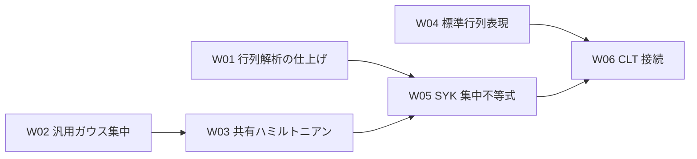

# 共有模型・集中不等式・CLT の全体実施計画

## 対象範囲と文書の役割

この文書は、共有模型と集中不等式の再設計、CLT の有限模型との接続、およびそこから続く原稿監査・形式化について、全体の実施手順と待ち合わせを管理する。`Universality` などの独立した研究課題の作業順序は定めず、`Annealed_FE` は引き続き移行対象外とする。

これはリポジトリとともに Git で共有する開発計画であり、個人の予定表ではない。守る条件は [AGENTS.md](AGENTS.md)、設計理由と数学的な依存関係は各 `ARCHITECTURE.md`、個々のファイル群の編集・証明・検証の細目は、その担当ディレクトリの `EDITING_PLAN.md` に置く。

| 計画書 | 担当するファイル群 |
| --- | --- |
| [Model](Model/EDITING_PLAN.md) | 共有模型の定義・代数・行列解析・ガウス型相互作用・標準表現 |
| [汎用ガウス集中](Probability/GaussianConcentration/EDITING_PLAN.md) | 独立したガウス測度・滑らかな共分散評価・リプシッツ関数の集中評価 |
| [SuperConcentration](SuperConcentration/EDITING_PLAN.md) | 汎用部分の旧配置の整理、共有模型を使う集中評価とその利用側 |
| [CLT](CLT/EDITING_PLAN.md) | CLT の Lean ファイル群と対応する原稿 |
| [Chapters](Chapters/EDITING_PLAN.md) | Blueprint の各章と宣言参照 |

一つの作業単位が複数のディレクトリにまたがる場合、同じ ID を使って各詳細計画の担当部分をまとめて実行する。例えば W02 は、汎用基盤の構成、Model の測度接続、SuperConcentration の利用側移行、Blueprint の更新を含む。詳細計画が分かれることを、ユーザーへの指示単位の分割と解釈しない。

## 再開と状態の管理

ユーザーは ID と優先順位を指定し、作業担当が全体の状態と関係する詳細計画を更新する。例えば、次の指示で一単位を再開する。

> W02 を検証・文書更新まで完了してください。コミットは作成せず、メッセージを提案してください。

単位全体の状態はこの文書だけで管理する。詳細計画には担当する編集の細目・完了条件・検証根拠を記録し、同じ細目のチェックを複数の場所に置かない。状態は「未着手」「実行中」「前提待ち」「判断待ち」「完了」とする。「未着手」は着手に必要な条件が整っていること、「前提待ち」は不足する成果や仕様があることを表す。「判断待ち」には必要な判断と根拠を詳細計画に記す。作業終了時には、未完了なら残作業と再開地点も記録する。

一単位は実装・検証・必要な文書更新までを含む。細目は検証の区切りであり、毎回の承認・停止・コミットの区切りではない。一つの goal に複数のコミット候補を含めてよい。Git のコミット作成には別途明示的な依頼が必要である。個人用の実行予定表は任意であり、共有文書から必須参照しない。

## 共有模型から CLT 接続まで

2026-09-08、コミット `05d64f4` のソースと既存記録に基づく。文書再編では Lean を再検証していなかったが、W01 は同日に個別検査・関連ビルド・公理依存の確認を完了した。コミット済みであること自体を単位全体の完了根拠にはしない。

| ID | 作業単位・成果 | 前提 | 状態 | 詳細の管理先 |
| --- | --- | --- | --- | --- |
| W01 | 共有行列解析の仕上げ。追加済みの整関数性・複素微分・条件付き対数微分を、関連検証と Blueprint・文書更新まで完了した | 現行実装 | 完了 | [Model](Model/EDITING_PLAN.md#w01) |
| W02 | 汎用ガウス集中不等式の独立化。測度・平滑化・MGF・裾評価と `L=0` の処理、利用側の参照移行 | 現行の汎用証明 | 未着手 | [汎用基盤](Probability/GaussianConcentration/EDITING_PLAN.md#w02)、[Model の接続](Model/EDITING_PLAN.md#w02)、[利用側](SuperConcentration/EDITING_PLAN.md#w02) |
| W03 | ガウス型 SYK ハミルトニアンの共有化。標準スケールとハミルトニアンを Model に置き、直接の利用側を移行する | W02 | 前提待ち | [Model](Model/EDITING_PLAN.md#w03)、[利用側](SuperConcentration/EDITING_PLAN.md#w03) |
| W04 | 標準行列表現の構成。Jordan–Wigner 表現、次元、反交換関係、自己共役性、対象演算子族のトレース直交性 | 既存の共有代数 | 未着手 | [Model](Model/EDITING_PLAN.md#w04)、[必要な補題の移設元](SuperConcentration/EDITING_PLAN.md#w04) |
| W05 | SYK 集中不等式の移行完了。有限サイズ評価、標準規格化でのリプシッツ評価、MGF、上下・両側の裾評価、旧基本 API の整理 | W01・W03 | 前提待ち | [SuperConcentration](SuperConcentration/EDITING_PLAN.md#w05) |
| W06 | CLT の有限模型との接続。局所的な規格化分配関数、`Z(0)=1`、共有分配関数との対応、中心化した対数への集中評価の移送 | W04・W05 | 前提待ち | [CLT](CLT/EDITING_PLAN.md#w06) |

全 W 単位には、対応する [Blueprint の編集](Chapters/EDITING_PLAN.md) と必要な統合検証も含む。

W01 の「未着手」は残っている仕上げ作業についての状態であり、複素微分の証明を作り直す意味ではない。既存の関連ビルド・Blueprint 検証と今回の追加後の検証を混同しない。

W03 を W02 の後に置くのは、ガウス測度の共有方法と `SuperConcentration/Main.lean` の移行を競合させないためであり、数学的な必須順序ではない。W05 は標準表現ではなく抽象的な `MajoranaSystem` を使うので、W04 の完了を待つ必要はない。W06 は共有模型と集中不等式の再設計を完了してから行う。

W01 は2026-09-08に完了した。次は W02 と W04 を並行して進める候補である。ただし、並行作業を依頼されていない場合は、一覧順で前提が満たされた最初の未完了単位を一つ選ぶ。指定した単位が前提待ちなら、無断で前提の実装まで範囲を広げない。単位の完了時には、依存する単位の前提と状態も更新する。

## 原稿監査と後続の形式化

| ID | 原稿側の成果 | 前提・判断条件 | 状態 | 詳細の管理先 |
| --- | --- | --- | --- | --- |
| R01 | 数学的内容を変えない原稿整理とコンパイル | 誤植を現行原稿と再照合。旧証明コメント・生成物は未承認で削除しない | 未着手 | [CLT](CLT/EDITING_PLAN.md#r01) |
| R02 | 温度領域・非退化条件・外部入力・大数則の証明方針の精査と承認された修正 | 調査は直ちに可能。定理文や採用する前提の変更前に承認を得る | 未着手 | [CLT](CLT/EDITING_PLAN.md#r02) |
| R03 | Theorem 1.2 の証明監査と修正 | 調査は直ちに可能。最終的な修正は R02 の条件に従う | 未着手 | [CLT](CLT/EDITING_PLAN.md#r03) |
| R04 | Theorem 1.1 の明示的な証明 | R02 の方針、必要なアニール入力と集中評価の確定 | 前提待ち | [CLT](CLT/EDITING_PLAN.md#r04) |
| R05 | 対数 CLT の証明監査と修正 | R02・R03、必要な集中評価の確定 | 前提待ち | [CLT](CLT/EDITING_PLAN.md#r05) |

R04・R05 の原稿監査は Lean 形式化の完了と別に判定する。原稿で使う集中評価の監査は必要だが、その Lean 実装の完成を原稿作業の必須条件とはしない。R04 では Theorem 1.2 全体の完成を機械的な前提にしない。

以下の F01–F08 は後続の作業枠である。W06 と、各枠が使う原稿の監査・正確な定理文・外部入力の確定を待つ。現時点では一括実行を指示するための完成した証明仕様ではない。詳細は [CLT の形式化計画](CLT/EDITING_PLAN.md#formalization) に置く。

| ID | 形式化する成果 | 主な入力 | 状態 |
| --- | --- | --- | --- |
| F01 | ガウス–エルミート展開の完全性・射影・部分積分 | R03 の該当監査 | 前提待ち |
| F02 | 符号対称性と一次・二次カオスの同定 | F01、必要な F04 の微分・可積分性評価、R03 | 前提待ち |
| F03 | ラデマッハ符号化と一様な指数モーメント評価 | R03 の該当監査 | 前提待ち |
| F04 | 任意階の行列微分公式と評価 | 共有行列解析、R03 の該当監査 | 前提待ち |
| F05 | 高次カオスの剰余項評価 | F01–F04、R03 | 前提待ち |
| F06 | 凸性・アニール入力からの係数漸近と分配関数 CLT | F02・F05、R02・R03、正確な外部入力 | 前提待ち |
| F07 | 負の裾と中心化誤差を含む対数 CLT | F06、W06 の集中評価、R05 | 前提待ち |
| F08 | 共通確率空間と総和可能な裾評価による大数則 | W06、R04、必要なアニール入力 | 前提待ち |
| Z01 | 零点のない領域と必要な対数の構成 | CLT が必要とする領域・一様性・外部入力の選定 | 前提待ち |

Z01 の詳細は [Model](Model/EDITING_PLAN.md#z01) で管理する。実逆温度の集中不等式や W06 の前提にはしない。F08 が使うアニール入力の共有は詳細仕様で確定し、対数 CLT の完成を大数則の前提にしない。

## 編集範囲と並列・非同期実行

ここで非同期とは、担当範囲と入力を固定し、結果を後から統合できることを指す。数学的に独立でも、同じファイルや未確定の公開 API を同時に変更してよいとは限らない。次の可否は単位間の前提を満たした後のものであり、表に「条件付き」とあるものは条件を満たすまでは同時編集しない。

| ファイル・ファイル群 | 関係する単位 | 非同期・同時編集の可否と待ち合わせ |
| --- | --- | --- |
| `Model/FiniteDimensionalGibbs.lean` | W01、W04 のトレース補題、F04 の共有解析 | 同じファイルの変更は直列。W01 完了後、W04 と W02 の別ファイル作業は並行可能 |
| `Model/Majorana.lean` | W04、W05 で必要になる共有補題 | ガウス基盤のファイルとは並行可能。`Core.lean` からの補題移設は担当を一人に固定する |
| `Model/StandardRepresentation.lean`（作成予定） | W04 | 共有代数の入力が安定していれば W02 と並行可能 |
| `Model/GaussianDisorder.lean` | W02 の測度接続、W03 | 直列。W02 の汎用測度の確定後に接続し、W02 の統合完了後に W03 を行う |
| `Probability/GaussianConcentration/StandardGaussian.lean`（移行先） | W02 | W04 と並行可能。測度・可積分性の API を後続ファイルの着手前に固定する |
| 同 `Smooth.lean`（移行先） | W02 | `StandardGaussian.lean` の必要な宣言が検証・固定済みなら別作業と並行可能 |
| 同 `Lipschitz.lean`（移行先） | W02 | `Smooth.lean` の必要な共分散評価が検証・固定済みなら別作業と並行可能 |
| `SuperConcentration/GaussianConcentration/` の旧4ファイル | W02 | 調査は新基盤と並行可能。移設・削除と利用側の import 切替は一人が統合し、旧 API を併存させない |
| `SuperConcentration/Main.lean` | W02・W03・W05 | 同じファイルを変更するため直列。Model と汎用基盤の必要な API が揃ってから各移行を統合する |
| `SuperConcentration/Core.lean` と移行先の `DensityMatrix.lean`・`MajoranaBound.lean` | W04 の補題移設、W05 | 調査は並行可能。補題移設とファイル再配置は競合するため同時編集しない |
| `CLT/Main.lean`・`CLT/Lemmas/*.lean` | W06・F01–F08 | W06 後、定理文と入力・担当ファイルを固定した課題だけ並行可能。同じ雛形への複数課題の追加は直列に統合する |
| `CLT/refs/sections/gaussian-chaos.tex` | R01–R03 | 数学的部分ごとの読み取り監査は並行可能。原稿修正は同じファイルの担当一人に集約する |
| `CLT/refs/sections/introduction.tex`・`main-results.tex`・`CLT/refs/CLT_SYK.tex` | R01–R05 | 調査は並行可能。定理文・温度領域・参照の変更は R02 の判断後に直列で統合する |
| `Chapters/Model.lean` | W01・W03・W04 | 上流宣言が確定してから更新。同じ章の編集は直列 |
| `Chapters/GaussianConcentration.lean`・`SuperConcentration.lean`・`CLT.lean` | W02・W05・W06 と対応する後続課題 | 別章の編集は参照先の確定後に並行可能。Blueprint の生成・参照確認は統合後にまとめる |
| 全体計画・各詳細計画・構造文書 | 全単位 | 別ファイルの更新は並行可能。同じ文書と単位全体の状態更新は統合担当一人が行う |

W02 では「汎用基盤の構成 → Model の測度接続 → 利用側の import 切替・旧配置の整理 → 統合検証」の順に受け渡す。W03 は Model の共有定義を確定してから利用側を更新する。W04 と W05 が同じ代数補題を必要とする場合は、共有層への移設を先に統合してから双方が使用する。これらの受け渡しは一単位内で行い、そのたびに新しい指示を求めない。

- **並列実装**：W01 後の W02 と W04 が第一候補。数学的に独立でも、共有補題・文書・Blueprint の同時編集は調整する。
- **後続の並列候補**：W06 と各仕様の確定後の F01・F03・F04。F06 の凸性・外部入力の照合は他の証明から独立して調査できるが、単位全体の完了には一覧の前提が必要である。
- **非同期の調査**：R02 の外部入力照合、R03 の偶奇則と二次カオス・行列微分・ラデマッハ評価・外部入力の各監査、mathlib の探索。根拠・未解決点・必要な入力を報告し、定理文を無断で修正しない。
- **長時間の実装**：W02・W04、仕様確定後の F01–F08。開始前に対象の定理文・編集範囲・完了条件を固定する。
- **非同期の検証**：対象ソースを固定してビルド・公理依存を確認する。開始時のコミットと未コミット差分を記録し、その後にソースが変わった場合は対応する検証をやり直す。共有キャッシュへの複数の重いビルドは避ける。
- **直列の統合**：W02・W03・W05 の `Main.lean` 移行、共通文書の更新、同一ファイルへの変更の取り込み。別々に検証済みでも統合後に関連ビルドを行う。

並列候補の記載は、複数エージェントの起動やバックグラウンド処理の許可ではない。並行作業を依頼された場合は担当範囲を固定し、共通文書の統合担当を一人にする。判断待ちの間に別の単位へ進むのは、その単位も実行範囲として指示されている場合に限る。

## 完了とコミットの区切り

Lean の実装単位は、変更ファイルの個別検査、関連する最小ビルド、主要定理の公理依存・残る仮定の確認、差分確認、必要な文書・Blueprint 更新までを含む。全体の完了は、関係するすべての詳細計画の担当部分と統合検証が揃ってから判定する。正確なコマンドと例外は各作業の `AGENTS.md` と詳細計画に従う。原稿監査は数学的な確認とコンパイル結果を記録し、Lean による検証と区別する。

`Annealed_FE` は移行対象外のままとする。許容済みの既知の失敗は検証記録に明示し、それ以外の新規エラーを許容しない。Blueprint の生成などが既知の失敗で実行できない場合も成功とは記録せず、対象単位で必要な更新・試行・失敗の切り分けを行う。

一単位を原則一コミット候補とし、独立して検証できる成果が複数ある場合だけ分割する。例えば W04 は「標準表現と基本関係」「トレース直交性」で分けられるが、ユーザーへの指示単位は W04 のままでよい。W02 でも依存層ごとの検証を行うが、検証のたびに作業を終了しない。

## 旧計画との対応

| 旧計画 | 新しい管理先 |
| --- | --- |
| Model 段階0・1、段階2の実装済み部分 | Model の実装状況・履歴。追加解析の仕上げは W01 |
| Model 段階2の CLT 規格化分配関数 | W06 |
| Model 段階3 | W03・W04。移設済み定義は再実装しない |
| Model 段階4 | 集中不等式は W05、CLT は W06、検証・Blueprint・既知の失敗の記録は各単位 |
| SuperConcentration 段階1 | W02。新基盤の細目は Probability/GaussianConcentration、測度接続は Model、旧配置と利用側は SuperConcentration |
| SuperConcentration 段階2–4 | 移設済み部分を記録し、残りを W03・W05 に集約 |
| CLT 段階1–5 | R01–R05 |
| CLT 段階6 | W06・F01–F08 |
| Model・CLT の零点に関する後続課題 | Z01 |
