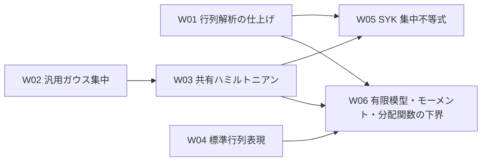

# 共有模型・集中不等式・CLT の全体実施計画

## Verso の一時休止（2026-09-18）

ユーザーの指示により、Verso の依存設定・Blueprint のビルド対象・CI の生成と参照検査をコメントで保持して休止した。Blueprint の本文と宣言参照の編集・照合は続けるが、Verso を必要とする章・生成入口の Lean 検査、HTML/PDF の生成、参照検査は実行しない。JSON の依存情報は `workspace/lake-manifest.verso.json` に保存し、現行 manifest は mathlib とその依存だけとした。復帰手順は `workspace/README.md` に記す。

検証：TOML・JSON の構文、mathlib とその依存のリビジョン保持、復帰用 manifest と変更前の内容一致、数学の Lean ソースから Verso を参照していないこと、差分を確認した。これは配布設定と当時の検証環境に関する記録である。共同研究者の親ワークスペースは他プロジェクトを含み、異なる設定を持ち得るため、個別の設定・検証結果をこの記録で上書きしない。

## 対象範囲と文書の役割

この文書は、共有模型と集中不等式の再設計、CLT の有限模型との接続、およびそこから続く原稿監査・形式化について、全体の実施手順と待ち合わせを管理する。`Universality` などの独立した研究課題の作業順序は定めず、`Annealed_FE` は引き続き移行対象外とする。

これはリポジトリとともに Git で共有する開発計画であり、個人の予定表ではない。守る条件は [AGENTS.md](AGENTS.md)、設計理由と数学的な依存関係は各 `ARCHITECTURE.md`、個々のファイル群の編集・証明・検証の細目は、その担当ディレクトリの `EDITING_PLAN.md` に置く。

| 計画書 | 担当するファイル群 |
| --- | --- |
| [Model](Model/EDITING_PLAN.md) | 共有模型の定義・代数・行列解析・ガウス型相互作用・標準表現 |
| [汎用ガウス集中](Probability/GaussianConcentration/EDITING_PLAN.md) | 独立したガウス測度・滑らかな共分散評価・リプシッツ関数の集中評価 |
| [SuperConcentration](SuperConcentration/EDITING_PLAN.md) | 汎用部分の旧配置の整理、共有模型を使う集中評価とその利用側 |
| [CLT](CLT/EDITING_PLAN.md) | CLT の Lean ファイル群と対応する原稿 |
| [Chapters](Chapters/EDITING_PLAN.md) | Blueprint の各章と宣言参照 |

一つの作業単位が複数のディレクトリにまたがる場合、同じ ID を使って各詳細計画の担当部分をまとめて実行する。例えば W02 は、汎用基盤の構成、Model の測度接続、SuperConcentration の利用側移行、Blueprint の更新を含む。詳細計画が分かれることを、ユーザーへの指示単位の分割と解釈しない。

## 再開と状態の管理

ユーザーは ID と優先順位を指定し、作業担当が全体の状態と関係する詳細計画を更新する。例えば、次の指示で一単位を再開する。

> W02 を検証・文書更新まで完了してください。コミットは作成せず、メッセージを提案してください。

単位全体の状態はこの文書だけで管理する。詳細計画には担当する編集の細目・完了条件・検証根拠を記録し、同じ細目のチェックを複数の場所に置かない。状態は「未着手」「実行中」「前提待ち」「判断待ち」「完了」とする。「未着手」は着手に必要な条件が整っていること、「前提待ち」は不足する成果や仕様があることを表す。「判断待ち」には必要な判断と根拠を詳細計画に記す。作業終了時には、未完了なら残作業と再開地点も記録する。

一単位は実装・検証・必要な文書更新までを含む。細目は検証の区切りであり、毎回の承認・停止・コミットの区切りではない。一つの作業目標に複数のコミット候補を含めてよい。Git のコミット作成には別途明示的な依頼が必要である。個人用の実行予定表は任意であり、共有文書から必須参照しない。

## 共有模型から CLT 接続まで

2026-09-08、コミット `05d64f4` のソースと既存記録に基づく。文書再編では Lean を再検証していなかったが、W01 は同日に個別検査・関連ビルド・公理依存の確認を完了した。コミット済みであること自体を単位全体の完了根拠にはしない。

| ID | 作業単位・成果 | 前提 | 状態 | 詳細の管理先 |
| --- | --- | --- | --- | --- |
| W01 | 共有行列解析の仕上げ。追加済みの整関数性・複素微分・条件付き対数微分を、関連検証と Blueprint・文書更新まで完了した | 現行実装 | 完了 | [Model](Model/EDITING_PLAN.md#w01) |
| W02 | 汎用ガウス集中不等式の独立化。測度・平滑化・MGF・裾評価と `L=0` の処理、利用側の参照移行 | 現行の汎用証明 | 完了（残る証明探索の整理は保守課題） | [汎用基盤](Probability/GaussianConcentration/EDITING_PLAN.md#w02)、[Model の接続](Model/EDITING_PLAN.md#w02)、[利用側](SuperConcentration/EDITING_PLAN.md#w02) |
| W03 | ガウス型 SYK ハミルトニアンの共有化。標準スケールとハミルトニアンを Model に置き、直接の利用側を移行する | W02 | 完了 | [Model](Model/EDITING_PLAN.md#w03)、[利用側](SuperConcentration/EDITING_PLAN.md#w03) |
| W04 | 標準行列表現の構成。Jordan–Wigner 表現、次元、反交換関係、自己共役性、対象演算子族のトレース直交性 | 既存の共有代数 | 完了 | [Model](Model/EDITING_PLAN.md#w04)、[必要な補題の移設元](SuperConcentration/EDITING_PLAN.md#w04) |
| W05 | SYK 集中不等式の移行完了。有限サイズ評価、標準規格化でのリプシッツ評価、MGF、上下・両側の裾評価、旧基本 API の整理 | W01・W03 | 完了 | [SuperConcentration](SuperConcentration/EDITING_PLAN.md#w05) |
| W06 | 現行 CLT の有限模型・モーメント・対数の基盤。既存実装の検査、`partition_moments`、トレース零と `Z≥1`、相対量の正規化・対数の中心化 | W01–W03、標準表現との照合に W04。W05 の集中評価は必須でない | 完了（2026-09-26） | [CLT](CLT/EDITING_PLAN.md#w06) |

全 W 単位には、対応する [Blueprint の編集](Chapters/EDITING_PLAN.md) と宣言参照の照合を含む。Verso の機械的検証は休止中は完了条件から除き、復帰後にまとめて行う。

W01 当時の検証結果と Blueprint 全体生成の失敗は、[Model の検証記録](Model/EDITING_PLAN.md#w01) と [Chapters の検証記録](Chapters/EDITING_PLAN.md#検証と記録) に履歴として残す。現在の既定ビルド範囲は、この文書の「完了とコミットの区切り」に記す。

W03 を W02 の後に置くのは、ガウス測度の共有方法と `SuperConcentration/Main.lean` の移行を競合させないためであり、数学的な必須順序ではない。W05 は標準表現ではなく抽象的な `MajoranaSystem` を使うので、W04 の完了を待つ必要はない。W06 は2026-09-24に現行原稿と手作業の実装を基準に再計画した。有限模型の未完了部分を完成し、集中評価の移送を必須成果にしない。

W01 は2026-09-08、W02 は2026-09-12、W03・W04・W05 は2026-09-18に完了した。W04 は Jordan–Wigner 表現と同じ偶数次数の相互作用の規格化トレース直交性を証明し、必要な共有代数補題を Model へ移設した。W05 は評価を分割し、標準規格化の MGF・上下・両側の裾と零逆温度の直接処理を供給した。詳細な検証記録は各担当計画に置く。W02 の基盤には既存の `aesop`・`grind` が残るため、その整理は完了記録と区別した保守課題とするが、検証済みの公開結果や W06 の前提を無効にはしない。W06 は2026-09-26に完了した。有限模型30定理の公理依存と CLT 全体のビルドを確認した。その後、`CLT/Lemmas/Tool.lean` を現行 mathlib 上で完成させ、同モジュールを含む CLT ビルドも成功した。Tool の補題を CLT 証明へ接続する作業は W06 の外側の F04 に残る。検証根拠は [CLT の W06 記録](CLT/EDITING_PLAN.md#w06) に集約する。

2026-09-26、`84bfde3` の統合監査で W06 の公開30定理と既定ビルドの成功を再確認した。一方、`CliffordSignParity` と Main の同時 import は分配関数の宣言名衝突で失敗する。W06 の完了と補助モジュール全体の統合を区別し、F02 への接続前にこの障害を解消する。監査の再現方法・規格化の接続・後続の残件は [CLT の統合監査](CLT/EDITING_PLAN.md#integration-audit-2026-09-26) に記録した。R・F 単位の状態は変更しない。

### 設定・運用文書の追加照合（2026-09-26）

W06 を未完了として扱う Model 側の現況説明と、CLT の指示ファイルに固定されていた再開候補を訂正した。汎用ガウス基盤の計画には、一般 Hermite 部分積分が既に検証済みであることと、共有層への配置・出典照合・重複整理が残ることを分けて記した。W06 の追加証明の実際の配置は `CLT/Main.lean` であり、Model へ移設済みとは扱わない。README には既定ビルドの一時除外と、Annealed_FE が CLT の依存先として構築される点を補った。過去の時点を明示した検証記録は保持する。

ルートと配布用の `AGENTS.md`・TOML・manifest・toolchain は一致し、Markdown のローカルリンク・節参照に不達は見つからなかった。一方、`.github/workflows/lean_action_ci.yml` の自動実行条件は `main` への `**.lean` の変更だけで、設定・依存ファイルだけの変更では起動しない。手動実行は可能である。この検査の空白は未解消として記録し、今回 CI の実行条件・依存設定・証明コードは変更しない。

後続の運用保守課題：CI の `paths` に、ビルドへ影響する `workspace/lakefile.toml`・`workspace/lake-manifest.json`・`workspace/lean-toolchain` とワークフロー自身を含めるか確認する。変更時は既存の Verso 休止設定を保持し、設定だけを変更した差分で CI が起動する条件と、既定の `lake build` が実際に走ることを検証する。これは F01–F08 の数学的前提ではない。

## 原稿監査と後続の形式化

2026-09-24：現在の原稿は He2026 のすべての実数の逆温度に関する外部結果を引用し、対数 CLT は `Z_N≥1` とカオス分解による中心化誤差の評価を用いる。旧集中評価と旧証明は `main-results.tex` の `\iffalse` 内に保存されている。以下の担当範囲はこの有効な本文に合わせたものであり、外部引用の監査や各証明の完成を意味しない。具体的な新旧差と W06 の完了条件は CLT の詳細計画に記す。

| ID | 原稿側の成果 | 前提・判断条件 | 状態 | 詳細の管理先 |
| --- | --- | --- | --- | --- |
| R01 | 数学的内容を変えない原稿整理とコンパイル | 誤植を現行原稿と再照合。旧証明コメント・生成物は未承認で削除しない | 未着手 | [CLT](CLT/EDITING_PLAN.md#r01) |
| R02 | 実数の温度領域・非退化条件・He2026 の外部入力と現行 `AnnealedInput` の照合 | 調査は直ちに可能。定理文や採用する前提の変更前に承認を得る | 未着手 | [CLT](CLT/EDITING_PLAN.md#r02) |
| R03 | Theorem 1.2 の証明監査と修正 | 調査は直ちに可能。最終的な修正は R02 の条件に従う | 未着手 | [CLT](CLT/EDITING_PLAN.md#r03) |
| R04 | 外部結果 `thm: input` の引用・規格化・概収束の照合 | R02 と引用元を共有して照合。内部での大数則証明の追加は既定で要求しない | 未着手 | [CLT](CLT/EDITING_PLAN.md#r04) |
| R05 | 対数 CLT の新証明の監査と修正 | R02・R03 の該当入力、`Z≥1`・小確率事象・四次モーメントの照合 | 前提待ち | [CLT](CLT/EDITING_PLAN.md#r05) |

R04・R05 の原稿監査は Lean 形式化の完了と別に判定する。W06 の Lean 実装や旧集中評価の移送を原稿監査の必須条件とはしない。R04 では CLT 全体の完成を前提にしない。

以下の F01–F08 は後続の作業枠である。W06 と、各枠が使う原稿の監査・正確な定理文・外部入力の確定を待つ。現時点では一括実行を指示するための完成した証明仕様ではない。詳細は [CLT の形式化計画](CLT/EDITING_PLAN.md#formalization) に置く。

| ID | 形式化する成果 | 主な入力 | 状態 |
| --- | --- | --- | --- |
| F01 | ガウス–エルミート展開の完全性・射影・部分積分 | R03 の該当監査、SpinGlass と既存 API の照合。共有部分の細目は [ガウス基盤](Probability/GaussianConcentration/EDITING_PLAN.md#f01) | 前提待ち。明示依頼の一般 Hermite 部分積分は 2026-09-26 完了、残りは [CLT の詳細](CLT/EDITING_PLAN.md#formalization) |
| F02 | 符号対称性と一次・二次カオスの同定 | F01、必要な F04 の微分・可積分性評価、R03 | 前提待ち |
| F03 | ラデマッハ符号化と一様な指数モーメント評価 | R03 の該当監査 | 前提待ち |
| F04 | 任意階の行列微分公式と評価 | 共有行列解析、R03 の該当監査 | 前提待ち |
| F05 | 高次カオスの剰余項評価 | F01–F04、R03 | 前提待ち |
| F06 | 凸性・アニール入力からの係数漸近と分配関数 CLT | F02・F05、R02・R03、正確な外部入力 | 前提待ち |
| F07 | `Z≥1`・小確率事象・中心化誤差を用いる対数 CLT | F06、F05 の剰余評価、W06 の有限模型、R05 | 前提待ち |
| F08 | 大数則の Lean 上の扱い（外部入力か内部証明かを再検討） | R04 の引用監査と仕様の確定。W06・CLT の必須前提ではない | 前提待ち |
| Z01 | 零点のない領域と必要な対数の構成 | CLT が必要とする領域・一様性・外部入力の選定 | 前提待ち |

Z01 の詳細は [Model](Model/EDITING_PLAN.md#z01) で管理する。実逆温度の集中不等式や W06 の前提にはしない。F08 の再仕様化は別途行い、旧 Borel–Cantelli 経路を自動的に実装しない。

## 共同実装の割当方法

R01–R05 は原稿・外部入力の監査、F01–F08 は Lean 形式化の成果を表す。F 番号をそのまま一人に渡さず、監査済みの主張と入力を固定した補題群ごとに担当を決める。原稿の編集は Lean 実装担当に含めない。

| 順序 | 着手できる作業と条件 |
| --- | --- |
| 直ちに進められる調査 | W06 は完了済み。R02・R04 の He2026 入力、R03 の数学的部分（エルミート展開・部分積分、偶奇則・二次カオス、行列微分、ラデマッハ評価など）、F01 の SpinGlass 流用元と既存 API、F06 の凸性・外部入力を読み取り調査できる。R01 の原稿整理は別枠とする |
| 最初の形式化 | W06 の統合、各担当箇所の R03 監査、定理文の確定後、F01・F03・F04 の独立した補題群を並行実装できる。F01 の汎用部分積分は F04 を待たず、`Z_N` への適用は F04 の正則性・成長評価を待つ |
| カオス成分と剰余 | F01 と必要な F04 の入力が揃ってから F02 を扱う。F01–F04 が揃ってから F05 の評価補題を証明し、剰余項へ統合する |
| 主結果 | R02・R03 の入力と F02・F05 が揃ってから F06 の係数漸近と相対・標準化 CLT を統合する。F07 は R05・F06 の後に対数の誤差評価から最終定理へ進む |
| 別途仕様を決める課題 | F08 は R04 の引用監査後に外部入力か内部証明かを決める。Z01 は必要な領域・一様性を選定する。いずれも W06 と現行 CLT の必須経路には加えない |

短い依頼でも、Lean 編集前に [CLT の担当別作業票](CLT/EDITING_PLAN.md#担当別作業票とコード整理)で正確な定理文、検証済みの入力、担当ファイル、検査方法を確定する。F01 は SpinGlass の出典・既存 API との対応・版差も記録する。原稿との不一致や不足する前提は根拠を示して報告し、定理文を推測して実装しない。

並行作業では、配布時の未コミット差分を含む同一の開始時点を共有し、担当ごとに独立したブランチまたは作業領域を使う。共有ファイルの編集担当と共通文書・Blueprint の統合担当を各一人に固定する。統合担当が変更を直列に取り込み、関連ビルドと宣言を再検査する。Git commit の作成には明示的な依頼を要する。

### 別環境への引き継ぎ

配布単位は `SYK/` の Git リビジョンと、その後の全差分である。現行の文書改訂は未コミットなので、`84bfde3f72b0b269ff60a13469a5a7f0ca7657e2` だけを clone しても反映されない。統合担当は、配布前に `git -C SYK rev-parse HEAD` と `git -C SYK status --short` を記録し、未コミット差分と未追跡ファイルを含む同一のソース一式を各担当者へ渡す。コミットや公開は別途指示に従う。受領側は差分適用後の状態を照合し、欠けた文書・ソースを推測で補わない。

別環境では [配布用ワークスペースの手順](workspace/README.md#collaborator-setup)に従い、ワークスペースのルートから Lake を実行する。既存の親ワークスペースに他の研究プロジェクトがある場合、`workspace/` の設定で上書きしない。Lean/toolchain、manifest、利用する Lake 設定の整合と `lake build` の対象を確認する。Verso は休止中なので関連する生成・参照検査を依頼しない。既定ビルドは証明の完成判定ではなく、各担当票の公開定理の型と公理依存を別に確認する。

割当時には、下の文面に担当票名、開始リビジョンと差分、編集可能なファイル、必要な先行成果を埋めて渡す。原稿監査だけの担当には Lean 編集を含めない。各担当者は変更ファイル、検査コマンドと結果、主要定理の `#print axioms`、残る仮定・警告・未解決事項を返す。統合担当は同じファイルの差分を直列に取り込み、関連する最小ビルド、最後に `lake build` を実行し、この文書の状態と詳細計画・Blueprint の参照を更新する。

> `SYK/CLT/EDITING_PLAN.md` の「担当別作業票とコード整理」にある **〈票名〉** を担当してください。開始地点は **〈SYK の完全なコミット ID と同梱差分〉**、担当ファイルは **〈パス〉**、受け取る先行成果は **〈監査結果・宣言名〉** です。ワークスペースの `AGENTS.md` から担当階層まで読み、原稿の有効な本文と既存 Lean の型を照合してください。票の着手条件が不足する場合は調査結果・不足する仕様だけを返し、定理文や外部仮定を推測して追加しないでください。変更する場合は票の完了条件まで検証し、差分と検査結果を統合担当に渡してください。コミットは依頼された場合だけ作成してください。

## 編集範囲と並列・非同期実行

ここでの「並行」は、担当範囲と入力を固定した別作業を、独立した作業領域で進められるという意味である。着手条件を満たした読み取り調査は並行できる。同じファイルへの編集と未確定の公開 API を使う実装は直列に受け渡す。

| 編集対象 | 関係する単位 | 担当を分ける際の条件 |
| --- | --- | --- |
| `Model/Majorana.lean`・`GaussianDisorder.lean`・`FiniteDimensionalGibbs.lean` | W06・F04 | W06 はトレース零・`Z≥1`・成長評価に必要な共有補題に限る。F04 の行列解析と同じファイルを変更する場合は直列に統合する |
| `Probability/GaussianConcentration/StandardGaussian.lean`・`Smooth.lean` | F01 | SpinGlass の候補と既存の部分積分を照合し、共有 API の編集担当を固定する。後続は検証済みの入力を受け取る |
| `CLT/Main.lean`・`CLT/Lemmas/*.lean` | W06・F01–F08 | W06 の統合後、定理文・入力・担当補題を固定して分担する。同じ雛形への変更は直列に統合する |
| `CLT/refs/CLT_SYK.tex`・`CLT/refs/sections/*.tex` | R01–R05 | 数学的部分ごとの読み取り監査は並行できる。原稿編集は別担当に集約し、定理文・温度領域・外部入力の変更は R02 の判断条件に従う |
| `Chapters/*.lean`・全体計画・各詳細計画・構造文書 | W06・F01–F08・Z01 | 統合担当が検証済みの成果に合わせて更新し、単位全体の状態も管理する。Verso の機械的検査は休止したままとする |

開始時のコミットと未コミット差分を記録し、固定したソースで個別検査・公理依存を確認する。統合後にソースが変わった場合は、関連する検査をやり直す。共有キャッシュへの複数の重いビルドは避ける。

並行候補の記載は複数エージェントの起動許可ではない。前提や作業票が未確定なら担当課題の調査結果を報告して停止する。判断待ちの間に別の単位へ進むのは、その単位も実行範囲として指示されている場合に限る。

## 完了とコミットの区切り

Lean の実装単位は、変更ファイルの個別検査、関連する最小ビルド、主要定理の公理依存・残る仮定の確認、差分確認、必要な文書と Blueprint の更新・宣言参照の照合までを含む。Verso の機械的検証は休止中は除き、復帰後に休止中の変更を含めて行う。全体の完了は、関係するすべての詳細計画の担当部分と必要な統合検証が揃ってから判定する。原稿監査は数学的な確認とコンパイル結果を記録し、Lean による検証と区別する。

`Annealed_FE` と `Universality` は Lake の独立したライブラリ登録を維持しつつ、`lakefile.toml` の `defaultTargets` から一時的に除外する。CI も同じ既定対象を使う。`Annealed_FE` は共有 API への移行と個別ビルド、`Universality` は実装と個別ビルドが完了した後、ルートと `workspace/` の両設定で `defaultTargets` に復帰させる。復帰後は `lake build` を実行する。Verso の復帰は独立した変更であり、そのときに限り Blueprint の生成と参照検査も再開する。

除外中の `lake build` と CI の成功は両ライブラリの個別検証を意味しない。`Annealed_FE` の過去のエラーと未完成の証明は検証記録に残し、既定範囲に新しいエラーや未完成の証明を許容しない。Verso 休止中は Blueprint の生成と参照検査を対象単位の完了条件にしない。公開 README には利用者に必要なビルド手順と暫定的な制約を記し、内部の担当・承認規則は載せない。

2026-09-24 のソース確認では `CLT/Main.lean` が `Annealed_FE/main_result.lean` を直接 import している。従って既定対象からの除外は、そのファイルが依存先として構築されないことを意味しない。旧 API によるエラーは過去の検証結果であり、同日の [CLT の個別検査記録](CLT/EDITING_PLAN.md) では再現しなかった。確認時のソースには CLT の2箇所と Annealed_FE の10箇所の `sorry` がある。W06 では有限模型の `partition_moments` を解消し、共同 CLT と Annealed_FE の未完成箇所は別課題として報告する。この記録は新しい `sorry` の許可ではない。

2026-09-08 に両ライブラリを一時除外し、`lake env lean SYK.lean`、`lake build Model SuperConcentration CLT`、`lake build`、`lake exe vbp build`、`lake exe vbp check` が成功した。Blueprint の manifest と HTML cache は各50件で整合した。Model・SuperConcentration・Chapters と VersoBlueprint には既存の linter warning が残るが、エラー、未解決の証明目標、および既定範囲の `sorry`・`admit`・`axiom` は検出されなかった。

一単位を原則一コミット候補とし、独立して検証できる成果が複数ある場合だけ分割する。例えば W04 は「標準表現と基本関係」「トレース直交性」で分けられるが、ユーザーへの指示単位は W04 のままでよい。W02 でも依存層ごとの検証を行うが、検証のたびに作業を終了しない。

## ビルド入口のプロジェクト内への移設（2026-09-11）

W01–W06 とは独立した構成変更として、コミット `e1ea38d` の配置から次の移行を行った。数学的な定義・定理・証明と依存バージョンは変更していない。

- 生成入口を `BlueprintMain.lean` に移設し、ルートの `SYK.lean`・`SYKMain.lean` と `workspace/` 内の配布用コピーを削除した。一括 import 専用ファイルは置かず、旧内容は Git 履歴に保持する。
- ルートと `workspace/` の `lakefile.toml` で `defaultTargets` を `["Model", "SuperConcentration", "CLT", "SYK"]` に揃えた。`SYK` の対象は共有基盤の `SYK.Probability.GaussianConcentration.+`、`SYK.Blueprint`、`SYK.Chapters.+` とし、数学の各話題は個別対象で管理する。`lake build` は既定対象全体、`lake build SYK` は共有基盤・Blueprint・章とその依存先を検査する。共有の `.lake/` は引き続き使う。
- Blueprint は `lake lean SYK/BlueprintMain.lean -- --run SYK/BlueprintMain.lean --output SYK/_out/site` で直接生成する。Lake が import を自動ビルドするため、シェルスクリプトや専用の実行ファイルは追加しない。生成先は Git の対象外とした。README のサーバー起動箇所には、現行の `vbp build --serve` がルート直下しか生成入口を探索しないことと、内蔵サーバーも Python を使うことをコメントで明記した。
- `README.md`・`workspace/README.md`・`SuperConcentration/README.md` の配置・コピー・ビルド・生成手順、`.github/workflows/lean_action_ci.yml`、`AGENTS.md`、本計画、`Model/EDITING_PLAN.md`・`Chapters/EDITING_PLAN.md` の現行検証手順を更新した。CI のビルド対象一覧は TOML の `defaultTargets` に集約した。過去の検証コマンドは履歴として保持した。

最終構成で `lake build`（3562 jobs）、`lake env lean SYK/BlueprintMain.lean`、上記の `lake lean` による直接生成が成功した。`lake exe vbp check --site SYK/_out/site` は manifest・HTML cache 各50件、エラー0件で成功した。配布用と実際の Lake 設定・manifest・toolchain の一致、および `git diff --check` も確認した。

Model・SuperConcentration・Chapters と VersoBlueprint の既存の警告は残る。`Annealed_FE`・`Universality` の一時除外は維持しており、両ライブラリを検証済みとは扱わない。GitHub 上の CI 実行、任意の PDF 生成、ローカルサーバーの起動は今回の検証には含めていない。

## 旧計画との対応

2026-09-18：一般 `MajoranaSystem` に対する `CLT/Main.lean` の設定と二種類の CLT の定理文を、`sorry` を許可する明示的な依頼に従って追加する作業を実施した。実数の `|β|` 条件を今回の宣言に採用し、共有模型や原稿は変更しない。これは W06・F06・F07 の完了ではなく、証明付き形式化に先立つ定理文の追加である。詳細・検証は [CLT の記録](CLT/EDITING_PLAN.md#main-statements-2026-09-18) に集約する。

| 旧計画 | 新しい管理先 |
| --- | --- |
| Model 段階0・1、段階2の実装済み部分 | Model の実装状況・履歴。追加解析の仕上げは W01 |
| Model 段階2の CLT 規格化分配関数 | W06 |
| Model 段階3 | W03・W04。移設済み定義は再実装しない |
| Model 段階4 | 集中不等式は W05、CLT は W06、検証・Blueprint・既知の失敗の記録は各単位 |
| SuperConcentration 段階1 | W02。新基盤の細目は Probability/GaussianConcentration、測度接続は Model、旧配置と利用側は SuperConcentration |
| SuperConcentration 段階2–4 | 移設済み部分を記録し、残りを W03・W05 に集約 |
| CLT 段階1–5 | R01–R05 |
| CLT 段階6 | W06・F01–F08 |
| Model・CLT の零点に関する後続課題 | Z01 |
