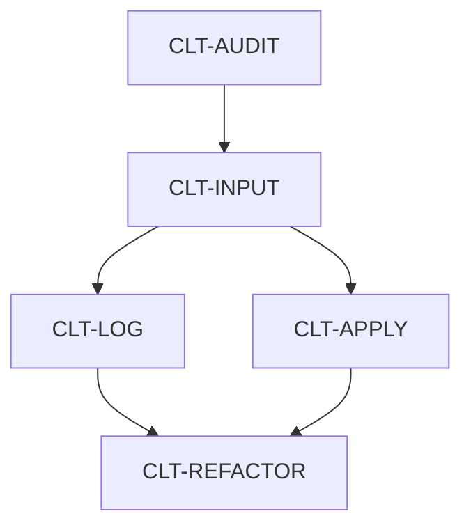

# 共有模型・集中不等式・CLT の全体実施計画

## 現在の検証範囲

Verso は一時休止中である。Blueprint の本文・宣言参照はソース上で照合し、章・生成入口の Lean 検査、HTML/PDF 生成、`vbp check` は復帰後に行う。復帰手順と保存した依存情報は [配布用ワークスペース](workspace/README.md) を参照する。

## 対象範囲と文書の役割

この文書は、共有模型・集中不等式・CLT に残る作業と共同作業の引き継ぎを管理する。`Universality` などの独立した研究課題の作業順序は定めず、`Annealed_FE` の個別移行順序は定めない。

この計画はリポジトリとともに Git で共有する。守る条件は [AGENTS.md](AGENTS.md)、設計理由と数学的な依存関係は各 `ARCHITECTURE.md`、各担当の残件は、そのディレクトリの `EDITING_PLAN.md` に置く。

| 計画書 | 担当するファイル群 |
| --- | --- |
| [Model](Model/EDITING_PLAN.md) | 共有模型の定義・代数・行列解析・ガウス型相互作用・標準表現 |
| [汎用ガウス集中](Probability/GaussianConcentration/EDITING_PLAN.md) | 独立したガウス測度・滑らかな共分散評価・リプシッツ関数の集中評価 |
| [SuperConcentration](SuperConcentration/EDITING_PLAN.md) | 共有模型を使う集中評価とその利用側 |
| [CLT](CLT/EDITING_PLAN.md) | CLT の Lean ファイル群と対応する原稿 |
| [Chapters](Chapters/EDITING_PLAN.md) | Blueprint の各章と宣言参照 |

複数のディレクトリにまたがる新しい作業では、担当部分と統合担当を先に定める。

## 残る作業

W01–W06、R01–R05、F01–F08、Z01 は、それぞれの履歴に記録した範囲で完了した。その後の CLT 原稿更新との整合は新しい作業として扱う。成果と検証は [W 単位の履歴](WORK_HISTORY.md#w-completion-notes)、[CLT 原稿・形式化の履歴](WORK_HISTORY.md#clt-r-f-completion-2026-09-28)、[Z01 の履歴](WORK_HISTORY.md#z01-local-zero-free-2026-09-28) を参照する。

現在進める CLT 作業の状態と担当は次の表で管理する。保留する課題は「その他の残件」に置く。数学的な仕様と完了条件は [CLT の詳細計画](CLT/EDITING_PLAN.md) に置き、担当・統合担当は着手前に指定する。

状態は「仕様未確定」「先行成果待ち」「割当可能」「作業中」「判断待ち」「統合待ち」「完了」とする。「先行成果待ち」は仕様・編集範囲・検証条件が定まり、先行成果の統合を待つ状態である。「割当可能」はその統合も完了した状態であり、担当や着手時のソース一式の確定前でも使える。着手時には担当と統合担当、参照原稿・Lean ソース一式を確定し、先行成果がそのソースに含まれることを確認する。分担者の検証後は「統合待ち」とし、統合・必要な文書更新・指定した原稿の版との照合を終えて「完了」とする。

| 作業ID | 作業 | 状態 | 担当 | 先行する成果 |
| --- | --- | --- | --- | --- |
| `CLT-AUDIT` | 原稿全体と Lean の対応の照合 | 完了 | Codex（単独・統合） | 着手時の原稿と実装 |
| `CLT-INPUT` | アニール入力の整理と条件付き CLT の再検証 | 完了 | Kamijima（担当・統合） | `CLT-AUDIT` |
| `CLT-LOG` | 対数の期待誤差の明示的評価 | 割当可能 | 未割当 | `CLT-INPUT` |
| `CLT-APPLY` | `prop:annealed-free-energy` を仮定した標準模型族への適用 | 仕様未確定 | 未割当 | `CLT-INPUT` |
| `CLT-REFACTOR` | CLT・共有層・利用側のリファクタリング | 仕様未確定 | 未割当 | `CLT-LOG`・`CLT-APPLY` と数学的実装範囲の確定 |

完了した `CLT-AUDIT` の結果と検証は [監査記録](WORK_HISTORY.md#clt-audit-2026-10-04) を参照する。

完了した `CLT-INPUT` の開始点、参照原稿、成果と検証は [入力整理の記録](WORK_HISTORY.md#clt-input-2026-10-04) を参照する。`CLT-LOG` の先行成果は統合済みである。`CLT-APPLY` は公開定理と編集範囲の確定が引き続き必要である。

LOG と、仕様確定後の APPLY は別担当で並行できる。図は現在進める作業間の依存関係を表し、同じファイルの同時編集を認めるものではない。

リファクタリングは現在の数学的実装を終えてから行う。保留した命題の証明を再開する場合は、それも含めた数学的実装を終えてからリファクタリングする。実装中に循環依存などの解消が必要な場合だけ、必要最小限の構造変更を先行させる。

| その他の残件 | 現在の境界・参照先 |
| --- | --- |
| `prop:annealed-free-energy` の証明 | 当面は命題の内容を Lean の明示的な仮定として受け取り、命題自体は証明済みとしない。証明を再開する場合は、`lem:convex-derivatives` の補完（保留中の `CLT-CONVEX`）、引用元と外部仮定の調査（`CLT-EXTERNAL`）、入力の構築（`CLT-ANNEALED`）を仕様化する。[CLT の詳細計画](CLT/EDITING_PLAN.md#その他の残件)を参照。 |
| ガウス基盤の保守 | 既存の局所的な `aesop`・`grind` 使用の整理は [汎用ガウス基盤の計画](Probability/GaussianConcentration/EDITING_PLAN.md) に残す。数学的実装後の独立した保守単位とする。 |
| `Annealed_FE`・`Universality` の既定ビルドへの復帰 | [一時除外の節](#既定ビルドからの一時除外)に従い、ソースと個別ビルドを確認してから既定対象へ戻す。 |
| Verso の復帰 | 保存した依存設定を復元後、休止中に編集した章も含めて機械的検査を行う。[Chapters の計画](Chapters/EDITING_PLAN.md)を参照。 |

## 識別情報と検証対象の記録

日常の計画は現行ファイル、TeX ラベル、Lean 宣言を参照し、特定コミットへ固定しない。設定文書は共同研究者による原稿更新を取り込んだ現行ソースに追従する。原稿更新や rebase の経緯だけを理由に、過去のコミット番号を各文書へ追記しない。

コミットIDは、検証対象の特定、原稿差分の比較、別環境への引き継ぎ、複数の作業状態の区別に必要な場合に記録する。未コミット変更があれば、IDだけで検証対象を表さず、対象差分と未追跡ファイルも特定する。旧原稿との比較根拠として過去のIDを使ってよい。既存の検証履歴は保持する。

作業IDは複数単位の依存・進捗管理に必要な場合に付け、完了済みIDを別作業へ再利用しない。検証記録には対象、コマンド、結果、警告、残る仮定を記す。公理依存の確認と、原稿・定理文の照合は別々に行う。

## 共同作業の引き継ぎ

共同作業では成果の統合、共有文書・Blueprint の編集、作業状態の記録を担当する統合担当一人を定める。担当ごとに独立した作業領域を使い、共有作業ツリーで同時編集しない。分担者は差分、変更した宣言と正確な型、原稿との対応、検証コマンドと結果、警告、公理依存、残る仮定・問題、文書・Blueprint の修正案を提出する。統合担当は成果を順に取り込み、関連ビルド・定理文を再検査して更新案を反映する。判断待ちの数学的な細目と再開条件は詳細計画、作業状態はこの文書に記録する。

### 原稿改訂と実装の同期

この手順は原稿全体に適用し、節の追加・移動、共通のプリアンブル、記法・ラベル・定義・主張・証明・引用の改訂を対象とする。定理の主張を維持する予定でも、変更差分の照合前に数学的同値性を確認済みとは扱わない。原稿担当の作業は Lean の実装と並行でき、原稿全体の改訂終了を全課題の着手条件にはしない。

各課題の着手時に統合担当が参照原稿と Lean ソース一式を固定し、作業IDに結び付けて引き渡す。これは課題ごとの再現可能な開始点を定めるものであり、プロジェクト全体を旧コミットへ固定するものではない。分担者はその仕様で作業し、改訂を見つけたら報告する。統合担当は原稿の変更差分を確認し、主張・仮定・依存関係・証明状態への影響を [構造文書](CLT/ARCHITECTURE.md#原稿改訂と実装の対応) と計画に反映する。

記法・ラベルだけの変更なら、型、添字集合、規格化、係数、量化、仮定、結論が維持されることを確認し、関係するコメント・文書・Blueprint の参照を統合担当が更新する。Lean の宣言名は原稿の記号に追従させる必要がない。数学的な差や不明点があれば影響する課題を判断待ちとし、研究者の判断後に仕様を更新して担当へ伝える。影響しない課題は継続する。

監査課題は指定した原稿の版への照合と結果の文書反映で完了し、原稿の推敲終了を待たない。実装課題も指定した版の仕様を満たし、検証・統合・必要な文書更新を終えた時点で完了とする。成果の統合時には最新原稿との差を確認し、参照する定義・主張・証明・引用や共通の記法への影響を調べる。指定した版より後の改訂への対応は別の残件とし、対象の版・影響範囲・完了条件を記録する。原稿全体との整合完了を報告する際も対象の版を明記し、その版についての未照合箇所を残さない。完了後の関連改訂も同じ手順で扱う。

### 別環境への引き継ぎ

配布単位は `SYK/` の Git リビジョンと、その後の全差分である。統合担当は配布時に `git -C SYK rev-parse HEAD` と `git -C SYK status --short` を記録し、未コミット差分と未追跡ファイルを含む同一のソース一式を各担当者へ渡す。開始リビジョンが受領側から取得できることを確認し、既定の `main` にまだない場合は取得可能なブランチまたは Git bundle なども指定する。受領側は差分適用後の状態を照合し、欠けた文書・ソースを推測で補わない。コミットや公開は別途指示に従う。

別環境では [配布用ワークスペースの手順](workspace/README.md#collaborator-setup) に従い、ワークスペースのルートから Lake を実行する。既存の親ワークスペースに他の研究プロジェクトがある場合、`workspace/` の設定で上書きしない。Lean のバージョン、`lean-toolchain`、`lake-manifest.json`、使用する Lake 設定の整合と `lake build` の対象を確認する。Verso は休止中なので関連する生成・参照検査を依頼しない。既定ビルドは証明の完成判定ではなく、対象の公開定理の型と公理依存を別に確認する。

別環境へ渡す依頼には、作業IDと担当、課題の目的、取得可能な開始コミットと追加差分、編集可能なファイル、先行する入力宣言、統合担当、検証条件を明記する。並行する読み取り調査は独立に進められるが、同じファイルへの編集や未確定の公開 API を使う実装は直列に受け渡す。並行候補の記載は複数エージェントの起動許可ではない。

## 既定ビルドからの一時除外

`Annealed_FE` と `Universality` は独立したライブラリとして登録されているが、`defaultTargets` から除外されている。`Annealed_FE` には未完成の証明があり、`Universality` は登録だけが残り、ソースディレクトリは存在しない。CI も同じ既定対象を使い、復帰用の設定は TOML のコメントに保持する。現在の `lake build` と CI の成功は両者の検証を意味しない。復帰には対象ソースの存在と個別ビルドの成功を確認し、承認を得てルートと `workspace/` の設定を揃え、既定対象へ戻してビルドを検査する。Verso の復帰は別の変更として扱う。過去の検証記録は [作業履歴](WORK_HISTORY.md#build-scope-2026-09)を参照する。
