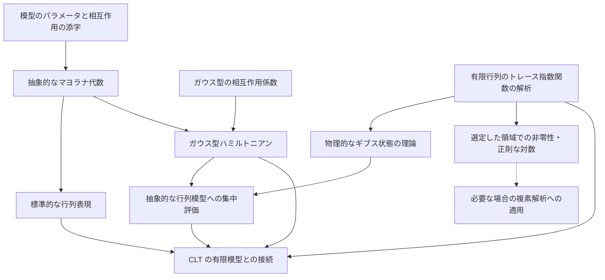

# 共有 SYK 模型の構造

## 目的

有限次元 SYK 模型を、複素逆温度に関する解析と、非負の実逆温度におけるギブス状態の理論の双方から利用できる共有 API として再設計する。ディレクトリは `SYK/Model/` へ改名済みであり、通常の分配関数の整関数性・複素微分・条件付き対数微分と、その検証・文書更新は W01 で完了している。標準スケールとハミルトニアンは W03 で共有化した。標準表現の構成は W04 で完了した。残作業は [編集計画](EDITING_PLAN.md) に従う。横断的な実行単位と待ち合わせは [全体計画](../EDITING_PLAN.md) を参照する。

## 正式な参照元と既知の相違

有限の `N` に対する模型の規約は `SYK/lectureNotes/note.tex`、CLT 固有の規格化は `SYK/CLT/refs/`、実装済みの型と検証状態は Lean のソースコードを優先する。`model.txt` は過去の設計案としてのみ参照する。同文書にある、`β ≥ 0` を `Params` に格納する設計、ガウス型のランダムな相互作用を任意の追加要素とする設計、および具体的な表現を持たない設計は、移行後の目標には採用しない。

## 固定する模型規約

以下の規約とモジュール構成は移行後の目標を記録する。抽象的な代数の定義に必要な仮定と、標準行列表現に必要な偶数 `N`・次元の条件は区別する。

| 項目 | 固定する内容と注意点 |
| --- | --- |
| マヨラナ演算子 | 自己共役とし、`ψᵢψⱼ + ψⱼψᵢ = 2δᵢⱼI`、従って `ψᵢ² = I` とする。演算子を定数倍すると相互作用の積も変わるため、相互作用係数との対応を確認する。 |
| トレース | 標準の分配関数には通常のトレース `Tr` を使う。規格化トレース `tr = Tr / d` は、標準表現の直交性と CLT 固有の分配関数に必要な場合だけ使う。両者の対数は実逆温度で `log d` だけ異なる。 |
| 相互作用係数 | 独立な標準正規変数 `g_A` と、実際の係数 `J_A = σ_N g_A` を区別する。`Var(J_A) = σ_N² = (q-1)! / N^(q-1)` は各係数の分散であり、ハミルトニアン全体の分散ではない。 |
| ギブス因子 | `exp(-zH)` を用い、実逆温度では `z = β` とする。指数の符号は、エネルギーの重み付けと逆温度による微分公式の符号を決める。 |
| 相互作用の次数 | `q` は一つの相互作用に含まれるマヨラナ演算子の個数。共有模型は偶数 `q >= 2`、CLT は偶数 `q >= 4` を扱う。添字を昇順に並べた積に位相因子 `i^(q/2)` を掛け、自己共役な相互作用を作る。 |
| 系の大きさと極限 | `N` はマヨラナ演算子の個数。偶数 `N` 個を二つずつ組み合わせると、`N/2` 組のフェルミオン生成・消滅演算子を構成でき、その標準的なフォック表現の次元は `2^(N/2)` である。CLT は `q` を固定し、偶数 `N` を通る極限を扱う。別の部分列や `q` も増加する極限へ暗黙に移らない。 |
| 逆温度 | 物理的・確率論的結果は `β >= 0` を対象とする方針だが、各定理の高温条件や端点の除外は別途保持する。非負全体で成り立つことを意味せず、特に `β = 0` で分散が消える場合の標準化に注意する。 |

共有模型では `partitionFunction` に通常のトレースを使い、`partitionFunction 0 H = Fintype.card d` とする。規格化トレースは `normalizedTrace` だけを共有 API に置き、CLT 側が必要な分配関数をこれで定義する。

定義の向きは次で固定する。

```text
normalizedTrace A = Matrix.trace A / (Fintype.card d : ℂ)
partitionFunction z H = Matrix.trace (exp (-z • H))
```

規格化トレースを使う API には `[Nonempty d]` を要求し、除数が0でないことを明示する。行列指数関数の解析は通常のトレースを基礎に置き、CLT 側で必要な規格化だけを明示的な除算として導く。

異なる添字のマヨラナ演算子は反交換するため、二つを入れ替えると積の符号が変わる。位相因子は偶数 `q` の相互作用を自己共役にするためのものであり、添字集合を同一視するだけでは順序と位相の一致は保証されない。

ここで相互作用演算子 `Ψ_A` は、昇順に並べたマヨラナ演算子の積に位相因子を掛けたものを指す。「直交性」は対象とする演算子族に対する内積 `⟨A, B⟩ = tr(A* B)` での直交性を意味し、`A*` は随伴を表す。標準表現の性質を、抽象的な `MajoranaSystem` の仮定として暗黙に追加しない。

## 現行実装と移行後の区別

| 項目 | 現行実装 | 移行後の目標 |
| --- | --- | --- |
| 逆温度 | `Params` から分離済みであり、解析には `z : ℂ`、物理的な結果には `β : ℝ≥0` を明示的に渡す。 | 移行済みの型を維持する。 |
| 分配関数 | `partitionFunction` は `z : ℂ` を受け、通常のトレースを使う。規格化が必要な利用側は `normalizedTrace` から局所的に定義する。 | 実装済み。 |
| 逆温度0 | `partitionFunction 0 H = Fintype.card d`。 | 実装済み。CLT 側の規格化分配関数は標準表現の構成後に定義する。 |
| 複素解析 | 整関数性・複素微分・非零点での `logDeriv` の公式は `05d64f4` に実装され、W01 で関連検証と Blueprint・文書の更新を完了した。 | 現在の API を維持する。零点のない領域と正則な対数は Z01 で別に扱う。 |
| ガウス型相互作用 | 係数空間、標準ガウス測度、`couplingScale P` と `normalizedHamiltonian P M g` は `Model.GaussianDisorder` に置く。 | 標準座標 `g_A` と実係数 `J_A = couplingScale P * g_A` を区別する。 |
| 標準行列表現 | W04 で `StandardRepresentation` に Jordan–Wigner 表現を構成した。`StandardBasis (N/2)` の次元、生成子の基本関係、同じ偶数次数の相互作用演算子族の規格化トレース直交性を検証済み。 | 抽象的な `MajoranaSystem` に仮定やフィールドを追加しない。 |
| ビルド対象 | ルートの `lakefile.toml` に `Model` と `SuperConcentration` がある。 | 改名は完了している。API の移行後もこの名称を維持する。 |

この表は現行の定義と移行後の目標を区別する。各項目の検証結果と移行順序は `EDITING_PLAN.md` に記録する。

## 再設計の実装方針

再設計の比較元は Git コミット `1b5a64cc9860f36876cc30b1a13d66ad4bfe8047` とする。旧版は Git 履歴で保持し、現行ファイルを直接改修する。旧 API を並行して維持する別モジュール、別名前空間、互換用の別名は作らない。

既存の定理文、規格化、数学的な証明の着想は資産として扱うが、証明スクリプトは固定しない。重複した位相・積の補助証明、可積分性や型変換の反復、mathlib の既存結果で置き換えられる部分は、定理文と仮定を照合した上で書き換える。各書き換えは一つの補題群に限り、変更したファイルの Lean 検査を通してから次へ進む。

共有する宣言の所属は次で固定する。

| 層 | 内容 |
| --- | --- |
| `Model.Definitions` | `N`、`q` とその許容条件、相互作用の添字と昇順 |
| `Model.Majorana` | 抽象的なマヨラナ系、位相付き相互作用演算子、確定的なハミルトニアン |
| `Model.FiniteDimensionalGibbs` | 有限次元行列に対する分配関数、Gibbs 状態、期待値、およびトレース指数関数の解析 |
| `Model.GaussianDisorder` | `CouplingSpace`、標準ガウス測度、`σ_N` を含む標準規格化ハミルトニアン |
| `Probability.GaussianConcentration` | 有限次元ユークリッド空間上の標準ガウス集中不等式 |
| `SuperConcentration` | 密度行列の評価、マヨラナ相互作用演算子の二乗和評価、SYK への集中不等式の適用 |

`IsDensityMatrix` と `expectation` は Gibbs 状態の構成にも使うため `Model.FiniteDimensionalGibbs` に置く。反交換族の二乗和評価は `SuperConcentration` に置く。これにより `Model` が `SuperConcentration` を import する循環を防ぐ。

非零次元・実逆温度で通常のトレースから規格化トレースへ移ると、`log Z_Tr = log Z_tr + log d` となる。次元は相互作用係数に依存しないため、中心化した対数や相互作用係数による微分ではこの差が消える。一方、`N^(-1) log d` は自由エネルギー密度の極限に残り得る。ギブス期待値は分子・分母を同じ規約で規格化すれば変わらない。

## 目標とする各層



図は数学的な利用関係を表し、実行順序は全体計画に置く。有限行列の解析は具体的な SYK ハミルトニアンの構成を前提としない。集中評価は抽象的な行列マヨラナ系で足り、標準表現の構成を待たない。零点のない領域は別の後続課題であり、実逆温度の集中評価や CLT の有限模型への接続の必須条件ではない。

- 模型のパラメータは `N`、`q` と、それらが許容条件を満たすことの証明だけを持ち、逆温度を持たない。
- 抽象的な反交換関係と、Jordan–Wigner 変換による標準的な行列表現を分離する。
- 汎用的な行列解析の層では、指数関数を取る前の行列、通常の行列トレース、整関数性、および複素微分を扱う。規格化トレースは直交性など実際の利用箇所に限る。
- SYK のガウス型相互作用係数の空間は共有模型に置く。有限個の座標を持つ型上のガウス集中不等式の証明は `SYK/Probability/GaussianConcentration/` に置く。

## 複素逆温度を扱う定理の仮定

以下で分配関数の正値性は `Z(β) > 0`、密度行列の条件は半正定値性と通常のトレースが1であることを指す。

ここで「無条件」は零点のない領域を仮定しないという意味であり、有限次元などの基本設定まで不要という意味ではない。`z` は逆温度の複素数への拡張を表す。

| 分類 | 内容 | 仮定 |
| --- | --- | --- |
| 零点に関する仮定なし | `Z(0)=Fintype.card d`、整関数性、`Z'` の公式 | なし |
| 零点のない点または領域 | `logDeriv Z` と複素数値の規格化された商 | `Z z ≠ 0` |
| 物理的な実逆温度 | 正値性、熱平衡状態の密度行列、ギブス期待値、実数値の `log Z` | `β : ℝ≥0`、自己共役な `H` |

`Z z ≠ 0` は複素平面全体では一般に成り立たない。将来は高温領域に対応する円板や帯状領域など、具体的に零点がない領域を証明し、その範囲で仮定を供給する。領域全体で正則な対数を定めるには、零点がないことに加えて、対数の枝を選べる領域であることが必要になる。複素逆温度における正値性や密度行列としての性質は、証明を後回しにしているのではなく、そもそも主張しない。

通常の密度行列は `ρ = exp(-βH) / partitionFunction β H` とし、半正定値で `Tr(ρ) = 1` を満たす。CLT 側の規格化分配関数を使う場合だけ、分母は次元との積になる。

## 標準行列表現

`StandardBasis m` は `Unit` から `Fin 2 × StandardBasis m` を繰り返す計算基底であり、`standardBasis_card` はその次元 `2^m` を与える。`jordanWigner m a b` は、前の各サイトに Pauli Z、指定サイトに X（b=0）または Y（b=1）、後の各サイトに恒等行列を置く Kronecker 積である。Y は講義ノートと同じ `[[0,-i],[i,0]]` とする。`jordanWignerSystem m` の零始まりのラベルは `2*a+b` であり、講義ノートのラベルとは1だけ異なる。`standardMajoranaSystem N hN` は偶数 N に対し `N/2` サイトを用い、ちょうど N 個の生成子を持つ共有構造を返す。

`standardInteraction_orthonormal` は、共有の昇順積と位相で定義する同じ偶数次数 q の相互作用について `normalizedTrace (star Ψ_A * Ψ_B) = if A = B then 1 else 0` を証明する。非対角成分は対称差の生成子による共役と有限行列のトレースの巡回性で消え、対角成分は共有の二乗公式と `normalizedTrace_one` で1になる。この固定次数の証明はマヨラナ関係とトレースから従い、既約性の追加仮定を要しない。異なる次数を混ぜた演算子族など、この定理の範囲外の直交性と区別する。

`majorana_sq`、語の随伴との積、相互作用の二乗、および語の並べ替えの補題は `SuperConcentration.Core` から `Model.Majorana` へ移設した。生成子が添字集合に含まれる場合・含まれない場合の相互作用との交換則も同じ共有層に置く。集中評価側はこれらを直接利用し、Model から集中評価への import は作らない。

## 利用側

- `SYK/SuperConcentration/`：物理的なギブス状態に限定した結果と SYK の相互作用係数を使う。
- `SYK/CLT/`：複素解析に関する結果と、`β : ℝ≥0` に限定した確率論的結果を使う。
- `SYK/Annealed_FE/`：現在は編集・移行対象外とする。

SpinGlass にある有限系の汎用的なギブス解析は、層を分離する際の参考とする。ただし、古典系の有限和を対象とする API と外部リポジトリへの依存関係は採用しない。

参照先は <https://github.com/or4nge19/SpinGlass> である。特に `FiniteGibbs` の
模型に依存しない部分と依存する部分の境界、具体的な模型へ結果を移す補題、および解析機能のモジュール分割を参考にする。

## モジュールと名前空間

目標とするモジュール構成は次のとおりとする。

```text
SYK/Model/
  Definitions.lean
  Majorana.lean
  StandardRepresentation.lean
  FiniteDimensionalGibbs.lean
  GaussianDisorder.lean
```

モジュールのパスは `SYK.Model.*` とするが、共有する主要な宣言は `namespace SYK` に置く。ファイルごとの名前空間を機械的に追加しない。内部だけで使う補助宣言は、必要な局所名前空間または `private` に置いて公開しない。
