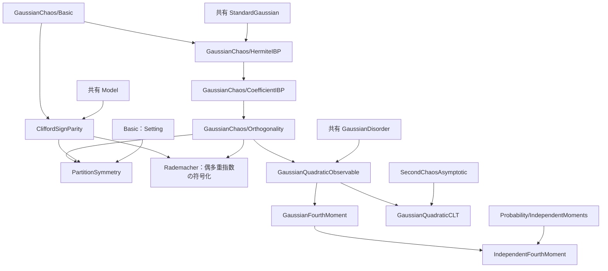
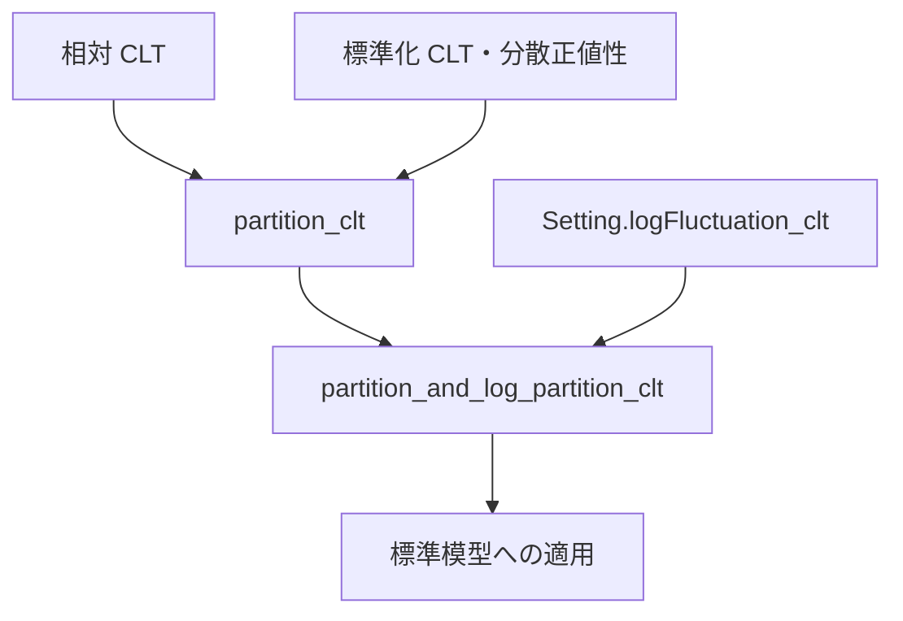
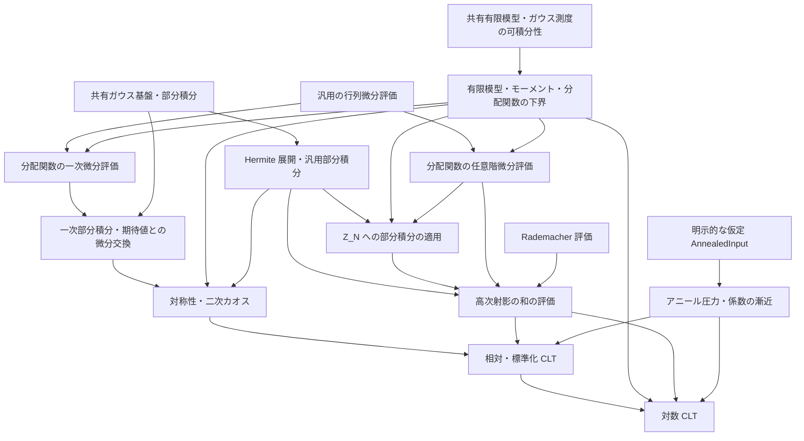

# SYK 中心極限定理の証明構造

## 現行の配置

数学コードはリポジトリの `SYK/` に置く。共有環境とビルド対象は [ワークスペース案内](../../workspace/README.md) を参照する。宣言の名前空間はファイルの配置ではなく数学的な話題で決める。下表の右端の列が各配置の主な名前空間である。

| 配置（リポジトリ内） | 数学的役割 | 名前空間 |
| --- | --- | --- |
| `SYK/Analysis/Matrix/` | 特異値・トレース指数関数・微分評価 | `SYK.MatrixAnalysis` |
| `SYK/Probability/GaussianChaos/` | Hermite 基本定義・部分積分・直交性・密度・完全性 | `SYK.GaussianChaos` |
| `SYK/Probability/` 直下 | 独立変数のモーメント・モーメント一意性・分布移送 | `SYK.Probability` |
| `SYK/Probability/GaussianConcentration/` | 共有ガウス基盤 | `SYK.GaussianConcentration` |
| `SYK/CLT/Chaos/` | 模型の符号対称性・分配関数の微分・二次・高次・零次カオス | `SYK.CLT`（符号ゲージ・頂点偶奇則は `SYK` と `SYK.MajoranaSystem`） |
| `SYK/CLT/Quadratic/` | 有限個のガウス変数二乗の観測量・四次モーメント・二次和の CLT | `SYK.CLT` |
| `SYK/CLT/Limit/`・`SYK/CLT/Log/` | 模型への分布移送・分散・相対・標準化 CLT と対数への移送 | `SYK.CLT` |
| `SYK/Main.lean` | 自立した模型・入力・主定理の入口 | `SYK.CLT.GaussianSYK` |
| `SYK/MainAudit.lean` | 主定理文の依存境界の検査 | `SYK.MainAudit` |

数学ライブラリは Lean のモジュール形式を用いる。公開宣言は `public section`、内部の補助宣言は `private` とし、公開宣言の文に必要な依存を `public import` で伝える。他ファイルで必要な定義の展開だけを `@[expose]` で公開する。公開定理の型の一致に必要な `standardSetting`・`StandardBasis` の展開も、この公開の境界に含む。公開する同値写像の逆写像の証明は `private_decl%` で非公開補題の参照を保つ。Blueprint は従来形式のままライブラリを読み込む。

## 基準と正式な参照元

有限模型と、三種類の条件付き CLT をまとめた `partition_and_log_partition_clt` は、Lean に受理されている。現行の `AnnealedInput` は、原稿の `prop:annealed-free-energy` の命題文に対応する内容を、明示的な仮定として受け取る。各フィールドの対応は「アニール入力」に記す。入力を整理した後の検証の時点と公理依存は [CLT-INPUT の記録](../../WORK_HISTORY.md#clt-input-2026-10-04)、原稿全体の照合は [監査記録](../../WORK_HISTORY.md#clt-audit-2026-10-04) を参照する。

情報の置き場所は次のとおりである。

- 正確な原稿の主張：`../../Paper/CLT_SYK.tex` と、そこから読み込む `introduction.tex`、`gaussian-chaos.tex`、`higher-chaoses.tex`、`main-results.tex`
- 実装の型と証明項：Lean ソース
- 残作業と状態：[全体計画](../../EDITING_PLAN.md)
- 完了済み作業の詳しい検証根拠：[作業履歴](../../WORK_HISTORY.md)

原稿内の証明、外部結果、Lean の検証済みの証明を区別する。

`main-results.tex` の対数 CLT は `Z_N≥1` とカオス分解を用い、旧集中評価を必須入力にしない。

## 原稿改訂と実装の対応

全4節の主要な主張と Lean の対応は「現行原稿の主張」に記す。改訂時には [同期手順](../../AGENTS.md#原稿の改訂と実装の同期) に従い、主張、仮定、規格化、依存関係、証明の状態への影響を確認する。

模型と主定理を一つのファイルで読む入口は [SYK/Main.lean](../Main.lean) とする。模型・アニール入力・主定理を `SYK.CLT.GaussianSYK` で直接記述し、他の SYK 宣言は共同定理の証明内だけで使う。宣言と原稿の対応は同ファイルの docstring を参照する。具体模型のアニール入力は主定理の仮定として残る。

定理文は mathlib と同じファイルの定義だけで書き、内部の定義と重複していても置き換えない。定理文を mathlib だけで照合できるようにするためである。[SYK/MainAudit.lean](../MainAudit.lean) が、主定理3つの型から定義の型・値と構成子の型をたどり、他の SYK モジュールへの依存をビルド時に拒否する。定理の証明は検査の探索対象に含めない。

## 模型・型・規格化

| 項目 | 現行の内容 |
| --- | --- |
| 模型 | 固定した偶数 `q≥4`、独立標準正規座標 `g_I`。原稿は偶数 `q, N` と `4≤q≤N` を前提とし、Lean も偶数 `N≥q` を要求する |
| 演算子 | 自己共役な Majorana 生成子、反交換関係 `ψ_i ψ_j+ψ_j ψ_i=2δ_ij I`、昇順積と位相 `i^(q/2)` |
| ハミルトニアン | `H_N=σ_N Σ_I g_I ψ_I`、`σ_N²=(q-1)!/N^(q-1)` |
| 原稿のトレース | `tr=2^(-N/2) Tr`、標準表現の次元で規格化 |
| Lean のトレース | 一般の非空有限次元表現で、行列の添字型の要素数 `Fintype.card d` で割る `normalizedTrace` |
| 分配関数 | 原稿は `Z_N(β)=tr exp(-β H_N)`、`β : ℝ`、`Z_N(0)=1`。Lean の有限模型は `z : ℂ` を扱い、CLT は実逆温度に特殊化する |
| 確率論の逆温度 | 現行原稿・CLT の宣言は `β : ℝ`。共有のギブス状態・集中 API の `β : ℝ≥0` は変更しない |
| 系の極限 | 原稿は偶数 N を通る極限。Lean の `Setting q` は偶数サイズが無限大へ発散する任意の族 |
| 確率空間 | 各サイズの共有ガウス係数空間。分布収束はサイズごとの空間を許す。概収束には別途共通確率空間が必要 |

標準表現に特殊化したときに原稿のトレースと一致することと、一般の表現で外部の極限定理を利用できることは、別の確認事項である。前者は `Normalization.lean` の `partitionFunction_standard` で照合する。CLT は、一つの抽象的な模型族 `S : Setting q` と `hFE : AnnealedInput q S` を入力とする条件付きの定理として統一する。

有限模型の定義、評価、モーメントは `FiniteModel.lean` に置き、一般の `Params` と非空有限行列表現 `MajoranaSystem` だけを仮定する。`Basic.lean` がこれを import し、`Setting.partition_moments` では `S.params n` と `S.majorana n` に適用する。標準表現の import は、規格化を照合する `Normalization.lean` に分け、抽象的な CLT の依存に含めない。最終的な3つの定理の入力は `{q : ℕ} (S : Setting q) (hFE : AnnealedInput q S)` にそろえる。`Even q` と `4 ≤ q` は `S` だけが保持する。

共有の `SYK.partitionFunction` は、通常のトレースを使う。CLT の局所定義は、通常のトレースの分配関数を次元で割ったものとの一致も、証明項として持つ。複素解析の API は共有側を使い、零点のない領域や対数の枝は仮定しない。現行の条件付き CLT は、複素対数を入力に使わない。

## 標準模型族への適用設計

`StandardModel.lean` の `standardSetting` は `N n = q + 2 * n` の標準表現族を構成する。偶数 `q ≥ 4` に対してこの列は `N ≥ q` の偶数をすべて一度ずつ通り、無限大へ発散する。したがって、原稿の偶数サイズの極限を表せる。有限個の `N < q` を除いても極限は変わらず、有限サイズの規格化では、必要な `q ≤ N` を明示できる。スケーリングは列の添字ではなく実際のサイズ `N` のべきとする。

`StandardModel.lean` は、模型族の構成、偶数サイズの対応、規格化の橋渡し、具体的な適用を担う。このファイルは `Main.lean` と `Normalization.lean` の利用側に置く。これにより、標準表現の import を抽象的な CLT の証明の依存に入れずに、原稿の `2^(-N/2) Tr` と共有の標準模型を接続する。公開定理の仕様は下の表に記す。`standardSetting_size_iff` が全ての偶数サイズの列挙を、`standardSetting_Z` が規格化を照合する。`standard_partition_and_log_partition_clt` は、この族に対する `AnnealedInput` の下で検証済みである。検証記録は [作業履歴](../../WORK_HISTORY.md#clt-log-apply-completion-2026-10-05) を参照する。

入力は、構成した標準模型族そのものに対する `AnnealedInput` とする。表現独立性を経由せずに、この族へ条件付きの定理を適用するので、表現独立性の証明は不要である。定理 `standard_partition_and_log_partition_clt` から、同じ高温の半径で、相対・標準化・対数の CLT を得る。`E[log Y_N]` の明示的な評価は、標準模型族への適用に必要な入力ではない。

`standardSetting (q : ℕ) (hq : Even q) (hq4 : 4 ≤ q) : Setting q` の次元添字は `SYK.StandardBasis ((q + 2*n)/2)`、マヨラナ系は `SYK.standardMajoranaSystem` である。構成後の抽象 CLT 適用時に偶数性や `q≥4` を再要求しない。

| 公開定理（名前空間 `SYK.CLT`） | 結論と証明依存 |
| --- | --- |
| `standard_partition_and_log_partition_clt` | `partition_and_log_partition_clt` を適用し、圧力収束、相対・対数 CLT、極限分散と全有限サイズ分散の正値性、標準化 CLT を同時に結論する |

この定理の入力は `{q : ℕ} (hq : Even q) (hq4 : 4 ≤ q)` と `hFE : AnnealedInput q (standardSetting q hq hq4)` である。`S := standardSetting q hq hq4` とし、量化は `∃ βq : ℝ, 0 < βq ∧ ∀ β : ℝ, |β| < βq → β ≠ 0 → ...` である。`standard_partition_and_log_partition_clt` が全結論に共通する半径を供給する。

相対量は `N^(q/2-1)(Z/E Z-1)`、対数量は `N^(q/2-1)(log Z-E log Z)`、標準化量は `(Z-E Z)/sqrt(Var Z)` である。サイズは `N=q+2*n`、測度は `standardGaussianMeasure (S.N n) q`、極限変数は `fun x : ℝ ↦ x` とする。相対量と対数量の極限測度は `gaussianReal 0 (limitVariance q hFE.ℓ β)`、標準化量の極限測度は `gaussianReal 0 1` である。収束は `n → atTop` の `TendstoInDistribution` であり、共通確率空間や概収束は仮定しない。

位相 `i^(q/2)`、係数分散 `(q-1)!/N^(q-1)`、ギブス因子の負号を保ち、原稿の `subsec:SYK-model`、`eq:Y_N`、`eq:scaled-relative-clt`、`eq:standardized-clt`、`thm:partition-clt`、`thm:free-energy-clt` に対応する。

## 補題の探し方

各モジュールの役割、入口の宣言、追加の仮定は、ファイル冒頭の docstring に書く。宣言名と利用箇所の検索は [README の案内](README.md#finding-a-lemma) から始め、見つけたモジュールの docstring で入口と仮定を確認し、正確な型は Lean 宣言で確かめる。名前空間、節の変数、型クラス、局所記法も確認する。

この文書は、原稿の主張との対応を [現行原稿の主張](#現行原稿の主張) に、モジュール間の依存を次の節の図に記す。

## 有限補題と漸近 CLT の分離

現在の import 関係は次のとおりである。矢印は依存先から利用側へ向かう。



汎用の Hermite 補題を実際に利用するのは、この CLT 内の展開と符号対称性である。そのため、共有ガウス基盤に CLT の記法を追加しない。四次モーメントの経路には、二次 CLT と `SecondChaosAsymptotic` を含めない。これにより、有限モーメント評価の数学的な前提を直接読める。

有限行列解析の3つのファイルは、`SingularValues`、`TraceExponential`、`TraceExpDerivatives` の順に依存する。実際の外部の利用側は `PartitionDerivatives` だけで、Model はこれを import しない。`SYK.normalizedTrace` は複素行列のトレースを次元で割り、`SYK.MatrixAnalysis.normalizedTrace` は一般の `RCLike` 上で次元の逆数をトレースに掛ける。両定義は空型も扱うが、スカラー、定義式、Model が行列解析に依存しない向きを保つため、統合しない。CLT への規格化の接続は `Setting.Z_eq_traceExp` と `Setting.norm_traceExp_disorder` に残る。この配置を採用した判断と検証は [作業履歴](../../WORK_HISTORY.md#clt-refactor-2026-10-06) を参照する。

## 証明の共有

証明は次のように共有している。

- `SingularValues` の平方と単調性には mathlib の API を使い、有限和の Hölder には非負実数の有限和の不等式を使う。零を許す列を正値に強めない。
- 二次観測量の可測性は、`GaussianQuadraticObservable` から、法則の対応、二次 CLT、四次モーメントへ供給する。
- 2 次の Hermite 多項式の値 `x² - 1`（`hermite_two_eval`）は `GaussianChaos/Basic` で共有する。
- 四次モーメントの六つの項は、可積分性を個別に確認してから、有限和として積分する。
- 独立な中心化実確率変数の二次・四次モーメント加法公式は `Probability/IndependentMoments.lean` に置き、ガウス平方和の有限モーメント評価が利用する。この汎用層は模型や CLT を import しない。
- Hermite 射影のノルム、異なる次数の直交性、零次の多重指数と Hermite 積は `GaussianChaos/Orthogonality.lean` に置く。次数を固定した多重指数集合は `multiIndicesOfDegree` とする。
- 座標ごとの中心化ガウス平方の L⁴ 評価は `GaussianFourthMoment` の `SYK.CLT.centeredGaussianSquare_eval_memLp_four` で共有し、同じファイルの全座標和と `IndependentFourthMoment` の有限部分和に使う。

行列のトレース指数関数の定義は、`SYK.MatrixAnalysis.traceExp` の1つだけである。滑らかさは `SYK.MatrixAnalysis.contDiff_traceExp` が与え、Hermitian な基点での高階微分評価は、公開定理 `iterDirectionalFDeriv_traceExp_bound` が与える。List に沿う微分と mathlib の反復 Fréchet 微分は、滑らかさによって接続する。この接続と、二つの規格化トレースの型は保つ。`TraceExponential` では、Schatten ノルムと語の評価、Taylor 係数が高階微分の解析的な証明を担う。Duhamel の公式は使わない。

`Main` は分配関数の CLT を先に証明し、`partition_and_log_partition_clt` が下位の対数 CLT と組み合わせて共通半径を取る。`SYK/Main.lean` の個別定理は同じファイルの共同定理から射影する。矢印は証明結果から利用側へ向かい、公開定理の全結論と入力 `hFE` は変えない。



検証結果は [作業履歴](../../WORK_HISTORY.md#clt-cleanup-2026-10-06) を参照する。

`AnnealedInput.sign` はすべての非零の実逆温度で `β * deriv ℓ β > 0` を与える。この入力の下で `limitVariance_pos_of_ne_zero` は半径なしに極限分散の正値性を証明する。CLT の高温の半径は、相対・標準化・対数の収束評価から取る。

## アニール入力

`Basic.lean` は外部入力の証明を import せず、`SYK.CLT.AnnealedInput q S` を宣言する。一つの `S : Setting q` について、現行原稿の `prop:annealed-free-energy` の内容を仮定として受け取る。原稿の模型族についての命題そのものや、一般表現への適用可能性を証明済みとしない。極限関数の存在は `ℓ` を含む構造体の入力として表す。

| 現行のフィールド | 型・条件 | 現行原稿との対応 |
| --- | --- | --- |
| `ℓ` | `ℝ → ℝ` | 極限関数 `ℓ_q` |
| `even`、`convex`、`contDiff_one` | `∀ β, ℓ (-β) = ℓ β`、`ConvexOn ℝ Set.univ ℓ`、`ContDiff ℝ 1 ℓ` | 全実軸の偶・凸な `C¹` 極限 |
| `pressure_limit` | `S.annealedFreeEnergy` の `ℓ` への全実軸での局所一様収束 | `eq:annealed-free-energy-limit` |
| `derivative_limit` | `(∂_β log E Z_N)/N` の `deriv ℓ` への全実軸での局所一様収束 | `eq:annealed-derivative-limit` |
| `sign` | `∀ β : ℝ, β ≠ 0 → 0 < β * deriv ℓ β` | 命題末尾の、非零の逆温度での符号条件 |

原稿の証明の本文に残る導関数と圧力の上界は、命題文の内容と区別する。三種類の CLT は、表の入力を仮定する。`Z_N≥1`、二次・四次モーメント、高次カオスの剰余の評価には、内部の証明を再利用する。

`AnnealedInput` の説明は Blueprint の CLT 章にもある。形式化の範囲は [仮定する命題と形式化の範囲](#仮定する命題と形式化の範囲) に記す。

## 現行原稿の主張

全4節の主要な主張と Lean の対応は次のとおりである。「実装済み」は対応する主張を意味し、原稿の証明中の全表示を同じ手順で形式化したことを意味しない。

| 節・TeX ラベル | Lean の入口 | 状態・残る境界 |
| --- | --- | --- |
| `thm: input` | — | 各固定実逆温度でのアニール圧力の極限と、極限関数の全実軸での微分可能性を述べる外部入力。クエンチ圧力の期待値 `E[N^(-1) log Z_N]` の極限や標本ごとの概収束は定理文に含まない |
| `lem:convex-derivatives` | — | 原稿は各点収束から関数・導関数の局所一様収束を全実軸上で結論し、Rockafellar を引用して証明を省略する。補題全体は未形式化であり、条件付き CLT は必要な収束を `AnnealedInput` として受け取る |
| `subsec:SYK-model`、`eq:Y_N` | `realPartitionFunction`、`Setting.Y`、`partitionFunction_standard` | 有限模型と標準表現の規格化照合は実装済み。標準模型族への条件付き適用も `StandardModel.lean` で検証済み |
| `eq: chaos` | `hasSum_hermiteCoefficients_unconditional`、`hasSum_hermiteDegreeProjection_unconditional` | ガウス `L²` の展開・完全性は実装済み |
| `lem: parity rule lemma` | `Setting.Z_sign_gauge`、`Setting.Z_swap`、`Setting.integral_Z_mul_hermite_eq_zero_pi` | CLT に使う対称性と係数消滅は実装済み。原稿の一般反射・任意の符号付き置換の統一形は一部のみ対応 |
| `lem:Gaussian-Hermite-IBP`、`eq:Gaussian-Hermite-IBP` | `hermite_coefficient_ibp`、`Setting.hermite_coefficient_Z_eq_integral_partialMulti` | 一般部分と分配関数への特殊化は実装済み。成分ごとの `η≤α` の成長条件を保持 |
| `prop:exact-second-chaos` | `Setting.Y_firstChaos_eq_zero`、`Setting.Y_secondChaos_eq` | 全実逆温度で実装済み。アニール入力は不要 |
| `lem:Z-derivative-bound`、`eq:Z-derivative-bound` | `Setting.abs_partialMulti_Z_le` | 高階微分評価は実装済み。原稿の Duhamel 積分表示そのものは未形式化 |
| `lem:Rademacher-encoding` | `Rademacher.even_sum_rademacher_moment`、`Rademacher.rademacher_encoding` | 有限和恒等式と指数付き三次モーメント評価は実装済み |
| `prop:higher-chaos-closure` | `Setting.tsum_higherChaosProjection_le_power`、`Setting.higherChaosProjection_isLittleO` | 高温でのべき評価と little-o は実装済み |
| `prop:annealed-free-energy` | `AnnealedInput` | 命題文の内容を明示的な仮定として受け取る。命題自体と入力の構築は未形式化 |
| `eq:intro-A_N-limit`、`eq:Y-decomposition-final` | `secondChaosCoefficient_tendsto`、`Setting.secondChaosScaledCoefficient_tendsto`、`Setting.Y_decomposition` | 分解は実装済み、係数の各点での極限は条件付きで実装済み。係数の局所一様収束の独立した定理は未追加 |
| `thm:partition-clt`、`thm:free-energy-clt` | `partition_clt`、`partition_and_log_partition_clt` | `0<\|β\|<β_q` で現行の `AnnealedInput` を仮定して実装済み。`E[log Y_N]` の明示的な次数評価も `Setting.integral_log_Y_isBigO` で検証済み |

相対量・スケール・極限分散は
```text
Y_N = Z_N / E Z_N,  a = q/2 - 1,
ρ²(β) = (q!/2) β² (ℓ_q'(β))².
```
相対 CLT は `N^a(Y_N-1)`、対数 CLT は `N^a(log Z_N-E log Z_N)` の分布収束である。標準化は `(Z_N-E Z_N)/sqrt(Var Z_N)`。`β = 0` では前二者は退化するが、原稿と Lean の CLT 定理文はともに対象外とする。零分散での標準化と混同しない。`partition_and_log_partition_clt` は非零の小さい逆温度で「すべての有限サイズの分散正値性」も結論に含むため、漸近分散の正値性だけではその結論を充足しない。

## カオス分解と係数の漸近

現在の原稿は次の二つの同値な記法を使う。
```text
|I_N| = choose(N,q),  Q_N = |I_N|⁻¹ Σ_I(g_I²-1),
A_N(β) = (β/2) ∂_β log E[Z_N(β)],
U_N = (2|I_N|)^(-1/2) Σ_I(g_I²-1),
c_N(β) = β ∂_β log E[Z_N(β)] / sqrt(2|I_N|),

Y_N - 1 = A_N Q_N + R_N = c_N U_N + R_N,
R_N = Σ_{r≥3} P_r Y_N.
```

符号ゲージの対称性と Hermite 部分積分により、一次と二次のカオスを同定する。トレース指数関数の高階微分評価と、Rademacher 符号化および指数モーメントにより、`‖R_N‖₂²=O(N^(-3a))` を得る。係数の同一性は、符号付きの頂点転置とガウス測度の不変性から証明した。`PartitionDerivatives.lean` の一次部分積分、放射方向微分、期待値との微分交換を用い、全実数の逆温度で共通の係数を同定済みである。アニール導関数の極限と `|I_N|~N^q/q!` により
```text
A_N/N → (β/2) ℓ_q'(β),
N^a c_N → sqrt(q!/2) β ℓ_q'(β).
```
古典的 CLT と Slutsky を適用し、標準化には直交分解による分散漸近と非退化性を別に使う。

## 対数 CLT の証明経路

`W_N=log Y_N` とすると
```text
N^a(log Z_N-E log Z_N)
  = N^a(W_N-(Y_N-1)) + N^a(Y_N-1) - N^a E W_N.
```
最初の項は対数の局所近似と確率的有界性、二番目は相対 CLT を使う。最後の期待値の制御は次の入力に依存する。

| 入力・評価 | 主な Lean モジュール |
| --- | --- |
| 相互作用・H のトレース零、Jensen による `Z_N≥1`、モーメントと正しい中心化の恒等式 | `FiniteModel.lean`、`Basic.lean` |
| `‖R_N‖₂²=O(N^(-3a))` | `Chaos/HigherChaosProjection.lean`、`Chaos/HigherChaosRemainder.lean`（`Setting.higherChaosRemainderLp_le_power`） |
| `c_N=O(N^(-a))`、アニール入力から `log E Z_N=O(N)` | `Basic.lean`、CLT の漸近補題 |
| `sup_N E U_N^4<∞`、`P(Y_N<1/2)=O(N^(-3a))`、`E[log Y_N]` の評価 | `Quadratic/GaussianFourthMoment.lean`、`Log/EventBound.lean`、`Log/Asymptotics.lean` |

`E[log Y_N]` は `Y_N≥1/2` と `Y_N<1/2` に分け、表のモーメント評価と分配関数の下界から制御する。分布収束だけからモーメント評価は推論しない。`Log/Asymptotics.lean` は CLT に必要な `N^a E[log Y_N] → 0` を証明している。`Setting.cubed_scale_Y_lt_half_bounded` は `N^(3a) P(Y_N<1/2)` の終局的有界性を証明する。`Setting.integral_log_Y_isBigO` は非零の小さい実逆温度で、原稿の明示的な `E[log Y_N]=O(N^(-2a))` を証明する。右辺は自然数べきの逆数 `((N : ℝ)^(2*(q/2-1)))⁻¹` で表し、偶数 `q≥4` では原稿の指数と一致する。定数は固定した逆温度に依存してよい。数学的な導出は `main-results.tex` の `thm:free-energy-clt` の証明を参照する。

## 仮定する命題と形式化の範囲

現行原稿は He2026 v3 の Theorem 1.1、Proposition 3.3、Theorem 2.5 を引用し、Schwinger–Dyson 圧力、その微分公式、正の Lehmann 表現を用いる。現行の変換は `H̃_N=2^(-q/2)H_N`、`s=2^(q/2)|β|` であり、規格化トレースを使う。符号の処理にはガウス分布に従う相互作用係数の対称性を使う。過去の引用照合は [作業履歴](../../WORK_HISTORY.md#clt-r01-r05-audit-2026-09-27) を参照する。

Lean の確定仕様は、`prop:annealed-free-energy` の内容を `AnnealedInput` として仮定する条件付き CLT と、標準模型族への条件付き適用である。次は形式化の範囲に含めない。

- 命題 `prop:annealed-free-energy` 自体の証明と、`AnnealedInput` の構築
- 一般の表現への適用可能性（表現独立性）の証明
- 各点収束から関数・導関数の局所一様収束を導く補題 `lem:convex-derivatives` 全体の証明
- 引用元の原文の再調査と、He2026 の定理自体の全面的な形式化

## 依存関係と実装の分担

次の図は現行実装の証明に使う数学的な入力の関係を表す。Lean の import グラフではない。入力は `AnnealedInput` であり、原稿の命題文との対応は上の入力表に記す。汎用のガウス・Hermite 部分積分は有限模型を数学的な前提としない。



ガウス・Hermite 部分積分には、共有基盤の `gaussianReal_stein` と `pi_gaussian_stein_coord` を用いる。流用候補の調査と採否は [作業履歴](../../WORK_HISTORY.md#clt-f01-completion-2026-09-27) を参照する。

原稿の `lem:Gaussian-Hermite-IBP` は `f ∈ C^{|α|}` を仮定し、成分ごとに `η ≤ α` を満たす各偏導関数について、ある `C_η > 0` による `|∂G^η f(G)| ≤ C_η exp(C_η ‖G‖)` を要求する。この一般の部分は、同じ仮定のまま、`GaussianChaos/HermiteIBP.lean` で証明した。共有の `pi_gaussian_stein_coord` は、選択した座標だけの成長評価を使う。`HermiteIBP` は、偏微分の順序の交換と Hermite 因子の成長評価から、その反復の入力を導く。主定理は `hermite_coefficient_ibp` で、両辺の可積分性も `hermite_coefficient_integrable` で証明済みである。`Z_N` の正則性と成長評価、およびこの公式の特殊化は、`PartitionHigherDerivatives.lean` で証明した。有限射影、有限積ガウス $L^2$ の完全性、無限次数和の収束も証明済みである。原稿の `eq: chaos` は、研究者の確認に従い、ガウス $L^2$ の等式として解釈する。

模型から独立したガウス基盤は、利用側を import しない。Model が CLT を import する依存も作らない。`SuperConcentration` は既存の独立した成果として維持し、新しい対数 CLT の必須入力にはしない。現行の `Main.lean` は外部入力の証明を import せず、アニール入力を `AnnealedInput q S` として受け取る。

有限模型の定義と証明は `FiniteModel.lean` に、標準表現との規格化の照合は `Normalization.lean` に置く。必要な補題の再利用先が増えた場合は、実際の型と利用関係を確認して、共有層への移設を検討する。原稿の `prop:annealed-free-energy` に対応する入力は、`Basic.lean` の `AnnealedInput q S` が受け取る。`Main.lean` は、これを仮定して主定理を証明する。主要な補題の所在は、各モジュールの docstring を参照する。

対応する公開説明は `../../Blueprint/SYKBlueprint/CLT.lean` に置く。更新時の規則は [リポジトリの規則](../../AGENTS.md#ビルドと-blueprint)、残件は [全体計画](../../EDITING_PLAN.md) を参照する。
