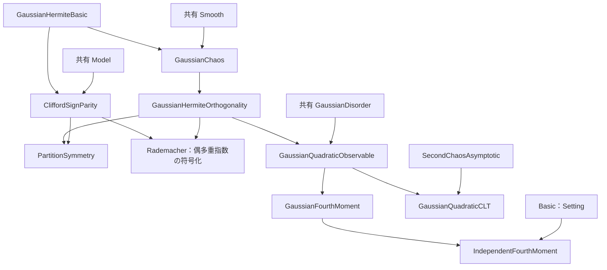
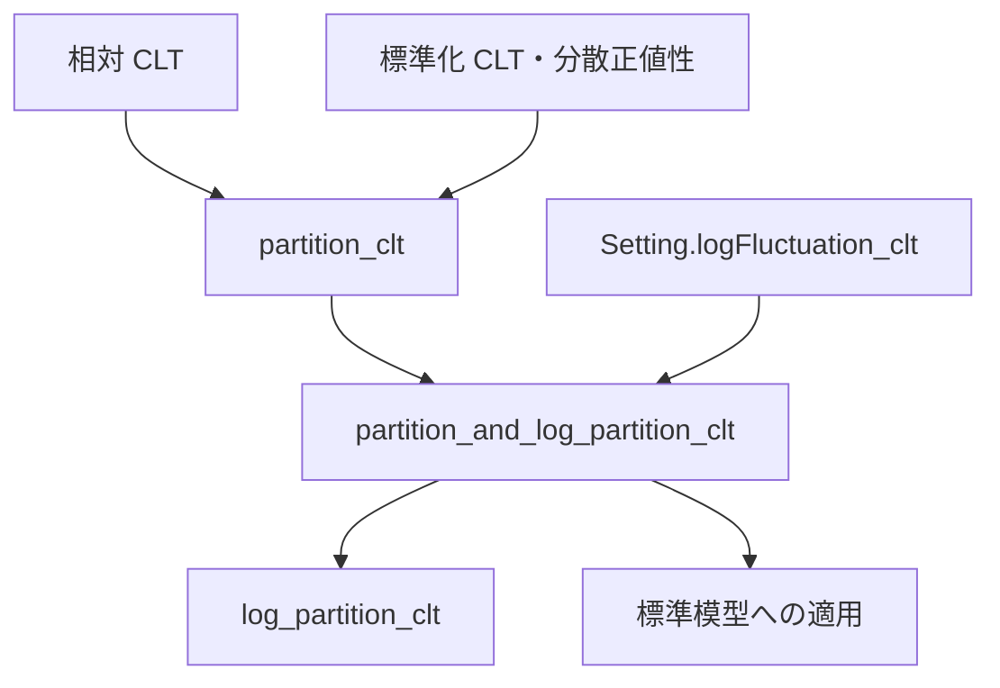
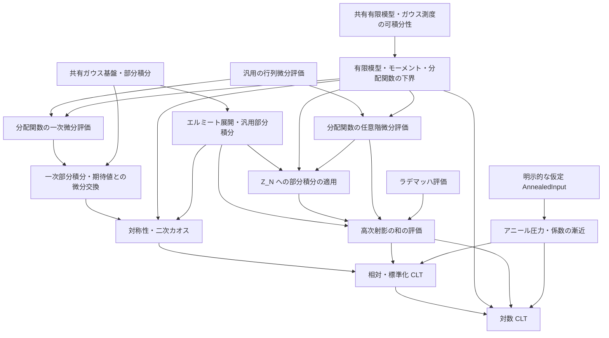

# SYK 中心極限定理の証明構造

## 現行の配置

数学コードはリポジトリの `SYK/` に置く。共有環境とビルド対象は [ワークスペース案内](../../workspace/README.md) を参照する。ファイルの配置と宣言の名前空間は別であり、確率基盤の一部の宣言は既存の `SYK.CLT` 名前空間を保持している。

| 配置（リポジトリ内） | 数学的役割 |
| --- | --- |
| `SYK/Analysis/Matrix/`・`SYK/Analysis/ConvexDerivatives.lean` | 特異値・トレース指数関数・微分評価と凸関数列の補題 |
| `SYK/Probability/GaussianChaos/` | Hermite 基本定義・部分積分・直交性・密度・完全性 |
| `SYK/Probability/` | モーメント一意性・分布移送・旧 GaussianIBP と GaussianConcentration 基盤 |
| `SYK/CLT/Chaos/` | 模型の符号対称性・分配関数の微分・二次/高次/零次カオス |
| `SYK/CLT/Quadratic/` | 有限個のガウス変数二乗の観測量・四次モーメント・二次和の CLT |
| `SYK/CLT/Limit/`・`SYK/CLT/Log/` | 模型への分布移送・分散・相対/標準化 CLT と対数への移送 |

## 基準と正式な参照元

有限模型と、三種類の条件付き CLT をまとめた `partition_and_log_partition_clt` は Lean に受理されている。現行の `AnnealedInput` は原稿の `prop:annealed-free-energy` の命題文に対応する内容を明示的な仮定として受け取る。各フィールドの対応は「アニール入力」に記す。入力整理後の検証時点・公理依存は [CLT-INPUT の記録](../../WORK_HISTORY.md#clt-input-2026-10-04)、原稿全体の照合は [監査記録](../../WORK_HISTORY.md#clt-audit-2026-10-04) を参照する。

正確な原稿の主張は `../../Paper/CLT_SYK.tex` と、そこから読み込む `introduction.tex`・`gaussian-chaos.tex`・`higher-chaoses.tex`・`main-results.tex` を参照する。実装の型と証明項は Lean ソース、横断的な状態は [全体計画](../../EDITING_PLAN.md)、残作業は [編集計画](EDITING_PLAN.md)、完了済み作業の詳しい検証根拠は [作業履歴](../../WORK_HISTORY.md) に置く。原稿内の証明、外部結果、Lean の検証済み証明を区別する。

`main-results.tex` の対数 CLT は `Z_N≥1` とカオス分解を用い、旧集中評価を必須入力にしない。

## 原稿改訂と実装の対応

現行原稿は赤字を採用案、青字を置換前の記述として扱う。全4節の主要な主張と Lean の対応は「現行原稿の主張」に記す。改訂時には [同期手順](../../EDITING_PLAN.md#原稿改訂と実装の同期) に従い、主張・仮定・規格化・依存関係・証明状態への影響を確認する。

## 模型・型・規格化

| 項目 | 現行の内容 |
| --- | --- |
| 模型 | 固定した偶数 `q≥4`、独立標準正規座標 `g_I`。Lean は偶数 `N≥q` を要求する。原稿の冒頭には偶数 `N` だけが明記されているため、分母に `\|I_N\|` を使う有限サイズの主張では `N≥q` の明示を提案している |
| 演算子 | 自己共役な Majorana 生成子、反交換関係 `ψ_i ψ_j+ψ_j ψ_i=2δ_ij I`、昇順積と位相 `i^(q/2)` |
| ハミルトニアン | `H_N=σ_N Σ_I g_I ψ_I`、`σ_N²=(q-1)!/N^(q-1)` |
| 原稿のトレース | `tr=2^(-N/2) Tr`、標準表現の次元で規格化 |
| Lean のトレース | 一般の非空有限次元表現で、行列の添字型の要素数 `Fintype.card d` で割る `normalizedTrace` |
| 分配関数 | 原稿は `Z_N(β)=tr exp(-β H_N)`、`β : ℝ`、`Z_N(0)=1`。Lean の有限模型は `z : ℂ` を扱い、CLT は実逆温度に特殊化する |
| 確率論の逆温度 | 現行原稿・CLT の宣言は `β : ℝ`。共有のギブス状態・集中 API の `β : ℝ≥0` は変更しない |
| 系の極限 | 原稿は偶数 N を通る極限。Lean の `Setting q` は偶数サイズが無限大へ発散する任意の族 |
| 確率空間 | 各サイズの共有ガウス係数空間。分布収束はサイズごとの空間を許す。概収束には別途共通確率空間が必要 |

標準表現への特殊化で原稿のトレースと一致することと、一般表現で外部極限定理を利用できることは別の確認事項である。前者は `Normalization.lean` の `partitionFunction_standard` で照合する。CLT は一つの抽象模型族 `S : Setting q` と `hFE : AnnealedInput q S` を入力とする条件付き定理として統一する。`hFE` の構築や表現独立性の証明はこの CLT の完了条件ではない。

有限模型の定義・評価・モーメントは `FiniteModel.lean` に置き、一般の `Params` と非空有限行列表現 `MajoranaSystem` のみを仮定する。`Basic.lean` がこれを import し、`Setting.partition_moments` では `S.params n` と `S.majorana n` に適用する。標準表現の import は規格化照合の `Normalization.lean` に分離し、抽象 CLT の依存から外す。最終三定理の入力は `{q : ℕ} (S : Setting q) (hFE : AnnealedInput q S)` にそろえ、`Even q` と `4 ≤ q` は `S` だけに保持する。

共有の `SYK.partitionFunction` は通常のトレースを使う。CLT の局所定義は既に存在し、通常トレースの分配関数を次元で割ったものとの一致も証明項を持つ。複素解析の API は共有側を使い、零点のない領域や対数の枝は仮定しない。現行の条件付き CLT は複素対数を入力に使わない。

## 標準模型族への適用設計

`StandardModel.lean` の `standardSetting` は `N n = q + 2 * n` の標準表現族を構成する。`CLT-APPLY` で実装・Lean 検証を完了した。偶数 `q ≥ 4` に対してこの列は `N ≥ q` の偶数をすべて一度ずつ通り、無限大へ発散する。従って原稿の偶数サイズの極限を表せる。有限個の `N < q` を除くことは極限を変えず、有限サイズの規格化では必要な `q ≤ N` を明示できる。スケーリングは列の添字ではなく実際のサイズ `N` のべきとする。

`StandardModel.lean` は模型族の構成・偶数サイズの対応・規格化の橋渡しと具体的適用を担い、`Main.lean` と `Normalization.lean` の利用側に置く。これにより標準表現の import を抽象 CLT の証明依存へ入れずに、原稿の `2^(-N/2) Tr` と共有の標準模型を接続する。公開定理の仕様は下表に記す。`standardSetting_size_iff` が全偶数サイズの列挙を、`standardSetting_Z` が規格化を照合する。`standard_partition_and_log_partition_clt` と2つの個別定理は、この族に対する `AnnealedInput` の下で検証済みである。検証記録は [作業履歴](../../WORK_HISTORY.md#clt-log-apply-completion-2026-10-05) を参照する。

入力は構成した標準模型族そのものに対する `AnnealedInput` とする。表現独立性を経由せずにこの族へ条件付き定理を適用するため、表現独立性の証明は不要である。アニール命題の証明・入力の構築は引き続き保留する。共同定理から同じ高温半径で相対・標準化・対数の CLT を得る。対数の期待誤差の明示的評価は、標準模型族への適用に必要な入力ではない。

`standardSetting (q : ℕ) (hq : Even q) (hq4 : 4 ≤ q) : Setting q` の次元添字は `SYK.StandardBasis ((q + 2*n)/2)`、マヨラナ系は `SYK.standardMajoranaSystem` である。構成後の抽象 CLT 適用時に偶数性や `q≥4` を再要求しない。

| 公開定理（名前空間 `SYK.CLT`） | 結論と証明依存 |
| --- | --- |
| `standard_partition_and_log_partition_clt` | `partition_and_log_partition_clt` を適用し、圧力収束、相対・対数 CLT、極限分散と全有限サイズ分散の正値性、標準化 CLT を同時に結論する |
| `standard_partition_clt` | 上の共同定理から圧力収束、相対 CLT、両分散の正値性、標準化 CLT を射影する |
| `standard_log_partition_clt` | 同じ共同定理から圧力収束と中心化した対数 CLT を射影する |

各定理の入力は `{q : ℕ} (hq : Even q) (hq4 : 4 ≤ q)` と `hFE : AnnealedInput q (standardSetting q hq hq4)`。`S := standardSetting q hq hq4` とし、量化は `∃ βq : ℝ, 0 < βq ∧ ∀ β : ℝ, |β| < βq → β ≠ 0 → ...` である。一つの共同定理が全結論に共通する半径を供給し、個別定理はその証人を利用する。

相対量は `N^(q/2-1)(Z/E Z-1)`、対数量は `N^(q/2-1)(log Z-E log Z)`、標準化量は `(Z-E Z)/sqrt(Var Z)`。サイズは `N=q+2*n`、測度は `standardGaussianMeasure (S.N n) q`、極限変数は `fun x : ℝ ↦ x` とする。前二者の極限測度は `gaussianReal 0 (limitVariance q hFE.ℓ β)`、標準化は `gaussianReal 0 1` である。収束は `n → atTop` の `TendstoInDistribution` で、共通確率空間や概収束を仮定しない。位相 `i^(q/2)`、係数分散 `(q-1)!/N^(q-1)`、ギブス因子の負号を保ち、原稿の `subsec:SYK-model`、`eq:Y_N`、`eq:scaled-relative-clt`、`eq:standardized-clt`、`thm:partition-clt`、`thm:free-energy-clt` に対応する。

## 補助 Lean ファイルの役割

補題を利用するときは、以下の用途と宣言名から対象を選び、ソースで定理文と必要な定義を確認する。名前空間、節の変数、型クラス、局所記法も確認し、証明の詳細は必要になった箇所を読む。この参照方法は通常の文書・Lean ソースを対象とし、適用される `AGENTS.md` の確認範囲を限定しない。以下の説明は索引であり、正確な仮定と型は Lean 宣言を参照する。

- `../Probability/GaussianIBP.lean` は、指数傾斜によるシフト恒等式、差商の一様評価、支配収束を用いて、実ガウス分布の Stein 型部分積分を構成する旧経路である。`Main` の再帰 import に含まれず、`../../Blueprint/CLT.lean` の参照と子 `SYK` ライブラリのグロブによる全量ビルドを残す。現行の CLT の部分積分は共有 `../Probability/GaussianConcentration/Smooth.lean` を使う。同基盤は、独立標準ガウスと probabilists' Hermite 多項式に対し、`C^{|α|}` の正則性と `η ≤ α` の各偏導関数に対する指数増大から、多重指数部分積分 `hermiteMulti_ibp_of_expGrowth` と両辺の可積分性を与える。これは `lem:Gaussian-Hermite-IBP` の一般部分に対応するが、`Setting.Z` の各偏導関数の評価を供給したり、この公式を `Z_N` に適用したりするものではない。
- [GaussianHermiteBasic.lean](../Probability/GaussianChaos/GaussianHermiteBasic.lean)：任意の有限型に対する `SYK.hermiteMulti`、`gaussianCouplings` と符号反転・置換による期待値の不変性を置く。模型や CLT を import しない。これらを使うマヨラナ系の符号ゲージ・頂点偶奇則は `CliffordSignParity.lean` に置く。
- [GaussianChaos.lean](../Probability/GaussianChaos/GaussianChaos.lean)：`SYK.CLT.hermite_coefficient_ibp` と `hermite_coefficient_integrable` が係数の部分積分と両辺の可積分性の入口である。`SYK.GaussianConcentration.hermiteMulti` と `GaussianHermiteBasic.lean` の `SYK.hermiteMulti`、二つの標準ガウス測度の定義を照合し、原稿の成長条件で後者の記法へ移す。正次数の平均零と Hermite 関数の積の可積分性も証明する。模型固有の符号ゲージを import しない。
- [GaussianHermiteOrthogonality.lean](../Probability/GaussianChaos/GaussianHermiteOrthogonality.lean)：`SYK.CLT.hermiteMulti_orthogonality`、`inner_hermiteLp`、`hermiteFiniteProjection_eq_starProjection` が、原稿の Hermite 内積・階乗ノルムと任意の有限添字集合への直交射影公式の入口である。このファイルの `hasSum_hermiteCoefficients` と `hasSum_hermiteDegreeProjection` は $L^2$ 完全性を仮定する。完全性を別途渡さずに使う結果は、次の `GaussianPolynomialDensity.lean` を参照する。
- [GaussianHermiteDensity.lean](../Probability/GaussianChaos/GaussianHermiteDensity.lean)：一変数実多項式の Hermite 基底、任意の実係数多変数多項式関数の Hermite 有限線形包への包含、$L^2$ クラスへの移送を証明する。多項式クラスがガウス $L^2$ に稠密なら規格化 Hermite 族も稠密であることを証明済み。
- [GaussianMomentDetermination.lean](../Probability/GaussianMomentDetermination.lean)：指数モーメントを持つ有限実測度のモーメント一意性を扱う。
- [GaussianPolynomialDensity.lean](../Probability/GaussianChaos/GaussianPolynomialDensity.lean)：`SYK.CLT.hermiteOrthonormal_dense`、`hasSum_hermiteCoefficients_unconditional`、`hasSum_hermiteDegreeProjection_unconditional` が完全性と展開の入口である。標準ガウスの指数関数と $L^2$ 関数との積の可積分性、有限積ガウス $L^2$ の多項式稠密性を経て、Hermite 完全性、階乗係数と次数別の無限和を証明済みである。これらの展開定理は完全性を追加仮定として受け取らない。
- [SingularValues.lean](../Analysis/Matrix/SingularValues.lean)：特異値・min-max・Ky Fan・Schatten 評価の証明基盤である。[MatrixTraceExponential.lean](../Analysis/Matrix/MatrixTraceExponential.lean) は規格化トレース、Schatten 評価と指数の評価を扱う。[TraceExpDerivatives.lean](../Analysis/Matrix/TraceExpDerivatives.lean) の高階微分評価の入口は `MatrixAnalysis.Matrix.iterDirectionalFDeriv_traceExp_bound` と `iterDirectionalFDeriv_traceExp_bound_of_norm_le_one` であり、Hermitian な基点における反復方向微分を扱う。`Setting.Z` のスケール・実部・ガウス可積分性との接続は F04 の `PartitionHigherDerivatives.lean` で検証済みである。
- `Chaos/Rademacher.lean` は、Boolean ベクトル上の一様平均 `radE`、符号和、および次数 `q` の基本対称式である Rademacher カオスを定義する。`even_sum_rademacher_moment` は原稿 `eq:even-sum-Rademacher-moment` の有限和恒等式を証明する。Newton 恒等式でカオスを符号和から評価し、独立符号和の指数モーメント評価と組み合わせて、偶数 `q ≥ 4` と `0 ≤ t ≤ c_q N^{-(q-1)}` の下で `𝔼_ε[|S_{N,q}|^3 exp(t|S_{N,q}|)] ≤ C_q N^{3q/2}` を証明する。
- `Chaos/PartitionHigherDerivatives.lean` は既存の行列トレース指数微分評価を `Setting.Z` の任意階の偏導関数に接続し、原稿 `eq:Z-derivative-bound` の係数、指数増大、ガウス–エルミート部分積分との接続を証明する。`Chaos/HigherChaosProjection.lean` は各次数の Hermite 射影ノルムを偶多重指数の和、さらに Rademacher モーメントで評価し、無限次数和を指数付き三次モーメントで抑える。`tsum_higherChaosProjection_le_power` と `higherChaosProjection_isLittleO` は高温半径内の原稿 `prop:higher-chaos-closure` のべき評価を証明する。
- `../Analysis/ConvexDerivatives.lean` は、割線の差の評価と平均値の定理を準備し、凸関数列の導関数を左右の割線で挟む証明を形式化する。主定理 `convex_convergence_deriv_tendstoUniformlyOn` は、開集合 `I` 上の各関数の凸性・微分可能性、関数列の局所一様収束、極限関数の微分可能性と導関数の連続性を仮定し、任意のコンパクト集合 `K ⊆ I` 上で導関数の一様収束を結論する。原稿で必要な各点収束から局所一様収束への導出はこの補題に含まれない。条件付き CLT に必要な局所一様収束は `AnnealedInput` の仮定として受け取る。
- [GaussianQuadraticObservable.lean](Quadratic/GaussianQuadraticObservable.lean)：`centeredGaussianSquare` の平均零・二次モーメント1と、有限の `normalizedQuadraticSum`、共有ユークリッド係数空間と積ガウス測度との法則対応を置く。`Setting`、二次カオス係数の漸近、CLT に依存しない。`GaussianFourthMoment.lean` はここから四次モーメント15と `L⁴` 可積分性を、`IndependentFourthMoment.lean` は独立和の公式から規格化和の四次モーメント `3+12/card` と一様上界15を証明する。`GaussianQuadraticCLT.lean` は同じ観測量に特性関数の CLT を適用する。

## 有限補題と漸近 CLT の分離

現在の import 関係は次のとおりである。矢印は依存先から利用側へ向かう。定理文・仮定・属性・規格化は変えず、互換用の別名や旧パスを追加していない。



汎用 Hermite 補題の実利用側はこの CLT 内の展開と符号対称性であるため、共有ガウス基盤へ CLT の記法を追加しない。四次モーメントの経路から二次 CLT と `SecondChaosAsymptotic` を外すことで、有限モーメント評価の数学的前提が直接読める。

有限行列解析の `SingularValues → MatrixTraceExponential → TraceExpDerivatives` は現行配置を維持する。実際の外部利用側は `PartitionDerivatives` だけで、Model はこれを import しない。`SYK.normalizedTrace` は複素行列と非空型、`MatrixAnalysis.Matrix.normalizedTrace` は一般の `RCLike` と空型も対象にするため、型を保った整理で両定義を統合しない。CLT への規格化の接続は `Setting.Z_eq_traceExp` と `Setting.norm_traceExp_disorder` に残る。この配置を採用した判断と検証は [作業履歴](../../WORK_HISTORY.md#clt-refactor-2026-10-06) を参照する。

## 重複証明と定義の整理

現行実装は既存の型・仮定・規格化を保って証明を共有している。`SingularValues` の平方・単調性は mathlib の API、有限和 Hölder は非負実数の有限和不等式を使う。零を許す列を正値に強めない。二次観測量の可測性は `GaussianQuadraticObservable` から法則対応・二次 CLT・四次モーメントへ供給し、Hermite2 の評価式は `GaussianHermiteBasic` で共有する。四次モーメントの六つの項は可積分性を個別に確認して有限和を積分する。

行列トレース指数は `MatrixAnalysis.Matrix.traceExp` に一本化した。`DerivAux.contDiff_tE` と `iteratedFDeriv_tE_bound_hermitian` の公開名は保ち、対象を同じ定義へ接続する。List に沿う微分と mathlib の反復 Fréchet 微分の滑らかさによる接続、および二つの規格化トレースの型は保持する。`MatrixTraceExponential` の Duhamel は一次微分、Schatten・語の評価と Taylor 係数は高階微分の解析的証明を担う。

`Main` は分配 CLT を先に証明し、結合定理が下位の対数 CLT と組み合わせて共通半径を取る。個別の対数 CLT は結合定理から射影する。矢印は証明結果から利用側へ向かい、公開定理の全結論と入力 `hFE` は変えない。



検証結果は [作業履歴](../../WORK_HISTORY.md#clt-cleanup-2026-10-06) を参照する。

## アニール入力

`Basic.lean` は外部入力の証明を import せず、`SYK.CLT.AnnealedInput q S` を宣言する。一つの `S : Setting q` について、現行原稿の `prop:annealed-free-energy` の内容を仮定として受け取る。原稿の模型族についての命題そのものや、一般表現への適用可能性を証明済みとしない。極限関数の存在は `ℓ` を含む構造体の入力として表す。

| 現行のフィールド | 型・条件 | 現行原稿との対応 |
| --- | --- | --- |
| `ℓ` | `ℝ → ℝ` | 極限関数 `ℓ_q` |
| `even`、`convex`、`contDiff_one` | `∀ β, ℓ (-β) = ℓ β`、`ConvexOn ℝ Set.univ ℓ`、`ContDiff ℝ 1 ℓ` | 全実軸の偶・凸な `C¹` 極限 |
| `pressure_limit` | `S.annealedFreeEnergy` の `ℓ` への全実軸での局所一様収束 | `eq:annealed-free-energy-limit` |
| `derivative_limit` | `(∂_β log E Z_N)/N` の `deriv ℓ` への全実軸での局所一様収束 | `eq:annealed-derivative-limit` |
| `sign` | `∀ β : ℝ, β ≠ 0 → 0 < β * deriv ℓ β` | 命題末尾の非零逆温度での符号条件 |

原稿の証明本文に残る導関数・圧力の上界と、命題文の内容を区別する。三種類の CLT は表の入力を仮定し、`Z_N≥1`、二次・四次モーメント、高次カオス剰余の評価は内部の証明を再利用する。

独立した Rademacher 模型の `Annealed_FE` と対応章は承認済み構成変更で削除した。ガウス模型の `AnnealedInput` の説明は Blueprint の CLT 章へ移した。この配置変更は入力の構築やアニール命題の証明を意味しない。

## 現行原稿の主張

全4節の主要な主張と Lean の対応は次のとおりである。「実装済み」は対応する主張を意味し、原稿の証明中の全表示を同じ手順で形式化したことを意味しない。

| 節・TeX ラベル | Lean の入口 | 状態・残る境界 |
| --- | --- | --- |
| `thm: input` | — | 各固定実逆温度でのアニール圧力の極限と、極限関数の全実軸での微分可能性を述べる外部入力。期待クエンチ圧力の極限や標本ごとの概収束は定理文に含まない |
| `lem:convex-derivatives` | `convex_convergence_deriv_tendstoUniformlyOn` | 原稿は各点収束から関数・導関数の局所一様収束を全実軸上で結論し、Rockafellar を引用して証明を省略する。Lean は関数の局所一様収束を仮定しており、補題全体は未形式化。既存の開集合上の定理は維持する |
| `subsec:SYK-model`、`eq:Y_N` | `realPartitionFunction`、`Setting.Y`、`partitionFunction_standard` | 有限模型と標準表現の規格化照合は実装済み。標準模型族への条件付き適用も `StandardModel.lean` で検証済み |
| `eq: chaos` | `hasSum_hermiteCoefficients_unconditional`、`hasSum_hermiteDegreeProjection_unconditional` | ガウス `L²` の展開・完全性は実装済み |
| `lem: parity rule lemma` | `Setting.Z_sign_gauge`、`Setting.Z_swap`、`Setting.integral_Z_mul_hermite_eq_zero` | CLT に使う対称性と係数消滅は実装済み。原稿の一般反射・任意の符号付き置換の統一形は一部のみ対応 |
| `lem:Gaussian-Hermite-IBP`、`eq:Gaussian-Hermite-IBP` | `hermite_coefficient_ibp`、`Setting.hermite_coefficient_Z_eq_integral_partialMulti` | 一般部分と分配関数への特殊化は実装済み。成分ごとの `η≤α` の成長条件を保持 |
| `prop:exact-second-chaos` | `Setting.Y_firstChaos_eq_zero`、`Setting.Y_secondChaos_eq` | 全実逆温度で実装済み。アニール入力は不要 |
| `lem:Z-derivative-bound`、`eq:Z-derivative-bound` | `Setting.abs_partialMulti_Z_le` | 高階微分評価は実装済み。原稿の Duhamel 積分表示そのものは未形式化 |
| `lem:Rademacher-encoding` | `Rademacher.even_sum_rademacher_moment`、`Rademacher.rademacher_encoding` | 有限和恒等式と指数付き三次モーメント評価は実装済み |
| `prop:higher-chaos-closure` | `Setting.tsum_higherChaosProjection_le_power`、`Setting.higherChaosProjection_isLittleO` | 高温でのべき評価と little-o は実装済み |
| `prop:annealed-free-energy` | `AnnealedInput` | 命題文の内容を明示的な仮定として受け取る。命題自体と入力の構築は未形式化 |
| `eq:intro-A_N-limit`、`eq:Y-decomposition-final` | `secondChaosCoefficient_tendsto`、`Setting.secondChaosScaledCoefficient_tendsto`、`Setting.Y_decomposition` | 分解は実装済み、係数の各点での極限は条件付きで実装済み。係数の局所一様収束の独立した定理は未追加 |
| `thm:partition-clt`、`thm:free-energy-clt` | `partition_clt`、`log_partition_clt`、`partition_and_log_partition_clt` | `0<\|β\|<β_q` で現行の `AnnealedInput` を仮定して実装済み。対数期待誤差の明示的な次数評価も `Setting.integral_log_Y_isBigO` で検証済み |

相対量・スケール・極限分散は
```text
Y_N = Z_N / E Z_N,  a = q/2 - 1,
ρ²(β) = (q!/2) β² (ℓ_q'(β))².
```
相対 CLT は `N^a(Y_N-1)`、対数 CLT は `N^a(log Z_N-E log Z_N)` の分布収束である。標準化は `(Z_N-E Z_N)/sqrt(Var Z_N)`。逆温度ゼロでは前二者は退化するが、原稿と Lean の CLT 定理文はともに対象外とする。零分散での標準化と混同しない。`partition_and_log_partition_clt` は非零の小さい逆温度で「すべての有限サイズの分散正値性」も結論に含むため、漸近分散の正値性だけではその結論を充足しない。

## カオス分解と係数の漸近

現在の原稿は次の二つの同値な記法を使う。
```text
|I_N| = choose(N,q),  Q_N = |I_N|⁻¹ Σ_I(g_I²-1),
A_N(β) = (β/2) ∂_β log E[Z_N(β)],
U_N = (2|I_N|)^(-1/2) Σ_I(g_I²-1),
c_N(β) = β ∂_β log E[Z_N(β)] / sqrt(2|I_N|),

Y_N - 1 = A_N Q_N + R_N = c_N U_N + R_N,
R_N = Σ_{r≥3} P_r Y_N.
```

符号ゲージ対称性・Hermite 部分積分で一次・二次カオスを同定し、トレース指数の高階微分評価と Rademacher 符号化・指数モーメントにより `‖R_N‖₂²=O(N^(-3a))` を得る。係数の同一性は F02 で符号付き頂点転置とガウス測度の不変性から証明した。`PartitionDerivatives.lean` の一次部分積分・放射方向微分・期待値との微分交換を用い、全実数の逆温度で共通係数を同定済みである。アニール導関数の極限と `|I_N|~N^q/q!` により
```text
A_N/N → (β/2) ℓ_q'(β),
N^a c_N → sqrt(q!/2) β ℓ_q'(β).
```
古典的 CLT と Slutsky を適用し、標準化には直交分解による分散漸近と非退化性を別に使う。

## 対数 CLT の証明経路

`W_N=log Y_N` とすると
```text
N^a(log Z_N-E log Z_N)
  = N^a(W_N-(Y_N-1)) + N^a(Y_N-1) - N^a E W_N.
```
最初の項は対数の局所近似と確率的有界性、二番目は相対 CLT を使う。最後の期待値の制御は次の入力に依存する。

| 入力・評価 | 主な Lean モジュール |
| --- | --- |
| 相互作用・H のトレース零、Jensen による `Z_N≥1`、モーメントと正しい中心化の恒等式 | `FiniteModel.lean`、`Basic.lean` |
| `‖R_N‖₂²=O(N^(-3a))` | `Chaos/HigherChaosProjection.lean`、`Chaos/HigherChaosRemainder.lean`（`Setting.higherChaosRemainderLp_le_power`） |
| `c_N=O(N^(-a))`、アニール入力から `log E Z_N=O(N)` | `Basic.lean`、CLT の漸近補題 |
| `sup_N E U_N^4<∞`、`P(Y_N<1/2)=O(N^(-3a))`、期待値の誤差 | `Quadratic/GaussianFourthMoment.lean`、`Log/LogEventBound.lean`、`Log/LogAsymptotics.lean` |

期待誤差は `Y_N≥1/2` と `Y_N<1/2` に分け、表のモーメント評価と分配関数の下界から制御する。分布収束だけからモーメント評価は推論しない。`LogAsymptotics.lean` は CLT に必要な `N^a E[log Y_N] → 0` を証明している。`Setting.cubed_scale_Y_lt_half_bounded` は `N^(3a) P(Y_N<1/2)` の終局的有界性を証明する。`Setting.integral_log_Y_isBigO` は非零の小さい実逆温度で、原稿の明示的な `E[log Y_N]=O(N^(-2a))` を証明する。右辺は自然数べきの逆数 `((N : ℝ)^(2*(q/2-1)))⁻¹` で表し、偶数 `q≥4` では原稿の指数と一致する。定数は固定した逆温度に依存してよい。数学的な導出は `main-results.tex` の `thm:free-energy-clt` の証明を参照する。

## 仮定する命題と保留した証明

現行原稿は He2026 v3 の Theorem 1.1、Proposition 3.3、Theorem 2.5 を引用し、Schwinger–Dyson 圧力・その微分公式・正の Lehmann 表現を用いる。現行の変換は `H̃_N=2^(-q/2)H_N`、`s=2^(q/2)|β|` であり、規格化トレースを使う。符号の処理にはガウス分布に従う相互作用係数の対称性を使う。過去の引用照合は [作業履歴](../../WORK_HISTORY.md#clt-r01-r05-audit-2026-09-27) を参照する。

当面の Lean の対象は `prop:annealed-free-energy` を仮定した条件付き CLT と具体模型への条件付き適用である。命題自体の証明と引用元の原文再調査は [編集計画の保留課題](EDITING_PLAN.md#その他の残件) に置く。証明を再開する場合は、He2026 から受け取る結果と内部で証明する導出を分離し、残る外部仮定を明示する。He2026 の定理自体の全面的な形式化は現在の計画に含めない。

## 依存関係と実装の分担

次の図は現行実装の証明に使う数学的な入力の関係を表す。Lean の import グラフではない。入力は `AnnealedInput` であり、原稿の命題文との対応は上の入力表に記す。汎用のガウス–エルミート部分積分は有限模型を数学的な前提としない。



ガウス–エルミート部分積分には、共有基盤の `gaussianReal_stein` と `pi_gaussian_stein_coord` を用いる。流用候補の調査と採否は [作業履歴](../../WORK_HISTORY.md#clt-f01-completion-2026-09-27) を参照する。

原稿の `lem:Gaussian-Hermite-IBP` は `f ∈ C^{|α|}` を仮定し、成分ごとに `η ≤ α` を満たす各偏導関数について、ある `C_η > 0` による `|∂G^η f(G)| ≤ C_η exp(C_η ‖G‖)` を要求する。この一般部分は同じ仮定のまま共有 `Smooth.lean` で証明した。共有 `pi_gaussian_stein_coord` は選択座標だけの成長評価を使い、偏導順序の交換と Hermite 因子の成長評価から反復の入力を導く。両辺の可積分性も `hermiteMulti_ibp_integrable` で証明済み。`Z_N` の正則性・成長評価と特殊化は `PartitionHigherDerivatives.lean` で証明した。有限射影、有限積ガウス $L^2$ 完全性、無限次数和の収束も証明済み。原稿の `eq: chaos` は研究者の確認に従いガウス $L^2$ の等式として解釈する。

模型から独立したガウス基盤は利用側を import しない。Model が CLT を import する依存も作らない。`SuperConcentration` は既存の独立成果として維持し、新しい対数 CLT の必須入力にはしない。現行 `Main.lean` は外部入力の証明を import せず、アニール入力を `AnnealedInput q S` として受け取る。

有限模型の定義・証明は `FiniteModel.lean` に、標準表現との規格化照合は `Normalization.lean` に置く。必要な補題の再利用先が増えた場合は、実際の型と利用関係を確認して共有層への移設を検討する。原稿の `prop:annealed-free-energy` に対応する入力を `Basic.lean` の `AnnealedInput q S` が受け取り、`Main.lean` はそれを仮定して主定理を証明する。命題自体の証明は [その他の残件](EDITING_PLAN.md#その他の残件) に置く。主要補題の所在は上の索引を参照する。

対応する公開説明は `../../Blueprint/CLT.lean` に置く。更新時の規則と残件は [全体計画](../../EDITING_PLAN.md#blueprint-の更新) を参照する。
