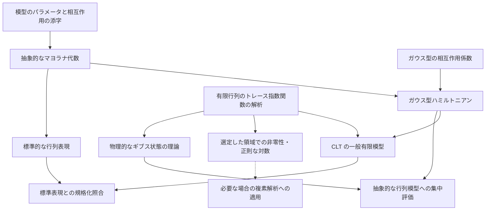

# 共有 SYK 模型の構造

## 目的

有限次元 SYK 模型を、複素逆温度に関する解析と、非負の実逆温度におけるギブス状態の理論の双方から利用できる共有 API として記述する。分配関数の整関数性・複素微分・条件付き対数微分、固定した自己共役有限行列の実軸近傍での局所非零性と主値対数の正則性、標準スケールとハミルトニアン、標準行列表現は実装済みである。残件は [全体計画](../../EDITING_PLAN.md)、検証の経緯は [作業履歴](../../WORK_HISTORY.md#model-w01) を参照する。

## 正式な参照元と既知の相違

有限の `N` に対する模型の規約は `SYK/Notes/note.tex`、CLT 固有の規格化は `SYK/Paper/`、実装済みの型と検証状態は Lean のソースコードを優先する。過去の設計案にあった、`β ≥ 0` を `Params` に格納する設計、ガウス型のランダムな相互作用を任意の追加要素とする設計、および具体的な表現を持たない設計は採用していない。

## 固定する模型規約

以下は現行の模型規約である。抽象的な代数の定義に必要な仮定と、標準行列表現に必要な偶数 `N`・次元の条件は区別する。

| 項目 | 固定する内容と注意点 |
| --- | --- |
| マヨラナ演算子 | 自己共役とし、`ψᵢψⱼ + ψⱼψᵢ = 2δᵢⱼI`、従って `ψᵢ² = I` とする。演算子を定数倍すると相互作用の積も変わるため、相互作用係数との対応を確認する。 |
| トレース | 標準の分配関数には通常のトレース `Tr` を使う。規格化トレース `tr = Tr / d` は、標準表現の直交性と CLT 固有の分配関数に必要な場合だけ使う。両者の対数は実逆温度で `log d` だけ異なる。 |
| 相互作用係数 | 独立な標準正規変数 `g_A` と、実際の係数 `J_A = σ_N g_A` を区別する。`Var(J_A) = σ_N² = (q-1)! / N^(q-1)` は各係数の分散であり、ハミルトニアン全体の分散ではない。 |
| ギブス因子 | `exp(-zH)` を用い、実逆温度では `z = β` とする。指数の符号は、エネルギーの重み付けと逆温度による微分公式の符号を決める。 |
| 相互作用の次数 | `q` は一つの相互作用に含まれるマヨラナ演算子の個数。共有模型は偶数 `q >= 2`、CLT は偶数 `q >= 4` を扱う。添字を昇順に並べた積に位相因子 `i^(q/2)` を掛け、自己共役な相互作用を作る。 |
| 系の大きさと極限 | `N` はマヨラナ演算子の個数。偶数 `N` 個を二つずつ組み合わせると、`N/2` 組のフェルミオン生成・消滅演算子を構成でき、その標準的なフォック表現の次元は `2^(N/2)` である。CLT は `q` を固定し、偶数 `N` を通る極限を扱う。別の部分列や `q` も増加する極限へ暗黙に移らない。 |
| 逆温度 | 共有模型のギブス状態と集中評価は `β : ℝ≥0` を使う。CLT 固有の確率論的結果は `β : ℝ` を使い、三つの主 CLT は `0 < \|β\| < β_q` を仮定する。`β = 0` の有限模型の恒等式と、分散が零となる標準化 CLT の定理文を区別する。 |

共有模型では `partitionFunction` に通常のトレースを使い、`partitionFunction 0 H = Fintype.card d` とする。規格化トレースは `normalizedTrace` だけを共有 API に置き、CLT 側が必要な分配関数をこれで定義する。

定義の向きは次で固定する。

```text
normalizedTrace A = Matrix.trace A / (Fintype.card d : ℂ)
partitionFunction z H = Matrix.trace (exp (-z • H))
```

規格化トレースと、実逆温度での分配関数の正値性・局所非零性を使う API には `[Nonempty d]` を要求する。空の添字型では分配関数が0となるため、この条件は本質的である。行列指数関数の解析は通常のトレースを基礎に置き、CLT 側で必要な規格化だけを明示的な除算として導く。

異なる添字のマヨラナ演算子は反交換するため、二つを入れ替えると積の符号が変わる。位相因子は偶数 `q` の相互作用を自己共役にするためのものであり、添字集合を同一視するだけでは順序と位相の一致は保証されない。

ここで相互作用演算子 `Ψ_A` は、昇順に並べたマヨラナ演算子の積に位相因子を掛けたものを指す。「直交性」は対象とする演算子族に対する内積 `⟨A, B⟩ = tr(A* B)` での直交性を意味し、`A*` は随伴を表す。標準表現の性質を、抽象的な `MajoranaSystem` の仮定として暗黙に追加しない。

## 現行の実装

| 項目 | 現行実装 |
| --- | --- |
| 逆温度 | `Params` から分離し、解析には `z : ℂ`、物理的な結果には `β : ℝ≥0` を明示的に渡す。 |
| 分配関数 | `partitionFunction` は `z : ℂ` と通常のトレースを使う。規格化が必要な利用側は `normalizedTrace` から局所的に定義する。`partitionFunction 0 H = Fintype.card d`。CLT 側の規格化分配関数は零逆温度で1となり、標準表現と原稿の対応は `SYK.CLT.partitionFunction_standard` で照合済み。 |
| 複素解析 | 整関数性・複素微分・非零点での `logDeriv` の公式、および固定した自己共役行列の実軸近傍での局所非零性・主値対数の正則性は検証済み。正確な範囲は「複素逆温度を扱う定理の仮定」を参照する。 |
| ガウス型相互作用 | 係数空間、標準ガウス測度、`couplingScale P` と `normalizedHamiltonian P M g` は `Model.GaussianDisorder` に置く。標準座標 `g_A` と実係数 `J_A = couplingScale P * g_A` を区別する。 |
| 標準行列表現 | `StandardRepresentation` に Jordan–Wigner 表現を構成し、`StandardBasis (N/2)` の次元、生成子の基本関係、同じ偶数次数の相互作用演算子族の規格化トレース直交性を検証済み。抽象的な `MajoranaSystem` に仮定は追加していない。 |

実装と検証の詳しい経緯は [作業履歴](../../WORK_HISTORY.md) を参照する。

## 共有する宣言の所属

現在の宣言の所属は次のとおりである。

| 層 | 内容 |
| --- | --- |
| `Model.Definitions` | `N`、`q` とその許容条件、相互作用の添字と昇順 |
| `Model.Majorana` | 抽象的なマヨラナ系、位相付き相互作用演算子、確定的なハミルトニアン |
| `Model.FiniteDimensionalGibbs` | 有限次元行列に対する分配関数、ギブス状態、期待値、およびトレース指数関数の解析 |
| `Model.GaussianDisorder` | `CouplingSpace`、標準ガウス測度、`σ_N` を含む標準規格化ハミルトニアン |
| `Probability.GaussianConcentration` | 有限次元ユークリッド空間上の標準ガウス集中不等式 |
| `SuperConcentration` | 密度行列の評価、マヨラナ相互作用演算子の二乗和評価、SYK への集中不等式の適用 |

`IsDensityMatrix` と `expectation` はギブス状態の構成にも使うため `Model.FiniteDimensionalGibbs` に置く。反交換族の二乗和評価は `SuperConcentration` に置く。これにより `Model` が `SuperConcentration` を import する循環を防ぐ。

非零次元・実逆温度で通常のトレースから規格化トレースへ移ると、`log Z_Tr = log Z_tr + log d` となる。次元は相互作用係数に依存しないため、中心化した対数や相互作用係数による微分ではこの差が消える。一方、`N^(-1) log d` は自由エネルギー密度の極限に残り得る。ギブス期待値は分子・分母を同じ規約で規格化すれば変わらない。

## 各層の依存関係



図は数学的な利用関係を表す。有限行列の解析は具体的な SYK ハミルトニアンの構成を前提としない。集中評価と CLT の一般有限模型は標準表現の構成を待たず、標準表現を使うのは有限サイズの規格化照合である。現行の対数 CLT の証明は集中評価と局所非零性の結果を必須入力としない。

- 模型のパラメータは `N`、`q` と、それらが許容条件を満たすことの証明だけを持ち、逆温度を持たない。
- 抽象的な反交換関係と、Jordan–Wigner 変換による標準的な行列表現を分離する。
- 汎用的な行列解析の層では、指数関数を取る前の行列、通常の行列トレース、整関数性、および複素微分を扱う。規格化トレースは直交性など実際の利用箇所に限る。
- SYK のガウス型相互作用係数の空間は共有模型に置く。有限個の座標を持つ型上のガウス集中不等式の証明は `SYK/Probability/GaussianConcentration/` に置く。

## 複素逆温度を扱う定理の仮定

以下で分配関数の正値性は `Z(β) > 0`、密度行列の条件は半正定値性と通常のトレースが1であることを指す。

零点に関する追加仮定の要否と、有限次元などの基本設定は区別する。`z` は逆温度の複素数への拡張を表す。

| 分類 | 内容 | 仮定 |
| --- | --- | --- |
| 零点に関する仮定なし | `Z(0)=Fintype.card d`、整関数性、`Z'` の公式 | 零点に関する追加仮定なし |
| 零点のない点または領域 | `logDeriv Z` と複素数値の規格化された商 | `Z z ≠ 0` |
| 物理的な実逆温度 | 正値性、熱平衡状態の密度行列、ギブス期待値、実数値の `log Z` | `[Nonempty d]`、`β : ℝ≥0`、自己共役な `H` |

`Z z ≠ 0` は複素平面全体では一般に成り立たない。ここでは `[Nonempty d]`、固定した自己共役有限行列 `H`、各 `β∈ℝ` に対し、半径 `ε(H,β)>0` の複素円板上で `Re Z_H(z)>0` を連続性から得る。この円板で既存の `Z z ≠ 0` 仮定を供給でき、像が右半平面に入るため主値の `Complex.log ∘ Z_H` が正則である。全 `H`、系の大きさ `N`、乱数標本に一様な半径は主張しない。複素逆温度における正値性や密度行列としての性質は、証明を後回しにしているのではなく、そもそも主張しない。

通常の密度行列は `ρ = exp(-βH) / partitionFunction β H` とし、半正定値で `Tr(ρ) = 1` を満たす。CLT 側の規格化分配関数を使う場合だけ、分母は次元との積になる。

## 標準行列表現

`StandardBasis m` は `Unit` から `Fin 2 × StandardBasis m` を繰り返す計算基底であり、`standardBasis_card` はその次元 `2^m` を与える。`jordanWigner m a b` は、前の各サイトに Pauli Z、指定サイトに X（b=0）または Y（b=1）、後の各サイトに恒等行列を置く Kronecker 積である。Y は講義ノートと同じ `[[0,-i],[i,0]]` とする。`jordanWignerSystem m` の零始まりのラベルは `2*a+b` であり、講義ノートのラベルとは1だけ異なる。`standardMajoranaSystem N hN` は偶数 N に対し `N/2` サイトを用い、ちょうど N 個の生成子を持つ共有構造を返す。

`standardInteraction_orthonormal` は、共有の昇順積と位相で定義する同じ偶数次数 q の相互作用について `normalizedTrace (star Ψ_A * Ψ_B) = if A = B then 1 else 0` を証明する。非対角成分は対称差の生成子による共役と有限行列のトレースの巡回性で消え、対角成分は共有の二乗公式と `normalizedTrace_one` で1になる。この固定次数の証明はマヨラナ関係とトレースから従い、既約性の追加仮定を要しない。異なる次数を混ぜた演算子族など、この定理の範囲外の直交性と区別する。

`majorana_sq`、語の随伴との積、相互作用の二乗、および語の並べ替えの補題は `Model.Majorana` に置く。生成子が添字集合に含まれる場合・含まれない場合の相互作用との交換則も同じ共有層に置く。集中評価側はこれらを直接利用し、Model から集中評価への import は作らない。

## 利用側

- `SYK/SuperConcentration/`：物理的なギブス状態に限定した結果と SYK の相互作用係数を使う。
- `SYK/CLT/`：共有の複素解析を利用し、固有の確率論的結果は `β : ℝ` で述べる。共有のギブス・集中評価を使う場合は、逆温度の型と範囲を明示的に接続する。

汎用ガウス解析は共有基盤に置き、Model に複製しない。外部の SpinGlass パッケージを Lake の依存に追加していない。設計時の流用候補と採否は [作業履歴](../../WORK_HISTORY.md#clt-f01-completion-2026-09-27)に記録した。

## モジュールと名前空間

現行のモジュール構成は次のとおりである。

```text
SYK/Model/
  Definitions.lean
  Majorana.lean
  StandardRepresentation.lean
  FiniteDimensionalGibbs.lean
  GaussianDisorder.lean
```

モジュールのパスは `SYK.Model.*` とするが、共有する主要な宣言は `namespace SYK` に置く。ファイルごとの名前空間を機械的に追加しない。内部だけで使う補助宣言は、必要な局所名前空間または `private` に置いて公開しない。
