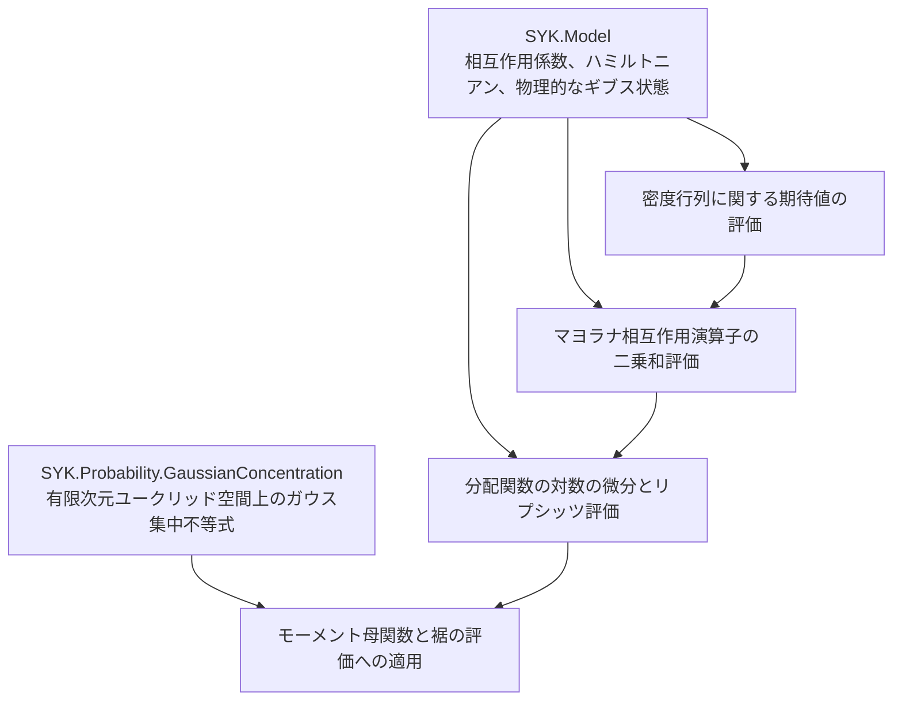

# SYK 分配関数の対数に対する集中不等式の構造

## 目的

共有 SYK 模型のうち物理的なギブス状態を扱う層と、模型に依存しないガウス集中不等式の基盤部分を接続し、通常のトレースで定義した SYK 分配関数の対数に対する集中不等式を証明する。評価は `DensityMatrix`、`MajoranaBound`、`Main` の3つのファイルに分け、MGF と、上側・下側・両側の裾の評価を供給する。残件は [全体計画](../../EDITING_PLAN.md)、過去の検証根拠は [作業履歴](../../WORK_HISTORY.md#super-w05) を参照する。

## 依存関係

`Main.lean` は `Model.GaussianDisorder` の標準ハミルトニアンと、共有模型の通常の分配関数の対数を扱い、一般スケール `𝒥` の引数を持たない。図の矢印は「上流の結果を下流が利用する」という意味である。



依存は図の矢印に沿う一方向とする。ガウス集中不等式の基盤部分は `Model` も `SuperConcentration` も `import` しない。

## 汎用的な基盤部分の分離

共有ガウス基盤と SYK に固有の部分の境界は次のとおりである。

`CouplingSpace`、`couplingSpace_card`、`standardGaussianMeasure` は `Model.GaussianDisorder` に置く。汎用測度は `../Probability/GaussianConcentration/StandardGaussian.lean` に置き、模型の測度をその有限添字型への特殊化として定義する。同一性を述べる `standardGaussianMeasure_eq_onEuclidean` は Model 側に置く。汎用部分は Model に依存せず、`N, q` への特殊化も含まない。

汎用測度 `standardGaussianMeasureOnEuclidean ι` は、標準ガウスの積測度を `toLp 2` で移したものとして定義し、mathlib の `stdGaussian (EuclideanSpace ℝ ι)` には置き換えない（研究者の決定、2026-10-11）。両者は `map_pi_eq_stdGaussian` で等しい。この形を保つ理由は次のとおりである。

- 座標ごとの Stein の恒等式、Hermite 展開、CLT の `gaussianCouplings` は積測度の形で進む。`stdGaussian` を定義にすると、定義が積測度の像であることに依存する箇所（`Smooth` の `gaussian_ibp_coord`、CLT の `normalizedQuadraticSum_law` と `FiniteVariancePositivity`）で、毎回書き換えが要る。
- 定理文は名前で述べているので、置き換えても文面は簡単にならない。得られるのは確率測度・`IsGaussian` のインスタンスの証明の省略（数行）だけである。
- [模型規約](../Model/ARCHITECTURE.md) は、係数の測度を独立な標準ガウスの積として記述している。
- mathlib の `Multivariate` は新しい API なので、定義の土台にするより証明の中で局所的に使う方が、mathlib の更新の影響を抑えられる。

mathlib の補題は、この等式を経由して証明の中で使う（`isGaussian_pi_gaussianReal`、`standardGaussianMeasureOnEuclidean_integral_id`）。`integrable_exp_mul_norm` は、`IsGaussian` から Fernique の定理を直接使う。

残る基盤部分では、座標を添字付ける任意の有限型 `ι` だけについて量化し、中心となる結果をモーメント母関数の評価 `HasSubgaussianMGF` として述べる。上側・下側・両側の裾の評価は、mathlib の劣ガウス確率変数に関する API から導く。

`L > 0` の場合の既存の証明を保ち、`L = 0` の場合は、関数が定数であることから別に処理する。公開 MGF 定理は、`L ≥ 0` に対してパラメータ `L^2` を与える。正の `L` に対する裾の評価と、零の場合に裾の事象の測度が零になる定理は、分けて述べる。分母に `L^2` を含む表示に、零を代入しない。

## 共通ガウス集中不等式の定数

ここで標準ガウス測度は各座標が独立な平均0・分散1の分布、距離はユークリッドノルムによるものとする。`X = f - E[f]` の劣ガウス性のパラメータが `L^2` とは、すべての実数 `s` に対する `E[exp(s X)] <= exp(s^2 L^2 / 2)` という評価を指し、`Var(X) = L^2` という等式ではない。`L = 0` は定数関数の場合であり、`L^2` で割る裾の公式と区別する。

## SYK に固有の証明

`Ψ_A` はマヨラナ演算子の昇順の積に位相因子を掛けた相互作用演算子である。共有分配関数には通常のトレースを使うため、`Z(0)=d`、`log Z(0)=log d` となる。ただし、この定数は相互作用係数に依存しない。

ここで二乗和の評価は、相互作用演算子 `Ψ_A` に対する `sum_A |Tr(ρ Ψ_A)|^2` の上界を指す。個々のマヨラナ演算子の期待値の和ではない。また、以下の `L` は使えるリプシッツ定数であり、その最小値を同定したという意味ではない。

期待値と確率は、独立な標準正規座標 `g_A` の積測度に関するものとする。ハミルトニアンの実際の係数は `J_A = σ_N g_A` であり、リプシッツ定数は `g_A` のユークリッドノルムに関して測る。係数 `J_A` 自体を座標にすると定数も変わるため、二つを混同しない。

物理的な逆温度 `β : ℝ≥0` と標準的に規格化したハミルトニアンに対し、通常の分配関数で定義したギブス状態の微分公式と、マヨラナ相互作用演算子の二乗和評価から

```text
L = β / sqrt q,
劣ガウス性のパラメータ = β^2 / q
```

を得る。公開する結果はモーメント母関数、下側・上側・両側の裾の評価とする。規格化トレースを使う CLT 側の量との差は `log d` という定数だけであり、ギブス期待値、相互作用係数に関する微分、および中心化した `log Z` は変わらない。

`X = log Z - E[log Z]` とすると、モーメント母関数の評価とは、すべての実数 `s` に対する `E[exp(s X)] <= exp(s^2 β^2 / (2q))` を指す。劣ガウス性のパラメータ `β^2/q` は分散そのものではなく上界の定数である。`β > 0`、`t > 0` では上下それぞれの裾に `exp(-q t^2/(2β^2))`、両側の裾にその2倍を得る。`β = 0` では `X = 0` を直接使い、この分母を持つ式には代入しない。

標準スケールとハミルトニアンは `Model.GaussianDisorder` に置き、一般スケール `𝒥` は基本 API に含めない。公開の MGF と、上側・下側・両側の裾の評価は、標準ガウス座標に対するリプシッツ性を内部で証明する。`logPartitionLipschitzConstant` は単一の公開リプシッツ定数であり、有限サイズの途中計算用定数は非公開とする。通常のトレースと規格化トレースの差が中心化で消える理由は `../Model/ARCHITECTURE.md` を参照する。

複素数 `z` に対する分配関数の整関数性や対数微分は、`Model` の解析部分で扱う。この証明には正の実数値を取る分配関数が必要なので、複素逆温度に対して非零性を仮定する API は経由しない。

抽象的なマヨラナ系に対する二乗和評価と対数分配関数の評価には、標準行列表現やトレース直交性を要求しない。必要な入力は、共有の行列解析、標準ハミルトニアン、汎用のガウス集中の3つである。旧配置と削除済み API の経緯は [作業履歴](../../WORK_HISTORY.md#super-legacy) を参照する。

## 公開定理と有限サイズの評価

`Main.lean` の公開定理は `SYK.logPartition_hasSubgaussianMGF`、`logPartition_upper_tail_standardGaussian`、`logPartition_lower_tail_standardGaussian`、`logPartition_two_sided_tail_standardGaussian` である。入力は `P : SYK.Params`、非空有限行列表現の `MajoranaSystem`、`β : ℝ≥0` である。裾の指数表示には、追加で `β ≠ 0` と `t > 0` を仮定する。`β = 0` の場合は、`logPartition_tail_of_beta_zero`、`logPartition_centered_of_beta_zero` と、上側・下側の対応する定理で処理する。MGF はこの場合も含む。

`SYK.syk_sum_sq_expectation_le` は任意の密度行列 `ρ` について次を証明する。

```text
Σ_{|A|=q} |Tr(ρ Ψ_A)|² ≤ choose(N,q-1)/q,
有限サイズのリプシッツ定数の二乗 ≤ (β couplingScale(P))² choose(N,q-1)/q.
```

`couplingScale(P) = sqrt((q-1)!/N^(q-1))` を用いて後者を `β²/q` で抑え、上の MGF と裾評価を得る。標準ガウス座標に関する評価で、規模 `N` に依存しない上界である。

## モジュールと名前空間

```text
SYK/Probability/GaussianConcentration/
  StandardGaussian.lean
  Smooth.lean
  Lipschitz.lean

SYK/SuperConcentration/
  DensityMatrix.lean
  MajoranaBound.lean
  Main.lean
```

汎用的な基盤部分の宣言は `namespace SYK.GaussianConcentration`、SYK に固有の集中不等式は `namespace SYK` に置く。汎用的な基盤部分のために独立した `lean_lib` のビルド対象を増やさず、ワークスペースの `SYK` ライブラリの一部とする。
