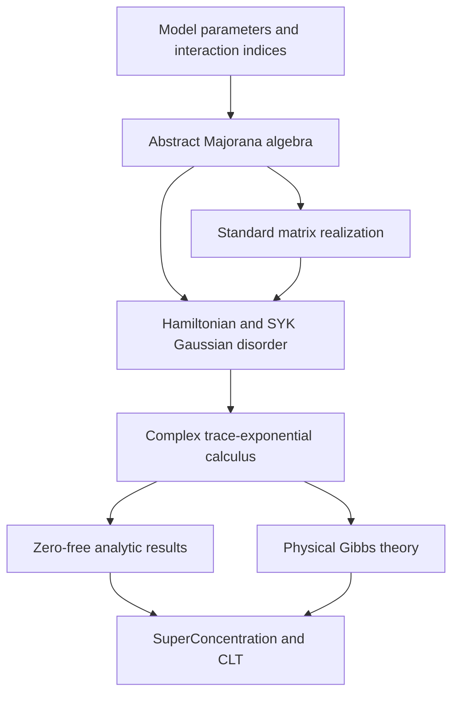

# 共有 SYK 模型の構造

## 目的

有限次元 SYK 模型を、複素温度の解析と非負実温度の Gibbs theory の双方から利用できる
共有 API として再設計する。現在の `SYK/SYK_model/` は将来 `SYK/SYKModel/` へ改名する。

## Source と既知の相違

finite-`N` 規約は `SYK/lectureNotes/note.tex`、CLT の normalization は
`SYK/CLT/refs/`、検証状態は Lean source を優先する。`model.txt` は historical
blueprint であり、`β ≥ 0` を `Params` に格納すること、raw trace のみを使うこと、
Gaussian disorder を optional とすること、および concrete representation を持たない
ことは目標設計として採用しない。

## 固定する模型規約

| 項目 | 共有模型での扱い |
| --- | --- |
| Majorana relation | `{ψ_i,ψ_j}=2δᵢⱼ I` |
| fermion number | even `N`、physical dimension `2^(N/2)` |
| interaction order | even `q >= 2`。CLT の `q >= 4` は consumer 側 |
| interaction | canonical order と phase `Complex.I ^ (q / 2)` |
| Gaussian scale | `σ_N²=(q-1)!/N^(q-1)` |
| partition function | `Z(z)=tr(exp(-zH))`、`tr` は normalized trace |
| physical temperature | `β : ℝ≥0`、analytic temperature は `z : ℂ` |

raw trace は基礎・互換 API として残すが、標準の `partitionFunction` は normalized traceを
使い、`Z(0)=1` とする。

定義の向きは次で固定する。

```text
normalizedTrace A = Matrix.trace A / (Fintype.card d : ℂ)
rawPartitionFunction z H = Matrix.trace (exp (-z • H))
partitionFunction z H = normalizedTrace (exp (-z • H))
                      = rawPartitionFunction z H / (Fintype.card d : ℂ)
```

最下層の analytic functional は exponent matrix を直接受け取る
`A ↦ normalizedTrace (exp A)` とし、`partitionFunction` は `A=-z • H` による
specialization とする。normalized API には `[Nonempty d]` を要求し、除数の非零性を
明示する。raw/normalized の逆向き等式は consumer が必要とする場合だけ補題として持つ。

## 目標 layer



- model parameter は `N`, `q` と admissibility のみを持ち、temperature を持たない。
- abstract relations と standard Jordan--Wigner matrix realization を分離する。
- generic matrix layer は exponent matrix、normalized trace、trace exponential、entire 性、
  複素微分を扱う。
- SYK Gaussian coupling space は shared model に置き、finite coordinate type 上の Gaussian
  concentration proof は `SYK/Probability/GaussianConcentration/` に置く。

## 複素温度の theorem contract

| 分類 | 内容 | 仮定 |
| --- | --- | --- |
| 無条件 | `Z(0)=1`、entire 性、`Z'` の公式 | `[Nonempty d]` |
| zero-free | logarithmic derivative、complex normalized quotient | `Z z ≠ 0` |
| physical | positivity、thermal density、Gibbs expectation、real `log Z` | `β : ℝ≥0`、self-adjoint `H` |

`Z z ≠ 0` は複素平面全体では一般に偽である。将来は high-temperature disk や strip などの
具体的な zero-free region を証明し、その範囲で仮定を供給する。global holomorphic
logarithm には zero-free 性に加えて branch を選べる領域条件が必要である。複素温度での
positivity と density-matrix 性は deferred proof ではなく、主張しない性質である。

## Consumer

- `SYK/SuperConcentration/`：physical Gibbs specialization と SYK coupling を使う。
- `SYK/CLT/`：complex analytic inputs と `β : ℝ≥0` の確率論的 specializationを使う。
- `SYK/Annealed_FE/`：現在は編集・移行対象外とする。

SpinGlass の generic finite Gibbs calculus は layer 分離の参考とするが、classical finite-sum
API、raw normalization、外部 repository dependency は採用しない。

参照先は <https://github.com/or4nge19/SpinGlass> である。特に `FiniteGibbs` の
model-independent boundary、concrete model への bridge lemma、calculus の module 分離を
参考にする。

## Module と namespace

目標 module tree は次で固定する。

```text
SYK/SYKModel/
  Model.lean
  Majorana.lean
  StandardRepresentation.lean
  MatrixThermodynamics.lean
  GaussianDisorder.lean
```

module path は `SYK.SYKModel.*` とするが、共有する主要 declaration は `namespace SYK`
に置く。file ごとの追加 namespace を機械的に作らない。内部 helper は必要な局所 namespace
または `private` で閉じる。
