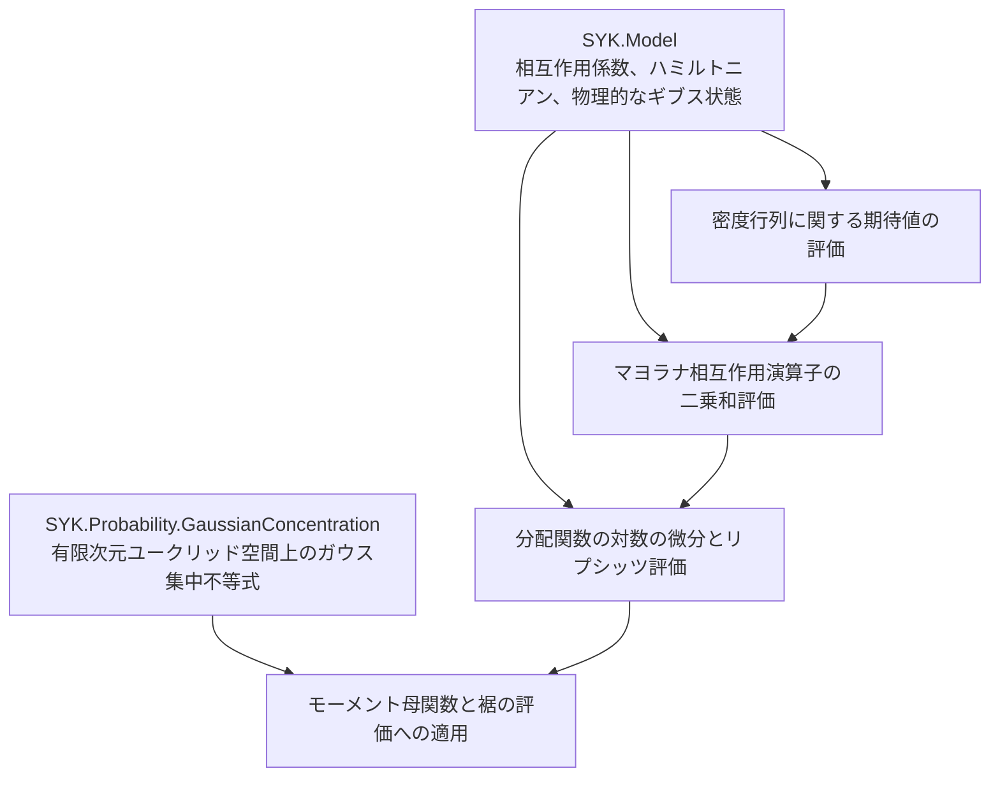

# SYK 分配関数の対数に対する集中不等式の構造

## 目的

共有 SYK 模型のうち物理的なギブス状態を扱う層と、模型に依存しないガウス集中不等式の基盤部分を接続し、通常のトレースで定義した SYK 分配関数の対数に対する集中不等式を証明する。ディレクトリは `SYK/SuperConcentration/` へ改名済みであり、以下の API とモジュール分割への移行は未完了である。実行単位と待ち合わせは [全体計画](../EDITING_PLAN.md)、細目と検証根拠は [編集計画](EDITING_PLAN.md) に集約する。

## 依存関係

この文書の配置と API は移行後の目標である。現行の `Main.lean` は一般スケール `𝒥` と共有模型の通常の分配関数の対数を扱う。移行後の基本 API は `𝒥 = 1` に対応する標準のハミルトニアン規格化を用い、共有模型から分配関数を受け取る。図の矢印は「上流の結果を下流が利用する」という意味である。

再設計の比較元は Git コミット `1b5a64cc9860f36876cc30b1a13d66ad4bfe8047` とする。旧版は Git 履歴で保持し、現行ファイルを直接改修する。既存の定理文、規格化、証明の着想を比較に使う一方、証明スクリプトは重複の除去、mathlib の利用、可読性の改善のために書き換えてよい。旧 API を維持する別モジュール、別名前空間、互換用の別名は作らない。



依存は図の矢印に沿う一方向とする。ガウス集中不等式の基盤部分は `Model` も `SuperConcentration` も `import` しない。

## 汎用的な基盤部分の分離

新基盤の編集・証明の細目は [汎用基盤の計画](../Probability/GaussianConcentration/EDITING_PLAN.md)、旧配置の整理と SYK への適用は [このディレクトリの計画](EDITING_PLAN.md#w02) に記録する。以下は移設の設計理由と境界であり、作業状態の一覧ではない。

`CouplingSpace`、`couplingSpace_card`、`standardGaussianMeasure` は `Model.GaussianDisorder` に置く。W02 で汎用測度を `Probability/GaussianConcentration/StandardGaussian.lean` に移し、模型の測度をその有限添字型への特殊化として定義した。同一性を述べる `standardGaussianMeasure_eq_onEuclidean` は Model 側に置き、汎用部分から Model への依存と `N, q` への特殊化を除いた。

残る基盤部分では、座標を添字付ける任意の有限型 `ι` だけについて量化し、中心となる結果をモーメント母関数の評価 `HasSubgaussianMGF` として述べる。上側・下側・両側の裾の評価は、mathlib の劣ガウス確率変数に関する API から導く。

`L > 0` の既存証明を保持し、`L = 0` では関数が定数であることから別に処理する。公開 MGF 定理は `L ≥ 0` でパラメータ `L^2` を与える。正の `L` に対する裾評価と、零の場合に裾事象の測度が零である定理を分け、分母に `L^2` を含む表示へ零を代入しない。

## 共通ガウス集中不等式の定数

ここで標準ガウス測度は各座標が独立な平均0・分散1の分布、距離はユークリッドノルムによるものとする。`X = f - E[f]` の劣ガウス性のパラメータが `L^2` とは、すべての実数 `s` に対する `E[exp(s X)] <= exp(s^2 L^2 / 2)` という評価を指し、`Var(X) = L^2` という等式ではない。`L = 0` は定数関数の場合であり、`L^2` で割る裾の公式と区別する。

## SYK に固有の証明

`Ψ_A` はマヨラナ演算子の昇順の積に位相因子を掛けた相互作用演算子である。共有分配関数には通常のトレースを使うため、`Z(0)=d`、`log Z(0)=log d` となる。ただし、この定数は相互作用係数に依存しない。

ここで二乗和の評価は、相互作用演算子 `Ψ_A` に対する `sum_A |Tr(ρ Ψ_A)|^2` の上界を指す。個々のマヨラナ演算子の期待値の和ではない。また、以下の `L` は使えるリプシッツ定数であり、その最小値を同定したという意味ではない。

期待値と確率は、独立な標準正規座標 `g_A` の積測度に関するものとする。ハミルトニアンの実際の係数は `J_A = σ_N g_A` であり、リプシッツ定数は `g_A` のユークリッドノルムに関して測る。係数 `J_A` 自体を座標にすると定数も変わるため、二つを混同しない。

物理的な逆温度 `β : ℝ≥0` と標準的に規格化したハミルトニアンに対し、通常の分配関数で定義したギブス状態の微分公式と、マヨラナ相互作用演算子の二乗和評価から

```text
L = β / sqrt q,
劣ガウス性のパラメータ = β^2 / q
```

を得る。公開する結果はモーメント母関数、下側・上側・両側の裾の評価とする。規格化トレースを使う CLT 側の量との差は `log d` という定数だけであり、ギブス期待値、相互作用係数に関する微分、および中心化した `log Z` は変わらない。

`X = log Z - E[log Z]` とすると、モーメント母関数の評価とは、すべての実数 `s` に対する `E[exp(s X)] <= exp(s^2 β^2 / (2q))` を指す。劣ガウス性のパラメータ `β^2/q` は分散そのものではなく上界の定数である。`β > 0`、`t > 0` では上下それぞれの裾に `exp(-q t^2/(2β^2))`、両側の裾にその2倍を得る。`β = 0` では `X = 0` を直接使い、この分母を持つ式には代入しない。

現行の一般スケールでは、モーメント母関数のパラメータに `𝒥^2` が掛かる。標準の規格化への移行はこのスケールを基本 API から分離するものであり、定数を粗い評価に置き換えることではない。通常のトレースと規格化トレースの差が中心化で消える理由は `../Model/ARCHITECTURE.md` を参照する。

複素数 `z` に対する分配関数の整関数性や対数微分は、`Model` の解析部分で扱う。この証明には正の実数値を取る分配関数が必要なので、複素逆温度に対して非零性を仮定する API は経由しない。

## 廃止する構造

- `Core.lean` 内で再定義されていた相互作用演算子は
  `Model/Majorana.lean` へ移設済みである。
- `Gibbs.lean` 内で再定義されていた有限次元行列の Gibbs 状態と
  トレース微分は `Model/FiniteDimensionalGibbs.lean` へ移設し、旧ファイルは
  削除済みである。
- `exactLipschitzSq` と `simpleLipschitzConstant` の二重公開
- 基本定理に含まれる一般のスケール `𝒥`
- 物理的なヒルベルト空間が空である場合の分岐
- 証明計画書にある `N^(q/2)` の目標と旧来のファイル構成

抽象的なマヨラナ系に対する証明と、標準的な行列表現への特殊化は区別する。ただし、同じ定義を重複して持たない。現行の `syk_sum_sq_expectation_le` と対数分配関数の評価は抽象的な `MajoranaSystem` を使うため、W05 は W04 の標準表現やトレース直交性を待たずに進められる。必要な前提は共有の行列解析・標準ハミルトニアン・汎用ガウス集中である。

## モジュールと名前空間

```text
SYK/Probability/GaussianConcentration/
  StandardGaussian.lean
  Smooth.lean
  Lipschitz.lean

SYK/SuperConcentration/
  DensityMatrix.lean
  MajoranaBound.lean
  Main.lean
```

汎用的な基盤部分の宣言は `namespace SYK.GaussianConcentration`、SYK に固有の集中不等式は `namespace SYK` に置く。汎用的な基盤部分のために独立した `lean_lib` のビルド対象を増やさず、ワークスペースの `SYK` ライブラリの一部とする。
