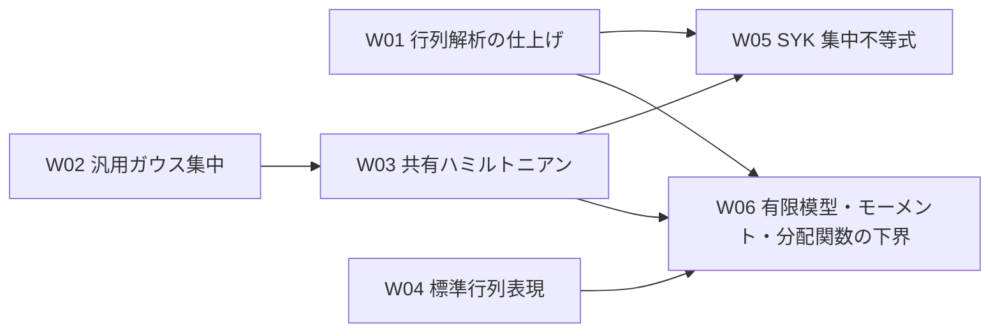

# SYK の作業履歴

完了済み作業の検証結果と旧計画を保存する。現行の残件は [全体計画](EDITING_PLAN.md) と各詳細計画で確認する。履歴内の「現在」「未解決」は記録当時を指す。通常の作業再開時に全体を読む必要はない。

<a id="clt-refactor-2026-10-06"></a>

## CLT-REFACTOR の第1巡実装・検証（2026-10-06）

担当・統合担当は Kamijima。最大3巡の作業・監査という依頼に従う。以下の実装・検証記録は、第1巡提出時点から監査再開前までの状態を記したものである。第1巡監査は使用量の限度で実施前に停止した。再開時の指示により、担当・統合担当を Kamijima に統一した。その時点では既存の第1巡成果を保持し、状態を監査未了の統合待ちとした。開始 HEAD は `96f846e58a45abda31d404c3e84370d92e150246`、開始時の差分と未追跡ファイルはなかった。参照原稿は同 HEAD の `CLT/refs/CLT_SYK.tex` と全4節（`introduction.tex`、`gaussian-chaos.tex`、`higher-chaoses.tex`、`main-results.tex`）。この5ファイルを開始 HEAD とバイト比較し、SHA-256 も一致することを確認した。原稿・`SYK/README.md`・共有 Model・ガウス基盤・Lake 設定は編集していない。保留中の命題証明・外部入力調査・凸収束補題は再開していない。

調査した重点3項目の採否・移設宣言・前後の依存・検証対象を、編集前に `CLT/EDITING_PLAN.md` へ記録した。`GaussianHermiteBasic.lean` に任意有限型の Hermite 積、積ガウス測度、符号反転・置換不変性の7公開宣言を `CliffordSignParity.lean` から抽出した。`GaussianChaos` はこの基礎を利用し、模型固有の符号ゲージを import しなくなった。頂点偶奇則を実際に使う `Rademacher` は `CliffordSignParity` を明示 import する。

`GaussianQuadraticObservable.lean` に `centeredGaussianSquare`、平均零・二次モーメント1、`normalizedQuadraticSum` と法則対応の5公開宣言、および4個の private 補助を抽出した。`GaussianFourthMoment` と `GaussianQuadraticCLT` はこれを直接利用する。`IndependentFourthMoment` は `Setting` のため `Basic` を明示 import する。ソースの再帰 import 調査により、`GaussianChaos` から Model・`CliffordSignParity` が外れ、`GaussianFourthMoment` と `IndependentFourthMoment` から `GaussianQuadraticCLT`・`SecondChaosAsymptotic` が外れたことを確認した。

有限行列解析3ファイルの利用先は CLT 内の `PartitionDerivatives` だけであり、共有 Model への先行移設は採用しなかった。2種類の規格化トレースは `ℂ` と一般 `RCLike`、非空型の仮定、定義式が異なるため保持した。`Setting.Z_eq_traceExp` と `Setting.norm_traceExp_disorder` の接続、および原稿 `subsec:SYK-model`・`eq:Z-derivative-bound` の規格化を照合した。

移設した12公開宣言と4 private 補助の元ソースブロックが、移設先にそのまま含まれることを確認した。private の `centeredGaussianSquare_measurable` は `@[fun_prop]` と証明項を保って観測量ファイルへ移した。二次 CLT 内でこの private 名を直接使っていた箇所は、同じ可測性の局所証明に接続した。元ソースから再検査した一時入力と移設後の `#print` を比較し、12公開宣言の型・定義が一致した。公開名・名前空間・仮定・量化・属性・規格化を変更せず、互換用別名・旧パスは追加していない。

Lean 4.32.2、Lake 5.0.0（commit `f3b06c7`）で、共有ワークスペースのルートから以下を検証した。環境の PATH に Lake がなかったため、既存の `/home/yoshi/.elan/bin/lake` を明示して実行した。

- `lake env lean SYK/CLT/Lemmas/<名前>.lean` は、新規2ファイルと `CliffordSignParity`、`GaussianChaos`、`GaussianQuadraticCLT`、`GaussianFourthMoment`、`IndependentFourthMoment`、`Rademacher`、直接利用側の `GaussianHermiteOrthogonality`、`Preliminaries`、`QuadraticBridge`、`LogEventBound`、`HigherChaosProjection` の計13ファイルですべて成功した。必要な `olean` は `lake build +<module>:olean` で依存順に生成した。
- 最終 `lake build CLT` は3256 jobsで成功した。エラー0件、既存の linter・非推奨警告540件（直前の LOG・APPLY 記録と同数）。内訳は `StandardGaussian` 264、`Smooth` 183、`GaussianIBP` 74、`SingularValues` 2、`MatrixTraceExponential` 6、`TraceExpDerivatives` 2、`PartitionDerivatives` 5、`Preliminaries` 2、`Rademacher` 1、`FiniteDimensionalGibbs` 1。関連する警告は既存の長い行、非推奨の線形写像補題、`show`・柔軟な `simp` の使用、未使用の型クラス仮定である。新規2ファイルと移設元に新しい警告はない。共有層・設定を変更していないため既定ビルドは本単位の検証対象に含めず、既定対象外の `Annealed_FE`・`Universality` も検査していない。
- 24宣言の `#print` と `#print axioms` が成功した。対象は移設12公開宣言、Hermite 部分積分、四次モーメントと一様上界、行列トレース指数の方向微分評価、二次和 CLT、抽象3 CLT、LOG の Big-O 定理、標準模型3 CLT。すべて `[propext, Classical.choice, Quot.sound]` のみで、`sorryAx`・新規公理はない。主定理の `hFE : AnnealedInput` と実逆温度 `0<|β|<βq`、尺度 `N^(q/2-1)`、極限分散 `(q!/2)β²(ℓ_q'(β))²`、標準化分散1を再照合した。
- 全体計画、CLT の詳細計画・構造文書・案内、章の計画と `Chapters/CLT.lean` を更新した。Blueprint の有限二次観測量と四次モーメントを別の節にし、二次 CLT は平均・二次モーメント・法則対応、対数中心化誤差は四次モーメントを参照する依存にした。追加した宣言名・依存名と原稿 `lem:Gaussian-Hermite-IBP`・`eq:Gaussian-Hermite-IBP`・`eq: chaos`・`thm:free-energy-clt` をソース上で照合した。Verso の章 Lean 検査・生成・`vbp check` は休止中のため実施していない。関係する差分を確認し、`git diff --check` も成功した。

初回の個別検査では private の可測性属性の推移利用を検出し、定義とともに移設して解消した。初回の CLT ビルドでは `Rademacher` の `InteractionIndex`・`IsEvenMultiIndex` の推移 import 依存を検出し、模型固有の import を明示して解消した。いずれも定理文・数学的前提の変更は必要なかった。最終検証に残るエラー・未完成証明・未解決目標はない。`hFE` の命題自体は引き続き外部からの明示的な仮定であり、その構築や表現独立性は証明していない。コミットは作成していない。

### 第1巡監査と統合完了

実作業には Sol、監査には Astra を用いた。再開後に第1巡の完成成果を読み取り監査した。必須修正0件、任意提案0件、未解決事項0件で、追加の Lean 検証要求はなかった。監査では12公開宣言と4 private 補助のブロック・型・属性の保持、import 閉包と循環・共有層への逆依存の不在、行列解析と規格化トレースの非移設判断、原稿との対応、13個別検査・3256 jobsのビルド・24宣言の公理確認、540既存警告、Blueprint と文書の参照・担当・Verso 休止の境界を確認した。

指摘なしの結論を受け、担当・統合担当の Kamijima が現行計画を完了へ更新した。この最終更新は状態と履歴のみで、数学的ソースや定理文・仮定・規格化を追加変更せず、Lean 検証も繰り返していない。関係する差分・リンク・状態の整合を確認し、`git diff --check` は成功した。実際の作業・監査は第1巡のみで完了した。使用量の限度による監査実施前の失敗は監査巡回に数えない。`hFE : AnnealedInput` は引き続き明示的な仮定で、Verso の機械的検査は休止中である。コミットは作成していない。

<a id="clt-log-apply-completion-2026-10-05"></a>

## CLT-LOG・CLT-APPLY の実装と検証（2026-10-05–06）

担当・統合担当は Noda。開始点は割当時と同じ HEAD `5b7b401b4cc7188787f68329e5e914862eb2f3a4`。最初の実装着手時の追跡差分は割当・仕様確定で更新した4文書、未追跡は `CLT/refs/out/CLT_SYK.pdf` のみだった。検証再開時はこれに LOG・APPLY の未検証実装案と進捗文書の差分が加わっていた。参照原稿は同 HEAD の `CLT/refs/CLT_SYK.tex` と全4節であり、本単位では原稿を編集していない。

当初は親ワークスペースの設定と指定 toolchain が未構築だったため、ソース実装案を未検証として保存した。ユーザーの環境更新後、親の `lake env lean --version` で Lean 4.32.2（Windows、commit `f3b06c705e6c85f5314019d5d3baab0fec5b580c`）を確認し、mathlib と配布用と同じ対象の Lake 設定を使用して検証した。初回の個別検査は SYK のコンパイル済みモジュールがなく失敗したため、必要な依存をビルドした。依存の版・共有設定は変更していない。

LOG は `Lemmas/LogAsymptotics.lean` に `Setting.cubed_scale_Y_lt_half_bounded` と `Setting.integral_log_Y_isBigO` を追加した。二次カオス係数の尺度付き極限と四次モーメント、高次カオス剰余の定量評価から `N^(3a) P(Y_N<1/2)` の終局的有界性を得る。分散の尺度付き極限、`log E Z_N=O(N)`、`N≤N^a` と既存の対数線形化誤差の上界を使い、非零の小さい固定実逆温度で `E[log Y_N]=O(N^(-2a))` を証明した。右辺は自然数べきの逆数 `((N : ℝ)^(2*(q/2-1)))⁻¹` で表す。偶数 `q≥4` では `2*(q/2-1)=q-2` であり、`thm:free-energy-clt` の証明の指数と一致する。定数の逆温度についての一様性は主張しない。

APPLY は `StandardModel.lean` の `standardSetting` に `N n=q+2*n` の標準表現族を構成した。`standardSetting_size_iff` は任意の偶数 `N≥q` が一意に現れることを示し、`standardSetting_Z` は規格化トレースとの一致を与える。`standard_partition_and_log_partition_clt` と個別の `standard_partition_clt`・`standard_log_partition_clt` が、この模型族に対する `AnnealedInput` の下で3種類の CLT を適用する。確率測度の型は依存型を揃えるため `standardGaussianMeasure (S.N n) q` と記し、`S.N n=q+2*n` は定義による。標準表現を抽象 `Main.lean` の import 先には加えていない。

初回検査で判明した LOG の実数指数と自然数指数の変換、不等式の接続、APPLY の確率測度インスタンスと依存型の表記を修正した。仮定・結論・規格化は変更していない。原稿の `subsec:SYK-model`、`eq:Y_N`、`eq:scaled-relative-clt`、`eq:standardized-clt`、`thm:partition-clt`、`thm:free-energy-clt`、`prop:annealed-free-energy` と、サイズの極限、温度範囲、尺度、中心化、分散を照合した。

共有ワークスペースのルートで以下を検証した。

- `lake env lean SYK/CLT/Lemmas/LogAsymptotics.lean`、`lake env lean SYK/CLT/StandardModel.lean`、直接利用先の `lake env lean SYK/CLT/Main.lean` はすべて成功し、個別検査の警告はなかった。
- `lake build CLT` は3254 jobsで成功し、新規 `SYK.CLT.StandardModel` のビルドも含む。既存の linter・非推奨警告540件が表示された。今回変更した2モジュールに新しい警告はない。既定対象外の `Annealed_FE`・`Universality` の検証は含まない。
- 新規8宣言（LOG の2定理、標準模型族、サイズ対応、規格化、3つの適用定理）と既存の `partition_and_log_partition_clt` の `#print axioms` はすべて `[propext, Classical.choice, Quot.sound]` のみ。`sorryAx` はない。`#print` で LOG の Big-O 定理と標準模型族の3定理の型・残る仮定・結論を確認した。
- 全体計画、CLT の詳細計画・構造文書・案内、章の計画、`Chapters/CLT.lean` に成果を反映した。Blueprint は対数期待誤差の明示的次数を追記し、標準模型族への条件付き適用のノードを追加した。Verso を import しない一時検査入力で同章の93宣言を #check し、エラー・警告なしで成功した。追加したノードの依存先と履歴リンクをソース上で確認し、git diff --check も成功した。Verso の章検査・生成・`vbp check` は休止中のため実施していない。

アニール命題の内容は `hFE` として残る。命題自体の証明、入力の構築、表現独立性は本単位の成果に含まない。LOG・APPLY の完了後も `CLT-REFACTOR` は範囲・担当の確定前であり、リファクタリングには着手していない。コミットは作成していない。

### 完了記述の第1巡照合（2026-10-06）

完了した `CLT-LOG`・`CLT-APPLY` の文書監査で、`CLT/EDITING_PLAN.md` の完了仕様に残っていた実装・検証・文書更新の未来形を実績の記述へ直した。`Chapters/EDITING_PLAN.md` の導入は完了済み項目と残件の双方を示す表現へ改めた。`Chapters/CLT.lean` の証明経路と対数 CLT の説明から、未完了を示唆する `intended`・`remaining` を除いた。既存の完了記録と過去の割当記録は当時の記録として保持した。

修正箇所の数式・定理名・宣言参照・依存名・`hFE` の条件は変更していない。LOG の次数 `O(N^(-2a))`、標準模型族 `N=q+2n` と条件付き3定理の記述を実装ソースと照合し、文書内リンクの参照先と差分を確認した。今回の編集は説明文のみで、既存の Lean 個別検査・`lake build CLT`・公理依存・Blueprint 93 宣言の参照検査は上記完了記録を参照する。Verso の章検査・生成・`vbp check` は休止中のため行っていない。

Astra の第2巡は指摘なし。Sol の修正は第1巡のみで、追加修正は不要だった。最終確認で変更範囲を確認し、`git diff --check` は成功した。


<a id="clt-log-apply-plan-2026-10-05"></a>

## CLT-LOG の割当と CLT-APPLY の仕様確定（2026-10-05）

ユーザーの指定に従い、`CLT-LOG` と `CLT-APPLY` の担当・統合担当を Noda とした。この単位は割当・仕様確定・関連文書の更新であり、両課題の Lean 実装は未着手である。先行成果の統合と仕様確定により両課題を「割当可能」とし、割当済みであることを全体計画に明記した。

割当時の開始点は HEAD `5b7b401b4cc7188787f68329e5e914862eb2f3a4`。`git status --short` では追跡ファイルの差分はなく、未追跡は `CLT/refs/out/CLT_SYK.pdf` のみだった。同 HEAD の Lean ソース一式、`CLT/refs/CLT_SYK.tex` と `sections/` の全4節を両課題の参照ソースとする。未追跡 PDF は参照原稿の版を定めるソースに含めない。今回の追加差分は全体計画、`CLT/EDITING_PLAN.md`、`CLT/ARCHITECTURE.md`、本履歴の4文書である。実装開始時にはこの開始点からの差分を確認し、原稿または入力が変わっていれば同期手順を適用する。

`CLT-LOG` は既存の3ファイルの編集範囲と `E[log Y_N] = O(N^(-2a))` の完了条件を保持し、既存の期待誤差・分散の入口を詳細計画に追記した。`main-results.tex` の `thm:free-energy-clt` の証明で、二次モーメント、小確率事象、`Z_N ≥ 1`、`log E Z_N = O(N)`、`a ≥ 1` による `N^(1-3a) ≤ N^(-2a)` が評価を与えることを確認した。

`CLT-APPLY` は `N n = q + 2 * n` の標準模型族、全偶数サイズとの対応、標準表現の規格化、3つの公開定理、編集範囲と検証条件を確定した。原稿の `subsec:SYK-model`、`eq:Y_N`、`eq:scaled-relative-clt`、`eq:standardized-clt`、`thm:partition-clt`、`thm:free-energy-clt`、`prop:annealed-free-energy` を `Setting`・`AnnealedInput`・`Main.lean`・`Normalization.lean`・共有標準表現の型とソース上で照合した。極限の取り方、温度条件、中心化、尺度、極限分散、有限サイズの分散正値性を保持する。入力はこの族の `AnnealedInput` とし、命題の証明や表現独立性を完了条件に追加しない。

確認は文書・原稿・宣言のソース照合である。`git diff --check` は成功し、`git diff --stat`・`git status --short` で変更が上記4文書に限られることを確認した。追加したリンクの参照先・履歴アンカーと担当記載も照合した。新規模型族・定理の Lean 検査、公理依存確認、関連ビルド、Blueprint の実装成果の反映は後続の実装単位に残る。今回の作業で Lean や原稿の証明状態は変わっていない。Verso の機械的検査も行っていない。

<a id="clt-input-2026-10-04"></a>

## CLT-INPUT：アニール入力の整理と統合（2026-10-04）

担当・統合担当は Kamijima。開始点は `kamijima` の HEAD `f87e0a064cd527bd58f7354eed32c83cbd33cfee` で、着手時の追跡・未追跡差分はなかった。同 HEAD の Lean ソース一式と、原稿 `CLT/refs/CLT_SYK.tex`・そこから読み込む全4節を基準とし、`CLT-AUDIT` の成果を含むことを確認した。検証対象はこの HEAD に本単位の未コミット差分を加えたソースである。

`Basic.lean` の `AnnealedInput q S` から `derivative_pos`、`derivative_le`、`derivative_error_nonneg`、`derivative_error_le`、`pressure_error_nonneg`、`pressure_error_le` の6フィールドを削除した。残る7フィールドは `ℓ`、`even`、`convex`、`contDiff_one`、`pressure_limit`、`derivative_limit`、`sign` である。削除した評価を別の仮定・宣言として残していない。構造体のコメントと `Main.lean` の説明を、命題文の内容を明示的な仮定として受け取る方針に合わせた。

原稿の `prop:annealed-free-energy` と各フィールドを照合した。全実軸の偶・凸な `C¹` 極限、`eq:annealed-free-energy-limit`・`eq:annealed-derivative-limit` の局所一様収束、すべての非零実逆温度での `βℓ_q'(β)>0` に対応する。極限関数の存在は、関数 `ℓ` を含む構造体を入力として受け取る形で表す。命題は原稿の模型族についての主張であり、Lean は指定した一つの一般表現族 `S : Setting q` についてその内容を仮定する。標準模型族への適用や一般表現への外部極限定理の適用可能性を、この整理で証明したとは扱わない。

相対・標準化・対数 CLT の結論を維持した。`Main.lean` はコメントを除くと開始時と完全に一致し、定理文・証明項・import は変更していない。`Basic.lean` もコメントと6フィールドの削除以外は一致する。`Setting`、`N^(q/2-1)` の尺度、`(q!/2)β²(ℓ_q'(β))²` の極限分散、`0<|β|<β_q` の温度条件、中心化、有限サイズの分散正値性を保持した。有限模型の `Z_N≥1`、二次・四次モーメント、高次カオス剰余の評価は変更していない。

主な依存は、導関数収束から二次カオス係数の極限を得る `annealedDerivative_tendsto` と `secondChaosCoefficient_tendsto`、符号条件から極限分散の正値性を得る `exists_small_temperature_variance_pos`、相対・標準化・対数の個別 CLT である。三つの個別結果を共通の小温度半径でまとめる既存の証明を再利用した。

共有ワークスペースのルートから次を検証した。

- `lake env lean SYK/CLT/Basic.lean`、直接の利用先の `lake env lean SYK/CLT/Lemmas/Preliminaries.lean`、`lake env lean SYK/CLT/Main.lean` はすべて成功し、個別検査の警告はなかった。利用先の検査前に `lake build SYK.CLT.Basic` で変更した入力の生成物を更新した。
- `lake build CLT` は 3253 jobs で成功した。既存の linter・非推奨警告540件が再表示された。対象は `StandardGaussian.lean`、`Smooth.lean`、`FiniteDimensionalGibbs.lean`、`SingularValues.lean`、`MatrixTraceExponential.lean`、`TraceExpDerivatives.lean`、`Rademacher.lean`、`GaussianIBP.lean`、`Preliminaries.lean`、`PartitionDerivatives.lean` であり、変更した `Basic.lean`・`Main.lean` の新しい警告はない。未解決の証明目標・検査エラーはない。
- 再ビルド後の `#print AnnealedInput` と三つの主定理の `#print` により、削除後の入力と、残る仮定・量化・型・結論を確認した。`partition_and_log_partition_clt`、`partition_clt`、`log_partition_clt`、`Setting.relativeFluctuation_clt`、`Setting.standardizedFluctuation_clt`、`Setting.logFluctuation_clt` の `#print axioms` はすべて `[propext, Classical.choice, Quot.sound]` のみだった。
- `annealedFreeEnergy_tendsto`、`annealedDerivative_tendsto`、`secondChaosCoefficient_tendsto`、`exists_small_temperature_sign`、`exists_small_temperature_variance_pos`、`Setting.Y_firstChaos_eq_zero`、`Setting.Y_secondChaos_eq`、`Setting.higherChaosProjection_isLittleO`、`Setting.scaled_integral_logLinearError_tendsto_zero` の公理依存も同じ通常公理のみだった。合計15宣言に `sorryAx` はない。
- CLT の README・構造文書・詳細計画、全体計画、章の計画、`Chapters/CLT.lean`・`Chapters/AnnealedFE.lean` の説明を更新した。両章の参照先100宣言を、Verso を import しない一時検査入力の `#check` で確認した。Blueprint の66宣言と157の依存・親・証明参照をソース上で照合し、参照の欠落・宣言の重複はなかった。変更箇所の TeX ラベル、文書の内部リンク、差分も確認した。
- 統合時にも原稿の5ソースが開始時の HEAD とバイト単位で一致することを確認した。原稿・共有設定・依存設定は編集していない。Verso の章検査・生成・`vbp check` は休止中のため行っていない。

`CLT-INPUT` は実装・検証・文書と Blueprint の統合まで完了した。`hFE : AnnealedInput q S` は明示的な仮定として残り、命題自体と入力の構築は未証明である。対数期待誤差の明示的な次数評価、標準模型族への条件付き適用、凸関数列の補完、外部入力の調査は後続・保留課題である。`CLT-LOG` は先行成果の統合により割当可能とし、`CLT-APPLY` は仕様未確定のままとした。後続の実装には着手していない。既定対象外の `Annealed_FE`・`Universality` は今回のビルドによる検証対象に含めない。コミットは作成していない。

<a id="clt-audit-2026-10-04"></a>

## CLT 原稿全体の監査と文書同期（2026-10-04）

開始時の HEAD は `6b36c7c96be98f81f49f82a03b8189ae51a5ca76`、未コミット変更はなかった。原稿ルート `CLT/refs/CLT_SYK.tex` と全4節を読み、研究者の指定に従い赤字を採用案として Lean・関連文書・Blueprint と照合した。前回の文書整理時点からの原稿差分の比較には `ce28cc1` を用いた。主要 CLT の温度範囲、中心化、規格化、スケーリング、極限分散と、高次剰余の評価次数は維持され、数学的実装の大枠は変更しない。符号付き置換の一般形と Duhamel 積分表示を、既存の Lean の個別の対称性・高階微分評価と同一視しないことを構造文書へ記した。

原稿の5つの Git 管理下のソースは編集せず、元のバイト列と一致する。

構造文書、CLT の詳細計画・README、全体計画、章の計画と CLT 章の説明を同期した。数学ライブラリでは `Basic.lean`、`Main.lean`、`ConvexDerivatives.lean`、空の `GaussianConcentration.lean`、`QuadraticBridge.lean`、`QuadraticGaussianVariance.lean`、`TraceExpDerivatives.lean` のコメントだけを変更した。コメントを除いたソースは変更前と一致し、宣言名・型・仮定・証明項・import は変更していない。

検証は共有ワークスペースのルートから行った。

- 変更した数学ライブラリの7ファイルと直接の利用先 `FiniteVariancePositivity.lean`、`LpDistributionTransfer.lean`、`PartitionDerivatives.lean`、`Preliminaries.lean` に `lake env lean` を実行し、11ファイルすべて成功した。個別検査の警告は `TraceExpDerivatives.lean` の既存の `ContinuousLinearMap.smul_apply` の非推奨警告1件である。
- `lake build CLT` は 3253 jobs で成功した。既存の linter・非推奨警告が再表示され、再表示を含む警告メッセージは540件だった。定理の未完成箇所や新しい検査エラーはない。
- `partition_and_log_partition_clt`、`partition_clt`、`log_partition_clt`、`Setting.Y_firstChaos_eq_zero`、`Setting.Y_secondChaos_eq`、`Setting.tsum_higherChaosProjection_le_power`、`Setting.higherChaosProjection_isLittleO`、`Setting.scaled_integral_logLinearError_tendsto_zero`、`partitionFunction_standard` の `#print axioms` はすべて `[propext, Classical.choice, Quot.sound]` のみだった。
- CLT 章の参照先85宣言を、Verso を import しない検査入力の `#check` で確認した。Blueprint の依存名の欠落と重複、現行 Markdown の内部リンク、Lean コメントの原稿ラベルをソース上で検査した。Verso による章検査・生成・`vbp check` は休止中のため行っていない。
- 監査段階の LaTeX 全体ビルドは一時ディレクトリへの出力で成功し、最終ログに未解決参照・引用はなかった。赤青併記では60ラベル・112参照が解決するが、赤字だけを採用する読み方では56ラベル・106参照のうち `eq:even-multi-index` の参照が1件未解決になる。この訂正は原稿担当に委ねる。
- ルートと配布用の Lake 設定・manifest・toolchain は改行を正規化して一致した。`Main` の SYK 内依存は41モジュールで、標準表現・規格化照合・`Annealed_FE`・`SuperConcentration` への依存や、共有層から CLT への逆依存はない。共有のガウス部分積分基盤は利用している。

監査は指定した原稿への対応の調査・文書反映として完了した。数学的実装の完了を意味しない。現行の CLT は追加6フィールドを含む `AnnealedInput q S` を仮定しており、原稿の命題のみからの検証は `CLT-INPUT` 後に確認する。対数期待誤差の明示的な次数評価と標準模型族への条件付き適用は後続課題である。引用元の原文再監査、命題の証明、凸関数列の補完と、既定ビルド対象外の `Annealed_FE` にある10箇所の `sorry` は今回の検証対象に含めない。

<a id="clt-manuscript-input-plan-2026-10-03"></a>

## CLT 原稿更新後の監査と入力方針（2026-10-03）

`lem:convex-derivatives` の旧原稿は開集合 `I` 上の主張だったが、`prop:annealed-free-energy` では既に `I=ℝ` として利用していた。全実軸への限定によってこの用途は変わらず、既存の Lean の一般形を削除する必要はない。Rockafellar の引用も旧原稿にあり、証明省略によって新しい文献依存は増えていない。各点収束から局所一様収束への未形式化部分は原稿更新前から存在した。

研究者の指示により、命題の内容を明示的な仮定として受け取る方針を計画へ反映し、命題の証明とそのための調査・補題を「その他の残件」へ移した。この時点の `AnnealedInput` には旧原稿の追加6フィールドが残る。今回の修正は設定文書と Blueprint の説明を対象とし、数学ライブラリの定義・定理文・証明は変更していない。Blueprint は原稿・宣言・依存名をソース上で照合し、休止中の Verso による機械的検査は行っていない。

<a id="z01-doc-integration-2026-09-29"></a>

## Z01 と設定文書の統合（2026-09-29）

`kamijima` の HEAD `1221b18` に Z01 が取り込まれた後、`c20e415` を基点とする stash の文書整理と作業用 Lean ファイルの削除を適用した。競合した六つの文書は、固定した自己共役有限行列の局所非零円板と主値対数の正則性を Z01 の完了範囲とし、現行 CLT に `N`・標本一様な非零領域を要求しない形に統合した。`lake build` はワークスペースのルートで 3326 jobs を完了し、既存の linter・非推奨警告を再表示した。Verso の生成・参照検査は休止中である。

<a id="z01-local-zero-free-2026-09-28"></a>

## Z01：固定有限行列の局所非零円板（2026-09-28）

現行 CLT の Lean 宣言と原稿を照合し、複素対数、`N`・乱数標本に一様な零点のない円板・帯状領域の利用箇所がないことを確認した。研究者が固定 `H` の局所円板を最初の対象として選択した。`Model/FiniteDimensionalGibbs.lean` で、`[Nonempty d]` を仮定した自己共役な固定有限行列 `H` と各 `β∈ℝ` に対し `Re Z_H(β)>0` を証明し、連続性から半径 `ε(H,β)>0` の複素円板で `Re Z_H(z)>0` を得た。`partitionFunction_ne_zero_near_real` は同円板で `Z_H(z)≠0` を供給し、`partitionFunction_mul_log_deriv_near_real` は既存の条件付き対数微分公式を適用する。値が右半平面にあるため `partitionFunction_log_differentiable_near_real` は主値の `Complex.log ∘ Z_H` が円板上で複素微分可能であることを証明する。外部結果、公理、ハミルトニアンのノルム上界を追加していない。半径の `H`・`N`・標本についての一様性や全複素平面での非零性は主張しない。

検証時の HEAD は `e20f361`。`lake -f SYK/workspace/lakefile.toml env lean SYK/Model/FiniteDimensionalGibbs.lean`、`lake -f SYK/workspace/lakefile.toml build Model SuperConcentration CLT`（3325 jobs）、同設定の既定 `lake build`（3326 jobs）は成功した。五つの新定理の `#print axioms` はすべて `[propext, Classical.choice, Quot.sound]` のみ。既存の上流・補助モジュールの linter 警告は再表示された。Blueprint は本文・宣言名・依存名をソース照合し、休止中の Verso 生成・参照検査は行っていない。この検証時点では変更は未コミットだった。

<a id="clt-workspace-scratch-audit-2026-09-29"></a>

## 配布設定と作業用 Lean ファイルの点検（2026-09-29）

ルートと `SYK/workspace/` の `lakefile.toml`・`lake-manifest.json`・`lean-toolchain` は、改行を正規化するとそれぞれ同一であり、manifest の JSON データも一致した。ルートの前二者は CRLF、配布用は LF である。依存設定・CI の発火条件は変更していない。

Git 管理下の `F02Audit.lean` は F02 の定理文と公理依存を表示する一時検査ファイルで、個別 Lean 検査に成功した。8件の `#print axioms` はすべて `[propext, Classical.choice, Quot.sound]` のみで、結果は既存の F02 検証記録にもある。`F03Scratch.lean` の補題群は `CLT/Lemmas/Rademacher.lean` に統合済みで、末尾の階乗付き恒等式は `even_sum_rademacher_moment` と同じ主張である。この作業用ファイルは現行の `Rademacher.lean` を import すると重複宣言のため個別 Lean 検査に失敗する。両ファイルは現行ライブラリの import と Lake のビルド対象から参照されないため、作業用のコピーを削除した。証明は現行モジュールに保持され、過去の作業用ファイルは Git 履歴から参照できる。

<a id="clt-integration-audit-2026-09-29"></a>

## CLT 統合後の再検証（2026-09-29）

統合済み HEAD `c20e415` に対し、ワークスペースのルートから `lake -f SYK/workspace/lakefile.toml build CLT`（3253 jobs）と既定の `lake -f SYK/workspace/lakefile.toml build`（3326 jobs）が成功した。主要定理 `partition_and_log_partition_clt`・`partition_clt`・`log_partition_clt`・`Setting.logFluctuation_clt` の `#print axioms` はすべて `[propext, Classical.choice, Quot.sound]` のみで、`sorryAx` への依存はない。ビルドでは既存の linter・非推奨警告が多数再表示された。

原稿 `thm:partition-clt`・`cor:free-energy-clt` と `CLT/Main.lean` の三つの結論を照合した。逆温度は実数の `0<|β|<β_q`、尺度は `N^{q/2-1}`、極限分散は `(q!/2)β²(ℓ_q'(β))²` で一致する。原稿と Lean の双方で相対ゆらぎ・標準化ゆらぎ・中心化した対数ゆらぎを述べ、Lean の共同定理は三者に共通する半径と分散正値性も与える。Lean は `S : Setting q` と `hFE : AnnealedInput q S` を仮定する条件付き結果であり、`AnnealedInput` の構築や引用元の定理自体を証明したものではない。既定対象のビルドは設定で除外された `Annealed_FE`・`Universality` の個別検証を含まず、Verso の章検査・生成・参照検査も休止設定に従い行っていない。ソース・文書の差分は本記録の追加のみ。

<a id="clt-nonzero-temperature-2026-09-28"></a>

## CLT の Lean 定理文を非零温度へ統一（2026-09-28）

研究者の指示により、原稿 `thm:partition-clt`・`cor:free-energy-clt` と対応する Lean の共同定理 `partition_and_log_partition_clt`、個別定理 `partition_clt`・`log_partition_clt`、中間の `Setting.relativeFluctuation_pi_clt`・`Setting.relativeFluctuation_clt`・`Setting.logFluctuation_clt` に、共通して `|β|<βq → β≠0` を明示した。既存の `Setting.standardizedFluctuation_clt` も同じ範囲である。先頭二次カオスの固定温度 CLT `Setting.scaledQuadraticGaussianLp_clt` にも `β≠0` を明示した。有限模型の零温度恒等式、全実数で成り立つ解析・係数・剰余評価、および外部入力 `AnnealedInput` の全実軸での主張は変更していない。共同定理は非零温度の分散正値性と標準化 CLT を同じ量化の下に置き、原稿の三つの結論と整合する。

変更前から前節の原稿・計画・Blueprint 更新は未コミットで存在し、その差分を保持した。ワークスペースのルートから `lake -f SYK/workspace/lakefile.toml build CLT` は 3253 jobs で成功した。共同・個別・中間の八つの CLT 宣言の `#print axioms` はすべて `[propext, Classical.choice, Quot.sound]` のみ。既存の上流・補助モジュールの linter 警告は再表示された。Blueprint の数学的主張と宣言名はソース上で照合し、休止中の Verso 機械的検査は行っていない。変更は未コミット。

<a id="clt-r-f-completion-2026-09-28"></a>

## CLT 原稿 R01–R05 と F01–F08 の確認（2026-09-28）

開始 HEAD は `9857962`（`sasayan_task`）、作業開始時の追跡・未追跡差分はなかった。R02-A の手動修正を確認した。`introduction.tex` の `thm:partition-clt` と `cor:free-energy-clt` はいずれも `β∈(-β_q,β_q)\setminus\{0\}` を仮定する。相対・対数 CLT に関しては Lean の零温度を含む主張より狭いが、標準化量の零温度での未定義性は解消している。F06 の `Setting.varianceZ_pos_of_ne_zero` は非零温度における全有限サイズの正値性を与える。R02-B の `S : Setting q` と `hFE : AnnealedInput q S` を入力とする条件付き方針は維持した。

R04-A は方針(i)を採用し、`thm: input` を `N^{-1}E[log Z_N(β)]` と `N^{-1}log E[Z_N(β)]` の決定論的な共通極限へ修正した。標本ごとの概収束表記を除去した。[He2026 v3, Theorem 1.1](https://arxiv.org/html/2607.18998v3) は固定した正の逆温度で期待クエンチ・アニール圧力の極限を述べる。負温度はガウス係数の対称性、零温度は `Z_N(0)=1`、極限関数の `C¹` 正則性は原稿の Proposition 4.2 に基づく。`thm: input` の見出しから直接引用の表示を外し、引用と原稿内の拡張を定理直後に区別した。R01・R03・R05 は既存の監査記録と現行本文を照合し、R01–R05 の状態を完了にそろえた。

F08 は R04-A の決定で概収束の形式化対象がなくなったことを確認し、新規 Lean 宣言を追加せず仕様確定で完了した。`AnnealedInput q S` は期待クエンチ圧力も概収束も要求せず、条件付きの相対・標準化・対数 CLT の入力を維持する。F01–F07 の既存実装・検証記録と合わせて F01–F08 を完了とした。これらの完了は `AnnealedInput` 自体の構築、He2026 の Lean 証明、概収束の Lean 証明を意味しない。

`latexmk -pdf -silent -interaction=nonstopmode -halt-on-error -outdir=/private/tmp/syk-r08-tex.jkAZxk CLT_SYK.tex` は17ページの PDF を一時ディレクトリに生成して成功し、最終ログに未解決引用・参照や組版警告はない。ワークスペースのルートから `lake -f SYK/workspace/lakefile.toml build CLT` は3253 jobs で成功した。既存 Lean ファイルの linter 警告は再表示された。Blueprint の数学的主張と参照はソース上で照合し、休止中の Verso 生成・参照検査は行っていない。変更は未コミット。

<a id="clt-abstract-input-2026-09-27"></a>

## CLT の抽象入力統一（2026-09-27）

開始リビジョンは `c14fce15e06308ad5c370ca5a98e5579ea483c78`。依頼に従い、有限模型の定義・証明を `CLT/FiniteModel.lean` へ移し、`realPartitionFunction_continuous` と `realPartitionFunction_moments` を一般の `Params`・非空有限行列表現 `MajoranaSystem` で証明した。`Setting.partition_moments` はこの有限定理を適用する。標準表現との有限規格化照合 `partitionFunction_standard` は名前と型を保って `CLT/Normalization.lean` に移した。`Main.lean` の import を再帰的に調べ、`Model.StandardRepresentation` と `CLT.Normalization` が依存に含まれないことを確認した。

三つの最終 CLT の入力を `{q : ℕ} (S : Setting q) (hFE : AnnealedInput q S)` にそろえ、`S` のフィールドと重複する偶数性・`4 ≤ q` の引数を除去した。変更前後のソースを比較し、`Setting`・`AnnealedInput` の全フィールドと三定理の結論が同一であることを確認した。Proposition 4.2 の構築を条件付き CLT の完了条件から外す方針を R02-B・F06 と構造文書へ反映した。規格化・温度範囲・極限分散は変更していない。

検証環境は親ワークスペースの Lean 4.32.2 と既存 `lakefile.toml`。既存の `lakefile.lean` と区別するため `lake -f lakefile.toml` を使い、親の設定は変更しなかった。`env lean` による `FiniteModel.lean`、`Main.lean`、`Normalization.lean`、直接 consumer の `Lemmas/Preliminaries.lean` の個別検査、および `build CLT` が成功した（3196 jobs）。最初のビルドでは共有 `.lake` への書き込み権限が不足し、権限付き実行に切り替えた。CLT 全体の初回検査では共有キャッシュのファイル欠落が発生したが、依存を再構築した再検査は成功した。既存の親ワークスペースの既定対象は別プロジェクトの `RSATMain` であり、今回の関連検証には使用していない。

一時ファイルで24宣言の `#print axioms` を実行した。移設・一般化した有限模型の13定理、`Setting` 側のモーメント・相対量・対数の5定理、条件付きアニール極限の3定理は `[propext, Classical.choice, Quot.sound]` のみ。最終 CLT と二つの射影には既存の `sorryAx` が残り、CLT の証明完了を意味しない。有限模型の新規部分に警告はなく、既存の上流・補助モジュールの linter 警告と主 CLT の `sorry` 警告は残る。

Blueprint は検証後に規格化照合を独立ノードへ分離し、有限モーメントと仮定 `hFE` の参照・依存関係をソース上で照合した。Verso の章検査・HTML/PDF 生成・参照検査は休止中のため未実施。作業中に原稿の `introduction.tex` と `main-results.tex` に別途加わった零逆温度除外の差分は編集していない。今回の Lean は相対・対数ゆらぎについて従来の零温度の退化例も含むため、その点では更新中の原稿より広い定理文を保持する。

<a id="clt-r01-r05-audit-2026-09-27"></a>

## CLT 原稿監査 R01–R05（2026-09-27）

R01 では現行の `CLT/refs/sections/` を旧指摘と再照合した。`eq: chaos` は既に完全なガウス $L^2$ 展開式を持ち、Lemma 3.1 と Corollary 1.3 に重複した証明はなく、長い `\iffalse` ブロックも現存しなかった。`ell_p`、`beta_p`、`Y_n`、`sometime`、`resutls` と、ガウスカオス展開の引数区切りを数学的内容を変えずに修正した。一時ディレクトリへ `latexmk -pdf -interaction=nonstopmode -halt-on-error` で17ページを生成し、2回の `pdflatex` 後に成功した。未解決の参照・引用、Overfull/Underfull、LaTeX/Package 警告はない。生成物はリポジトリへ追加していない。

R02 では、相対・対数 CLT が `β=0` で零への退化極限を持つ一方、標準化した量は `Var Z_N(0)=0` のため定義できないことを確認した。原稿の定理文は標準化 CLT にも `β=0` を含めるが、証明と Lean の `partition_clt` は `β≠0` を要求する。従って標準化 CLT だけを `0<|β|<β_q` とする修正を R02-A の研究者判断へ渡した。現行原稿に旧 `\widetilde\beta_q` はなく、明示的な証明半径は高次カオスの `β_{\rm r}` だけである。He2026 の入力は標準既約表現についてのもので、一般 `Setting q` への適用は R02-B・F06 の境界として残す。

R03 では [He2026 v3](https://arxiv.org/abs/2607.18998v3) の Theorem 1.1、Theorem 2.5、Proposition 3.3 を原文照合した。He のハミルトニアンは原稿の `2^{-q/2}H_N` であり、`s=2^{q/2}|β|`、規格化トレース、正の Lehmann 表現、二次モーメント `2^{2-q}s²`、圧力微分公式は原稿の変換と一致する。凸性により各点収束から局所一様収束と導関数収束を得る議論も正しい。probabilists' Hermite と分散1のガウス測度、`η≤α` の成長仮定、反復 Duhamel 公式、規格化 Schatten Hölder、ラデマッハ符号化、Newton/Hoeffding 評価を照合した。`r!` 個の順列と単体体積 `1/r!` は相殺し、`N^{-3(q/2-1)}=o(N^{2-q})` である。二次カオスの対角係数が添字に依らない理由を、サイト置換・ガウス符号対称性・Clifford 自動同型によるトレース不変性として原稿に追記した。

R04 では、He2026 Theorem 1.1 が固定 `β>0` のアニール圧力と期待クエンチ圧力の決定論的極限を述べ、標本ごとの概収束を直接には述べないことを確認した。[GPSZ2026 v1](https://arxiv.org/abs/2605.02768v1) も高温の自由エネルギー極限であり、現行 `thm: input` の全実軸の概収束をそのまま裏付けない。偶数サイズを共通の積確率空間へ結合して Gaussian concentration と Borel--Cantelli で固定温度の概収束を補うか、定理を期待クエンチ圧力の極限へ弱めるかを R04-A の判断待ちとした。CLT 証明が使う外部入力は別の `prop:annealed-free-energy` であり、この判断に依存しない。

R05 では `a=q/2-1≥1` とし、`E(g²-1)²=2`、`E(g²-1)⁴=60` から `E S_N⁴=3+12/M_N≤15` を明記した。`c_N=O(N^{-a})` と `‖R_N‖₂²=O(N^{-3a})` により `P(Y_N<1/2)=O(N^{-3a})`。トレース零と Jensen から `Z_N≥1`、アニール圧力から `log E Z_N=O(N)` が従い、二事象への分割は `-E log Y_N=O(N^{-2a})=o(N^{-a})` を与える。対数の局所二次誤差について tightness と `Y_N-1→0` in probability の積評価を追記した。`β=0` は `Z_N=Y_N=1` で自明であり、標準化 CLT に依存しない。

<a id="clt-f02-completion"></a>

## F02：一次・二次カオスの同定完了（2026-09-27）

開始時の HEAD は `ffd041a67e5c50b0b50f1bb469267751bbf3133e`。既存の未コミット実装を保持して検証・統合した。`Preliminaries.lean` の符号付き頂点転置と固定濃度集合への推移性により、対角 Hermite 係数が相互作用添字によらないことを証明した。`PartitionDerivatives.lean` は一次微分の指数評価、ガウス部分積分、放射方向微分恒等式、局所的な可積分支配による期待値の微分交換を実装する。`CLTComponents.lean` の `Setting.Y_secondChaos_eq` は 旧 `lem:exact-second-chaos`（現 `prop:exact-second-chaos`）の二次射影を全実数 `β` について証明する。一次射影は `Setting.Y_firstChaos_eq_zero`。原稿の係数 `1/(2M_N)`、`H₂(x)=x²-1`、分散1のガウス測度、実際の表現次元による規格化を照合した。標準表現、外部極限入力、非零逆温度を追加要求しない。

原稿が省略する対角係数の同一性を証明で補い、定理文・模型規約は変更していない。F02 には一次部分積分で足りるため、任意階の評価と特殊化は F04 に残る。`Main.lean` の線形 Hamiltonian と指数評価を公開して再利用し、`Tool.lean` は現行 mathlib の特異値を利用する。`Annealed_FE/main_result.lean` の開始時からの差分は今回の対象外として保持した。

共有ワークスペースのルートから `lake -f lakefile.toml --old env lean` で `SYK/CLT/Main.lean` と `SYK/CLT/Lemmas/` の `Preliminaries.lean`、`Tool.lean`、`PartitionDerivatives.lean`、`CLTComponents.lean` を個別検査し成功した。`lake -f lakefile.toml --old build CLT` は3189 jobsで成功。`lake -f lakefile.toml --old build` は3858 jobsで成功。ただし、この環境の既定対象は `RSATMain` であり、配布用設定の既定対象一式の検証とは同一視しない。CLT は明示的な個別ビルドで確認した。最初のビルドは共有キャッシュの書込権限で失敗し、同じ既存キャッシュへの権限付き再実行で成功した。依存設定は変更していない。

`#print axioms` で `Setting.Z_sign_gauge`、`integral_Z_mul_hermite_eq_zero`、`Y_firstChaos_eq_zero`、`integral_Y_mul_sq_sub_one_eq`、`meanZ_hasDerivAt`、`integral_Z_mul_sq_sub_one_ibp`、`sum_integral_Y_mul_sq_sub_one`、`Y_secondChaos_eq` を確認した。いずれも `propext`、`Classical.choice`、`Quot.sound` のみで、`sorryAx` はない。最終定理の型に残る入力は `Setting q`、実数 `β`、有限サイズ添字 `n` のみ。

既存の最終 CLT の `sorry`、`Tool.lean` の非推奨名警告、共有ガウス基盤等の linter 警告は残る。新規ファイルには Lake の行長警告があるが、証明エラーはない。Blueprint には一次・二次射影の検証済みノードを追加し、未完了の高次剰余と区別した。数学的主張・宣言名・依存名はソース照合済み。Verso 休止に従い、章の Lean 検査・HTML/PDF 生成・参照検査は実行していない。

関係する節： [CLT の W06・統合監査](#clt-w06)、[ガウス部分積分](#clt-f01-gaussian)、[W06 後の F01](#clt-f01-after-w06)、[F01 取り込み検証](#merge-f01-2026-09-27)、[Tool](#clt-tool)、[主結果の定理文](#clt-main-statements)、[Model の W01–W04](#model-w01)、[旧段階](#model-legacy)、[ワークスペースの移設](#workspace-migration)。

<a id="clt-docs"></a>

## CLT の運用文書

出典：`CLT/EDITING_PLAN.md`。以下は移動時点の記録であり、現行の状態は元の編集計画を参照する。

## 運用文書の整備履歴

以下は旧段階0の完了記録であり、数学的監査や形式化の完了を示さない。

- [x] 共有 Lean ワークスペース用の `AGENTS.md` を一般化する。
- [x] `SYK/workspace/AGENTS.md` を配布用テンプレートとして追加する。
- [x] `SYK/AGENTS.md` と `SYK/CLT/AGENTS.md` を追加する。
- [x] `SYK/CLT/ARCHITECTURE.md` と本計画を追加する。
- [x] 公開用の英語版 `SYK/workspace/README.md` と `SYK/CLT/README.md` を追加する。

完了条件：正式な参照元、依存関係、未完了事項、および文書の役割分担が明示されている。

<a id="clt-w06"></a>

## CLT の W06 と統合監査

出典：`CLT/EDITING_PLAN.md`。以下は移動時点の記録であり、現行の状態は元の編集計画を参照する。

<a id="w06"></a>

## W06：現行 CLT の有限模型・モーメント・対数の基盤

### 再設計の基準（2026-09-24）

コミット `6621fedfb214cef1b1c3dead0951efdff6bb3e2d` の Lean と、親 TeX が読み込む4節を確認した。以下はソースの棚卸しであり、この再計画で Lean・LaTeX・外部文献の再検証は行っていない。9月18日の記録は履歴として保持する。

| 現在あるもの | 扱い |
| --- | --- |
| 一般の非空有限次元 `MajoranaSystem`、`Setting q`、行列の添字型の要素数 `Fintype.card d` で規格化した `partitionFunction` | 現行定義を維持する。標準表現への置き換えや重複定義はしない |
| `partitionFunction_zero`、`realPartitionFunction_zero`、通常トレースとの一致、実数性、正値性、`Setting.varianceZ_zero` | 証明項あり。W06 で現行環境の検査と公理依存を確認する |
| `Setting.partition_moments` | `sorry` が残る。W06 の主要な証明対象 |
| `AnnealedInput` と条件付きのアニール量・導関数・二次係数の極限、小温度での符号・極限分散正値性 | 再実装しない。入力と原稿の差は R02・F06 に残す |
| `partition_and_log_partition_clt` と二つの射影 | 共同定理に `sorry`。W06 の証明対象外 |
| `ConvexDerivatives.lean` | 証明項あり。ただし局所一様収束を仮定する。原稿の各点収束から両方の局所一様収束を導く補題全体ではない |
| `Preliminaries`・`CLTComponents`・`GaussianConcentration` | 実質的に雛形。最後の集中評価は現行本文では不使用 |

現行の `cor:free-energy-clt` の有効な証明は `Z_N ≥ 1` とカオス分解のモーメント評価を使う。旧集中評価と旧証明は `main-results.tex` の `\iffalse` 内であり、W06 の必須成果から集中評価の移送を外す。W05 の成果自体は維持する。

### 対象と正確な成果

有限模型では現在の `P : Params`、`M : MajoranaSystem P.N (Matrix d d ℂ)`、`[Fintype d] [DecidableEq d] [Nonempty d]` とすべての `β : ℝ` を用いる。確率測度は `standardGaussianMeasure P.N P.q`。原稿の漸近結果は引き続き固定偶数 `q≥4` と `Setting q` を使う。有限模型の定理に `AnnealedInput` や最終 CLT を仮定しない。

- [x] 既存の有限模型の定義・証明を再検査する。標準表現へ特殊化したとき、`standardBasis_card` により `normalizedTrace = 2^(-N/2) Tr` となる対応を確認する。一般表現と標準表現の分配関数が一致するという表現独立性までは証明対象にしない。
- [x] 偶数の正の次数の各相互作用のトレースが零であることから `normalizedTrace (normalizedHamiltonian P M g) = 0` を導く。既存の `interactionOperator_mul_generator_of_mem`、`majorana_sq`、トレースの巡回性を使う局所的な証明を優先し、F02 の符号ゲージ変換全体を前提にしない。
- [x] 自己共役性とトレース零から、規格化された固有値平均への Jensen により `1 ≤ realPartitionFunction P M β g` を証明する。一般行列の補題を追加する場合は Model の既存ファイルに置き、SYK の適用と分離する。
- [x] 有限次元で `Z(β,g) ≤ exp(C * ‖g‖)`（固定した模型・`β` に依存する有限定数）などの支配評価と可測性を示し、ガウス測度の既存の `integrable_exp_mul_norm` を使う。必要な結論は `MemLp (S.Z β n) 2 μ`、`Integrable (log ∘ S.Z β n) μ`、`0 < S.meanZ β n`。現在の `partition_moments` の定理文を保って `sorry` を除く。全次数の微分評価やサイズに一様な最良定数は要求しない。
- [x] `Y_N=Z_N/E Z_N` の正値性・可積分性・`E Y_N=1` と `MemLp Y_N 2 μ` を導く。`log Y_N=log Z_N-log E Z_N` とその可積分性を示し、中心化した `log Y_N` と `log Z_N` の一致を証明する。
- [x] 新証明への有限模型の受け渡しとして `0≤log Z_N`、`-log Y_N≤log E Z_N`、`0≤log E Z_N` を供給する。`log E Z_N=O(N)` と中心化誤差の漸近評価は外部入力・カオス評価を要するため F06・F07 に残す。
- [x] `β=0` で `meanZ=1`、`Y_N=1`、実対数と相対・対数ゆらぎが零になることを確認する。標準化 CLT を `β=0` に拡張しない。
- [x] README・構造文書・Blueprint の現在の定理文、入力、証明状態、現行原稿の参照との一致を確認する。

### 範囲と実行順序

主な編集対象は既存の `Main.lean` と対応文書・`Chapters/CLT.lean`。共有が必要なトレース・有限行列補題に限り `Model/Majorana.lean`・`GaussianDisorder.lean`・`FiniteDimensionalGibbs.lean` を使用し、Model の作業規則と検証も適用する。新しい構造体・ファイル・互換 API は予定しない。

順序は「既存実装の検査 → トレース零と `Z≥1` → 成長評価と `partition_moments` → 相対量・対数・零逆温度 → 統合検証」。主な入力は W01–W03、標準表現との照合には W04 を使う。W05 の集中評価、R02 の外部入力変更、F01–F07 の完成は待たない。

複素分配関数の定義は維持するが、現在使われない整関数性・複素対数微分の CLT 専用 API を一式追加することは完了条件にしない。必要な解析は利用課題で共有結果から導く。零点のない領域は Z01、任意階微分と積分交換は F04、凸性とアニール導関数収束は F06 に置く。通常トレースの対数との差 `log d` と集中評価の移送も、実際の利用が生じた際の別作業とする。

`AnnealedInput` の型・最終 CLT の定理文・`Annealed_FE`・TeX 本文は W06 で変更しない。現行 `AnnealedInput` の構築を W06 の前提にせず、有限模型の成果はこの入力にも既存の未証明定理にも依存させない。

### 完了条件と検証

変更ファイルの `lake env lean` と `lake build CLT` を行う。Model を変更した場合は `lake build Model SuperConcentration CLT` を行い、波及を確認する。W06 の有限模型の主要定理、特に `partition_moments` の `#print axioms` に `sorryAx` がないことと、定理文に未検証の前提がないことを確認する。

`CLT/Main.lean` は `Annealed_FE/main_result.lean` を直接 import するため、同ライブラリの既定対象からの除外だけでは依存先としての構築を除けない。既存の `Annealed_FE` の10箇所と共同 CLT の `sorry` は対象外として報告し、ビルド成功を最終結果の証明完了と呼ばない。対象外のエラーが検査を妨げる場合は根拠を記録し、無断で対象外へ修正を広げない。

W06 の完了は、上記の有限模型の成果・原稿との対応・[Chapters の計画](Chapters/EDITING_PLAN.md)の更新・差分確認までとする。Verso の生成・参照検査は休止中につき行わない。今回の再計画ではこれらの証明・ビルドを実施しておらず、W06 完了ではない。

### 引き継ぎ・有限模型の検証（2026-09-26）

開始時点は `nakajima` の `b885edd`、作業ツリーはクリーンだった。`0cb8c28` にはトレース零、固有値による `Z≥1`、指数増大と `partition_moments`、零逆温度の証明が既に含まれていた。上の9月24日の棚卸しは履歴であり、現在の未証明箇所の一覧ではない。

今回、既存証明を維持して次を追加・検証した。

- `normalizedHamiltonian_normalizedTrace_eq_zero` と `partitionFunction_standard`。後者は `standardBasis_card` により通常トレースの係数を `(2^(N/2))⁻¹` とする。原稿の `subsec:SYK-model` と位相、ガウス分散、ギブス因子の符号、標準表現の次元が一致する。一般表現の外部極限定理や表現独立性は主張しない。
- `Setting.Y_memLp`・`Y_integrable`・`Y_pos`・`integral_Y` により相対量の正値性、二乗可積分性、可積分性、期待値1を得た。
- `meanZ_ge_one`・`log_meanZ_nonneg`・`log_Y_eq`・`log_Y_integrable`・`integral_log_Y`・`centered_log_Y_eq`・`neg_log_Y_le_log_meanZ` により、有効な `cor:free-energy-clt` の有限模型の対数恒等式と下界を得た。`meanLogZ` と `log meanZ` を同一視していない。`log E Z=O(N)` と中心化誤差の漸近評価は引き続き F06・F07。
- 既存の `varianceZ_zero`・`meanZ_zero`・`Y_zero`・`meanLogZ_zero`・`relativeFluctuation_zero`・`logFluctuation_zero` を再検証した。実対数が零になることは `realPartitionFunction_zero`・`Y_zero` と `Real.log_one` から従う。

検証結果：

- 初回 `lake env lean SYK/CLT/Main.lean` は古い `main_result.olean` の `incompatible header` で失敗。`lake build SYK.CLT.Main` による依存先の再構築で解消し、依存設定・バージョンは変更していない。
- 最終 `lake env lean SYK/CLT/Main.lean` と `lake build SYK.CLT.Main` は成功（3134 jobs）。`lake build SYK.Model.StandardRepresentation` も成功した。Main の警告は対象外の共同 CLT の既存 `sorry` のみ。
- Main の有限模型・Setting 部分にある公開30定理すべての `#print axioms` は `propext`・`Classical.choice`・`Quot.sound` のみ。`partition_moments`、トレース零、`Z≥1`、今回追加した相対量と対数の結果は `AnnealedInput`、最終 CLT、未検証の前提に依存しない。
- 最終 `lake build CLT` は `CLT/Lemmas/Tool.lean:1:0: unknown module prefix 'RequestProject'` で失敗した。Main はこのビルドでも成功し、失敗対象は Tool のみ。`Tool.lean` は着手前から追跡されている別課題の補助ファイルで、W06 の import 経路にない。対象を除外して成功扱いにする設定変更や、未承認の外部依存追加は行わない。GaussianIBP 等の既存 linter・非推奨警告は残る。
- 既存の共同 CLT の1箇所と `Annealed_FE` の10箇所の `sorry` は対象外。有限模型30定理の公理依存とは区別する。
- README・構造文書・Blueprint の有限模型の記述を検証済み宣言に対応させ、章の古い GaussianIBP import パスも実在する `Lemmas/GaussianIBP` に合わせた。章内の宣言参照と依存名をソース照合した。Verso は休止中であり、章の Lean 検査・生成・`vbp check` は未実施。

この引き継ぎ時点では有限模型の実装と個別検証が完了し、W06 全体は関連ライブラリの検査条件が未達だった。後続の削除・完了記録は次節を参照する。

- [x] `Tool.lean` の扱いを確定した後、`lake build CLT` を再実行し、W06 の統合検証を完了する（後続依頼による参照監査・削除で解消）。

### Tool.lean の参照監査・削除（履歴）と W06 完了（2026-09-26）

ユーザーから「本文の主張を含む他ファイルからの参照を確認し、問題なければ Tool.lean を削除し、W06 を閉じて作業記録を残す」と指示されたため、次の順で実施した。

1. **参照監査**：ワークスペース内の Lean・TeX・Markdown・Lake 設定を検索した。他の Lean に `SYK.CLT.Lemmas.Tool` の import はなく、本文・Blueprint にこのモジュールや固有宣言への参照もなかった。Tool 内の宣言名候補60件（コメントアウトされた宣言を含む）を短い名前でも検索した。同名ヒットの `hermiteMulti` は `SYK.CLT.GaussianIBP` の独立定義、`normalizedTrace` は Model または AnnealedFE の独立定義、`partitionFunction` は Model・CLT・AnnealedFE の独立定義とその利用だった。`kernel` と `reflection` は自然言語の記述であり、Tool の宣言利用ではない。README・構造文書・計画書の紹介と履歴だけが Tool を参照していた。本文に関連する題材が Tool に含まれていたことと、本文の主張がその Lean 宣言を参照・利用していることを区別した。
2. **削除と検証**：`CLT/Lemmas/Tool.lean`（834行）を削除した。削除前の内容は `0cb8c287f85e338e6b25043c228009876ca2ec35:CLT/Lemmas/Tool.lean` で参照できる。Lake の glob・依存・toolchain は変更していない。削除後の `lake build CLT` は **3171 jobsで成功**、`lake env lean SYK/CLT/Main.lean` も成功した。有限模型の公開30定理の公理依存を再確認し、すべて `propext`・`Classical.choice`・`Quot.sound` のみで `sorryAx` はなかった。
3. **記録の更新**：README・構造文書から Tool を現存する部品として扱う説明を外し、全体計画の W06 を完了に更新した。Blueprint の対応する有限模型のソース照合は前節の結果を維持し、章の計画書にもビルド障害の解消を記録した。過去の Tool の紹介・ビルド失敗は時点付きの履歴として残す。

**W06 は完了。** 有限模型・モーメント・相対量と対数の恒等式・零逆温度・標準表現との対応、個別検査・関連ビルド・公理依存・文書とBlueprintのソース照合・差分確認を終えた。共同 CLT の1箇所と Annealed_FE の10箇所の既存 `sorry`、GaussianIBP 等の既存 linter・非推奨警告は残り、最終 CLT や F01–F08 の完成を意味しない。Verso の章検査・生成・参照検査は休止規則に従って未実施。次単位には着手せず、変更は未コミット。

### Tool.lean 完成後の記録修正（2026-09-26）

上の削除は時点付きの履歴である。その後、`CLT/Lemmas/Tool.lean` は現行 mathlib だけを使う補助モジュールとして同じパスに再実装された。有限次元の特異値、von Neumann 型トレース評価、Schatten--Hölder 評価、Hermitian 行列の指数と規格化トレース指数の高階微分評価を証明し、`sorry`・`admit`・`axiom` を含まない。

親ワークスペースからの `lake -f SYK/workspace/lakefile.toml env lean SYK/CLT/Lemmas/Tool.lean` と `lake -f SYK/workspace/lakefile.toml build CLT` は成功した。前者には5件の非推奨 API・未使用 `simp` 引数の warning、後者には既存の GaussianIBP 等の linter warning が残るが、エラーはない。`Tool.lean` は現在も `Main.lean` や Blueprint から import されていないため、W06 の有限模型の成果と公理依存は変わらない。行列微分評価を CLT のカオス解析へ接続する作業は引き続き F04 に残る。

<a id="integration-audit-2026-09-26"></a>

### W06 後の統合監査（2026-09-26、`84bfde3`）

開始時の HEAD は `84bfde3`、未コミット差分はなかった。W06 の有限模型と、同時に取り込まれた補助モジュールを分けて検査した。数学の Lean・TeX、Lake 設定、依存バージョンは変更していない。

**判定：W06 の完了を再確認した。ただし、補助モジュール全体の統合は未完了である。** 次の阻害要因を解消してから F02 の利用側へ接続する。

| 指摘 | 根拠と影響 | 次の対応・完了条件 |
| --- | --- | --- |
| 優先度高：分配関数の宣言名が衝突 | `Lemmas/CliffordSignParity.lean:131` が `SYK.partitionFunction` を定義し、`Model/FiniteDimensionalGibbs.lean:119` の共有宣言と衝突する。両者は別々ならビルドできるが、`Main` と符号対称性を同時に import できない | 共有分配関数を利用する形に整理し、各定理の対象を保つ。単なる改名だけで規格化の接続が済んだとは扱わない。同時 import と主要定理の公理依存を再検査する |
| F02 の入力の接続が未完了 | 符号対称性の分配関数は通常トレース・未スケールの `hamiltonian P M J`・複素数値。W06 の `Z` は次元で割り、`couplingScale P` を掛けたハミルトニアンの実分配関数である。符号対称性の `gaussianCouplings` は関数空間の積測度、W06 は `WithLp.toLp 2` で移した測度を使う。`hermiteMulti` も GaussianIBP と別定義 | 温度・相互作用係数の変換、次元による除算、実部、測度の移送、Hermite の対応を明示する。積の可積分性を確認し、`Setting.Z` に対する偶奇則へ接続する。現行の積分等式だけをカオス係数の完成としない |
| F03 の符号化恒等式は未実装 | `Rademacher.rademacher_encoding` は指数付き三次モーメント評価を証明する。原稿の `eq:even-sum-Rademacher-moment`（偶多重指数の和と符号モーメントの一致）は含まない | 原稿の二つの結論を区別し、符号化恒等式を別の未完了成果として残す |
| F04 の共有模型への接続が未完了 | `Tool.lean` は `MatrixAnalysis.Matrix.normalizedTrace`・`traceExp` と一般行列の方向微分を使い、共有 `SYK.normalizedTrace`・`Setting.Z` を利用していない | 規格化トレースの定義を共有する配置を検討し、連鎖律による `β`・`couplingScale P` の因子、実部、偏導関数の指数増大を照合する。既存の高階微分評価自体は再証明しない |

名前衝突は、一時ファイルの次の二行を `lake env lean` で検査して再現した。

```lean
import SYK.CLT.Main
import SYK.CLT.Lemmas.CliffordSignParity
```

```text
error: import SYK.CLT.Lemmas.CliffordSignParity failed, environment already contains 'SYK.partitionFunction.eq_1' from SYK.Model.FiniteDimensionalGibbs
```

`lake build` は各モジュールを独立に検査するため、今回の成功だけではこの同時 import の失敗を検出できない。F02 の統合検査にはこの組合せを含める。W06 の Main は符号対称性モジュールを import しておらず、有限模型の証明をこの衝突で未証明へ戻す必要はない。

検証結果：

- ワークスペースのルートで `lake build` 成功（3252 jobs）。`lake env lean SYK/CLT/Main.lean` も成功し、警告は既存の共同 CLT の `sorry` のみ。
- Main の有限模型・Setting の公開30定理を列挙して `#print axioms` を再実行した。すべて `propext`・`Classical.choice`・`Quot.sound` のみ。定理文も確認し、`AnnealedInput` や最終 CLT を有限模型の前提として使っていない。
- 証明の役割は、反交換関係とトレースの巡回性によるトレース零、固有値に対する `Real.add_one_le_exp` による `Z≥1`、線形なハミルトニアンのノルム評価と `integrable_exp_mul_norm` による二乗・対数の可積分性、`standardBasis_card` による標準表現の規格化である。全実数の `β`、正の有限次元、位相・係数の分散・指数の符号、零逆温度、中心化を原稿と照合した。一般表現への外部極限定理の適用可能性は未確認のまま。
- 補助9定理の公理依存も通常公理のみ：GaussianIBP の `hermiteMulti_ibp_of_expGrowth`・`hermiteMulti_ibp_integrable`・`partialList_perm`、Rademacher の `rademacher_encoding`、Tool の `iterDirectionalFDeriv_traceExp_bound`・`normalizedSchattenNorm_mul_le`、符号対称性の `exists_gauge`・`partitionFunction_sign_gauge`・`expectation_partitionFunction_mul_hermite_eq_zero`。符号対称性だけは独立した import 環境で検査した。他の三補助モジュールと Main の同時 import は成功した。
- 共同 CLT と二つの射影は引き続き `sorryAx` に依存する。`AnnealedInput` の型を表示し、解析性・共通半径・一般表現族全体に対する局所一様収束・小温度展開が仮定として残ることを確認した。Main の主結果の節は `6621fed` から不変である。
- Blueprint の数学モジュールだけを import した一時ファイルで、全章の宣言参照110件を `#check` して成功した。ソース上の53ノードについて、未知の依存先・重複した主張ノード・循環がなく、証明ノードの対応先があることも確認した。これは Verso の章検査や `vbp check` の代替ではなく、それらと生成処理は休止中につき未実施。
- 文書4件の差分を確認した。既存の CRLF 改行を保持し、`git -c core.whitespace=cr-at-eol diff --check` で行末の空白等を検査した。
- ルートと `workspace/` の TOML・manifest・toolchain は一致する。CI は同じ既定対象を使う。GitHub 上の CI は今回実行していない。`Annealed_FE` 全体・`Universality` の個別ビルド、LaTeX のコンパイル、外部文献の再監査は対象外。
- 既存の未完成証明は Main の1箇所と `Annealed_FE/main_result.lean` の10箇所。ソース検索で他の `sorry`・`admit`・`axiom` の宣言追加は見つからなかった。ガウス基盤・GaussianIBP・Tool・Rademacher 等の非推奨 API、未使用引数、柔軟な `simp`、書式等の警告は残る。ビルドエラーはなく、別途の同時 import 検査では上記エラーが残る。

今回の記録は R02–R05 の原稿・外部入力監査や F01–F08 の完成を意味しない。既知の `β=0` の標準化の不一致、全実軸の `C¹` 入力と `AnnealedInput` の解析性の差は従来の担当課題に残す。文書の Tool 削除済みという現況説明を訂正し、符号対称性モジュールの所在と統合障害を追記した。次の作業単位の実装には着手していない。

### 現行証明の再検証（2026-09-24）

ユーザーの再検証依頼により、コミット `6621fedfb214cef1b1c3dead0951efdff6bb3e2d` の数学ソースを検査した。着手時の未コミット差分は前回の再計画による6文書のみで、Lean・TeX の差分はない。今回も数学ソース・依存設定を変更していない。Lean は 4.32.2、Lake は 5.0.0-src+f3b06c7。新しい toolchain や依存は取得していない。

2026-09-24 の PATH 設定後の追加確認では、対話 Bash で `command -v lake` が成功し、`lake --version` と `lake env lean --version` が上記と同じバージョンを示した。通常の `lake env lean SYK/CLT/Main.lean` も成功し、既存の `sorry` 警告2件のみだった。初回の検証では指定 toolchain の実行ファイルを絶対パスで呼び出したが、これは当時の実行方法の記録であり、プロジェクトの必須手順ではない。

2026-09-25 の再開時は、この環境の初期 PATH から `lake` を解決できなかった。ローカルの elan 設定を読み込んだ後、指定バージョンの Lake・Lean と CLT Main の個別検査が成功し、既存の `sorry` 警告2件のみだった。これは当時の実行環境の記録であり、共同編集者の PATH 設定方法を指定しない。シェルの起動設定・toolchain・依存設定は変更していない。

| 検査（ワークスペースのルートから実行） | 結果 |
| --- | --- |
| `lake build Model SuperConcentration CLT` | 成功、3213 jobs。CLT の Main・ConvexDerivatives・CLTComponents を構築。変更のない依存先では既存のビルド成果物を利用 |
| `lake env lean SYK/CLT/Main.lean` | 成功。209行の `partition_moments` と302行の共同 CLT の `sorry` 警告2件 |
| `lake env lean SYK/CLT/Lemmas/ConvexDerivatives.lean` | 成功、警告なし |
| `lake env lean SYK/Annealed_FE/main_result.lean` | 成功、既存の `sorry` 警告10件。旧 API に関する過去のビルドエラーは今回発生しなかった |
| 一時監査ファイルによる26宣言の `#print axioms`、関連する型の `#check` と入力構造の `#print` | 成功。内訳は下表。監査用 Lean ファイルは検査後に削除 |
| `git diff --check` と Lean・TeX の差分確認 | 成功。数学ソースへの変更なし |

公理依存は以下のとおり。通常公理とは `[propext, Classical.choice, Quot.sound]` を指す。

| 宣言（名前空間を省略した箇所は CLT） | 公理依存と意味 |
| --- | --- |
| `partitionFunction_zero`、`realPartitionFunction_zero`、`partitionFunction_eq_trace_div_card`、`partitionFunction_im_eq_zero`、`realPartitionFunction_pos`、`Setting.varianceZ_zero` | 通常公理のみ。一般の非空有限次元表現に関する現在の型の下で検証済み |
| `annealedFreeEnergy_tendsto`、`annealedDerivative_tendsto`、`secondChaosCoefficient_tendsto`、`exists_small_temperature_sign`、`exists_small_temperature_variance_pos` | 通常公理のみ。ただし `hFE : AnnealedInput q` を仮定した結果 |
| `abs_slope_sub_le`、`abs_slope_sub_deriv_lt`、`convex_convergence_deriv_tendstoUniformlyOn` | 通常公理のみ。最後の定理は局所一様収束・凸性・微分可能性・極限導関数の連続性などを仮定し、コンパクト集合上の導関数の一様収束を結論とする |
| `SYK.partitionFunction_has_deriv_at`、`SYK.partitionFunction_analytic_at`、`SYK.standardMajoranaSystem`、`SYK.standardInteraction_orthonormal`、`SYK.GaussianConcentration.integrable_exp_mul_norm`、`SYK.logPartition_hasSubgaussianMGF` | 通常公理のみ。共有基盤の主要6宣言 |
| `Setting.partition_moments`、`partition_and_log_partition_clt`、`partition_clt`、`log_partition_clt` | 通常公理に加えて `sorryAx`。個別 CLT も未証明の共同定理に依存する |
| `SYK.AnnealedFE.main_pressure_result`、`SYK.AnnealedFE.main_result` | 通常公理に加えて `sorryAx`。アニール主結果も未証明 |

計20宣言は通常公理のみ、6宣言は `sorryAx` を含む。CLT の有限模型6定理は、import 先にある未完成のアニール証明に依存していない。一方、条件付き漸近5定理が受け取る `AnnealedInput` には、共通高温半径、解析性、偶性、圧力と導関数の局所一様収束、二つの小温度展開がフィールドとして残る。公理依存が通常公理だけであることは、この入力自体を証明したことを意味しない。

`Annealed_FE` の未完成10宣言は、`exists_canonicalMajorana`、`paperHamiltonian_eq_sum`、`partitionFunction_eq_exp`、`paperHamiltonian_selfAdjoint`、`annealedPartition_pos`、`annealedPartition_zero`、`chordMeasure_isProbabilityMeasure`、`phiC_real_of_real`、`exists_canonicalCCG`、`exists_betaStar`。今回の範囲で新たな `sorry`・`admit`・`axiom` は追加していない。

関連ビルドは既存のガウス基盤の警告を再表示した。保存されたビルドログ上の警告件数は StandardGaussian 265件、Smooth 174件、Lipschitz 75件で、柔軟な `simp`、`refine'`、複数目標の操作、長い行、`maxHeartbeats` の設定、不要な `simpa`、未使用の仮定・変数・`simp` 引数、旧 `integral_finset_sum` 名の非推奨警告を含む。別に `FiniteDimensionalGibbs.lean:66` の未使用 `[DecidableEq d]` 警告がある。エラーや `sorry` 以外の未解決目標は報告されなかった。

この検証は W06 の新しい補題の実装、最終 CLT の完成、原稿全体の数学的監査、He2026 の引用監査を含まない。Verso は休止中のため Blueprint の機械的検証は行っていない。W06 の次の実装箇所はトレース零・`Z≥1` と `partition_moments` であり、今回の成功を W06 全体の完了としない。

<a id="clt-f01-gaussian"></a>

## CLT のガウス–エルミート部分積分

出典：`CLT/EDITING_PLAN.md`。以下は移動時点の記録であり、現行の状態は元の編集計画を参照する。

2026-09-26 の局所確認：`GaussianIBP/GIBPMultiIndex.lean` で creation 作用素から `Polynomial.hermite` の有限積への一致と、明示的な `IBPFamily` を仮定した反復部分積分は Lean 検査済み。`GaussianIBPstandard` と `GaussianIBPHilbert` の import と個別ビルドも成功した。両ファイルの部分積分は多項式増大を仮定するため、指数増大は既存の共有 `StandardGaussian.lean` の定理を利用する。`Setting.Z` の任意階の正則性・指数増大は F04 の未証明入力であり、`Z_N` への特殊化と原稿の `lem:Gaussian-Hermite-IBP` 全体は未検証のまま。定理文を強い増大仮定に置き換えて完了扱いにしない。

同日の追加検査：共有 `pi_gaussian_stein_coord` の増大仮定を選択座標 `i` の導関数だけに弱め、`Smooth.lean` の利用箇所を更新して両モジュールをビルドした。`GIBPMultiIndex.lean` では原稿のユークリッドノルムによる指数増大からこの一座標定理への変換を Lean で検査した。これは原稿の `η ≤ α` 以外の増大評価を使わない一次の入力であり、全多重指数への反復・`Z_N` の評価完了を意味しない。原稿との照合では、エルミート規格化と有限積は一致し、旧抽象多重指数定理には `IBPFamily` という未構成の仮定が残る。

続く局所検査では、指数増大の一座標 Stein 公式から creation 作用素の部分積分を導き、その可積分性を有限積ガウス上の指数可積分性で証明した。`ExpIBPChain` を使う多重指数定理は、必要な座標列に沿う積の増大評価だけを要求し、正則性は単一の `ContDiff ℝ |α| f` から導く。旧 `IBPFamily` より原稿に近いが、原稿の各 `η ≤ α` の偏導関数評価から `ExpIBPChain` の積評価を導く補題、異なる偏導順序の一致、および `Z_N` の入力は未証明である。従って原稿と完全に同じ定理文は未完成。

追加の Lean 検査では、整数係数多項式の評価の指数増大から、各 `Polynomial.hermite` 因子、有限積、および `hermiteMulti α` 自身のユークリッドノルムによる指数増大を証明した。偏導関数との積の評価には、反復中の残りのエルミート因子とその座標導関数に対する同種の評価、および原稿の `η ≤ α` と導関数列との対応がなお必要であった。

2026-09-26、明示的な `GIBPMultiIndex.lean` 完成依頼により、上記の一般部分の残件を解消した。作業開始時の HEAD は `f133a26ab1e116b8f8b581252de9a47089c81294`、同ファイルと二つの GaussianIBP 依存ファイルは未追跡、共有ガウス基盤などには既存差分があった。それらを保持して一般定理と必要な補助証明を追加した。`coordDeriv_comm`・`partialList_perm` は有限階の正則性だけで偏導順序の一致を証明する。各接頭辞の出現回数が `α` 以下であることと `partialList_eq_partialMulti` を用い、原稿の成長仮定から `ExpIBPChain` を導いた。残りの Hermite 関数とその座標導関数は、多項式関数の四則のうち定数・座標・差・積と微分への閉性を使って指数評価する。

公開定理 `hermiteMulti_ibp_of_expGrowth` の仮定は `ContDiff ℝ (∑ i, α i) f` と、各 `η ≤ α` に対する正の `C_η` による原稿と同じユークリッドノルムの評価のみ。`IBPFamily`・`ExpIBPChain`・追加の成長仮定・無限階正則性は要求しない。`hermiteMulti_ibp_integrable` は同じ仮定で両辺の可積分性を証明し、`α = 0` と空の有限添字型も除外していない。原稿の `lem:Gaussian-Hermite-IBP`・`eq:Gaussian-Hermite-IBP` と、標準独立ガウス測度・probabilists' Hermite 規格化・偏導関数・量化範囲を照合した。ユーザーの回答に従い、`Z_N` への適用は F04 に残す。

検証：親ワークスペースで `lake -f lakefile.toml env lean SYK/CLT/GaussianIBP/GIBPMultiIndex.lean` と `lake -f lakefile.toml --no-cache build SYK.CLT.GaussianIBP.GIBPMultiIndex` が成功（3144 jobs）。通常の Lake 入口は既存の `lakefile.lean` を優先し、VersoBlueprint の Git ownership 検査で失敗したため、既存 TOML を明示した。設定・依存バージョン・Git 設定は変更していない。対象ファイルには型クラス仮定についての linter warning、依存先には既存のスタイル・非推奨 API の warning が残る。上記二つの公開定理、`coordDeriv_comm`、`partialList_perm`、`partialList_eq_partialMulti`、`hermiteMulti_eq_prod` の `#print axioms` はすべて `propext`・`Classical.choice`・`Quot.sound` のみで `sorryAx` なし。対象ファイルに `sorry`・`admit`・`axiom` はない。全 CLT の完成や F01 全体の完成を意味しない。Blueprint はソース上の対応を更新し、Verso の章検査・生成・参照検査は休止規則に従い実施していない。

<a id="clt-tool"></a>

## CLT の補助モジュールと Tool

出典：`CLT/EDITING_PLAN.md`。以下は移動時点の記録であり、現行の状態は元の編集計画を参照する。

2026-09-26 のファイル整理：`Chapters/CLT.lean` の import も新モジュールへ変更した。親ワークスペースで統合ファイルの `lake -f lakefile.toml env lean SYK/CLT/GaussianIBP.lean` と `lake -f lakefile.toml build SYK.CLT.GaussianIBP` が成功した。主要な四宣言の公理依存は `propext`・`Classical.choice`・`Quot.sound` のみ。当時の `Tool.lean` による CLT ビルド失敗は、完成後の同モジュールを含む `lake -f SYK/workspace/lakefile.toml build CLT` の成功で解消した。上の個別ファイル名と検証結果は統合前の履歴として残す。Verso の章検査は休止中のため実施していない。

2026-09-26 の補助ファイル確認：`Lemmas/GaussianIBP.lean` は一般ガウス–エルミート部分積分、`Lemmas/Rademacher.lean` は有限符号平均と `rademacher_encoding`、`Lemmas/Tool.lean` は行列解析・トレース指数微分・符号ゲージと Hermite 偶奇則を含む。`Lemmas/ConvexDerivatives.lean` は既存の `convex_convergence_deriv_tendstoUniformlyOn` を持ち、局所一様収束などを仮定する。これらは補題候補の所在を明確にするもので、F01/F03/F04/F06 の完了や Main の証明状態変更を意味しない。`Tool.lean` の `RequestProject.*` imports はこのソースツリー内で解決を確認できず、CLT への統合・ビルドは未確認。個別診断では Rademacher と ConvexDerivatives にエラーなし、GaussianIBP には現行 Mathlib の非推奨 import/API 診断、Tool には import 更新要求があった。Lake によるこの4ファイルの個別検査・関連ビルドと公理依存確認は未実施。

2026-09-26 の `Tool.lean` 依存診断：`RequestProject.SingularValues`・`GaussianIBPAux`・`SchattenAux`・`ExpAux`・`MatrixRealNormed`・`DerivAux` のソースは現ワークスペースと Git 履歴に存在しない。これらの import だけを外した一時コピーの Lean 検査では、ガウス–エルミート部分積分、特異値の有限和表示、トレース・Schatten 積評価、Hermitian 指数行列の特異値・トレース公式、行列の実ノルム空間インスタンス、高階微分評価が未解決となり、Duhamel 部分にも独立した証明エラーが出た。一時コピーは削除済み。元ファイルの主張を保持して依存を置き換えるには、これらの証明を現行 mathlib と共有模型に合わせて実装・個別検査する必要がある。現時点で `Tool.lean` の Lean 検査は成功していない。

同日の後続修正：`Tool.lean` に mathlib の特異値 import と有限和への変換補題を追加し、Duhamel の導関数計算を修正した。行列の実ノルム空間インスタンスは既存の複素または実スカラーの構造から制限して与えた。Hermitian 行列の指数のトレース公式はスペクトル分解から証明し、トレースの絶対値と特異値の和の評価は `T†T` の固有基底から証明した。`diagonal ![1, 0]` の正規化 Schatten ノルムは二つの特異値を直接計算して証明した。これらの箇所は親 Lake 環境でエラーなしとなった。ファイル全体の個別検査はなお失敗し、未解決の主な入力は Schatten の積評価、指数行列の特異値公式、正規化トレース指数の高階微分評価である。未検証の定理を削除・弱化せず、これらの証明を次の検証対象とする。

同日の追加検査：Hermitian 行列指数のユニタリ対角化公式 `ExpAux.exp_smul_spectral` を追加し、単独の検査ファイル `ToolScratch.lean` では Lean 検査に成功した。`Tool.lean` に統合した後の個別検査は、`SchattenAux.holder`、`SchattenAux.mul_opNorm`、`SchattenAux.opNorm_mul`、`ExpAux.sum_sv_exp`、`DerivAux.tE` が未定義で失敗した。対角化公式はそれらの証明の基礎にはなるが、特異値公式や高階微分評価をまだ証明しない。定理文の削除・弱化、`sorry` の追加は行っていない。

続く検査で `ExpAux.trace_exp_re_pos` を追加し、Hermitian 行列指数のトレースの実部が正であることをスペクトル和から証明した。個別 Lean 検査ではこの補題にエラーは出ず、上記五つの未定義入力に関するエラーが残る。PhysLib の `QuantumInfo/ForMathlib/HermitianMat/Schatten.lean` に複素行列の Schatten–Hölder 不等式があることを確認したが、現ワークスペースの依存には含まれず、一般 `RCLike` の現行定理へ直ちに適用できるものとは扱わない。依存設定は変更していない。

さらに `ExpAux.exp_smul_posSemidef` と `ExpAux.exp_smul_posDef` をスペクトル分解と対角行列の正値性から証明した。これらは親 Lake 環境で新たなエラーを生じていない。`ExpAux.sum_sv_exp` には、正値行列の特異値の和をその固有値の和へ移す補題がなお必要である。現行 mathlib の `LinearMap.singularValues` は `T†T` の固有値の平方根で定義されており、この移行は定義の書き換えだけでは済まない。ファイル全体の個別検査には先述の五つの未定義入力が残る。

続く実装で正値作用素の `T†T` の特性多項式と固有値を計算し、`SVDAux.singularValues_fin_of_positive` を証明した。Hermitian 行列指数の特性多項式の根と Euclidean 線形写像の固有値の多重集合を照合し、任意の実関数 `f` に対する `ExpAux.sum_sv_exp` を証明した。これを用いて `normalizedSchattenNorm_exp_hermitian` の既存証明も修正した。単独の `ToolScratch.lean` の Lean 検査は成功し、二つの主要補題の `#print axioms` は `propext`・`Classical.choice`・`Quot.sound` のみだった。`Tool.lean` の個別検査で指数行列の特異値公式に関するエラーは消え、残る未定義入力は三つの Schatten 積評価と `DerivAux.tE` である。ファイル全体の Lean 検査はなお成功していない。

`CLT/Lemmas/AGENTS.md` の追加後、既存の `ToolScratch.lean` を通常の `SYK.CLT.Lemmas.ToolScratch` モジュールとして個別ビルドし、`Tool.lean` から import した。重複していたスペクトル・SVD の宣言を `Tool.lean` から除き、`ExpAux.sum_sv_exp` は sibling モジュールの証明を使う。`DerivAux.tE` は規格化トレース指数として定義し、`Matrix.traceExp` との定義的等価性を個別検査で確認した。`Tool.lean` の現在の未解決入力は三つの Schatten 積評価、`DerivAux.contDiff_tE`、`DerivAux.iteratedFDeriv_tE_bound_hermitian` である。`ToolScratch.lean` の Lake ビルドは親ワークスペースの `.lake` への書き込みが sandbox で拒否されたため、同じビルドコマンドの権限昇格を自動審査で許可された後に成功した。ファイル全体の Lean 検査はまだ失敗する。

<a id="clt-main-statements"></a>

## CLT の主結果の定理文

出典：`CLT/EDITING_PLAN.md`。以下は移動時点の記録であり、現行の状態は元の編集計画を参照する。

<a id="main-statements-2026-09-18"></a>

## 2026-09-18：設定と主結果の定理文

今回の明示的な依頼は、一般 `MajoranaSystem` による分配関数の設定と、十分小さい `|β|` での分配関数・対数分配関数の CLT を `Main.lean` に記し、証明に `sorry` を許可するものである。通常の証明・非負逆温度に関する規則よりこの指示を優先した。原稿と共有模型は変更していない。

`partitionFunction` は共有の `normalizedHamiltonian`・`gibbsOperator`・`normalizedTrace` を用いる。一般表現では実際の次元で割り、標準表現の `2^(N/2)` と区別する。`Setting q` は `q ≥ 4`・偶数次数・偶数の系サイズ・`q ≤ N`・サイズの発散・非空有限次元表現を明示する。各サイズの確率空間は共有ガウス係数空間で、分布収束には mathlib の `TendstoInDistribution` を用いる。

共通の半径・微分可能なアニール極限・両 CLT を `partition_and_log_partition_clt` にまとめ、分散は `(q!/2) β² (deriv ℓ β)²` とする。`β = 0` は相対・対数 CLT の退化したガウス極限に含め、標準化は非零の `β` に限って有限模型と極限の分散正値性を明示する。個別の `partition_clt`・`log_partition_clt` は共同定理から射影する。

未証明の宣言は実逆温度での実数性・正値性、必要なモーメント、共同 CLT である。アニール極限の外部入力・カオス評価・古典的 CLT・対数への移行の証明は未実装であり、W06・F01–F08 や原稿監査を完了扱いにしない。大数則は今回の範囲外。Blueprint の CLT 節にも正確な設定・式・未証明状態を反映する。Verso 休止中のため生成・参照検査は行わない。

検証：`lake env lean SYK/CLT/Main.lean` と `lake build CLT` は成功し、追加した4宣言の `sorry` 警告が残る。上流の `StandardGaussian.lean` に既存の linter 警告・タクティク案内がある。共同 CLT・個別の両 CLT の `#print axioms` は `[propext, sorryAx, Classical.choice, Quot.sound]`、`partitionFunction_zero` と通常トレースとの一致は `[propext, Classical.choice, Quot.sound]` であった。公理検査用の一時ファイルは削除した。章の宣言参照は `SYK.CLT.Main` の import により解決する。今回の差分は作業開始時のコミットからの未コミット変更で、コミットは作成していない。

最終の `lake build CLT` は成功し、`lake env lean SYK/Chapters/CLT.lean` は警告なしで成功した。`git diff --check` は成功した。Git の LF/CRLF 変換案内は数学的・Lean 的な警告とは区別する。

`Tool.lean` の微分補助部分では、Banach 代数の指数関数について全 Fréchet 微分の Duhamel 積分表示 `Duhamel.fderiv_exp_apply` を証明した。さらに `DerivAux.contDiff_tE` を実装し、実スカラーへの制限と行列トレースの解析性から検証した。個別 Lean 検査でこの二つの宣言にエラーはない。残る未定義入力は三つの Schatten 積評価と `DerivAux.iteratedFDeriv_tE_bound_hermitian` であり、`Tool.lean` 全体の検査は未成功である。

この後段の Tool に関する診断・部分実装の記録は、完成までの履歴である。最終状態は上の「Tool.lean 完成後の記録修正」に従う。すなわち、現行の `Tool.lean` は全体として Lean 検査済みであり、同モジュールを含む CLT ビルドも成功している。

<a id="model-w01"></a>

## Model の W01

出典：`Model/EDITING_PLAN.md`。以下は移動時点の記録であり、現行の状態は元の編集計画を参照する。

<a id="w01"></a>

## W01：共有行列解析の仕上げ

`partitionFunction_has_deriv_at`、`partitionFunction_differentiable`、`partitionFunction_analytic_at`、`partitionFunction_mul_log_deriv` は追加済みである。これらを二つの実装課題に分け直さず、残る確認・記録を一単位で完了する。

- [x] 追加済みの定理の型・仮定・符号と通常のトレース規約を照合した。`logDeriv` の商の公式を、複素対数の枝や零点のない領域の構成と混同していない。
- [x] `FiniteDimensionalGibbs.lean` を個別に検査し、`lake build Model SuperConcentration` と追加した主要定理の `#print axioms` を確認した。
- [x] 差分、警告、既知の失敗と今回の検証範囲を記録し、構造文書と Blueprint の現在の状態を更新した。

担当部分の完了条件：追加の解析 API と Model 内の対応文書が一致し、上記の検証結果が記録されている。W01 全体では [Chapters の計画](Chapters/EDITING_PLAN.md) に記す章の更新と宣言参照の照合も含む。Verso の機械的検証は休止中は要求しない。CLT の局所定義や零点のない領域の証明は含めない。

### 検証記録（2026-09-08）

対象実装はコミット `05d64f4` の `FiniteDimensionalGibbs.lean` に追加された4定理である。通常のトレースによる `Z_H(z) = Tr(exp(-zH))` について、複素微分は `Z_H'(z) = -Tr(H * exp(-zH))`、解析性は各 `z : ℂ` での `AnalyticAt`、対数微分の公式は `Z_H(z) ≠ 0` を仮定する点ごとの商公式であることを照合した。自己共役性、実逆温度、零点のない領域、複素対数の枝はこの4定理の仮定・結論に含まれない。

- `lake env lean SYK/Model/FiniteDimensionalGibbs.lean` は成功した。
- `lake build Model SuperConcentration` は3195 jobsで成功した。今回の対象ファイルには、既存の `density_variance_nonneg` の型にある未使用の `[DecidableEq d]` に関する linter warning が残る。`SuperConcentration/GaussianConcentration/` の既存の `refine'`・柔軟な `simp`・長い行などの warning と `Main.lean` の copyright header warning も残るが、W01 は変更していない。
- `#print axioms` で `partitionFunction_has_deriv_at`、`partitionFunction_differentiable`、`partitionFunction_analytic_at`、`partitionFunction_mul_log_deriv` を確認した。いずれも `propext`、`Classical.choice`、`Quot.sound` のみへ依存し、`sorry`、`admit`、追加の `axiom` は示されなかった。

Blueprint の章は W01 の3項目を追加して `lake env lean SYK/Chapters/Model.lean` で個別に検査し、受理された。既存の `Params` と `MajoranaSystem` のフィールドにドキュメント文字列がないという warning は残る。`lake exe vbp build` は編集対象外の `Annealed_FE/main_result.lean` が廃止済みの `Params.β`・`Params.β_nonneg` を参照する既知の2エラーで失敗した。Blueprint の章と `SYK.Blueprint` はその前にビルドされたが、生成物は完成していない。続く `lake exe vbp check` は manifest 不在を報告した。いずれも成功とは記録しない。

<a id="model-w02"></a>

## Model の W02

出典：`Model/EDITING_PLAN.md`。以下は移動時点の記録であり、現行の状態は元の編集計画を参照する。

<a id="w02"></a>

## W02：汎用ガウス測度への接続

新基盤の測度が確定した後、`GaussianDisorder.lean` の模型側の定義を接続する。受け渡しの順序は全体計画に従う。

- [x] `standardGaussianMeasure` を、[汎用基盤](WORK_HISTORY.md#gaussian-foundation) の有限型に対する測度を使う定義に揃え、積測度を重複定義しない。`CouplingSpace` とその次元の定義は再利用する。
- [x] 模型の測度と汎用測度の一致を利用側で扱えることを確認する。同一性の既存結果を移す場合は Model 側に置き、汎用側が Model を import する依存を除く。
- [x] `GaussianDisorder.lean` の個別検査と Model のビルドを行い、定義・必要な測度の性質と import を確認する。

担当部分の完了条件：Model が独立した汎用測度を利用し、通常の標準ガウス座標の規約を維持している。利用側の import 切替は [SuperConcentration の W02](WORK_HISTORY.md#gaussian-foundation) で管理する。

`GaussianDisorder.lean` の個別検査と `+SYK.Model.GaussianDisorder:olean` は成功した。`standardGaussianMeasure_eq_onEuclidean` の公理依存は `propext`、`Classical.choice`、`Quot.sound` のみである。親ワークスペースの `lakefile.lean` に `Model`、`SuperConcentration`、`CLT` の個別ターゲットを追加した後、`lake build Model SuperConcentration` は3194 jobsで成功した。2026-09-12には Blueprint の直接生成と参照検査も成功し、manifest と HTML cache は各52件、エラーは0件であった。

<a id="model-w03"></a>

## Model の W03

出典：`Model/EDITING_PLAN.md`。以下は移動時点の記録であり、現行の状態は元の編集計画を参照する。

<a id="w03"></a>

## W03：ガウス型 SYK ハミルトニアンの共有化

前提は W02。測度の独立化と利用側の import 移行が終わった後に、同じ利用側ファイルの規格化を移行する。

- [x] 移設済みの `CouplingSpace` と標準ガウス測度を再利用し、`σ_N² = (q-1)! / N^(q-1)` に対応する標準スケールを `Model.GaussianDisorder` に置く。
- [x] 標準規格化ハミルトニアンを共有する確定的ハミルトニアンから定義し、線形性・自己共役性など利用側で必要な既存の結果を移す。
- [x] Model の基本 API は標準スケールに限定し、一般スケール `𝒥` や互換用の別名を重複して公開しない。移行元の削除と微分・リプシッツ・裾評価の追従は [SuperConcentration の W03](WORK_HISTORY.md#super-w03) で管理する。
- [x] 個別検査、Model と移行済み利用側のビルド、主要定理の公理依存、このディレクトリ内の対応文書の更新を完了する。

担当部分の完了条件：標準の相互作用係数とハミルトニアンが Model の一つの定義系列になる。W03 全体は直接の利用側への移行と統合検証まで含めて完了する。各係数の分散と、ガウス座標 `g_A` に関する評価であることを明記する。

### 検証記録（2026-09-18）

対象は着手時コミット `475378724d3c2541711a15b19f3ec6500dbf8b2b` からの未コミット差分。着手時の SYK 作業ツリーは変更なし。`couplingScale P` と `normalizedHamiltonian P M g`、アフィン性・自己共役性を `GaussianDisorder.lean` に移し、スケールの非負性・二乗公式と零・加法・実スカラー倍の性質を追加した。通常のトレース、昇順積、位相、共有 `Params` の条件は変更していない。講義ノートの `eq:Hqnormalized`・`eq:Jcovariance` と CLT 原稿の `subsec:SYK-model` にある標準係数規約を照合した。原稿の偶数 N・標準表現・q≥4・規格化トレースは抽象的な共有 API に追加しない。

- `lake env lean SYK/Model/GaussianDisorder.lean` と `+SYK.Model.GaussianDisorder:olean` は成功し、同ファイルの warning はなかった。
- `lake build Model SuperConcentration` は3194 jobsで成功した。
- `couplingScale_sq`、ハミルトニアンのアフィン性・加法・実スカラー倍・自己共役性の `#print axioms` は `propext`、`Classical.choice`、`Quot.sound` のみを示した。
- 各実係数は `J_A = couplingScale P * g_A`、各係数の分散は `(q-1)!/N^(q-1)`。利用側のノルムと集中評価は標準ガウス座標 `g_A` に関するものである。分散の新しい確率論的定理を追加したという意味ではなく、既存の標準ガウス測度とスケールの二乗公式に基づく規約の確認である。

`lake build` は3561 jobsで成功し、Blueprint の直接生成と `lake exe vbp check --site SYK/_out/site` も成功した。manifest と HTML cache は各63件、エラー0件であった。既存の汎用ガウス集中の linter warning と `density_variance_nonneg` の未使用 `[DecidableEq d]` warning は残る。`Annealed_FE` と `Universality` は今回も編集・個別検証の対象外である。

<a id="model-w04"></a>

## Model の W04

出典：`Model/EDITING_PLAN.md`。以下は移動時点の記録であり、現行の状態は元の編集計画を参照する。

<a id="w04"></a>

## W04：標準行列表現の構成

既存の共有代数を使い、W02・W03 のガウス集中や確率的な規格化の移行とは独立して進められる。実際の同時編集範囲は全体計画で調整する。

- [x] 偶数 `N` に対する Jordan–Wigner 表現を `StandardRepresentation.lean` に構成し、次元 `2^(N/2)`、反交換関係、自己共役性を証明する。
- [x] 規格化トレースの内積について、対象とする相互作用演算子族の直交性を証明する。昇順積と位相が共有定義に一致することを確認する。
- [x] 必要な代数補題は Model 内の適切な共有層に置く。`Model` から `SuperConcentration` を import しない。既存補題を移す場合、移設元と利用側の修正は [SuperConcentration の担当部分](WORK_HISTORY.md#super-w04) と合わせて統合する。
- [x] 個別検査、関連ビルド、主要定理の公理依存、次元・仮定の照合、このディレクトリ内の対応文書の更新を完了する。

担当部分の完了条件：具体的な表現と直交性が仮置きの証明なしに検査され、抽象的なマヨラナ系に標準表現の性質を暗黙に追加していない。表現の構成と直交性でコミット候補を分けても、指示単位は W04 のままとする。

### W04 の検証記録（2026-09-18）

対象は着手時コミット `4a27dd8e77e99784683f460d2d5d826adac166e3` からの未コミット差分。`StandardRepresentation.lean` に再帰的な基底 `StandardBasis m` と Jordan–Wigner 生成子を構成し、偶数 N に対する `standardMajoranaSystem` を実装した。次元は `2^(N/2)`、生成子は自己共役で共有のマヨラナ関係を満たす。講義ノートの `eq:majoranaCAR` と CLT 原稿の `subsec:SYK-model` に照合し、Pauli Y の符号、先行サイトの Z、0始まりの添字と原稿の1始まりの添字の対応を確認した。

`standardInteraction_orthonormal` は、共有の昇順積・位相をそのまま使い、同じ偶数次数 q の相互作用族について `normalizedTrace (star Ψ_A * Ψ_B) = if A = B then 1 else 0` を証明する。非対角成分は添字集合の差にある生成子による共役とトレースの巡回性から消える。この固定次数の証明に既約性の追加仮定は不要であり、異なる次数を混ぜた族の直交性は主張していない。抽象構造のフィールドや仮定は変更していない。

- `majorana_sq`、語の並べ替え・随伴との積、相互作用の二乗の既存証明を `SuperConcentration.Core` から `Model.Majorana` へ移設した。生成子が添字集合に含まれる場合・含まれない場合の交換則を共有層に追加し、逆向きの import は作っていない。
- `lake env lean SYK/Model/Majorana.lean`、`lake env lean SYK/Model/StandardRepresentation.lean`、`lake env lean SYK/SuperConcentration/Core.lean` は warning なしで成功した。`lake build +SYK.Model.Majorana:olean` と `lake build Model SuperConcentration`（3195 jobs）も成功した。関連ビルドには既存のガウス基盤・密度行列の linter warning が残る。
- 基底の次元、生成子の二乗・自己共役性・反交換関係、二つの系の構成、トレース直交性、移設・追加した共有補題、および既存の二乗和・両側集中評価に対する `#print axioms` は、すべて `propext`・`Classical.choice`・`Quot.sound` のみだった。仮置きの証明や新たな公理はない。
- 全体ビルドと Blueprint の生成・参照検査は [Chapters の W04 記録](Chapters/EDITING_PLAN.md) に記録する。`Annealed_FE` と `Universality` は既定対象から除外されたままで、今回も検証していない。

<a id="model-legacy"></a>

## Model の再編前の記録

出典：`Model/EDITING_PLAN.md`。旧段階の記録であり、現行の作業状態は編集計画を参照する。

## 再編前の実装・検証履歴

以下は旧段階0–2の記録である。「現行」「段階」や旧パスはそれぞれの記録当時を指し、上の現状表や現在の再開順序を上書きしない。`[x]` は当時の個別項目の記録であり、W01 などの単位全体が完了したことを意味しない。旧記述の「零温度」は逆温度0の補題を指す。

### 旧段階0：現状と文書の確認

各項目は移行作業の計画であり、チェックの付いていない項目を実装済みとみなさない。現行と目標の型・規格化・ビルド対象の差は `ARCHITECTURE.md` の対応表を参照する。以下のコマンドで使う新名称は、対象の改名と Lake 設定の更新後に有効になる。

- [x] 現在公開されている識別子と、その利用箇所を列挙する。
  - 2026-09-07 時点の `Definitions.lean` の公開宣言は、模型パラメータ
    `Params`（`inverseTemperature` とその型変換に関する補題を含む）、添字の
    `InteractionIndex`・`orderedIndices`・`length_orderedIndices`、抽象代数の
    `MajoranaSystem`（`psiProduct`、`anticommute`、二つの `star_psiProduct`
    補題）、`phase`、`hamiltonian`・`hamiltonian_self_adjoint`、および有限次元行列の
    Gibbs 状態・分配関数に関する
    `gibbsOperator`・`partitionFunction`・`gibbsState` とそれぞれの零温度補題である。
  - 直接 `import` しているファイルは `SuperConcentration/Core.lean`、
    `Annealed_FE/main_result.lean`、`Chapters/Model.lean` である。
    `SuperConcentration/Main.lean` と `Gibbs.lean` は前者を通じて利用し、
    `InteractionIndex`、`MajoranaSystem`、その積・反交換補題、`phase`、
    `hamiltonian`、Gibbs/分配関数 API を参照する。特に `Main.lean` は
    `Params.β` と `Params.inverseTemperature` を参照する。
  - `Annealed_FE/main_result.lean` は `InteractionIndex`、`MajoranaSystem`、
    `phase`、`hamiltonian`、`partitionFunction`、および温度を含む `Params` を参照する。
    これは承認済みの移行対象外であり、段階1の旧 API 削除後に同ライブラリだけが
    一時的にビルド不能となる見込みである。`Chapters/Model.lean` は
    `Params`、`MajoranaSystem`、`hamiltonian`、`partitionFunction` を Blueprint に公開する。
- [x] 講義ノート、CLT 原稿、`model.txt`、Lean のソースコードの相違を記録する。
  - 講義ノートの有限次元模型は、偶数 `q >= 2`、昇順の添字組
    `I`、`ψ_I = i^(q/2) ψ_{i₁} ... ψ_{i_q}`、および
    `H_q = σ_N ∑_I g_I ψ_I` を用いる。`g_I` は独立な標準ガウス変数で、
    `σ_N² = (q - 1)! / N^(q - 1)` である。標準表現は偶数 `N` に対し
    次元 `2^(N/2)` を持ち、講義ノート後半では規格化トレース
    `τ_N = 2^(-N/2) Tr` と相互作用演算子の直交性を用いる。
  - CLT 原稿の `subsec:SYK-model` は、偶数 `N` と偶数 `q >= 4` に限定し、
    講義ノートと同じ `σ_N`、位相、ガウス係数、標準行列表現を使う。分配関数は
    `Z_N(z;G) = tr(exp(-z H_N(G)))` であり、`tr = 2^(-N/2) Tr`、
    `z : ℂ` を許すため `Z_N(0;G) = 1` となる。一方、その高温結果では
    実数 `β` を負の値も含めて用いる。これは共有模型で物理量を
    `β : ℝ≥0` に限る方針と異なるため、解析層の複素変数 API と CLT 固有の
    仮定を分離して扱う必要がある。
  - `model.txt` は現在の Lean 実装の初期設計案であり、`β >= 0` を
    `SYKParams` に格納し、非規格化 `Tr(exp(-βH))` と `β : ℝ≥0` の
    Gibbs state を提案する。ガウス型の disorder と具体的な行列表現は任意の
    後続項目で、抽象トレース代数も選択肢としている。共有模型では通常の
    トレースと複素変数を採用したため、トレースの規約は一致するが、逆温度を
    `Params` に格納する点と具体的な表現を後回しにする点は移行後の目標と一致しない。
  - 現行 Lean の `Params` は `N`、偶数で正の `q`、`q ≤ N` に加え
    `β : ℝ` と非負性を保持し、偶数 `N`、標準表現、`σ_N`、ガウス係数は
    表現しない。`MajoranaSystem`、昇順積、位相、および決定論的な
    `hamiltonian` は講義ノートの代数的部分と対応するが、ハミルトニアンに
    `σ_N` は含まれない。`partitionFunction` と `gibbsState` は
    `β : NNReal`、非規格化トレースで定義され、現行の零温度定理は
    `partitionFunction 0 H = Fintype.card d` である。したがって、原稿の
    `Z_N(0)=1`、複素解析、および規格化トレースに関する主張は未実装である。
- [x] 現在のビルド結果と、重要な定理が依存する公理を記録する。
  - 2026-09-07 にワークスペースのルートで
    `lake build Model SuperConcentration` を実行し、3193 jobs を成功として完了した。
    エラー、未解決の証明目標、`sorry`、`admit`、追加の `axiom` は報告されなかった。
  - `SuperConcentration` には既存の linter warning が残る。主なものは
    `GaussianConcentrationAux.lean` と `GaussianCovMollify.lean` の
    `refine'`、柔軟な `simp`、100 文字超過、未使用の simp 引数、および
    `Core.lean` の未使用 `DecidableEq` 仮定である。これらはビルドを失敗させず、
    今回は共有模型の API 移行と無関係なため変更しない。
  - `#print axioms` により、代数的な主要定理
    `SYK.MajoranaSystem.star_psiProduct_of_even`、
    `SYK.hamiltonian_self_adjoint`、および現行の熱力学の零温度定理
    `SYK.partitionFunction_zero` はいずれも
    `propext`、`Classical.choice`、`Quot.sound` だけに依存することを確認した。

- [x] 共有模型と集中不等式の既存宣言を棚卸しし、再設計の方針を確定する。
  - `SYK_model/model.lean` から `Model/Definitions.lean` への移動、および Lake のビルド対象名の `Model` への改名は完了している。
  - 比較元は Git コミット `1b5a64cc9860f36876cc30b1a13d66ad4bfe8047` とする。旧版は Git 履歴で保持し、現行ファイルを直接改修する。旧 API を並行して維持する別モジュール、別名前空間、互換用の別名は作らない。
  - 既存の定理文、規格化、数学的な証明の着想、検証結果は比較対象として保持する。証明スクリプトは、数学的内容を保ち、変更後の Lean 検査を通す限り、重複の除去、mathlib の利用、可読性の改善のために置き換えてよい。
  - `IsDensityMatrix` と `expectation` は `Model.FiniteDimensionalGibbs` に置き、反交換族の二乗和評価は `SuperConcentration` に残す。これにより共有模型が利用側を import する循環を作らない。
  - 汎用ガウス集中不等式には、現行の `L > 0` の結果に加え、`L = 0` を定数関数として扱う API を用意する。SYK 専用の MGF と上側・下側・両側の裾評価は、汎用結果とリプシッツ評価を接続して供給する。

### 旧段階1：比較基準と共有する代数、および有限次元行列の Gibbs 状態・分配関数

- [x] `lake build Model SuperConcentration` と主要定理の `#print axioms` を再実行し、実装直前の比較結果を記録する。
  - 2026-09-07 にワークスペースのルートで `lake build Model SuperConcentration` を実行し、3193 jobs を成功として完了した。エラー、未解決の証明目標、`sorry`、`admit`、追加の `axiom` は報告されなかった。
  - `SYK.MajoranaSystem.star_psiProduct_of_even`、`SYK.hamiltonian_self_adjoint`、`SYK.partitionFunction_zero` に対する `#print axioms` は、いずれも `propext`、`Classical.choice`、`Quot.sound` だけを表示した。
  - 既存の linter warning は `SuperConcentration` のガウス集中不等式の補助ファイル、`Core.lean`、`Main.lean` に残る。主には `refine'`、柔軟な `simp`、100 文字超過、未使用の simp 引数、未使用の `DecidableEq` 仮定であり、今回の比較基準の確認では変更しない。
- [x] `Model.Definitions`、`Model.Majorana`、`Model.FiniteDimensionalGibbs`、`Model.GaussianDisorder` の責務に従って現行宣言を再配置する。
  - `Definitions.lean` には模型パラメータと相互作用添字、`Majorana.lean` には
    抽象マヨラナ系、昇順積、位相、位相付き相互作用演算子、確定的な
    ハミルトニアンを置いた。
  - `FiniteDimensionalGibbs.lean` には密度行列と期待値、分散の非負性、
    Gibbs 演算子・分配関数・熱平衡密度行列の性質、および行列指数関数の
    トレース微分を集約した。重複元の `SuperConcentration/Gibbs.lean` は削除し、
    集中不等式固有の反交換族評価だけを `SuperConcentration/Core.lean` に残した。
  - `GaussianDisorder.lean` には相互作用係数空間、その次元、および標準
    ガウス測度を置いた。`lake build Model SuperConcentration` により移設後の
    依存関係を検査した。
- [x] 相互作用の添字、昇順積、位相、位相付き相互作用演算子、確定的なハミルトニアンを一つの定義系列に統一する。
  - `InteractionIndex` と `orderedIndices` から `MajoranaSystem.psiProduct`、
    `phase`、`MajoranaSystem.interactionOperator` を順に定め、確定的な
    `hamiltonian` を実係数による相互作用演算子の有限和として定義した。
    これは従来の `((J I : ℂ) * phase q) • psiProduct I` という各項の展開と
    同じ規格化である。
  - 相互作用演算子の自己共役性を `Model.Majorana` に置き、ハミルトニアンの
    自己共役性を各項の自己共役性から証明する依存関係に改めた。利用側の
    `normalizedHamiltonian_affine` も相互作用演算子を用いる証明へ更新した。
- [x] `IsDensityMatrix`、`expectation`、行列指数関数のトレース微分、物理的な Gibbs 状態を `Model.FiniteDimensionalGibbs` に集約する。
  - 密度行列と期待値、非負実逆温度の Gibbs 演算子・分配関数・熱平衡
    密度行列、およびアフィンな行列指数関数のトレース微分を、同ファイル内の
    三つの節として整理した。共有宣言が `SuperConcentration` 側に重複して
    いないことも全利用箇所の検索で確認した。
  - この層は SYK の模型パラメータを使わないため、`Model.Definitions` への
    不要な依存を除いた。`Model` と `SuperConcentration` のビルド、および
    主要定理の公理依存を移行後の配置で検査した。
- [x] 位相・積・可積分性・型変換の重複を一つの補題群ずつ整理する。広範な証明探索に依存する既存部分は、同じ数学的役割を保つ明示的な証明へ置き換える。
  - 生成元をマヨラナ積の右から左へ移す符号を
    `MajoranaSystem.listProduct_mul_generator`、位相の絶対値が1であることを
    `star_phase_mul_self` として `Model.Majorana` で一度だけ証明した。
    `SuperConcentration.Core` にあった同じ帰納法と位相計算を削除し、これらの
    共有補題を相互作用演算子の二乗と反交換性の証明から利用する形にした。
  - 自己共役ハミルトニアンの分配関数を実部から複素数へ戻す変換を
    `partitionFunction_eq_ofReal_re` にまとめ、熱平衡密度行列と Gibbs 期待値の
    証明に重複していた `Complex.ext` を置き換えた。方向微分評価での期待値の
    線形性も、位相と積を再展開する柔軟な `simp` ではなく、有限和・トレース・
    実数係数の複素埋め込みを列挙した証明に改めた。
  - 再配置済みの `Model` と直接の接続部である `Core.lean`・`Main.lean` を検索し、
    可積分性を個別に再証明する重複と `aesop`・`grind`・`apply_rules` が残って
    いないことを確認した。未移行の汎用ガウス集中不等式に残る可積分性証明と
    探索タクティクは `SuperConcentration/EDITING_PLAN.md` の段階1で扱う。
  - 変更した四つの Lean ファイルを個別に検査し、
    `lake build Model SuperConcentration` と主要定理の `#print axioms` を実行した。

### 旧段階2：模型の公開 API

- [x] 逆温度を模型パラメータから削除し、解析には `z : ℂ`、物理的な定理には `β : ℝ≥0` を明示引数として渡す。
  - `Params` から `β`・`β_nonneg` を削除し、`Params.inverseTemperature` と
    その型変換補題も削除した。模型パラメータは `N`・`q` と許容条件だけを持つ。
  - `gibbsOperator` と通常のトレースによる `partitionFunction` は `z : ℂ` を
    直接受ける。正値性、熱平衡密度行列、Gibbs 期待値、および
    `SuperConcentration` の物理的結果には `β : ℝ≥0` を明示的に渡す。
  - `SuperConcentration/Main.lean` の分配関数の対数、微分、リプシッツ定数、
    裾評価を新しい引数に移行した。通常のトレースによる規約は共有模型に維持する。
  - 移行対象外の `Annealed_FE/main_result.lean` は編集せず、旧 `Params` の
    `β_nonneg` フィールド指定が使えなくなった状態を既知の破損として残した。
  - 変更した Lean ファイルを個別に検査し、`lake build Model SuperConcentration`
    を成功として完了した。主要定理の `#print axioms` は従来どおり
    `propext`、`Classical.choice`、`Quot.sound` だけを表示した。
    `lake build` と `lake exe vbp build` は、移行対象外の
    `Annealed_FE/main_result.lean` が削除済みの `Params.β`・`Params.β_nonneg` を
    指定する既知の2エラーだけで失敗した。後者が成果物を生成できなかったため、
    `lake exe vbp check` は Blueprint manifest がないことを報告した。
- [x] 通常の `partitionFunction` と、必要な箇所で使う `normalizedTrace` を定義する。
  - `partitionFunction z H = Matrix.trace (exp (-z • H))` とし、`partitionFunction 0 H = Fintype.card d` を証明した。`normalizedTrace` は標準表現の直交性など、次元で規格化する量だけに用いる。

CLT 固有の規格化分配関数の未完了項目は W06 へ移した。

- [x] 整関数性と複素微分を証明し、対数微分には `Z z ≠ 0` を明示する。
  - `partitionFunction_has_deriv_at` により
    `Z'(z) = -Tr(H * exp(-zH))` を示し、全点での複素微分可能性から
    `partitionFunction_analytic_at` を導いた。
  - `partitionFunction_mul_log_deriv` は `Z z ≠ 0` の下で
    `Z z * logDeriv Z z = -Tr(H * exp(-zH))` を与える。これは零点のない
    領域の構成や複素対数の枝の選択を仮定せず、局所的な対数微分だけを記録する。
- [x] 自己共役な `H` と `β : ℝ≥0` に限定して、通常の分配関数の正値性、密度行列、ギブス期待値、実対数を定義する。
  - 自己共役な `H` に対する分配関数の正値性、通常の分配関数で規格化した密度行列、その Gibbs 期待値、および実対数を整備した。
  - `SuperConcentration` の対数分配関数も通常の規約に統一した。規格化が必要な CLT 側では、後続の局所定義と必要な変換補題で扱う。
  - 2026-09-07 に `Model/FiniteDimensionalGibbs.lean`、`SuperConcentration/Main.lean`、`Chapters/Model.lean` を個別に検査し、`lake build Model SuperConcentration` を成功として完了した。既存の linter warning に加え、`Chapters/Model.lean` には公開済み `Params` と `MajoranaSystem` のフィールドにドキュメント文字列がないという warning が残る。
  - `SYK.partitionFunction_zero`、`SYK.partitionFunction_pos`、`SYK.thermalDensity_isDensityMatrix`、`SYK.logPartition_two_sided_tail_standardGaussian` に対する `#print axioms` は、いずれも `propext`、`Classical.choice`、`Quot.sound` だけを表示した。
  - `lake build` と `lake exe vbp build` は、移行対象外の `Annealed_FE/main_result.lean` が削除済みの `Params.β`・`Params.β_nonneg` を指定する既知の2エラーだけで失敗した。同ファイルには今回導入していない既存の `sorry` も残る。後者が成果物を生成できなかったため、`lake exe vbp check` は Blueprint manifest がないことを報告した。

<a id="workspace-migration"></a>

## ワークスペースのビルド入口と旧計画

出典：`EDITING_PLAN.md`。現行の手順は `workspace/README.md` と全体計画を参照する。

## ビルド入口のプロジェクト内への移設（2026-09-11）

W01–W06 とは独立した構成変更として、コミット `e1ea38d` の配置から次の移行を行った。数学的な定義・定理・証明と依存バージョンは変更していない。

- 生成入口を `BlueprintMain.lean` に移設し、ルートの `SYK.lean`・`SYKMain.lean` と `workspace/` 内の配布用コピーを削除した。一括 import 専用ファイルは置かず、旧内容は Git 履歴に保持する。
- ルートと `workspace/` の `lakefile.toml` で `defaultTargets` を `["Model", "SuperConcentration", "CLT", "SYK"]` に揃えた。`SYK` の対象は共有基盤の `SYK.Probability.GaussianConcentration.+`、`SYK.Blueprint`、`SYK.Chapters.+` とし、数学の各話題は個別対象で管理する。`lake build` は既定対象全体、`lake build SYK` は共有基盤・Blueprint・章とその依存先を検査する。共有の `.lake/` は引き続き使う。
- Blueprint は `lake lean SYK/BlueprintMain.lean -- --run SYK/BlueprintMain.lean --output SYK/_out/site` で直接生成する。Lake が import を自動ビルドするため、シェルスクリプトや専用の実行ファイルは追加しない。生成先は Git の対象外とした。README のサーバー起動箇所には、現行の `vbp build --serve` がルート直下しか生成入口を探索しないことと、内蔵サーバーも Python を使うことをコメントで明記した。
- `README.md`・`workspace/README.md`・`SuperConcentration/README.md` の配置・コピー・ビルド・生成手順、`.github/workflows/lean_action_ci.yml`、`AGENTS.md`、本計画、`Model/EDITING_PLAN.md`・`Chapters/EDITING_PLAN.md` の現行検証手順を更新した。CI のビルド対象一覧は TOML の `defaultTargets` に集約した。過去の検証コマンドは履歴として保持した。

最終構成で `lake build`（3562 jobs）、`lake env lean SYK/BlueprintMain.lean`、上記の `lake lean` による直接生成が成功した。`lake exe vbp check --site SYK/_out/site` は manifest・HTML cache 各50件、エラー0件で成功した。配布用と実際の Lake 設定・manifest・toolchain の一致、および `git diff --check` も確認した。

Model・SuperConcentration・Chapters と VersoBlueprint の既存の警告は残る。`Annealed_FE`・`Universality` の一時除外は維持しており、両ライブラリを検証済みとは扱わない。GitHub 上の CI 実行、任意の PDF 生成、ローカルサーバーの起動は今回の検証には含めていない。

## 旧計画との対応

2026-09-18：一般 `MajoranaSystem` に対する `CLT/Main.lean` の設定と二種類の CLT の定理文を、`sorry` を許可する明示的な依頼に従って追加する作業を実施した。実数の `|β|` 条件を今回の宣言に採用し、共有模型や原稿は変更しない。これは W06・F06・F07 の完了ではなく、証明付き形式化に先立つ定理文の追加である。詳細・検証は [CLT の記録](WORK_HISTORY.md#main-statements-2026-09-18) に集約する。

| 旧計画 | 新しい管理先 |
| --- | --- |
| Model 段階0・1、段階2の実装済み部分 | Model の実装状況・履歴。追加解析の仕上げは W01 |
| Model 段階2の CLT 規格化分配関数 | W06 |
| Model 段階3 | W03・W04。移設済み定義は再実装しない |
| Model 段階4 | 集中不等式は W05、CLT は W06、検証・Blueprint・既知の失敗の記録は各単位 |
| SuperConcentration 段階1 | W02。新基盤の細目は Probability/GaussianConcentration、測度接続は Model、旧配置と利用側は SuperConcentration |
| SuperConcentration 段階2–4 | 移設済み部分を記録し、残りを W03・W05 に集約 |
| CLT 段階1–5 | R01–R05 |
| CLT 段階6 | W06・F01–F08 |
| Model・CLT の零点に関する後続課題 | Z01 |

<a id="docs-audit-2026-09-26"></a>

## 設定・運用文書の追加照合（2026-09-26）

### 設定・運用文書の追加照合（2026-09-26）

W06 を未完了として扱う Model 側の現況説明と、CLT の指示ファイルに固定されていた再開候補を訂正した。汎用ガウス基盤の計画には、一般 Hermite 部分積分が既に検証済みであることと、共有層への配置・出典照合・重複整理が残ることを分けて記した。W06 の追加証明の実際の配置は `CLT/Main.lean` であり、Model へ移設済みとは扱わない。README には既定ビルドの一時除外と、Annealed_FE が CLT の依存先として構築される点を補った。過去の時点を明示した検証記録は保持する。

ルートと配布用の `AGENTS.md`・TOML・manifest・toolchain は一致し、Markdown のローカルリンク・節参照に不達は見つからなかった。一方、`.github/workflows/lean_action_ci.yml` の自動実行条件は `main` への `**.lean` の変更だけで、設定・依存ファイルだけの変更では起動しない。手動実行は可能である。この検査の空白は未解消として記録し、今回 CI の実行条件・依存設定・証明コードは変更しない。

<a id="clt-old-doc-policy"></a>

## CLT の旧文書分割方針

## 後から分離する可能性のある文書

現時点では次を作成しない。

- `proof_status.md`：結果数が増えて `ARCHITECTURE.md` の状態記述で管理できなくなった場合に分離する。
- `issue_register.md`：問題が増えて本計画の段階別管理では追跡できなくなった場合に分離する。
- `decision_log.md`：重要な設計変更が増え、現在の文書から判断理由を追えなくなった場合に追加する。
- `work_log.md`：Git 履歴と本計画では作業履歴が不足する場合に限り追加する。

<a id="build-scope-2026-09"></a>

## 既定ビルドと未完成証明の確認（2026-09）

2026-09-24 のソース確認では `CLT/Main.lean` が `Annealed_FE/main_result.lean` を直接 import している。従って既定対象からの除外は、そのファイルが依存先として構築されないことを意味しない。旧 API によるエラーは過去の検証結果であり、同日の [CLT の個別検査記録](CLT/EDITING_PLAN.md) では再現しなかった。確認時のソースには CLT の2箇所と Annealed_FE の10箇所の `sorry` がある。W06 では有限模型の `partition_moments` を解消し、共同 CLT と Annealed_FE の未完成箇所は別課題として報告する。この記録は新しい `sorry` の許可ではない。

2026-09-08 に両ライブラリを一時除外し、`lake env lean SYK.lean`、`lake build Model SuperConcentration CLT`、`lake build`、`lake exe vbp build`、`lake exe vbp check` が成功した。Blueprint の manifest と HTML cache は各50件で整合した。Model・SuperConcentration・Chapters と VersoBlueprint には既存の linter warning が残るが、エラー、未解決の証明目標、および既定範囲の `sorry`・`admit`・`axiom` は検出されなかった。

<a id="gaussian-foundation"></a>

## 汎用ガウス基盤の移設・検証

出典：`Probability/GaussianConcentration/EDITING_PLAN.md`。現行状態は元の編集計画を参照する。

2026-09-08 の文書再構成ではソースの配置と旧計画を照合しただけであり、この基盤の実装や Lean の再検証は行っていない。

2026-09-26：`pi_gaussian_stein_coord` の指数増大仮定を選択座標の偏導関数だけに弱めた。`StandardGaussian.lean` の個別 Lean 検査と、利用側 `Smooth.lean` のビルドに成功した。`CLT/GaussianIBP/GIBPMultiIndex.lean` ではユークリッドノルムの指数増大からこの補題への変換を検査した。`#print axioms` は共有の座標定理と CLT 側の変換定理について `[propext, Classical.choice, Quot.sound]` のみ。`lake build SYK` も成功したが、既存の `CLT/Main.lean` の `sorry` は残る。この検査時点では高階反復と `Z_N` への適用は未完了だった。同日の後続作業で一般の高階反復は完成し、現行ファイルは `CLT/Lemmas/GaussianIBP.lean` に統合された。`Z_N` への適用、展開の完全性・射影、共有配置の整理は残り、F01 全体は未完了である。

### 2026-09-11：検証環境の判断待ち

対象は `e38b47ab56bc0d0aa7449452a8377ee67838a644`。着手時の作業ツリーは変更なし。関連する規約、W02 の各詳細計画、旧4ファイルの宣言と参照を調査した。既存の正の `L` の証明を任意の有限型のまま移設し、零の場合を追加する方針である。実装変更・ファイル移設・Lean の証明検査はまだ行っていない。

当時の共同研究者の親ワークスペースでは、`lakefile.lean` と `lake-manifest.json` が mathlib 4.32.1、`lean-toolchain` が Lean 4.32.1 を指定していた。一方、このリポジトリの `workspace/` はコピー用テンプレートであり、Lean/mathlib 4.32.2 と VersoBlueprint を指定していた。親ワークスペースには VersoBlueprint、`Model`・`SuperConcentration` の個別ターゲット、`SYK.lean`・`SYKMain.lean` がなかった。他の研究ライブラリが登録されていたため、テンプレートの上書きは行わなかった。テンプレートのディレクトリで `lake --version` を実行し、Lean 4.32.2 の実行可能性だけは確認した。これはソースや依存パッケージの検証ではない。

当時必要だった判断は、他課題の設定を保持した共有環境の更新を許可するか、SYK 用の別ワークスペースと依存キャッシュの作成を許可するかであった。いずれも依存設定変更・別ワークスペース作成に関する規則により明示的な承認を要した。

当時の再開地点：承認された方法で検証環境を整え、`StandardGaussian.lean` の測度・可積分性の抽出から開始する計画だった。この作業は次の「実装と統合検証」で完了している。

### 2026-09-11から2026-09-12：実装と統合検証

対象は `580792710437fb4b5c02c80aaaada0fee2acca85`。着手時の作業ツリーは変更なし。旧4ファイルを目標の3ファイルへ移し、名前空間を `SYK.GaussianConcentration` に変更した。汎用3ファイルの import と宣言には Model・SuperConcentration・`N`・`q`・`CouplingSpace` が現れない。公開 MGF 定理は `L ≥ 0` の下でパラメータ `Real.toNNReal (L^2)` を与え、正の `L` では上下・両側の裾を `exp (-t^2/(2L^2))` とその2倍で評価する。`L=0` では関数の定数性を証明し、MGF と上下・両側の空事象を別に処理した。

`StandardGaussian.lean`、`Smooth.lean`、`Lipschitz.lean` は依存順の `lake env lean` に成功し、各 `+SYK.Probability.GaussianConcentration.<module>:olean` も成功した。主要な測度、MGF、正の `L` の両側評価、零の場合の両側評価は `#print axioms` で `propext`、`Classical.choice`、`Quot.sound` のみに依存した。移設元由来の未使用 `simp` 引数、deprecated 名、`ring_nf` の提案などの warning は残る。新しい `sorry`、`admit`、`axiom` はない。

最初の `lake build SYK` は、親ワークスペースで `lakefile.lean` が `lakefile.toml` より優先され、既定範囲外の `Annealed_FE` と親環境にない Verso モジュールまで含めたため失敗した。承認後、親の `lakefile.lean` に `Model`、`SuperConcentration`、`CLT` の個別ターゲットと VersoBlueprint 4.32.0 を追加し、mathlib を4.32.2へ揃えた。`lake build Model SuperConcentration` は3194 jobs、`lake build SYK` は3553 jobsで成功した。汎用3層、`SYK.SuperConcentration.Main`、`SYK.Chapters.GaussianConcentration` の明示的な olean ターゲットも成功している。

Verso 4.32.0 は Windows 上で同梱検索資産の相対接頭辞を除けず、Blueprint 生成時に出力先の外を指すパスを作る。このため `BlueprintMain.lean` に Windows 限定の準備とコピーを追加した。所定の直接生成コマンドは成功し、`lake exe vbp check --site SYK/_out/site` は manifest と HTML cache が各52件、エラー0件で成功した。これは当時の Windows 共同研究環境の記録であり、現在の各ワークスペースへの設定適用を意味しない。既存の未使用 `simp` 引数、deprecated 名、`ring_nf` の提案、Model の不足 docstring、VersoBlueprint の universe warning は残る。`aesop`・`grind` を使う既存証明の整理は W02 後の保守課題である。

<a id="super-w03"></a>

## SuperConcentration の W03

出典：`SuperConcentration/EDITING_PLAN.md`。現行状態は元の編集計画を参照する。

### 検証記録（2026-09-18）

着手時コミットは `475378724d3c2541711a15b19f3ec6500dbf8b2b`。Model の個別検査と olean 構築後に、移設元の重複定義を削除し、`Main.lean` の全 API から一般スケール `𝒥` とその符号仮定を除いた。有限サイズの二乗和評価、通常のトレースによる分配関数、方向微分の符号は保った。標準ガウス座標に関してリプシッツ定数は `β / sqrt q`、`β ≠ 0`・`t > 0` の両側の裾は `2 exp(-q t²/(2β²))` である。`β = 0` の `log Z = log card d` と裾の測度0も再検査した。`exactLipschitzSq` と `simpleLipschitzConstant` の配置・公開範囲の整理は W05 に残す。

- `lake env lean SYK/SuperConcentration/Main.lean` は warning なしで成功した。標準化により変わった平方根・二項係数の証明を調整し、未解決目標は残っていない。
- `lake build Model SuperConcentration` は3194 jobsで成功した。
- トレース商の方向微分、有限サイズの二乗評価、簡約された方向評価、熱期待値による方向微分、リプシッツ性、`β=0` の裾、公開両側の裾の `#print axioms` は `propext`、`Classical.choice`、`Quot.sound` のみであった。
- README・構造文書・過去の証明計画の位置付けを更新した。汎用基盤への SYK 依存や共有模型から集中評価への逆向き import、互換用の別名は追加していない。

`lake build` は3561 jobsで成功し、Blueprint の直接生成と `lake exe vbp check --site SYK/_out/site` も成功した。manifest と HTML cache は各63件、エラー0件であった。MGF と片側の裾の新しい模型固有定理はこの単位では追加していない。

<a id="super-w04"></a>

## SuperConcentration の W04

出典：`SuperConcentration/EDITING_PLAN.md`。現行状態は元の編集計画を参照する。

### W04 の検証記録（2026-09-18）

着手時コミットは `4a27dd8e77e99784683f460d2d5d826adac166e3`。`Core.lean` の `majorana_sq`、`listProduct_eq_smul_of_perm`、語の随伴との積、`psiProduct_star_mul_self`、`interactionOperator_sq` の証明を `Model.Majorana` へ移し、元の宣言を削除した。利用側は同じ共有宣言を直接使い、二乗和評価の仮定・有限サイズの定数は保った。

`lake env lean SYK/SuperConcentration/Core.lean` は warning なしで成功し、`lake build Model SuperConcentration` は3195 jobsで成功した。`syk_sum_sq_expectation_le` と `logPartition_two_sided_tail_standardGaussian` の公理依存は `propext`・`Classical.choice`・`Quot.sound` のみ。W05 のファイル再配置と MGF・片側評価の追加は未着手のまま残す。

<a id="super-w05"></a>

## SuperConcentration の W05

出典：`SuperConcentration/EDITING_PLAN.md`。現行状態は元の編集計画を参照する。

### W05 の検証記録（2026-09-18）

着手時コミットは `9c8f0354a8429e7f943a34abd5415b1e8845c5dc`、着手時の作業ツリーに未コミットの変更はなかった。対象はそこからの W05 の未コミット差分であり、コミットは作成していない。

`Core.lean` の反交換族の評価を `DensityMatrix.lean`、拡張相互作用・二重計数・有限サイズ評価を `MajoranaBound.lean` に分割し、旧ファイルを削除した。両ファイルの証明本体が元の対応箇所と完全に一致することを比較した。密度行列の定義・分散の非負性・Gibbs 解析は Model の宣言を直接使い、有限サイズの上界は `choose(N,q-1)/q` のままである。

`Main.lean` の単一の公開定数は `logPartitionLipschitzConstant`。有限サイズの途中計算用定数とその補助定理を `private` にし、公開二乗評価には定数の式を直接記した。リプシッツ性を仮定として要求する旧両側裾の重複 API は削除し、互換用の別名は作っていない。

新しい `logPartition_hasSubgaussianMGF` は、中心化した通常トレースの対数分配関数に `Real.toNNReal (β²/q)` のパラメータを与え、`β=0` を含む。上下の裾はそれぞれ `exp(-q t²/(2β²))`、両側はその2倍であり、裾の表示は `β≠0`・`t>0` に限定する。零逆温度では `log Z=log card d`、中心化した量の点ごとの零、および上下・両側の正の偏差の測度0を直接証明した。模型固有のリプシッツ仮定を利用側に要求しない。

- 共有ワークスペースのルートで、最終ソースの `lake env lean SYK/SuperConcentration/DensityMatrix.lean`・`MajoranaBound.lean`・`Main.lean` はすべて warning なしで成功した。初回の `Main.lean` 検査は W03 より古い `GaussianDisorder` の olean により識別子不明で失敗したが、共有模型を再構築した後の検査は成功した。
- `lake build Model SuperConcentration` は3196 jobs、`lake build Model SuperConcentration CLT` は3202 jobsで成功した。汎用ガウス基盤の既存の linter warning は残り、変更した数学ファイルに新規 warning はない。親ワークスペースの既定対象は別研究の `RSATMain` なので、対象を明示して検証した。親の依存設定・既定対象は変更していない。
- 反交換族・有限サイズ二乗和・トレース商の方向微分・二乗方向評価・簡約方向評価・熱期待値の方向微分・リプシッツ性・MGF・零逆温度の中心化と上下両側の裾・正温度の上下両側の裾の計15定理を `#print axioms` で確認し、すべて `propext`・`Classical.choice`・`Quot.sound` のみであった。一時監査ファイルは削除した。
- Model・SuperConcentration・Probability・CLT の Lean ソースに `sorry`・`admit`・`axiom` は検出されず、旧 Core の import や旧公開定数・重複裾 API の利用箇所は残っていない。README・構造文書・歴史的証明計画の冒頭と Blueprint 原稿を更新し、`git diff --check` は成功した。
- `lake env lean SYK/Chapters/SuperConcentration.lean` は warning なしで成功した。Blueprint 原稿の宣言名・依存名もソースと照合した。Verso 休止中の生成・参照検査は実行していない。`Annealed_FE`・`Universality` は今回も検証していない。

<a id="super-legacy"></a>

## SuperConcentration の再編前の記録

出典：`SuperConcentration/EDITING_PLAN.md`。現行状態は元の編集計画を参照する。

## 再編前の履歴

以下は旧段階0の棚卸し記録であり、宣言数・パス・対象ファイルは当時のものを指す。各単位の現在の完了状態や新しい検証結果ではない。

- [x] 現在の定理、依存する公理、ビルド結果、および利用箇所を記録する。
- [x] 証明計画書と Lean のソースコードについて、スケール、パス、証明状態の相違を記録する。
  - 棚卸し時点の対象は `Core.lean`、`Gibbs.lean`、`Main.lean`、旧ガウス集中不等式の4ファイルである。汎用部分には53宣言、共有模型・SYK 固有部分には83宣言がある。
  - 比較元は Git コミット `1b5a64cc9860f36876cc30b1a13d66ad4bfe8047` とする。旧版は Git 履歴で保持し、現行ファイルを直接改修する。旧 API を併存させる別モジュール、別名前空間、互換用の別名は作らない。
  - 定理文、規格化、数学的な証明の着想を保つ一方、証明スクリプトは重複の除去、mathlib の利用、可読性の改善のために置き換えてよい。変更後の定理文と定数は Lean の検査で確認する。

旧段階4のディレクトリ・ファイルの改名と Lake 対象の `SuperConcentration` への改名は完了済み。旧段階2の共有解析・相互作用演算子・係数空間の移設も完了済みである。残る標準ハミルトニアンは W03、集中評価の配置と公開 API の整理は W05 に対応する。

## 過去の証明計画書との相違

`blueprint_super_concentration.txt` にある `N^(q/2)` のスケールと、定数の存在のみを主張する評価は、現行の強い結果より弱い、放棄済みの目標である。ガウス集中不等式の証明計画書にある「上側の裾の定理に唯一の `sorry` が残る」という記述と旧パスも現状と一致しない。これらを根拠に証明や API を後退させない。

<a id="chapters-records"></a>

## Blueprint 各章の検証記録

出典：`Chapters/EDITING_PLAN.md`。現行状態は元の編集計画を参照する。

2026-09-25：現行の親原稿が読み込む CLT の有効な節と `Annealed_FE/refs/SYK-HT-arxiv.tex`、対応する Lean ソースを照合した。`lake env lean --stdin` で新しい両章の `lean :=` が指す宣言をすべて解決した。全章の 50 ノード・121 件の親子・利用・参照関係に ID 重複、参照切れ、依存循環は検出されなかった。`#print axioms` により CLT の有限模型・条件付きアニール補題と凸性補題は通常公理のみ、`Setting.partition_moments` と最終 CLT は `sorryAx` を含むことを確認した。Annealed_FE の Rademacher 模型の `paperHamiltonian` と主たる極限定理は `sorryAx` を含む。Verso が休止中のため、章自体の Lean 検査と HTML・参照検査は行っていない。

2026-09-18：明示的に `sorry` を許可された `CLT/Main.lean` の定理文追加に合わせ、`CLT.lean` に一般の非空有限次元 Majorana 表現・次元による規格化・アニール極限・両 CLT の式と共同半径・非零逆温度での標準化条件を記した。Lean 宣言への対応を付け、未証明状態を明示した。W06・F06・F07 の完了記録ではない。Verso の生成・参照検査は休止中のため行わない。関連検証は [CLT の記録](WORK_HISTORY.md#main-statements-2026-09-18) に集約する。


対象コミット・差分、照合した宣言、コマンド、結果、警告、未解決の参照をこの節に記録する。`Annealed_FE` と `Universality` は既定ビルドから一時的に除外されているため、その成功を両ライブラリの検証結果として扱わない。Verso 復帰後は Blueprint の生成と参照検査を行う。

2026-09-08 の文書再構成では章の Lean ソースを編集しておらず、Blueprint の生成・参照検査も再実行していない。

W01 では `Model.lean` を個別に検査し、追加した3項目を含めて受理された。既存の `Params` と `MajoranaSystem` のフィールドにドキュメント文字列がないという warning は残る。`lake exe vbp build` は、編集対象外の `Annealed_FE` が旧 `Params.β`・`Params.β_nonneg` を参照する既知の2エラーで失敗した。生成物がないため `lake exe vbp check` も manifest 不在を報告した。いずれも成功とは記録しない。詳細は Model の W01 の検証記録を参照する。

SuperConcentration の移行前基準では、`lake env lean SYK/Chapters/SuperConcentration.lean` が warning なしで成功した。`lake exe vbp build` は `SYK.Chapters.SuperConcentration` と `SYK.Blueprint` の構築には成功したが、その後、編集対象外の `Annealed_FE/main_result.lean` に残る旧 `Params.β`・`Params.β_nonneg` 参照の2エラーで全体として失敗した。`lake exe vbp check` は生成されなかった manifest の不在を報告したため、全体の生成・参照検査は未完了である。

2026-09-08 に `Annealed_FE` と `Universality` を既定ビルドから一時除外した後、`lake exe vbp build` と `lake exe vbp check` は成功した。manifest と HTML cache は各50件で整合した。既存の宣言に対するドキュメント文字列の warning と VersoBlueprint の universe に関する warning は残る。

2026-09-11 の生成入口移設後の検証は、[ビルド入口の移設記録](#workspace-migration)に保存した。章の本文・宣言参照は変更していない。

W02 では `GaussianConcentration.lean` の import と宣言参照を新しい名前空間へ切り替え、正の `L` の定数と零の場合の別定理を記録した。`SYK.Chapters.GaussianConcentration` の olean 構築と `lake build SYK` は成功した。2026-09-12、Windows で Verso 4.32.0 の同梱検索資産の相対接頭辞が残る問題に対し、`BlueprintMain.lean` に Windows 限定の準備とコピーを追加した。所定の直接生成コマンドは成功し、`lake exe vbp check --site SYK/_out/site` は manifest と HTML cache が各52件、エラー0件で成功した。既存の docstring と universe の warning は残る。

### W03 の検証記録（2026-09-18）

対象は着手時コミット `475378724d3c2541711a15b19f3ec6500dbf8b2b` からの未コミット差分。標準スケール・ハミルトニアンの定義ノードを同じ ID のまま Model 章へ移し、スケールの二乗・実線形性・自己共役性の宣言を追加した。各実係数の分散と標準座標 `g_A` を区別し、講義ノートの `eq:Hqnormalized`・`eq:Jcovariance` と CLT 原稿の `subsec:SYK-model` との対応を記した。集中評価の章では一般スケールの引数・仮定を除き、方向微分、有限サイズ評価、リプシッツ定数 `β / sqrt q`、`β = 0` と両側の裾 `2 exp(-q t²/(2β²))` を現在の宣言に合わせた。MGF・片側の裾の模型固有定理は未公開のまま区別した。

- 初回の `lake env lean SYK/Chapters/Model.lean` はこのワークスペースの Verso olean が未構築のため失敗した。その後 `lake build` で既存依存を構築し、再検査した。
- `lake build` は3561 jobsで成功した。`Annealed_FE` と `Universality` は既定対象から除外されたままであり、この結果は両ライブラリの検証ではない。
- `lake env lean SYK/Chapters/Model.lean` と `lake env lean SYK/Chapters/SuperConcentration.lean` は成功した。Model 章には既存の `Params`・`MajoranaSystem` のフィールドの docstring warning が残り、SuperConcentration 章に warning はなかった。
- `lake lean SYK/BlueprintMain.lean -- --run SYK/BlueprintMain.lean --output SYK/_out/site` は成功した。
- `lake exe vbp check --site SYK/_out/site` は初回の検査用実行ファイルの構築後に成功した。manifest と HTML cache は各63件、エラー0件であった。生成済み HTML に Model 章の標準ハミルトニアン定義・基本性質・Lean 宣言リンクがあることも確認した。新たな未解決参照はない。

### W04 の検証記録（2026-09-18）

対象は着手時コミット `4a27dd8e77e99784683f460d2d5d826adac166e3` からの未コミット差分。Model 章に標準表現・次元・生成子の基本関係・共有相互作用の自己共役性と二乗・規格化トレース直交性の5項目を追加した。Jordan–Wigner の Pauli Y の符号、テンソルの順序、0始まりの添字と講義ノートの1始まりの添字の対応を明記し、講義ノートの `eq:majoranaCAR` と CLT 原稿の `subsec:SYK-model` との対応を記した。同じ偶数次数の直交性は構成済みの標準表現に対する結論として記し、抽象構造への追加仮定や異なる次数を混ぜた族の主張は置いていない。

- `lake env lean SYK/Chapters/Model.lean` は成功した。既存の `Params`・`MajoranaSystem` のフィールドの docstring warning は残る。
- `lake build` は3562 jobsで成功した。既存のガウス基盤などの linter warning と VersoBlueprint の universe warning は残る。`Annealed_FE` と `Universality` は既定対象から除外されたままで、今回も検証していない。
- `lake lean SYK/BlueprintMain.lean -- --run SYK/BlueprintMain.lean --output SYK/_out/site` は成功した。
- `lake exe vbp check --site SYK/_out/site` は manifest と HTML cache が各89件、エラー0件で成功した。生成済みの Model 章 HTML に追加した5項目と標準表現・直交性の Lean 宣言リンクがあることを確認した。未解決参照はない。

### W05 の検証記録（2026-09-18）

対象は着手時コミット `9c8f0354a8429e7f943a34abd5415b1e8845c5dc` からの未コミット差分。SuperConcentration 章の配置説明を `DensityMatrix`・`MajoranaBound`・`Main` に合わせ、MGF と上下の裾の2項目を追加し、零逆温度の点ごとの中心化を公開宣言に対応付けた。MGF パラメータ `β²/q`、片側の指数 `-q t²/(2β²)`、両側の係数2、通常トレース・標準ガウス座標・非空の有限行列表現・逆温度の範囲は Lean の定理文と照合した。最良定数や分散の等式は主張していない。

`lake env lean SYK/Chapters/SuperConcentration.lean` は warning なしで成功した。宣言名と依存名を保存された章・数学ソースで照合し、未定義名は検出されなかった。上流の `lake build Model SuperConcentration CLT` と主要15定理の公理依存確認も成功した。Verso の休止に従い、HTML の生成・参照検査は実行しておらず、その成功は主張しない。

### W06 の有限模型のソース照合（2026-09-26）

有限模型30定理の公理依存確認と Main の個別ビルド成功後、モーメント・トレース零・`Z≥1` の状態を更新し、相対量と対数の中心化、零逆温度のノードを追加した。標準表現との規格化の対応もリンクした。古い `SYK.CLT.GaussianIBP` import は実在する `SYK.CLT.Lemmas.GaussianIBP` に訂正した。今回追加・変更した宣言参照とノード依存をソース照合した。当時の Tool の `RequestProject` 依存による CLT ビルド失敗は、Tool を現行 mathlib に再実装した後の `lake build CLT` 成功で解消した。Tool は現在も Blueprint の宣言参照に統合されていないため、章の有限模型ノードと W06 の範囲は変えない。Verso の章検査・生成・参照検査は休止中につき未実施。詳しい検証根拠は [W06 の作業履歴](#clt-w06) に保存した。

### 2026-09-25–28 の CLT 章更新

2026-09-25：`Blueprint.lean` に `AnnealedFE.lean` を組み込み、`Annealed_FE/annealed_blueprint.txt` の冒頭に現行配置と当時の未完成状態を記した。`CLT.lean` では、当時完成していた有限模型・条件付き漸近と、未完成だったモーメント・最終 CLT を区別し、原稿の対数 CLT への経路を記した。`thm: input` の概収束には原典からの追加論証が必要と記録した。その後、R04-A で原稿から概収束を除いた。

2026-09-27：抽象入力の統一後、`CLT.lean` に `Normalization` の明示的な `import` と独立した有限規格化ノードを追加した。有限モーメントは一般の `MajoranaSystem` に対する宣言を参照し、`AnnealedFE.lean` と合わせて、`hFE` の構築が条件付き CLT の前提作業ではないことを記した。個別検査・CLT ビルド・公理依存の確認後に宣言と依存をソース上で照合した。詳細は [抽象入力統一の記録](#clt-abstract-input-2026-09-27)を参照する。同日、F02 の `clt_exact_second_chaos` も追加し、全実数の逆温度での一次射影零・二次の共通係数を、添字対称性、一次部分積分、期待値の微分交換とともに対応付けた。当時は高次剰余を未形式化ノードとし、有限模型にアニール極限を要求しない依存へ直した。

2026-09-28：F03–F05 と F06 の先行部分に合わせ、`CLT.lean` に `clt_partition_higher_derivatives`、`clt_rademacher_encoding`、`clt_degree_projection_bound`、`clt_higher_chaos_moment_sum`、`clt_higher_chaos_closure`、`clt_gaussian_quadratic_sum` を追加した。原稿の `eq:Z-derivative-bound`、`eq:even-sum-Rademacher-moment`、`eq:Rademacher-exponential-moment`、`eq:Hermite-Rademacher-bound`、`eq:all-higher-chaoses-at-once`、`prop:higher-chaos-closure` と独立ガウス二乗和の CLT に対応付け、当時は最終 CLT への接続を未形式化として残した。その後、F06・F07 の統合で `partition_function_clt`、`clt_log_centering_error`、`log_partition_clt` を検証済みの相対・対数・共同主定理と中心化誤差に接続した。主要定理の公理依存は `[propext, Classical.choice, Quot.sound]` のみで、`AnnealedInput` は引き続き仮定とした。

同日、R02-A・R04-A・F08 の判断を章に反映し、`free_energy_law_of_large_numbers` という旧ノードを `clt_expected_pressure_limit` に改めた。期待クエンチ・アニール圧力の決定論的極限、標準表現に限る引用範囲、Lean には導入していない入力を区別し、概収束の宣言参照は追加しなかった。原稿と Lean の主 CLT をともに `0<|β|<β_q` に統一し、逆温度ゼロでの有限模型の恒等式を別の結果として保持した。以上の章更新では宣言参照と依存をソース上で照合し、Verso による章検査・生成・参照検査は休止規則に従い実施していない。

<a id="w-completion-notes"></a>

## W01–W06 の完了後の照合

出典：`EDITING_PLAN.md`。以下は移動時点の記録であり、現行の残件は [全体計画](EDITING_PLAN.md)を参照する。

W01 当時の検証結果と Blueprint 全体生成の失敗は、[Model の検証記録](WORK_HISTORY.md#model-w01) と [Chapters の検証記録](#chapters-records) に履歴として残す。現行の既定ビルド範囲は [全体計画](EDITING_PLAN.md#既定ビルドからの一時除外)を参照する。

W03 を W02 の後に置くのは、ガウス測度の共有方法と `SuperConcentration/Main.lean` の移行を競合させないためであり、数学的な必須順序ではない。W05 は標準表現ではなく抽象的な `MajoranaSystem` を使うので、W04 の完了を待つ必要はない。W06 は2026-09-24に現行原稿と手作業の実装を基準に再計画した。有限模型の未完了部分を完成し、集中評価の移送を必須成果にしない。



W01 は2026-09-08、W02 は2026-09-12、W03・W04・W05 は2026-09-18に完了した。W04 は標準表現の規格化トレース直交性を証明した。W05 は標準規格化の MGF と上下・両側の裾評価を供給した。W02 の既存証明に残る `aesop`・`grind` の整理は保守課題であり、完了状態を変更しない。W06 は2026-09-26に完了し、有限模型30定理の公理依存と CLT のビルドを確認した。`Tool.lean` の CLT への接続は F04 に残る。詳しい経緯は [作業履歴](#clt-w06) に保存した。

`84bfde3` の統合監査では、`CliffordSignParity` と Main の同時 import が分配関数の宣言名衝突で失敗した。後続の作業でこの障害を解消した。再現方法と規格化の差は [統合監査の記録](#clt-w06)、解消後の検証は [F01 取り込み検証](#merge-f01-2026-09-27) に記録した。

設定・運用文書の追加照合は [作業履歴](WORK_HISTORY.md#docs-audit-2026-09-26) に保存した。

<a id="clt-f01-after-w06"></a>

## W06 後に先行した F01 の部分成果

出典：`main` の `CLT/EDITING_PLAN.md`。F01 の完了結果は [後続の記録](#clt-f01-completion-2026-09-27)を参照する。以下は当時の検証記録である。

### F01 の今回の作業票と部分検証（2026-09-26）

原稿の有効な `eq: chaos` は有限添字集合 $\mathcal I_N$ 上の独立な分散1のガウス測度で、$H_\alpha(g)=\prod_I \mathrm{He}_{\alpha_I}(g_I)$、$\alpha!=\prod_I\alpha_I!$ とする。正確な未形式化の主張は $\int H_\alpha H_\eta\,d\gamma=\alpha!\mathbf1_{\alpha=\eta}$、この族の実 $L^2(\gamma)$ における完全性、各次数 $r$ の有限次元空間への直交射影公式、および次数の部分和が $L^2$ で元の関数へ収束することである。W06 の `Setting.Z` は実値で二乗可積分である。原稿の級数の等号はこの $L^2$ の意味として実装する必要がある。`CliffordSignParity.lean` の符号対称性側は複素値の `partitionFunction` を使うため、その F02 への適用と区別する。

既存の `GaussianIBP.lean` は原稿の `lem:Gaussian-Hermite-IBP` の一般部分を証明済みであり、`CliffordSignParity.lean` は同じ probabilists' Hermite 多項式と積ガウス測度を別定義で使用する。今回の `Lemmas/GaussianChaos.lean` は二つの定義の一致を証明し、既存の部分積分・可積分性を符号対称性側の記法へ移した。さらに正次数の Hermite 関数の平均零と、二つの Hermite 関数の積の可積分性を証明した。`GaussianIBP.lean` には多項式の微分と指数増大への閉性を用いた `hermiteMulti_pair_ibp` を追加し、二つの Hermite 関数の積の期待値を多重偏導関数の期待値へ移した。新しい仮定、`sorry`、公理、TeX 本文の変更はない。着手前の作業ツリーには `Lemmas/Tool.lean` の差分があり、これは変更していない。

この段階で残る主要な証明入力は Hermite 関数同士の直交性と正確なノルム、Hermite 多項式の線形包がガウス $L^2$ に稠密であること、およびその上の射影と次数和の収束であった。直交性・ノルム・有限射影は下記の追加作業で証明した。現行 mathlib とローカル SpinGlass に完成済みのガウス Hermite $L^2$ 基底定理は見つからず、既存の部分積分と符号偶奇則だけから完全性は従わない。R03 の該当する原稿監査と、上記 $L^2$ の型・複素係数との接続を確定してから、残る不足を新しい証明で埋める。F01 全体は未完了のままである。

親ワークスペースの Lean 4.32.2 で変更した二つの Lean ファイルの `lake -f lakefile.toml env lean` が成功した。最初の `lake -f lakefile.toml build CLT` は3180 jobsで成功した。`hermiteMulti_pair_ibp` の追加後、通常のビルドは親 `.lake` 内に存在する上流 `.olean` を構築中に一時的に開けず二度失敗したため、既存の依存成果物を用いる `lake -f lakefile.toml --old build CLT` を再実行し、3179 jobsで成功した。新しい `GaussianChaos.lean` に警告はない。既存の GaussianIBP・共有ガウス基盤の linter・非推奨警告と、対象外の Main・Annealed_FE の `sorry` 警告は残る。今回追加した七つの公開宣言の `#print axioms` はすべて `propext`・`Classical.choice`・`Quot.sound` のみ。章の本文・宣言参照はソース照合し、Verso の章 Lean 検査・生成・参照検査は休止規則により行っていない。親の `.lake` へのビルド書き込みには自動審査で許可された権限昇格を使用した。

同日の追加作業：`Lemmas/GaussianHermiteOrthogonality.lean` で一次元の Hermite 対積分を高階部分積分と多項式の導関数から導き、有限積ガウスの積分公式により $\int H_\alpha H_\eta\,d\gamma=\alpha!\mathbf1_{\alpha=\eta}$ を証明した。実 $L^2$ の `hermiteLp`、有限係数和、有限添字集合の張る部分空間を定義し、係数和と直交射影が一致することを証明した。各次数の多重指数集合が有限であることも証明し、`hermiteDegreeProjection` を定義した。空の座標型と次数0も除外していない。原稿の `eq: chaos` と内積・階乗・標準ガウスの規格化を照合した。$L^2$ 完全性と次数に沿う無限和の収束は未証明である。現行 mathlib にガウス Hermite 基底の完成済み定理が見つからないため、有限射影だけから無限和の等号を導いていない。R03 の全体監査、共有 F01 の SpinGlass との詳細照合、F04 の `Z_N` への部分積分適用も未完了であり、F01 全体は未完了。

検証：親ワークスペースの Lean 4.32.2 で `lake -f lakefile.toml env lean SYK/CLT/Lemmas/GaussianHermiteOrthogonality.lean` と `lake -f lakefile.toml --old build SYK.CLT.Lemmas.GaussianHermiteOrthogonality` が成功（3152 jobs）。`#print axioms` で `hermite_pair_integral_real`、`hermiteMulti_orthogonality`、`inner_hermiteLp`、`hermiteFiniteProjection_eq_starProjection`、`mem_multiIndices_degree` はすべて `propext`・`Classical.choice`・`Quot.sound` のみ。新規ファイルに `sorry`・`admit`・`axiom` はない。新規モジュールのビルド成果物を書き込むため、親 `.lake` への権限昇格を自動審査で許可された。Blueprint は本文と宣言名をソース上で照合し、Verso の章 Lean 検査・生成・参照検査は休止規則により行っていない。

継続作業：`hermiteOrthonormal_orthonormal` で階乗ノルムから正規直交族を作り、`multiIndexDegreeEquiv` と各次数の有限和によって、$L^2$ 稠密性を一つの明示的仮定として受ける `hasSum_hermiteCoefficients`・`hasSum_hermiteDegreeProjection` を証明した。従って `eq: chaos` の無限和の収束に必要な残件は、`(Submodule.span ℝ (Set.range hermiteOrthonormal)).topologicalClosure = ⊤` という無仮定の稠密性定理である。条件付きの `HasSum` をこの稠密性の証明として扱わない。親ワークスペースで同ファイルの個別 Lean 検査と `lake -f lakefile.toml --old build SYK.CLT.Lemmas.GaussianHermiteOrthogonality`（3154 jobs）が成功した。新しい三宣言の `#print axioms` は `propext`・`Classical.choice`・`Quot.sound` のみ。Verso の章検査・生成・参照検査は休止規則により未実施。

続く稠密性の準備：`Lemmas/GaussianHermiteDensity.lean` に実係数の Hermite 多項式列を `Polynomial.Sequence` として構成し、その基底定理から任意の一変数実多項式関数が Hermite 関数の有限線形包に属することを証明した。さらに座標ごとの線形性と有限集合上の帰納法を用い、有限個の一変数多項式関数の積が多変数 Hermite 関数の有限線形包に属することを証明した。多変数単項式に関する帰納法で任意の実係数多変数多項式関数にも拡張した。ガウス $L^2$ における多項式の稠密性はまだ証明していない。新ファイルの `lake -f lakefile.toml env lean` と `lake -f lakefile.toml --old build SYK.CLT.Lemmas.GaussianHermiteDensity` が成功（最終 3158 jobs）。積および多変数多項式の線形包定理の `#print axioms` はともに `propext`・`Classical.choice`・`Quot.sound` のみ。新ファイルに `sorry`・`admit`・`axiom` はない。`Chapters/CLT.lean` に代数的な線形包と未証明の解析的稠密性を区別したノードを追加し、宣言名はソース上で照合した。Verso の章検査・生成・参照検査は休止中のため実施していない。F01 の無仮定の $L^2$ 完全性と次数和は引き続き未証明。

次の橋渡し：Hermite 関数の有限線形包を $L^2$ に送ると、対応する `hermiteLp` の有限線形包に入ることを証明した。この結果から多変数多項式関数の $L^2$ 可積分性とその `mvPolynomialLp` クラスの包含を得た。さらに多項式クラスの線形包がガウス $L^2$ に稠密なら、規格化 Hermite 族の線形包も稠密であることを `hermiteOrthonormal_dense_of_mvPolynomialLp_dense` で証明した。これにより残る解析的入力を多項式クラスの $L^2$ 稠密性として明示した。親ワークスペースで新ファイルの個別 Lean 検査と `lake -f lakefile.toml --old build SYK.CLT.Lemmas.GaussianHermiteDensity`（3158 jobs）が成功し、四つの新しい公開定理の公理依存は `propext`・`Classical.choice`・`Quot.sound` のみ。多項式クラスの稠密性自体は未証明で、F01 は未完了。

解析的稠密性への継続作業：`Lemmas/GaussianMomentDetermination.lean` で、全実パラメータの指数可積分性と全次数のモーメント一致を仮定した有限実測度の一意性を証明した。実 MGF の局所 Taylor 級数と解析関数の一致定理から MGF を一致させ、複素 MGF と特性関数の一意性を用いる。`Lemmas/GaussianPolynomialDensity.lean` では標準ガウスに関する実指数関数の $L^2$ 可積分性と、任意の $f\in L^2$ との積の可積分性を証明した。これらは直交補空間から重み付き測度を作るための入力であり、多項式の $L^2$ 稠密性をまだ証明しない。親ワークスペースで両ファイルの個別 Lean 検査と `lake -f lakefile.toml --old build SYK.CLT.Lemmas.GaussianPolynomialDensity`（3160 jobs）が成功した。四宣言の `#print axioms` はすべて `propext`・`Classical.choice`・`Quot.sound` のみ。両ファイルに `sorry`・`admit`・`axiom` はない。次は $L^2$ の直交条件から正負の重み付き有限測度のモーメント一致を導き、測度一意性を多座標へ移す必要がある。

<a id="merge-f01-2026-09-27"></a>

## F01 先行作業の取り込み検証（2026-09-27）

`kamijima` の `8e8a5f05` を起点とする統合用ブランチへ、W06 の完了時点から分岐した `main` の `63811d8` を取り込んだ。文書4ファイルの競合を解消し、F01 の検証経緯を上の節へ移した。Lean・TeX はまず Git の自動マージで取り込み、後述の接続修正と TeX の行末空白の整理を行った。`Main.lean` の差は改行形式と空行のみだったため、統合差分では元の内容を保持した。`Tool.lean` には説明文と局所的な `simp` 引数の変更がある。原稿 `higher-chaoses.tex` ではラデマッハ半径の表記が `\beta_{\rm Rad}` から `\beta_{\rm r}` に変わったため、現行の R02 作業票もその表記へ合わせた。

統合後の `lake build CLT` は3188 jobs、既定の `lake build` は3262 jobsで成功した。後者は設定上、`Annealed_FE` と `Universality` の個別ビルドを意味しない。F01 の代表的な9宣言（`hermiteMulti_pair_ibp`、`hermite_coefficient_ibp`、`hermiteMulti_orthogonality`、`hermiteFiniteProjection_eq_starProjection`、`hasSum_hermiteDegreeProjection`、`hermiteOrthonormal_dense_of_mvPolynomialLp_dense`、`measure_eq_of_moments`、`gaussianExp_memLp_two`、`gaussianLp_integrable_mul_exp`）の `#print axioms` はいずれも `[propext, Classical.choice, Quot.sound]` のみだった。既存の `Main.lean` の共同 CLT と `Annealed_FE` の `sorry`、既存の linter・非推奨警告は残る。

最初の同時 import 検査は、`CliffordSignParity.lean` と共有 Model の `SYK.partitionFunction.eq_1` の衝突で失敗した。この段階では個別ビルド成功だけでは障害を検出できなかった。F01 の無条件の $L^2$ 完全性と無限次数和、R03 の原稿監査、共有配置も未完了である。

その後、`CliffordSignParity.lean` の重複した分配関数定義を除き、符号ゲージ不変性と偶奇則の定理で共有 `SYK.partitionFunction` を直接使うようにした。前後の式は定義上同じ通常トレースの指数であり、定理の仮定・量化順序・数学的結論は変えていない。変更ファイルの `lake env lean`、`lake build CLT`、`Main.lean` と `GaussianChaos.lean` の同時 import は成功した。二定理の `#print axioms` は `[propext, Classical.choice, Quot.sound]` のみで、既存の共同 CLT は `sorryAx` に依存する。符号結果と `Setting.Z` の規格化・スケール・実部・測度の対応は [F02 統合](WORK_HISTORY.md#clt-f02-completion) に残る。

最終の既定 `lake build` は3262 jobsで成功した。新しい F01 ノードを含む `Chapters/CLT.lean` の宣言参照をソースと照合し、実在しない `hermiteDegreeProjection_eq_starProjection` の参照を除いた。Verso を除く同章の import と59件の宣言参照は Lean で検査済みである。Verso の章検査・生成・参照検査は休止中のため実行していない。原稿 `CLT_SYK.tex` は一時領域への `latexmk -pdf` で17ページの PDF を生成し、警告・未解決参照なしで成功した。

<a id="clt-f01-completion-2026-09-27"></a>

## F01 の共有配置とガウス $L^2$ 完全性（2026-09-27）

原稿 `lem:Gaussian-Hermite-IBP` の一般部分を `CLT/Lemmas/GaussianIBP.lean` から共有 `Probability/GaussianConcentration/Smooth.lean` に移した。`hermiteMulti_ibp_of_expGrowth`、両辺の可積分性、`hermiteMulti_pair_ibp`、多重指数の偏導関数と Hermite 積の補題を同じ名前空間 `SYK.GaussianConcentration` に置いた。CLT 側の参照と import、および Blueprint の宣言名を更新した。原稿が要求する成分ごとの `η ≤ α`、Euclidean ノルムによる指数増大、独立な分散1のガウス座標は維持した。当初の F01 計画では SpinGlass `Common` の必要な証明を選んで共有ガウス基盤に移植する予定だった。対象コミット `dc1d3820af6e443c09bd1177ec3e409cf0640d5c` の `ExpGrowth.lean` にある `HasExpGrowth`・可積分性の補題と、`GaussianIntegrationByParts.lean` の `stein_lemma_gaussianReal_of_expGrowth'` を候補とした。先方の Lean/mathlib は `4.34.0-rc2`、当時の SYK ワークスペースは `4.32.2`。候補の指数増大 API と分散一般の Stein 定理を既存 `gaussianReal_stein`・`pi_gaussian_stein_coord` と照合し、原稿の標準分散1の入力を既存の補題で満たせるため、上流コードは移植しなかった。移植後の保守性を比較した記録は確認できない。約6,500行の旧前半は独立した API として残した。

原稿 `eq: chaos` の有限積標準ガウスを対象に、`GaussianPolynomialDensity.lean` で一変数の `gaussianMonomialLp_dense` と有限積の `mvPolynomialLp_dense` を証明した。後者では任意の連続線形写像を多変数多項式で表し、直交条件から正負の重み付き測度の全射影モーメントの一致を得る。指数モーメントによる一変数測度の一意性と特性関数の一意性から重み付き測度そのものを同定し、直交補空間を零にする。`hermiteOrthonormal_dense` が条件付きの稠密性入力を供給し、`hasSum_hermiteCoefficients_unconditional` と `hasSum_hermiteDegreeProjection_unconditional` が任意の実 $L^2$ クラスについて階乗係数の和と次数別の和の収束を与える。測度と probabilists' Hermite の規格化は `GaussianChaos.lean` の照合を使う。これらは $L^2$ の等式であり、`Z_N` への正則性・成長評価の適用は F04 に残す。

Lean 4.32.2 の個別検査と `lake -f lakefile.toml --old build Model SuperConcentration CLT` は成功した。変更後の `Main.lean` と F01 モジュールの同時 import も成功した。共有3宣言と新しい稠密性・無限和5宣言の `#print axioms` はすべて `[propext, Classical.choice, Quot.sound]` のみ。追加したソースに `sorry`、`admit`、`axiom` はない。親ワークスペースの古い `lakefile.toml` では `lake build SYK` が Blueprint の休止設定と整合せず `some modules have bad imports` で失敗したため、指定した関連ライブラリを個別に検査した。Verso の生成・参照検査は休止規則に従い未実施である。

研究者は原稿 `eq: chaos` をガウス $L^2$ の等式として読むことを確認した。これにより F01 の収束モードは確定し、F01 を完了とした。現在のソースで `lake -f lakefile.toml --old build CLT`（3188 jobs）と既定ビルド（3858 jobs）が成功した。`hermiteOrthonormal_dense`、`hasSum_hermiteCoefficients_unconditional`、`hasSum_hermiteDegreeProjection_unconditional`、共有 `hermiteMulti_ibp_of_expGrowth` の公理依存はそれぞれ `[propext, Classical.choice, Quot.sound]` のみ。F01 の対象ファイルに `sorry`・`admit`・`axiom` はない。既存の `Main.lean` の共同 CLT には `sorry` が残る。Blueprint は宣言参照をソース上で照合し、Verso の機械的検査は休止中のため実施していない。

<a id="clt-f03-f07-completion-2026-09-28"></a>

## F03–F07 条件付き CLT の統合（2026-09-28）

F03 のラデマッハ評価、F04 の任意階微分、F05 の高次カオス剰余を統合し、F06 では二次カオス係数の漸近、独立ガウス二乗和の CLT、残差の $L^2$ 消失、有限サイズ分散の正値性から相対・標準化 CLT を証明した。F07 ではガウス二乗和の一様四次モーメント、小確率事象、`Z_N≥1` による対数の線形化誤差を組み合わせ、中心化誤差の尺度付き $L^1$ 消失と対数 CLT を証明した。`Main.lean` の共同主定理は同じ高温半径で三つの結論を組み合わせ、既存の `sorry` を除去した。

`lake env lean SYK/CLT/Lemmas/LogAsymptotics.lean`、`lake build SYK.CLT.Main`（3247 jobs）、`lake build CLT`（3253 jobs）は成功した。`partition_and_log_partition_clt`、`partition_clt`、`log_partition_clt`、`Setting.logFluctuation_clt` の `#print axioms` は `[propext, Classical.choice, Quot.sound]` のみ。三つの主定理はすべて `{q : ℕ} (S : Setting q) (hFE : AnnealedInput q S)` を入力とし、実逆温度 `|β|<βq`、尺度 `N^(q/2-1)`、極限分散 `(q!/2)β²(ℓ_q'(β))²` を維持する。標準化 CLT は `β≠0` に限る。`hFE` の構築、F08 の大数則、R02-A・R04-A の原稿上の判断は含まない。Blueprint は宣言参照と依存をソース上で更新し、Verso の機械的検査は休止規則に従い実施していない。

文書・コメント更新後の既定 `lake build` も 3326 jobs で成功した。`CLT` の Lean ソースには `sorry` を残していない。`git diff --check` は成功し、コミットは作成していない。
