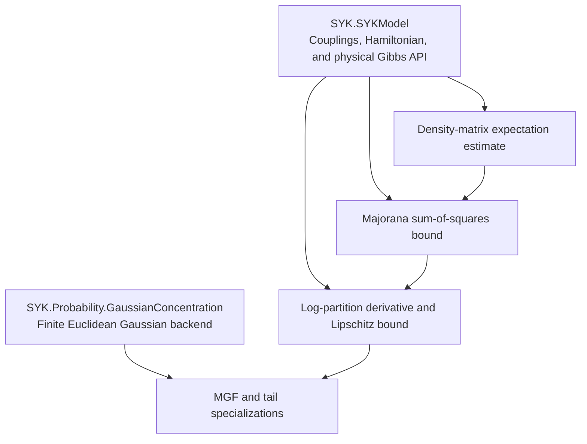

# SYK log-partition concentration の構造

## 目的

共有 SYK 模型の physical Gibbs layer と、模型から独立した Gaussian concentration
backend を接続して、canonical SYK log-partition の concentration を証明する。現在の
path は将来 `SYK/SuperConcentration/` へ改名する。

## Dependency graph



依存は下向きの一方向とし、Gaussian backend は `SYKModel` も `SuperConcentration` も
import しない。

## Generic backend の抽出

現行 `GaussianConcentrationAux.lean` 冒頭の `CouplingSpace`、`couplingSpace_card`、
`standardGaussianMeasure` とその generic measure への等式は `SYKModel` へ移す。現行
`gaussian_concentration.lean` 末尾の `N,q` specialization も model または concentration
adapter 側へ移す。

残る backend は任意の finite coordinate type `ι` だけに量化し、中心結果を
`HasSubgaussianMGF` とする。upper/lower/two-sided tail は mathlib の sub-Gaussian APIから
導く。

## SYK-specific proof

physical inverse temperature `β : ℝ≥0` と canonical Hamiltonianに対し、normalized Gibbs
state derivative と Majorana boundから

```text
L = β / sqrt q,
sub-Gaussian parameter = β^2 / q
```

を得る。公開結果は MGF、lower tail、upper tail、two-sided tail とする。normalized trace
への変更は Gibbs expectation、coupling derivative、centered `log Z` を変えない。

complex `z` に対する partition function の entire 性や logarithmic derivative は
`SYKModel` の analytic layer の責務である。この proof は positive real partition
function を必要とするため、complex zero-free 仮定付き API を経由しない。

## 廃止する構造

- `core.lean` 内で再定義された interaction operator
- `gibbs.lean` 内の共有 matrix thermodynamics
- `exactLipschitzSq` と `simpleLipschitzConstant` の二重公開
- 基本 theorem の一般 scale `𝒥`
- empty physical Hilbert space branch
- blueprint の `N^(q/2)` target と旧 file layout

abstract Majorana proof と standard matrix realization の specialization は区別するが、
同じ定義を重複して持たない。

## Module と namespace

```text
SYK/Probability/GaussianConcentration/
  StandardGaussian.lean
  Smooth.lean
  Lipschitz.lean

SYK/SuperConcentration/
  DensityMatrix.lean
  MajoranaBound.lean
  Main.lean
```

generic backend の declaration は `namespace SYK.GaussianConcentration`、SYK-specific な
concentration result は `namespace SYK` に置く。generic backend は独立した `lean_lib`
target を増やさず、workspace の `SYK` library の一部とする。
