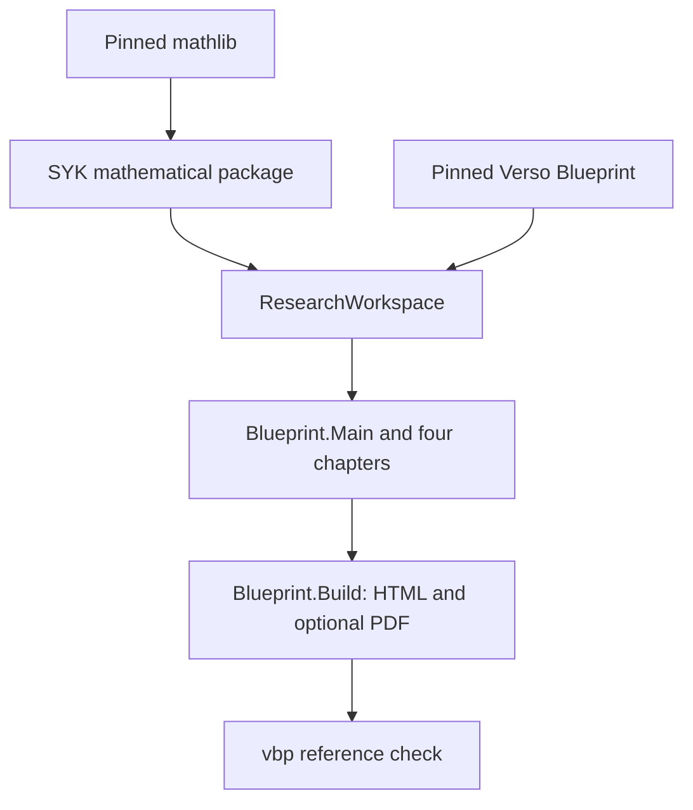

# Shared Lean Workspace Template

This directory supplies the parent `ResearchWorkspace` configuration for the local mathematical package `SYK`. The mathematical package's name and declaration namespaces remain unchanged.

## Intended layout

```text
<workspace-root>/
├── AGENTS.md
├── lakefile.toml            # ResearchWorkspace
├── lake-manifest.json       # local SYK and pinned external dependencies
├── lean-toolchain
├── .lake/packages/          # shared dependency checkouts
└── SYK/                     # cloned repository
    ├── lakefile.toml        # mathematical SYK package, mathlib only
    ├── lake-manifest.json   # mathematical dependency lock
    ├── lean-toolchain      # same Lean version as the parent
    ├── SYK/                # Analysis, Probability, Model, SuperConcentration, CLT
    ├── Blueprint/          # Main.lean, Build.lean, and four chapters
    ├── Paper/
    ├── Notes/
    └── workspace/
```

One parent dependency cache serves the mathematical package and the documentation, avoiding duplicate downloads and storage of the large mathlib dependency. Lake may place package build artifacts under each package's `.lake/build/`; these are local artifacts, not another dependency checkout or a separately installed mathlib. Sharing the workspace does not introduce mathematical dependencies between topics.

## Template files and targets

- `lakefile.toml` defines `ResearchWorkspace`, the local path dependency `SYK`, pinned Verso Blueprint, and the documentation library `Blueprint` with source directory `SYK/`. Its `needs` includes `SYK/SYK:leanArts`, so the default documentation build checks every mathematical module.
- `lake-manifest.json` locks the local package and the external dependency revisions. The repository's own manifest locks its mathlib-only dependency closure; keep shared revisions consistent.
- `lean-toolchain` fixes Lean for the parent and dependent package.
- `AGENTS.md` supplies project-independent rules; repository and topic rules also apply.

`lake build` and `lake build Blueprint` check the complete mathematics and documentation. `lake build SYK` checks the mathematical package only. No aggregate mathematical import file is required. The parent renderer is `SYK/Blueprint/Build.lean`.



## Initial setup

From the intended parent directory:

```bash
git clone git@github.com:TokyoProbabilityGroup/SYK.git
cp SYK/workspace/lakefile.toml .
cp SYK/workspace/lake-manifest.json .
cp SYK/workspace/lean-toolchain .
cp SYK/workspace/AGENTS.md .
lake exe cache get
lake build
lake lean SYK/Blueprint/Build.lean -- --run SYK/Blueprint/Build.lean --output SYK/_out/site
lake exe vbp check --site SYK/_out/site
```

Review existing parent files before copying. Keep other projects and their dependency constraints. Run Lake from the parent workspace so it uses the shared dependency cache. Generated output remains under `SYK/_out/site/` and is ignored by Git. Append `--pdf` to the renderer for an optional PDF when a compatible LuaLaTeX environment is available.

<a id="collaborator-setup"></a>

## Collaborator setup for an assigned task

Provide the complete repository revision and every required tracked or untracked change. From the parent directory, identify the source and prepare tracked changes:

```bash
git -C SYK rev-parse HEAD
git -C SYK status --short
git -C SYK diff --binary HEAD > syk-worktree.patch
git -C SYK ls-files --others --exclude-standard
```

A clone at the commit alone omits uncommitted changes. Transfer untracked sources separately, apply the patch with `git -C SYK apply ../syk-worktree.patch`, and verify the received files before editing. Read parent, repository, and applicable topic `AGENTS.md` files. Assignment scope and handoff requirements are in [the project plan](../EDITING_PLAN.md#別環境への引き継ぎ).

Check an edited mathematical file with `lake env lean SYK/SYK/path/to/File.lean`, then the affected build target, and finally `lake build`. For Blueprint source or referenced Lean declarations, also check the affected chapter and `Blueprint/Main.lean` and `Blueprint/Build.lean`, generate HTML, and run `vbp check`. Inspect theorem statements, assumptions, and `#print axioms` separately; successful generation does not complete an assumed mathematical input.

## Updating an existing workspace

Compare parent copies with the versioned template before applying changes:

```bash
diff -u lakefile.toml SYK/workspace/lakefile.toml
diff -u lake-manifest.json SYK/workspace/lake-manifest.json
diff -u lean-toolchain SYK/workspace/lean-toolchain
diff -u AGENTS.md SYK/workspace/AGENTS.md
```

The template is not automatically applied to an existing parent workspace. Reconcile its local packages and dependency revisions without discarding unrelated projects. If a parent `lakefile.lean` takes precedence, select the reviewed configuration with `lake -f lakefile.toml ...`.

A compatible new mathematics project can be a local dependency package or another library in the parent workspace. Keep one shared dependency cache and avoid copying mathlib into the repository. Incompatible Lean or dependency versions may require another workspace.

<a id="restoring-verso"></a>

## Blueprint dependencies

The document is `Blueprint/Main.lean`, with four chapter modules; `Blueprint/Build.lean` renders it. The explicit renderer command is used because the installed `vbp build` searches for root-level generators. The renderer retains the Windows search-asset preparation and copy needed by Verso 4.32.0, which otherwise leaves a relative source prefix in bundled asset paths. See [the verification history](../WORK_HISTORY.md#gaussian-foundation).

Verso Blueprint is enabled in the parent only; the child `SYK` package depends on mathlib. Active parent and child manifests preserve the previously pinned external revisions. The obsolete saved Verso lock is no longer distributed; do not overwrite the active parent manifest with a historical lock.

When updating an older workspace, apply the parent package configuration and the repository's mathematical package together, reconcile the lock files, then run the complete build and documentation commands above. Existing CI materializes this parent template and uses the same renderer/check commands. PDF compilation is optional and is not required by CI.

## Files excluded from this template

Do not distribute `.lake/`, compiled artifacts, mathlib copies, editor state, absolute local paths, secrets, or generated LaTeX and Blueprint products. Topic-specific plans and architecture belong with their mathematical sources.
