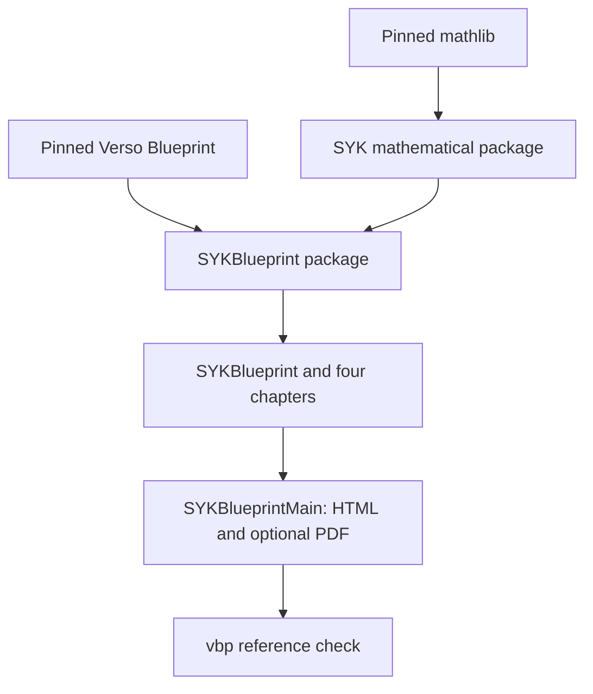

# Shared Lean Workspace Template

This directory supplies the parent `ResearchWorkspace` configuration for the local mathematical package `SYK`. The mathematical package's name and declaration namespaces remain unchanged.

## Intended layout

```text
<workspace-root>/
├── AGENTS.md
├── lakefile.toml            # ResearchWorkspace: requires SYK and SYKBlueprint
├── lake-manifest.json       # local packages and pinned external dependencies
├── lean-toolchain
├── .lake/packages/          # shared dependency checkouts
└── SYK_CLT/                 # cloned repository
    ├── lakefile.toml        # mathematical SYK package, mathlib only
    ├── lake-manifest.json   # mathematical dependency lock
    ├── lean-toolchain      # same Lean version as the parent
    ├── SYK/                # Main.lean, MainAudit.lean, Analysis, Probability, Model, SuperConcentration, CLT
    ├── Blueprint/          # SYKBlueprint package: lakefile.toml, lake-manifest.json,
    │   ├── lean-toolchain         # same Lean version as the parent
    │   ├── SYKBlueprint.lean      # the document
    │   ├── SYKBlueprintMain.lean  # generator entry point
    │   └── SYKBlueprint/          # four chapters
    ├── Paper/
    ├── Notes/
    └── workspace/
```

One parent dependency cache serves the mathematical package and the documentation, avoiding duplicate downloads and storage of the large mathlib dependency. Lake may place package build artifacts under each package's `.lake/build/`; these are local artifacts, not another dependency checkout or a separately installed mathlib. Sharing the workspace does not introduce mathematical dependencies between topics.

### Opening a package as the project root

`SYK_CLT/` and `SYK_CLT/Blueprint/` each have a `lean-toolchain`, so an editor that searches upward for the nearest `lean-toolchain` (the Lean 4 VS Code extension does) treats that directory as the project root and starts `lake serve` there. To keep this from creating a second copy of mathlib, both `lakefile.toml` files set `packagesDir` to the parent workspace's `.lake/packages` (`../.lake/packages` and `../../.lake/packages`), and the `packagesDir` of their `lake-manifest.json` agrees. A parent workspace ignores a dependency's `packagesDir`, so building from the workspace root is unchanged. Package build artifacts stay under each package's own `.lake/build/`, whichever directory is the root.

This relies on the layout above: the repository is cloned directly inside the workspace root, which holds the shared `.lake/packages`. Opening `SYK_CLT/` without such a parent has not been verified; it would need its own dependency checkout and a different `packagesDir`. Keep the three `lean-toolchain` files and the dependency revisions of all manifests identical. If `SYK_CLT/.lake/packages` or `SYK_CLT/Blueprint/.lake/packages` exists, it is a stale duplicate and can be deleted.

## Template files and targets

- `lakefile.toml` defines `ResearchWorkspace` and requires two local packages: `SYK` (the mathematics) and `SYKBlueprint` (the documentation, in `SYK_CLT/Blueprint/`). It declares no targets of its own, so a bare `lake build` in the parent builds nothing; name the target explicitly.
- `lake-manifest.json` locks the two local packages and the external dependency revisions. Each local package also has its own manifest (`SYK_CLT/lake-manifest.json`, `SYK_CLT/Blueprint/lake-manifest.json`); keep shared revisions consistent across all three.
- `lean-toolchain` fixes Lean for the parent and dependent package.
- `AGENTS.md` supplies project-independent rules; repository and topic rules also apply.

`lake build SYKBlueprint` checks the complete mathematics (its `needs` includes `SYK/SYK:leanArts`) and the documentation. `lake build SYK` checks the mathematical package only. No aggregate mathematical import file is required. The renderer is `SYK_CLT/Blueprint/SYKBlueprintMain.lean`.



## Initial setup

From the intended parent directory:

```bash
git clone git@github.com:TokyoProbabilityGroup/SYK_CLT.git
cp SYK_CLT/workspace/lakefile.toml .
cp SYK_CLT/workspace/lake-manifest.json .
cp SYK_CLT/workspace/lean-toolchain .
cp SYK_CLT/workspace/AGENTS.md .
lake exe cache get
lake build SYKBlueprint
lake lean SYK_CLT/Blueprint/SYKBlueprintMain.lean -- --run SYK_CLT/Blueprint/SYKBlueprintMain.lean --output SYK_CLT/_out/site
lake exe vbp check --site SYK_CLT/_out/site
```

Review existing parent files before copying. Keep other projects and their dependency constraints. Run Lake from the parent workspace so it uses the shared dependency cache. Generated output remains under `SYK_CLT/_out/site/` and is ignored by Git. Append `--pdf` to the renderer for an optional PDF when a compatible LuaLaTeX environment is available.

<a id="collaborator-setup"></a>

## Collaborator setup for an assigned task

Provide the complete repository revision and every required tracked or untracked change. From the parent directory, identify the source and prepare tracked changes:

```bash
git -C SYK_CLT rev-parse HEAD
git -C SYK_CLT status --short
git -C SYK_CLT diff --binary HEAD > syk-worktree.patch
git -C SYK_CLT ls-files --others --exclude-standard
```

A clone at the commit alone omits uncommitted changes. Transfer untracked sources separately, apply the patch with `git -C SYK_CLT apply ../syk-worktree.patch`, and verify the received files before editing. Read parent, repository, and applicable topic `AGENTS.md` files; start coding agents in the parent workspace, where Lake commands are run, so that this chain applies. Remaining tasks, their status, and pending decisions are in `SYK_CLT/EDITING_PLAN.md`. Do not fill in missing files by guesswork. State the task, owner, purpose, editable scope, inputs, integration owner, and verification conditions in the request, and treat commits and publication as separate explicit steps.

Check an edited mathematical file with `lake lean SYK_CLT/SYK/path/to/File.lean` (it builds the imports and applies the library's `leanOptions`, which `lake env lean` does not), then the affected build target, and finally `lake build SYKBlueprint`. For Blueprint source or referenced Lean declarations, also check the affected chapter and `SYKBlueprint.lean` and `SYKBlueprintMain.lean`, generate HTML, and run `vbp check`. Inspect theorem statements, assumptions, and `#print axioms` separately; successful generation does not complete an assumed mathematical input.

## Updating an existing workspace

Compare parent copies with the versioned template before applying changes:

```bash
diff -u lakefile.toml SYK_CLT/workspace/lakefile.toml
diff -u lake-manifest.json SYK_CLT/workspace/lake-manifest.json
diff -u lean-toolchain SYK_CLT/workspace/lean-toolchain
diff -u AGENTS.md SYK_CLT/workspace/AGENTS.md
```

The template is not automatically applied to an existing parent workspace. Reconcile its local packages and dependency revisions without discarding unrelated projects. If a parent `lakefile.lean` takes precedence, select the reviewed configuration with `lake -f lakefile.toml ...`.

A compatible new mathematics project can be a local dependency package or another library in the parent workspace. Keep one shared dependency cache and avoid copying mathlib into the repository. Incompatible Lean or dependency versions may require another workspace.

## Blueprint dependencies

The document is `SYKBlueprint.lean` in the package `SYKBlueprint` (`SYK_CLT/Blueprint/`), with four chapter modules under `SYKBlueprint/`; `SYKBlueprintMain.lean` renders it. From the parent workspace the explicit renderer command above is used, because `vbp build` looks for a generator only in the current directory, and the parent has none. Inside `SYK_CLT/Blueprint/` the standard `lake exe vbp build` finds `SYKBlueprintMain.lean` and writes `_out/site/`; this route uses the parent workspace's dependency cache through `packagesDir` (see above). Building in `SYK_CLT/Blueprint/` without a parent workspace has not been verified. The renderer retains the Windows search-asset preparation and copy needed by Verso 4.32.0, which otherwise leaves a relative source prefix in bundled asset paths.

Verso Blueprint is required by `SYKBlueprint` only; the mathematical `SYK` package depends on mathlib alone, and the parent requires both packages. The manifests of the parent and of `SYKBlueprint` preserve the previously pinned external revisions. The obsolete saved Verso lock is no longer distributed; do not overwrite the active parent manifest with a historical lock.

When updating an older workspace, apply the parent package configuration together with the repository's `SYK` and `SYKBlueprint` packages, reconcile the lock files, then run the complete build and documentation commands above. Existing CI materializes this parent template and uses the same build, renderer and check commands. PDF compilation is optional and is not required by CI.

## Files excluded from this template

Do not distribute `.lake/`, compiled artifacts, mathlib copies, editor state, absolute local paths, secrets, or generated LaTeX and Blueprint products. Topic-specific plans and architecture belong with their mathematical sources.
